# 1. Getting Oriented

*Part of the Claude Code Guide*\
Previous: [README](00-README.md) | Next: [Built-in Agents](02-built-in-agents.md)

## 1.1 What Claude Code is

Claude Code is an agentic coding assistant that runs in the terminal, the VS Code and JetBrains extensions, the desktop app, and the web. It can read and edit files, run commands, search codebases, and orchestrate more complex work through subagents, skills, and workflows.

Reference: https://code.claude.com/docs/en/overview.md

## 1.2 The basic interaction model (you + one conversation)

By default you talk to one main conversation. Claude uses tools, reads files, and responds in that session. For many tasks this is enough.

## 1.3 Why multi-agent and workflow features exist

Long research, large file reads, or multi-step coordination can fill the context window. Multi-agent features and workflows exist to:

- Keep the main conversation clean
- Isolate noisy work
- Coordinate tasks that are too large for turn-by-turn prompting

## 1.4 The core problem: context limits and coordination

Claude Code works inside a context window. When that window fills with intermediate search results, file contents, or logs, later reasoning suffers. The features in this guide (subagents, skills with fork, dynamic workflows, agent teams) are different ways to manage that problem. Note that agent teams are experimental and disabled by default; enable them with `CLAUDE_CODE_EXPERIMENTAL_AGENT_TEAMS=1`.

Reference: https://code.claude.com/docs/en/agent-teams.md

## 1.5 How this guide is organized

The guide moves from foundations → agents → skills → workflows → decision frameworks → practical patterns. You can read sequentially or jump to the section you need.

______________________________________________________________________

# 2. Core Concepts You Need First

## 2.1 The main conversation

The session you interact with directly. It can spawn subagents, invoke skills, and start workflows. It remains the coordinator.

## 2.2 Tools Claude can use

Built-in tools cover file operations, search, shell execution, web access, and orchestration (the Agent tool spawns subagents; the Skill tool runs skills). Use these exact tool names in permission rules and hook matchers. Custom tools can be added via MCP.

Reference: https://code.claude.com/docs/en/tools-reference.md

## 2.3 Context window basics

Every conversation has a finite context. Intermediate tool output counts against it. Keeping only summaries in the main conversation preserves room for reasoning.

Reference: https://code.claude.com/docs/en/context-window.md

## 2.4 Isolation vs. shared context

- **Shared**: Skills inline, main conversation.
- **Isolated**: Subagents (default), forked skills (a skill with `context: fork` runs in an isolated subagent, not a copy of your conversation), workflow script variables.

Isolation prevents noise from accumulating; shared context is better when steps are tightly coupled.

## 2.5 A simple mental model of agents and workflows

```mermaid
%%{init: {
  "theme": "base",
  "layout": "elk",
  "themeVariables": {
    "darkMode": true,
    "background": "#0b1120",
    "primaryColor": "#17243b",
    "primaryTextColor": "#e6edf7",
    "primaryBorderColor": "#60a5fa",
    "textColor": "#e6edf7",
    "lineColor": "#94a3b8",
    "edgeLabelBackground": "#111827",
    "clusterBkg": "#111827",
    "clusterBorder": "#475569",
    "titleColor": "#e6edf7"
  },
  "flowchart": {
    "curve": "linear",
    "nodeSpacing": 35,
    "rankSpacing": 55
  }
}}%%
flowchart TD
    MAIN_CONVERSATION_01["Main conversation (the lead)"]

    AGENT_EXPLORE_01["Explore (subagent)"]
    AGENT_PLAN_01["Plan (subagent)"]
    AGENT_GENERAL_01["General-purpose (subagent)"]

    SKILL_INLINE_01["Skills (inline, shared context)"]
    SKILL_FORK_01["Forked skill (context: fork)<br/>fresh isolated subagent, not a copy of the conversation"]
    WORKFLOW_01["Dynamic workflows (script)"]
    WORKFLOW_AGENTS_01["Many subagents"]

    MAIN_CONVERSATION_01 --> AGENT_EXPLORE_01
    MAIN_CONVERSATION_01 --> AGENT_PLAN_01
    MAIN_CONVERSATION_01 --> AGENT_GENERAL_01
    MAIN_CONVERSATION_01 --> SKILL_INLINE_01
    MAIN_CONVERSATION_01 --> SKILL_FORK_01
    MAIN_CONVERSATION_01 --> WORKFLOW_01
    WORKFLOW_01 --> WORKFLOW_AGENTS_01

    classDef nodeLead fill:#172b46,stroke:#60a5fa,color:#eff6ff,stroke-width:2px;
    classDef nodeAgent fill:#113832,stroke:#2dd4bf,color:#f0fdfa,stroke-width:2px;
    classDef nodeProcess fill:#29213f,stroke:#a78bfa,color:#f5f3ff,stroke-width:2px;
    classDef nodeDecision fill:#3a2f12,stroke:#fbbf24,color:#fffbeb,stroke-width:2px;
    classDef nodeNote fill:#202b3d,stroke:#94a3b8,color:#e2e8f0,stroke-width:1px,stroke-dasharray:6 4;
    classDef groupBox fill:#111827,stroke:#475569,stroke-width:1px;
    class MAIN_CONVERSATION_01 nodeLead;
    class AGENT_EXPLORE_01,AGENT_PLAN_01,AGENT_GENERAL_01,SKILL_FORK_01,WORKFLOW_AGENTS_01 nodeAgent;
    class SKILL_INLINE_01,WORKFLOW_01 nodeProcess;
```

Think of the main conversation as the lead. It can hand work to specialized helpers or to a script that coordinates many helpers.
