# 3. Built-in Agents

*Part of the Claude Code Guide*\
Previous: [Getting Oriented](01-getting-oriented.md) | Next: [Subagents](03-subagents.md)

**Tone**: Mix

Claude Code ships with several built-in agents. The three you will encounter most often are Explore, Plan, and General-purpose. Understanding when Claude chooses each one helps you predict behavior and steer it when needed. The full built-in list also includes `claude` (a catch-all), `statusline-setup`, and `claude-code-guide` (see 3.6).

Reference: https://code.claude.com/docs/en/sub-agents.md#built-in-subagents

## 3.1 Explore agent

Explore is a read-only agent optimized for searching and analyzing codebases.

- **Tools**: Read-only tools; Write and Edit are denied. (The docs do not publish the exact tool list; on macOS, Linux, and WSL, search likely runs through Bash `find` and `grep`.)
- **Purpose**: File discovery, code search, and codebase exploration without making changes.
- **Model**: Uses the main conversation’s model. If the main model is Fable, Explore may run on Opus instead, depending on how you connect (subscription, Console, or LLM gateway; on Bedrock, Claude Platform on AWS, Google Cloud Agent Platform, Foundry, and a Claude apps gateway it stays on the main model).
- **Thoroughness**: Claude can request quick, medium, or very thorough exploration.
- **Context**: Deliberately skips CLAUDE.md and the parent session’s git status to keep its context small.

Claude uses Explore when it needs to understand code without the risk of edits. You can also force it (for example, by setting `agent: Explore` on a forked skill).

Reference: https://code.claude.com/docs/en/sub-agents.md#built-in-subagents

## 3.2 Plan agent

Plan is a read-only research agent used during plan mode.

- **Tools**: Read-only. Write and Edit are denied.
- **Purpose**: Gather codebase context before Claude proposes a plan.
- **When used**: Primarily while you are in plan mode.
- **Context**: Also skips CLAUDE.md and git status.

Plan keeps exploration out of the main conversation so the conversation you approve from stays clean. It is the research counterpart to the planning workflow.

## 3.3 General-purpose agent

General-purpose is the full-featured worker.

- **Tools**: Every tool available to subagents (can write and edit files, run commands, etc.).
- **Model**: Uses `CLAUDE_CODE_SUBAGENT_MODEL` if it is set and nothing else assigns a model; otherwise the main conversation’s model.
- **Purpose**: Complex, multi-step tasks that require both exploration and action.
- **When used**: When the task needs more than pure reading.

In practice, expect Claude to reach for it when work involves both understanding code and changing it.

## 3.4 How Claude decides which agent to use

Claude does not choose randomly: the docs say it delegates based on each subagent’s description and the task context. Plan in plan mode is documented; the rest of the list below is this guide’s own heuristic, not a published decision table:

- **Plan mode + research needed** → Plan (or Explore for a quick lookup)
- **Normal mode + pure research** → Explore
- **Research that may involve changes** → General-purpose
- **No research needed** → Main conversation handles it directly

You can also request a specific agent explicitly, in natural language (“Use the Explore agent to find all usages of this function”) or with an @-mention.

Reference: https://code.claude.com/docs/en/sub-agents.md

## 3.5 Write access differences

| Agent             | Can write/edit files? |
| ----------------- | --------------------- |
| Explore           | No                    |
| Plan              | No                    |
| General-purpose   | Yes                   |
| Main conversation | Yes                   |

Explore and Plan are deliberately restricted so research cannot accidentally modify your codebase.

## 3.6 Other built-in helpers

Claude Code also ships smaller helper agents:

- **claude** — A catch-all fallback for tasks that do not fit a specialized agent; also the default for dispatched background sessions.
- **statusline-setup** — Configures the status line; it runs when you use `/statusline` (Sonnet model).
- **claude-code-guide** — Answers questions about Claude Code itself (Haiku model). The docs say it runs when you ask questions about Claude Code features.

These are less commonly interacted with directly.

Reference: https://code.claude.com/docs/en/sub-agents.md#built-in-subagents

## 3.7 Agent selection flowchart

```mermaid
%%{init: {
  "theme": "base",
  "layout": "elk",
  "themeVariables": {
    "darkMode": true,
    "background": "#0b1120",
    "primaryColor": "#17243b",
    "primaryTextColor": "#e6edf7",
    "primaryBorderColor": "#60a5fa",
    "textColor": "#e6edf7",
    "lineColor": "#94a3b8",
    "edgeLabelBackground": "#111827",
    "clusterBkg": "#111827",
    "clusterBorder": "#475569",
    "titleColor": "#e6edf7"
  },
  "flowchart": {
    "curve": "linear",
    "nodeSpacing": 35,
    "rankSpacing": 55
  }
}}%%
flowchart TD
    PROMPT_01(["User prompt"])
    DECISION_RESEARCH_01{"Needs research?"}
    DECISION_MODE_01{"Mode?"}
    DECISION_PURE_01{"Pure research?"}
    MAIN_CONVERSATION_01["Main conversation handles it directly"]
    AGENT_PLAN_01["Plan (or Explore for a quick lookup)"]
    AGENT_EXPLORE_01["Explore"]
    AGENT_GENERAL_01["General-purpose"]
    NOTE_HEURISTIC_01["This routing is the guide's heuristic,<br/>not a published decision table"]

    PROMPT_01 --> DECISION_RESEARCH_01
    DECISION_RESEARCH_01 -->|"No"| MAIN_CONVERSATION_01
    DECISION_RESEARCH_01 -->|"Yes"| DECISION_MODE_01
    DECISION_MODE_01 -->|"Plan mode"| AGENT_PLAN_01
    DECISION_MODE_01 -->|"Normal mode"| DECISION_PURE_01
    DECISION_PURE_01 -->|"Yes"| AGENT_EXPLORE_01
    DECISION_PURE_01 -->|"No, may involve changes"| AGENT_GENERAL_01
    NOTE_HEURISTIC_01 ~~~ PROMPT_01

    classDef nodeLead fill:#172b46,stroke:#60a5fa,color:#eff6ff,stroke-width:2px;
    classDef nodeAgent fill:#113832,stroke:#2dd4bf,color:#f0fdfa,stroke-width:2px;
    classDef nodeProcess fill:#29213f,stroke:#a78bfa,color:#f5f3ff,stroke-width:2px;
    classDef nodeDecision fill:#3a2f12,stroke:#fbbf24,color:#fffbeb,stroke-width:2px;
    classDef nodeNote fill:#202b3d,stroke:#94a3b8,color:#e2e8f0,stroke-width:1px,stroke-dasharray:6 4;
    classDef groupBox fill:#111827,stroke:#475569,stroke-width:1px;
    class PROMPT_01 nodeLead;
    class DECISION_RESEARCH_01,DECISION_MODE_01,DECISION_PURE_01 nodeDecision;
    class MAIN_CONVERSATION_01,AGENT_PLAN_01,AGENT_EXPLORE_01,AGENT_GENERAL_01 nodeAgent;
    class NOTE_HEURISTIC_01 nodeNote;
```

## 3.8 Best practices and pitfalls

**Best practices**

- Let Claude use Explore for pure investigation. It is safer (read-only tools), and often a good fit for lookups.
- Switch to plan mode when the approach matters as much as the implementation.
- Explicitly name an agent when you want to override Claude’s choice.

**Pitfalls**

- Expecting Explore or Plan to make changes (they cannot).
- Over-relying on General-purpose for simple lookups (Explore is read-only and a better fit; cost depends on your model configuration).
- Forgetting that Explore and Plan skip CLAUDE.md — restate important rules in the prompt if needed. This applies to Explore and Plan only; custom subagents load CLAUDE.md and git status by default, and `omitClaudeMd` in a definition skips only the user, project, and local CLAUDE.md files (not git status).
