```mermaid
%%{init: {
  "theme": "base",
  "layout": "elk",
  "themeVariables": {
    "darkMode": true,
    "background": "#0b1120",
    "primaryColor": "#17243b",
    "primaryTextColor": "#e6edf7",
    "primaryBorderColor": "#60a5fa",
    "textColor": "#e6edf7",
    "lineColor": "#94a3b8",
    "edgeLabelBackground": "#111827",
    "clusterBkg": "#111827",
    "clusterBorder": "#475569",
    "titleColor": "#e6edf7"
  },
  "flowchart": {
    "curve": "linear",
    "nodeSpacing": 35,
    "rankSpacing": 55
  }
}}%%
flowchart LR
    subgraph SG_PIPELINE["pipeline(): one agent per item"]
        PIPELINE_ITEM_01["Item 1"]
        PIPELINE_ITEM_02["Item 2"]
        PIPELINE_ITEM_03["Item 3"]
        PIPELINE_AGENT_01["Agent for item 1"]
        PIPELINE_AGENT_02["Agent for item 2"]
        PIPELINE_AGENT_03["Agent for item 3"]
        PIPELINE_RESULTS_01[("Returned array<br/>(null results kept)")]
    end

    subgraph SG_PARALLEL["parallel(): barrier"]
        PARALLEL_TASK_01["Task 1"]
        PARALLEL_TASK_02["Task 2"]
        PARALLEL_TASK_03["Task 3"]
        PARALLEL_BARRIER_01{{"Wait for all tasks"}}
        PARALLEL_NEXT_01["Script continues"]
    end

    PIPELINE_ITEM_01 --> PIPELINE_AGENT_01
    PIPELINE_ITEM_02 --> PIPELINE_AGENT_02
    PIPELINE_ITEM_03 --> PIPELINE_AGENT_03
    PIPELINE_AGENT_01 --> PIPELINE_RESULTS_01
    PIPELINE_AGENT_02 --> PIPELINE_RESULTS_01
    PIPELINE_AGENT_03 --> PIPELINE_RESULTS_01

    PARALLEL_TASK_01 --> PARALLEL_BARRIER_01
    PARALLEL_TASK_02 --> PARALLEL_BARRIER_01
    PARALLEL_TASK_03 --> PARALLEL_BARRIER_01
    PARALLEL_BARRIER_01 --> PARALLEL_NEXT_01

    %% --- Layout: stack the two panels so they read top to bottom

    %% --- styles
    classDef nodeProcess fill:#172b46,stroke:#60a5fa,color:#eff6ff,stroke-width:2px;
    classDef nodeAgent fill:#113832,stroke:#2dd4bf,color:#f0fdfa,stroke-width:2px;
    classDef nodeData fill:#29213f,stroke:#a78bfa,color:#f5f3ff,stroke-width:2px;
    classDef nodeDecision fill:#3a2a12,stroke:#fbbf24,color:#fffbeb,stroke-width:2px;
    classDef nodeOperator fill:#12313d,stroke:#22d3ee,color:#ecfeff,stroke-width:2px;
    classDef nodeNote fill:#202b3d,stroke:#94a3b8,color:#e2e8f0,stroke-width:1px;
    classDef stateExperimental stroke-dasharray:6 4;
    classDef groupBox fill:#111827,stroke:#475569,stroke-width:1px;
    class PIPELINE_ITEM_01,PIPELINE_ITEM_02,PIPELINE_ITEM_03 nodeNote;
    class PIPELINE_AGENT_01,PIPELINE_AGENT_02,PIPELINE_AGENT_03,PARALLEL_TASK_01,PARALLEL_TASK_02,PARALLEL_TASK_03 nodeAgent;
    class PIPELINE_RESULTS_01 nodeData;
    class PARALLEL_BARRIER_01 nodeDecision;
    class PARALLEL_NEXT_01 nodeProcess;
    class SG_PIPELINE,SG_PARALLEL groupBox;
```

# 6. Dynamic Workflows

*Part of the Claude Code Guide*\
Previous: [Skills](04-skills.md) | Next: [Diagrams and Decision Frameworks](06-diagrams-and-decisions.md)

**Tone**: Mix

Dynamic workflows move the orchestration plan out of the conversation and into a JavaScript script. Claude writes the script; a background runtime executes it. Intermediate results stay in script variables, so your main conversation only receives the final answer.

## 6.1 What dynamic workflows are

A dynamic workflow is a script that coordinates many subagents. It is useful when:

- The job is too large to coordinate turn-by-turn in one conversation.
- You want findings cross-checked.
- You need a repeatable orchestration pattern (audits, large migrations, multi-angle research).

The script holds the loop, branching, and intermediate data.

## 6.2 Difference from agent teams

| Aspect             | Dynamic workflows                                  | Agent teams                                                     |
| ------------------ | -------------------------------------------------- | --------------------------------------------------------------- |
| Who holds the plan | The script                                         | The lead agent (turn by turn)                                   |
| Communication      | Via script variables and explicit passing          | Direct messaging + shared task list                             |
| Scale              | Dozens to hundreds of agents (up to 1,000 per run) | Smaller coordinated groups (3 to 5 teammates suggested)         |
| Status             | Available (plan/provider gated; see 6.12)          | Experimental, opt-in (`CLAUDE_CODE_EXPERIMENTAL_AGENT_TEAMS=1`) |

Workflows are better when you want the plan codified and repeatable. Agent teams are better when agents need to discuss and self-coordinate.

## 6.3 Core primitives: `agent()`, `pipeline()`, `parallel()`, `phase()`

- **`agent()`** — Spawn a subagent with a prompt and optional configuration.
- **`pipeline()`** — Runs one agent per item in a list through its stages; null results are kept in the returned array. The official docs give a default cap of 16 concurrent agents but do not describe the order items start in or whether items advance without waiting for each other, so test that if your design depends on it.
- **`parallel()`** — Barrier-style fan-out (waits for all tasks before continuing).
- **`phase()`** — Group the agents that follow under a named title in the progress view.

The runtime also provides `log()` and an `args` global. `agent()` accepts options such as `label`, `model`, `schema`, and `stallMs`; check the workflows docs for the current list.

Reference: https://code.claude.com/docs/en/workflows.md

These are the main building blocks inside a workflow script.

## 6.4 The `pipeline()` function

`pipeline()` runs one agent per item in a list. The official docs give a default cap of 16 concurrent agents and a start stagger of up to 5 seconds for agents that share a prompt-cache prefix, but they do not say what order items start in or whether an item moves to its next stage before slower items finish, so test that behavior if your design depends on it. Its result is available once the call returns, as in the example in 6.7.

Useful when stages are sequential per item but items are independent of each other.

## 6.5 The `parallel()` function

`parallel()` fans work out and waits for all tasks to complete before the script continues. It is a barrier.

Useful when you need every result before the next step (for example, gather all findings, then synthesize).

## 6.6 Pros and cons of pipeline vs parallel

|              | Pipeline                                           | Parallel                                                     |
| ------------ | -------------------------------------------------- | ------------------------------------------------------------ |
| **Pros**     | One agent per item; simple per-item fan-out        | Simple “wait for everything” semantics; easy to reason about |
| **Cons**     | Harder to coordinate cross-item logic              | Higher wait time; all tasks must finish                      |
| **Best for** | Many items that each need the same agent treatment | Fan-out then synthesize                                      |

## 6.7 Simple workflow example

```javascript
// Example pattern (illustrative; exact signatures may differ)
// Without a schema, agent() returns prose, so request structured output.
const found = await agent("List all TypeScript files in src/", {
  schema: {
    type: "object",
    properties: { files: { type: "array", items: { type: "string" } } },
    required: ["files"],
  },
});

// One agent per item; the docs' per-item fan-out uses pipeline(list, item => agent(...)).
const reviews = await pipeline(
  found.files,
  f => agent(`Review ${f} for security issues`)
);

// pipeline() keeps null results (stopped or failed agents), so drop them before synthesis.
const summary = await agent(`Synthesize these review findings: ${JSON.stringify(reviews.filter(Boolean))}`);
return summary;
```

`parallel()` can be used instead of `pipeline()` when you need to wait for every result before continuing; the exact form it takes (for example an array of functions that each return an agent call) is not shown in the docs, so treat any `parallel()` snippet as illustrative.

Reference: https://code.claude.com/docs/en/workflows.md

## 6.8 Passing context between stages

Because intermediate results live in script variables, you pass context explicitly:

```javascript
const research = await agent("Find all usages of the old API"); // prose unless a schema is given
const updates = await agent(`Update these files:\n${JSON.stringify(research)}`);
```

The script is the coordinator.

## 6.9 When a script should own the plan

Use a dynamic workflow when:

- Coordination logic is complex or repetitive.
- You want the same orchestration to be rerunnable.
- The number of agents would overwhelm turn-by-turn delegation.
- You want intermediate results kept out of the main conversation.

## 6.10 Cost and token implications

Each agent call consumes tokens. Large fan-outs (especially with thorough models) can be expensive. Prefer:

- Lighter models for simple stages when possible (a `model` named for a stage applies to that agent).
- Watching for the `Large workflow` warning, shown above 25 agents or 1.5 million projected tokens.
- Explore for pure research.
- Clear, focused prompts so agents do less unnecessary work.

## 6.11 Best practices and pitfalls

**Best practices**

- Start with a small workflow and expand.
- Pass only the context each stage needs.
- Use `parallel` when you truly need all results; use `pipeline` for per-item multi-stage processing.
- Keep the final return value concise.

**Pitfalls**

- Over-engineering a simple task that a single subagent could handle.
- Forgetting that failed agent calls may resolve to null (handle them). `agent()` resolves to `null` if the run is stopped mid-run or the call hits an unrecoverable API error. A stalled agent inside `parallel()` or `pipeline()` also gives `null`, while a stalled agent awaited directly ends the run with an error.
- Letting prompts become so large that each agent is expensive.

## 6.12 Limits and availability

- **Concurrency**: 16 agents run at once by default (`CLAUDE_CODE_WORKFLOW_MAX_CONCURRENT_AGENTS`).
- **Per run**: at most 1,000 agents.
- **Concurrency**: the runtime may lower the effective concurrency based on available CPU; `CLAUDE_CODE_WORKFLOW_MAX_CONCURRENT_AGENTS` accepts values from 1 to 256 (check the workflows docs for current behavior).
- **Per call**: at most 4,096 items in a single `parallel()` or `pipeline()` call.
- **Cost warning**: a `Large workflow` warning appears above 25 agents or 1.5 million projected tokens.
- **Availability**: workflows need a paid plan, Anthropic API access, Amazon Bedrock, Google Cloud's Agent Platform, or Microsoft Foundry. On Pro, turn them on from the Dynamic workflows row in `/config`. Set `disableWorkflows` to turn them off.
- **Entry points**: `/workflows` manages workflows, `/deep-research` is a bundled workflow, and the `ultracode` keyword or `/effort ultracode` prompts Claude to use one. Saved workflows can be rerun as `/<name>`.

Reference: https://code.claude.com/docs/en/workflows.md


