# 7. Diagrams and Decision Frameworks

*Part of the Claude Code Guide*\
Previous: [Dynamic Workflows](05-dynamic-workflows.md) | Next: [Agent Teams](08-agent-teams.md)

This section collects the key diagrams and decision aids. They are also referenced from other chapters.

## 7.1 How dynamic workflows work

A dynamic workflow is a JavaScript script that Claude writes and a background runtime executes. The script coordinates multiple subagents. Intermediate results stay in script variables; only the final answer returns to your conversation.

```mermaid
%%{init: {
  "theme": "base",
  "layout": "elk",
  "themeVariables": {
    "darkMode": true,
    "background": "#0b1120",
    "primaryColor": "#17243b",
    "primaryTextColor": "#e6edf7",
    "primaryBorderColor": "#60a5fa",
    "textColor": "#e6edf7",
    "lineColor": "#94a3b8",
    "edgeLabelBackground": "#111827",
    "clusterBkg": "#111827",
    "clusterBorder": "#475569",
    "titleColor": "#e6edf7"
  },
  "flowchart": {
    "curve": "linear",
    "nodeSpacing": 35,
    "rankSpacing": 55
  }
}}%%
flowchart LR
    MAIN_CONVERSATION_01["Main conversation"]
    WORKFLOW_SCRIPT_01["Workflow script<br/>(JavaScript, run by a background runtime)"]

    subgraph SG_AGENTS["Subagents coordinated by the script"]
        WORKFLOW_AGENT_01["Agent 1"]
        WORKFLOW_AGENT_02["Agent 2"]
        WORKFLOW_AGENT_03["Agent 3"]
    end

    WORKFLOW_VARS_01[("Intermediate results<br/>(script variables)")]
    MAIN_CONVERSATION_02["Main conversation<br/>(receives only the final answer)"]

    MAIN_CONVERSATION_01 -->|"Claude writes the script"| WORKFLOW_SCRIPT_01
    WORKFLOW_SCRIPT_01 --> WORKFLOW_AGENT_01
    WORKFLOW_SCRIPT_01 --> WORKFLOW_AGENT_02
    WORKFLOW_SCRIPT_01 --> WORKFLOW_AGENT_03
    WORKFLOW_AGENT_01 --> WORKFLOW_VARS_01
    WORKFLOW_AGENT_02 --> WORKFLOW_VARS_01
    WORKFLOW_AGENT_03 --> WORKFLOW_VARS_01
    WORKFLOW_VARS_01 -->|"final answer"| MAIN_CONVERSATION_02

    %% --- styles
    classDef nodeProcess fill:#172b46,stroke:#60a5fa,color:#eff6ff,stroke-width:2px;
    classDef nodeAgent fill:#113832,stroke:#2dd4bf,color:#f0fdfa,stroke-width:2px;
    classDef nodeData fill:#29213f,stroke:#a78bfa,color:#f5f3ff,stroke-width:2px;
    classDef nodeDecision fill:#3a2a12,stroke:#fbbf24,color:#fffbeb,stroke-width:2px;
    classDef nodeOperator fill:#12313d,stroke:#22d3ee,color:#ecfeff,stroke-width:2px;
    classDef nodeNote fill:#202b3d,stroke:#94a3b8,color:#e2e8f0,stroke-width:1px;
    classDef stateExperimental stroke-dasharray:6 4;
    classDef groupBox fill:#111827,stroke:#475569,stroke-width:1px;
    class MAIN_CONVERSATION_01,MAIN_CONVERSATION_02 nodeOperator;
    class WORKFLOW_SCRIPT_01 nodeProcess;
    class WORKFLOW_AGENT_01,WORKFLOW_AGENT_02,WORKFLOW_AGENT_03 nodeAgent;
    class WORKFLOW_VARS_01 nodeData;
    class SG_AGENTS groupBox;
```

## 7.2 Pipeline vs parallel diagrams

**Pipeline** (runs one agent per item in a list; the official docs give a default cap of 16 concurrent agents but do not describe item start order or whether items wait for each other):

```mermaid
%%{init: {
  "theme": "base",
  "layout": "elk",
  "themeVariables": {
    "darkMode": true,
    "background": "#0b1120",
    "primaryColor": "#17243b",
    "primaryTextColor": "#e6edf7",
    "primaryBorderColor": "#60a5fa",
    "textColor": "#e6edf7",
    "lineColor": "#94a3b8",
    "edgeLabelBackground": "#111827",
    "clusterBkg": "#111827",
    "clusterBorder": "#475569",
    "titleColor": "#e6edf7"
  },
  "flowchart": {
    "curve": "linear",
    "nodeSpacing": 35,
    "rankSpacing": 55
  }
}}%%
flowchart LR
    PIPELINE_ITEM_01["Item 1"]
    PIPELINE_ITEM_02["Item 2"]
    PIPELINE_ITEM_03["Item 3"]
    PIPELINE_AGENT_01["Agent for item 1"]
    PIPELINE_AGENT_02["Agent for item 2"]
    PIPELINE_AGENT_03["Agent for item 3"]
    PIPELINE_RESULTS_01[("Returned array<br/>(null results kept)")]

    PIPELINE_ITEM_01 --> PIPELINE_AGENT_01
    PIPELINE_ITEM_02 --> PIPELINE_AGENT_02
    PIPELINE_ITEM_03 --> PIPELINE_AGENT_03
    PIPELINE_AGENT_01 --> PIPELINE_RESULTS_01
    PIPELINE_AGENT_02 --> PIPELINE_RESULTS_01
    PIPELINE_AGENT_03 --> PIPELINE_RESULTS_01

    %% --- styles
    classDef nodeProcess fill:#172b46,stroke:#60a5fa,color:#eff6ff,stroke-width:2px;
    classDef nodeAgent fill:#113832,stroke:#2dd4bf,color:#f0fdfa,stroke-width:2px;
    classDef nodeData fill:#29213f,stroke:#a78bfa,color:#f5f3ff,stroke-width:2px;
    classDef nodeDecision fill:#3a2a12,stroke:#fbbf24,color:#fffbeb,stroke-width:2px;
    classDef nodeOperator fill:#12313d,stroke:#22d3ee,color:#ecfeff,stroke-width:2px;
    classDef nodeNote fill:#202b3d,stroke:#94a3b8,color:#e2e8f0,stroke-width:1px;
    classDef stateExperimental stroke-dasharray:6 4;
    classDef groupBox fill:#111827,stroke:#475569,stroke-width:1px;
    class PIPELINE_ITEM_01,PIPELINE_ITEM_02,PIPELINE_ITEM_03 nodeNote;
    class PIPELINE_AGENT_01,PIPELINE_AGENT_02,PIPELINE_AGENT_03 nodeAgent;
    class PIPELINE_RESULTS_01 nodeData;
```

**Parallel** (barrier — waits for all tasks before continuing):

```mermaid
%%{init: {
  "theme": "base",
  "layout": "elk",
  "themeVariables": {
    "darkMode": true,
    "background": "#0b1120",
    "primaryColor": "#17243b",
    "primaryTextColor": "#e6edf7",
    "primaryBorderColor": "#60a5fa",
    "textColor": "#e6edf7",
    "lineColor": "#94a3b8",
    "edgeLabelBackground": "#111827",
    "clusterBkg": "#111827",
    "clusterBorder": "#475569",
    "titleColor": "#e6edf7"
  },
  "flowchart": {
    "curve": "linear",
    "nodeSpacing": 35,
    "rankSpacing": 55
  }
}}%%
flowchart TD
    PARALLEL_START_01["Start"]
    PARALLEL_TASK_01["Task 1"]
    PARALLEL_TASK_02["Task 2"]
    PARALLEL_TASK_03["Task 3"]
    PARALLEL_BARRIER_01{{"Barrier: wait for all tasks"}}
    PARALLEL_NEXT_01["Continue"]

    PARALLEL_START_01 --> PARALLEL_TASK_01
    PARALLEL_START_01 --> PARALLEL_TASK_02
    PARALLEL_START_01 --> PARALLEL_TASK_03
    PARALLEL_TASK_01 --> PARALLEL_BARRIER_01
    PARALLEL_TASK_02 --> PARALLEL_BARRIER_01
    PARALLEL_TASK_03 --> PARALLEL_BARRIER_01
    PARALLEL_BARRIER_01 --> PARALLEL_NEXT_01

    %% --- styles
    classDef nodeProcess fill:#172b46,stroke:#60a5fa,color:#eff6ff,stroke-width:2px;
    classDef nodeAgent fill:#113832,stroke:#2dd4bf,color:#f0fdfa,stroke-width:2px;
    classDef nodeData fill:#29213f,stroke:#a78bfa,color:#f5f3ff,stroke-width:2px;
    classDef nodeDecision fill:#3a2a12,stroke:#fbbf24,color:#fffbeb,stroke-width:2px;
    classDef nodeOperator fill:#12313d,stroke:#22d3ee,color:#ecfeff,stroke-width:2px;
    classDef nodeNote fill:#202b3d,stroke:#94a3b8,color:#e2e8f0,stroke-width:1px;
    classDef stateExperimental stroke-dasharray:6 4;
    classDef groupBox fill:#111827,stroke:#475569,stroke-width:1px;
    class PARALLEL_START_01,PARALLEL_NEXT_01 nodeProcess;
    class PARALLEL_TASK_01,PARALLEL_TASK_02,PARALLEL_TASK_03 nodeAgent;
    class PARALLEL_BARRIER_01 nodeDecision;
```

## 7.3 Agent selection flowchart

```mermaid
%%{init: {
  "theme": "base",
  "layout": "elk",
  "themeVariables": {
    "darkMode": true,
    "background": "#0b1120",
    "primaryColor": "#17243b",
    "primaryTextColor": "#e6edf7",
    "primaryBorderColor": "#60a5fa",
    "textColor": "#e6edf7",
    "lineColor": "#94a3b8",
    "edgeLabelBackground": "#111827",
    "clusterBkg": "#111827",
    "clusterBorder": "#475569",
    "titleColor": "#e6edf7"
  },
  "flowchart": {
    "curve": "linear",
    "nodeSpacing": 35,
    "rankSpacing": 55
  }
}}%%
flowchart TD
    SELECT_PROMPT_01["User prompt"]
    SELECT_Q_RESEARCH_01{"Needs research?"}
    SELECT_Q_MODE_01{"Current mode?"}
    SELECT_Q_PURE_01{"Pure research?"}
    SELECT_MAIN_01["Main conversation"]
    SELECT_PLAN_01["Plan"]
    SELECT_EXPLORE_01["Explore"]
    SELECT_GENERAL_01["General-purpose"]
    SELECT_LEGEND_01["Solid arrow: documented (Plan in plan mode)<br/>Dashed arrows: this guide's own heuristic"]

    SELECT_PROMPT_01 --> SELECT_Q_RESEARCH_01
    SELECT_Q_RESEARCH_01 edge_select_no_research@-->|"No"| SELECT_MAIN_01
    SELECT_Q_RESEARCH_01 edge_select_research@-->|"Yes"| SELECT_Q_MODE_01
    SELECT_Q_MODE_01 edge_select_plan_mode@-->|"Plan mode"| SELECT_PLAN_01
    SELECT_Q_MODE_01 edge_select_normal@-->|"Normal"| SELECT_Q_PURE_01
    SELECT_Q_PURE_01 edge_select_pure_yes@-->|"Yes"| SELECT_EXPLORE_01
    SELECT_Q_PURE_01 edge_select_pure_no@-->|"No, may involve changes"| SELECT_GENERAL_01

    %% --- styles
    classDef nodeProcess fill:#172b46,stroke:#60a5fa,color:#eff6ff,stroke-width:2px;
    classDef nodeAgent fill:#113832,stroke:#2dd4bf,color:#f0fdfa,stroke-width:2px;
    classDef nodeData fill:#29213f,stroke:#a78bfa,color:#f5f3ff,stroke-width:2px;
    classDef nodeDecision fill:#3a2a12,stroke:#fbbf24,color:#fffbeb,stroke-width:2px;
    classDef nodeOperator fill:#12313d,stroke:#22d3ee,color:#ecfeff,stroke-width:2px;
    classDef nodeNote fill:#202b3d,stroke:#94a3b8,color:#e2e8f0,stroke-width:1px;
    classDef stateExperimental stroke-dasharray:6 4;
    classDef groupBox fill:#111827,stroke:#475569,stroke-width:1px;
    classDef edgeDocumented stroke:#2dd4bf,stroke-width:2px;
    classDef edgeHeuristic stroke:#fbbf24,stroke-width:2px,stroke-dasharray:6 4;
    class SELECT_PROMPT_01 nodeOperator;
    class SELECT_Q_RESEARCH_01,SELECT_Q_MODE_01,SELECT_Q_PURE_01 nodeDecision;
    class SELECT_MAIN_01 nodeProcess;
    class SELECT_PLAN_01,SELECT_EXPLORE_01,SELECT_GENERAL_01 nodeAgent;
    class SELECT_LEGEND_01 nodeNote;
    class edge_select_plan_mode edgeDocumented;
    class edge_select_no_research,edge_select_research,edge_select_normal,edge_select_pure_yes,edge_select_pure_no edgeHeuristic;
```

## 7.4 Decision tree: which tool when

Use this to choose among pipeline, parallel, subagent, skill, or agent team. Note that `pipeline()` and `parallel()` are workflow script primitives, not standalone tools; they are available only inside a dynamic workflow (see chapter 6, entry points `/workflows` and `/deep-research`). Agent teams are experimental and disabled by default.

```mermaid
%%{init: {
  "theme": "base",
  "layout": "elk",
  "themeVariables": {
    "darkMode": true,
    "background": "#0b1120",
    "primaryColor": "#17243b",
    "primaryTextColor": "#e6edf7",
    "primaryBorderColor": "#60a5fa",
    "textColor": "#e6edf7",
    "lineColor": "#94a3b8",
    "edgeLabelBackground": "#111827",
    "clusterBkg": "#111827",
    "clusterBorder": "#475569",
    "titleColor": "#e6edf7"
  },
  "flowchart": {
    "curve": "linear",
    "nodeSpacing": 35,
    "rankSpacing": 55
  }
}}%%
flowchart TD
    CHOOSE_TASK_01["Task"]
    CHOOSE_Q_ISOLATION_01{"Needs isolation?"}
    CHOOSE_Q_ITEMS_01{"Multiple independent items?"}
    CHOOSE_INLINE_01["Skill inline or main conversation"]
    CHOOSE_PIPELINE_01["pipeline()<br/>(inside a workflow script)"]
    CHOOSE_PARALLEL_01["parallel()<br/>(inside a workflow script)"]
    CHOOSE_SUBAGENT_01["Subagent"]
    CHOOSE_TEAM_01["Agent team<br/>EXPERIMENTAL, opt-in"]
    CHOOSE_LEGEND_01["Branch routing is this guide's own heuristic.<br/>pipeline() and parallel() are workflow script primitives, not chat commands."]

    CHOOSE_TASK_01 --> CHOOSE_Q_ISOLATION_01
    CHOOSE_Q_ISOLATION_01 -->|"No"| CHOOSE_INLINE_01
    CHOOSE_Q_ISOLATION_01 -->|"Yes"| CHOOSE_Q_ITEMS_01
    CHOOSE_Q_ITEMS_01 -->|"Yes, one agent per item"| CHOOSE_PIPELINE_01
    CHOOSE_Q_ITEMS_01 -->|"Yes, wait for all"| CHOOSE_PARALLEL_01
    CHOOSE_Q_ITEMS_01 -->|"Single focused task"| CHOOSE_SUBAGENT_01
    CHOOSE_Q_ITEMS_01 -->|"Needs peer coordination"| CHOOSE_TEAM_01

    %% --- styles
    classDef nodeProcess fill:#172b46,stroke:#60a5fa,color:#eff6ff,stroke-width:2px;
    classDef nodeAgent fill:#113832,stroke:#2dd4bf,color:#f0fdfa,stroke-width:2px;
    classDef nodeData fill:#29213f,stroke:#a78bfa,color:#f5f3ff,stroke-width:2px;
    classDef nodeDecision fill:#3a2a12,stroke:#fbbf24,color:#fffbeb,stroke-width:2px;
    classDef nodeOperator fill:#12313d,stroke:#22d3ee,color:#ecfeff,stroke-width:2px;
    classDef nodeNote fill:#202b3d,stroke:#94a3b8,color:#e2e8f0,stroke-width:1px;
    classDef stateExperimental stroke-dasharray:6 4;
    classDef groupBox fill:#111827,stroke:#475569,stroke-width:1px;
    class CHOOSE_TASK_01 nodeOperator;
    class CHOOSE_Q_ISOLATION_01,CHOOSE_Q_ITEMS_01 nodeDecision;
    class CHOOSE_INLINE_01,CHOOSE_SUBAGENT_01 nodeProcess;
    class CHOOSE_PIPELINE_01,CHOOSE_PARALLEL_01 nodeAgent;
    class CHOOSE_TEAM_01 nodeAgent;
    class CHOOSE_TEAM_01 stateExperimental;
    class CHOOSE_LEGEND_01 nodeNote;
```

## 7.5 Quick decision summary

The diagrams above are kept inline so the explanation and the visual stay together. This table condenses the decision tree in 7.4.

| Situation                                  | Prefer                                                                                                    |
| ------------------------------------------ | --------------------------------------------------------------------------------------------------------- |
| Pure research, keep conversation clean     | Explore or forked skill                                                                                   |
| Research during plan mode                  | Plan                                                                                                      |
| Research + changes                         | General-purpose or custom agent                                                                           |
| Many independent items, one agent per item | `pipeline()` (inside a workflow script)                                                                   |
| Many independent items, wait for all       | `parallel()` (inside a workflow script)                                                                   |
| Agents need to message each other          | Agent team (experimental; opt-in via `CLAUDE_CODE_EXPERIMENTAL_AGENT_TEAMS=1`, interactive sessions only) |
| Reusable instructions, no isolation needed | Skill (inline)                                                                                            |
| Large orchestration owned by a script      | Dynamic workflow (`/workflows`, `/deep-research`)                                                         |

Subagents that Claude names can also message each other through `SendMessage` without a team. With `CLAUDE_CODE_EXPERIMENTAL_AGENT_TEAMS=1` set, a subagent that Claude names launches as a teammate instead.

Reference: https://code.claude.com/docs/en/agent-teams.md
