# 8. Agent Teams

*Part of the Claude Code Guide*\
Previous: [Diagrams and Decision Frameworks](06-diagrams-and-decisions.md) | Next: [Passing Context](08-passing-context.md)

**Tone**: Mix

Agent teams are an experimental feature that lets multiple full Claude Code sessions coordinate through a shared task list and direct messaging.

## 8.1 What agent teams are

One session acts as the **team lead**. Other sessions are **teammates**. Each teammate has its own context window. They share a task list and can message each other directly.

## 8.2 Architecture (lead, teammates, task list, mailbox)

- **Team lead**: Spawns teammates, creates tasks, coordinates, synthesizes results.
- **Teammates**: Independent Claude Code instances.
- **Shared task list**: Tasks with states (pending / in progress / completed) and dependencies. Teammates can claim work.
- **Mailbox**: Direct messages between agents (delivered automatically).

```mermaid
%%{init: {
  "theme": "base",
  "layout": "elk",
  "themeVariables": {
    "darkMode": true,
    "background": "#0b1120",
    "primaryColor": "#17243b",
    "primaryTextColor": "#e6edf7",
    "primaryBorderColor": "#60a5fa",
    "textColor": "#e6edf7",
    "lineColor": "#94a3b8",
    "edgeLabelBackground": "#111827",
    "clusterBkg": "#111827",
    "clusterBorder": "#475569",
    "titleColor": "#e6edf7"
  },
  "flowchart": {
    "curve": "linear",
    "nodeSpacing": 35,
    "rankSpacing": 55
  }
}}%%
flowchart TD
    TEAM_LEAD_01["Team lead"]
    TEAM_TASKS_01[("Shared task list<br/>pending / in progress / completed")]
    TEAM_TEAMMATE_01["Teammate 1<br/>own context window"]
    TEAM_TEAMMATE_02["Teammate 2<br/>own context window"]
    TEAM_MAILBOX_01["Mailbox<br/>direct messages"]
    TEAM_NOTE_01["Agent teams: experimental, off by default"]

    TEAM_NOTE_01 ~~~ TEAM_LEAD_01
    TEAM_LEAD_01 -->|"creates tasks"| TEAM_TASKS_01
    TEAM_LEAD_01 -->|"spawns"| TEAM_TEAMMATE_01
    TEAM_LEAD_01 -->|"spawns"| TEAM_TEAMMATE_02
    TEAM_TEAMMATE_01 -->|"claims"| TEAM_TASKS_01
    TEAM_TEAMMATE_02 -->|"claims"| TEAM_TASKS_01
    TEAM_TEAMMATE_01 <--> TEAM_MAILBOX_01
    TEAM_TEAMMATE_02 <--> TEAM_MAILBOX_01

    classDef nodeLead fill:#172b46,stroke:#60a5fa,color:#eff6ff,stroke-width:2px;
    classDef nodeAgent fill:#113832,stroke:#2dd4bf,color:#f0fdfa,stroke-width:2px;
    classDef nodeProcess fill:#29213f,stroke:#a78bfa,color:#f5f3ff,stroke-width:2px;
    classDef nodeDecision fill:#3a2f12,stroke:#fbbf24,color:#fffbeb,stroke-width:2px;
    classDef nodeNote fill:#202b3d,stroke:#94a3b8,color:#e2e8f0,stroke-width:1px,stroke-dasharray:6 4;
    classDef groupBox fill:#111827,stroke:#475569,stroke-width:1px;
    class TEAM_LEAD_01 nodeLead;
    class TEAM_TEAMMATE_01,TEAM_TEAMMATE_02 nodeAgent;
    class TEAM_TASKS_01,TEAM_MAILBOX_01 nodeProcess;
    class TEAM_NOTE_01 nodeNote;
```



## 8.3 Difference from subagents

| Aspect        | Subagents                                                                                                           | Agent teams                      |
| ------------- | ------------------------------------------------------------------------------------------------------------------- | -------------------------------- |
| Communication | Return a result to the caller (subagents Claude names at spawn time can also message each other with `SendMessage`) | Direct messaging                 |
| Coordination  | Main conversation manages                                                                                           | Shared task list + self-claiming |
| Cost          | Lower                                                                                                               | Higher                           |
| Status        | Only agent teams are labeled experimental in the docs                                                               | Experimental                     |

Reference: https://code.claude.com/docs/en/agent-teams.md ; https://code.claude.com/docs/en/sub-agents.md

## 8.4 Enabling agent teams

Disabled by default. Enable with:

```json
{
  "env": {
    "CLAUDE_CODE_EXPERIMENTAL_AGENT_TEAMS": "1"
  }
}
```

Or export the variable in your shell. Requires an interactive session (not `claude -p`; in non-interactive mode Claude does not spawn teammates). Note that a value of `"0"` in `settings.json` turns the feature off again and can override a shell export.

By default teammates run in-process in your terminal. Split panes require tmux or iTerm2 (explicit iTerm2 panes also need the `it2` CLI) and are chosen with the `teammateMode` setting (`in-process` by default, `auto`, `tmux`, or `iterm2`); `--teammate-mode` overrides it for one session.

Reference: https://code.claude.com/docs/en/agent-teams.md#choose-a-display-mode

## 8.5 Limitations and experimental status

- Experimental and disabled by default.
- Known limitations around session resumption, task coordination (task status can lag), and shutdown. Other documented limits: one team per session, no nested teams, the lead cannot be changed, in-process teammates cannot run background subagents, and split panes need tmux or iTerm2.
- Higher token cost because each teammate is a full session.
- While enabled, any subagent that Claude names launches as a teammate, even if you did not ask for a team. Set the variable to `"0"` to stop this.

Reference: https://code.claude.com/docs/en/agent-teams.md

## 8.6 When to use teams

Use agent teams when:

- Agents need to share findings or challenge each other’s work.
- The work splits into independent pieces that run in parallel and benefit from a shared task list.
- You want parallel workers that can self-claim tasks and coordinate.

For dependent or sequential work, same-file edits, or work with many dependencies, a single session or subagents are more effective.

## 8.7 When *not* to use teams

Avoid agent teams when:

- A single subagent or a dynamic workflow is sufficient.
- The work is simple, tightly sequential, or has many dependencies between steps.
- You want lower cost and simpler coordination.
- You are in a headless (`claude -p`) session.

## 8.8 Cross-session messaging

Separate from agent teams, Claude Code also supports cross-session messaging so sessions you run yourself can pass findings. It is on by default with nothing to enable, and requires Claude Code v2.1.224 or later on macOS and Linux (including WSL 2), or v2.1.234 or later on native Windows. Same-machine messaging on Amazon Bedrock, Claude Platform on AWS, Google Cloud's Agent Platform, Microsoft Foundry, or with feature-flag fetching off requires v2.1.248 or later. It uses the `ListAgents` and `SendMessage` tools, and `/list-agents` (alias `/peers`) lists reachable sessions. Agent teams add peer messaging on top of a shared task list; structured team protocol messages stay within a team and are not sent across sessions.

Reference: https://code.claude.com/docs/en/cross-session-messaging.md

## 8.9 Best practices and pitfalls

**Best practices**

- Enable only when you need peer coordination.
- Pre-approve common permissions to reduce prompt friction.
- Start with a small team.

**Pitfalls**

- Using teams for work that a workflow or subagent would handle more simply.
- Expecting `/resume` to restore in-process teammates (it does not; `/resume` and `/rewind` do not restore them, and the lead may try to message teammates that no longer exist).
- Underestimating token cost.
