# 7.6 Agent Harnesses, Workflows, and Reliability

*Part of the Claude Code Guide*\
Previous: [Diagrams and Decision Frameworks](06-diagrams-and-decisions.md) | Next: [Agent Teams](07-agent-teams.md)

**Tone**: Mix

## 7.6.1 Difference between a harness and a workflow

The rest of this chapter depends on two terms that are easy to blur. "Harness" is a term Anthropic's docs also use (the Claude Code glossary has an "agentic harness" entry), but it is not a Claude Code feature, setting, or command; this guide uses it with the definition below, which is its own, close to the glossary's. "Workflow" is also used in its general sense here; a Claude Code *dynamic workflow* (chapter 6) is one specific kind of workflow.

**Harness**: the code and runtime around a model that turn it into a working agent. It supplies the tools the model can call, decides what goes into the context window, enforces permissions, runs the loop (the model asks for a tool, the harness runs it, the result goes back to the model, repeat), and provides any verification, meaning checks that run before or after an action. The model proposes; the harness executes and enforces.

**Workflow**: a defined sequence or graph of agent steps toward a goal: which steps run, in what order, what each step receives, and what counts as done. It can be written as code, as a skill's instructions, or held turn by turn by a lead agent.

Short version: the harness decides *how* any step runs and what it may touch; the workflow decides *which* steps run.

### How they overlap

A workflow always runs inside a harness. Claude Code itself is the harness; Claude is the model inside it. It provides the built-in tools (file operations, search, shell, web, and the Agent and Skill tools), permission rules and hooks, a separate context window for each subagent, and the background runtime that executes workflow scripts. A dynamic workflow script is a workflow: it holds the plan in code, and Claude Code's runtime executes it. The script only coordinates; agents read, write, and run commands with the tools Claude Code gives them (see 9.3).

The boundary is not always clean. The limits in 6.12 (16 concurrent agents by default, at most 1,000 agents per run) are described in the docs as workflow runtime constraints; this guide counts the runtime as part of the harness. They shape what a workflow can do. A custom agent's `tools:` list (4.8) is a harness constraint, even though you write it in the same file as the agent's instructions.

```mermaid
%% Nested boxes: the workflow runs inside the harness, whose services apply to every agent.
%%{init: {
  "theme": "base",
  "layout": "elk",
  "themeVariables": {
    "darkMode": true,
    "background": "#0b1120",
    "primaryColor": "#17243b",
    "primaryTextColor": "#e6edf7",
    "primaryBorderColor": "#60a5fa",
    "textColor": "#e6edf7",
    "lineColor": "#94a3b8",
    "edgeLabelBackground": "#111827",
    "clusterBkg": "#111827",
    "clusterBorder": "#475569",
    "titleColor": "#e6edf7"
  },
  "flowchart": {
    "curve": "linear",
    "nodeSpacing": 35,
    "rankSpacing": 45
  }
}}%%
flowchart TB
    subgraph SG_HARNESS["Harness: Claude Code"]
        subgraph SG_SERVICES["Applied to every agent"]
            HARNESS_TOOLS["Tools"]
            HARNESS_PERMS["Permission rules and hooks"]
            HARNESS_CONTEXT["Per-agent context windows"]
        end
        subgraph SG_WORKFLOW["Workflow: script run by the workflow runtime"]
            WF_STEP_01["List the roles"]
            WF_STEP_02["One review agent per role"]
            WF_STEP_03["Drop null results"]
            WF_STEP_04["Synthesize one summary"]
        end
    end

    %% Step order is the workflow's job.
    WF_STEP_01 --> WF_STEP_02
    WF_STEP_02 --> WF_STEP_03
    WF_STEP_03 --> WF_STEP_04

    %% One dotted link stands for every harness service reaching every agent step.
    SG_SERVICES -.->|"governs"| SG_WORKFLOW

    classDef nodeHarness fill:#172b46,stroke:#60a5fa,color:#eff6ff,stroke-width:2px;
    classDef nodeStep fill:#113832,stroke:#2dd4bf,color:#f0fdfa,stroke-width:2px;
    classDef groupHarness fill:#111827,stroke:#60a5fa,stroke-width:1px;
    classDef groupWorkflow fill:#0f1f1c,stroke:#2dd4bf,stroke-width:1px;

    class HARNESS_TOOLS,HARNESS_PERMS,HARNESS_CONTEXT nodeHarness;
    class WF_STEP_01,WF_STEP_02,WF_STEP_03,WF_STEP_04 nodeStep;
    class SG_HARNESS,SG_SERVICES groupHarness;
    class SG_WORKFLOW groupWorkflow;
```



**Legend:** solid arrows are workflow step order. The dotted arrow means the harness services in the upper box apply to every agent the workflow runs; the harness does not decide the order of steps.

### A concrete example

Task: check every role in an Ansible repository for hard-coded credentials, then produce one summary.

- **Workflow**: one agent lists the roles, `pipeline()` runs one review agent per role, the script drops `null` results, and a final agent writes the summary. This is the same shape as the example in 6.7.
- **Harness**: Claude Code gives each review agent its own context, so the file contents of every role never reach your conversation. It runs up to 16 agents at once by default (fewer on machines with fewer CPUs; `CLAUDE_CODE_WORKFLOW_MAX_CONCURRENT_AGENTS` changes it) and applies your permission rules. In headless mode (`claude -p`) or the Agent SDK it never shows the workflow approval prompt, so the launch needs a `Workflow` or `Workflow(name)` allow rule, auto or bypass permissions mode, a `PreToolUse` hook that returns allow (this does not start a workflow in plan mode), or host approval through `--permission-prompt-tool` or an SDK `canUseTool` callback (10.1).

If the summary silently omits three roles, that is a workflow fault: nothing checked that every role produced a result. If the review agents cannot read the roles because a permission rule blocks them, that is a harness fault, and editing the prompts in the script will not fix it.

### Why the distinction matters for reliability

When an agent run goes wrong, the first diagnostic question is which layer failed. Workflow faults look like a missing or misordered step, context lost in a handoff, or unhandled `null` results. Harness faults look like a missing tool, a permission that blocks too much or allows too much, a context window flooded with noise, or no check on an output. The fixes live in different places, so naming the layer first saves time. Section 7.6.2 builds on this split.

|                      | Harness                                                                | Workflow                                                                                                                                                           |
| -------------------- | ---------------------------------------------------------------------- | ------------------------------------------------------------------------------------------------------------------------------------------------------------------ |
| Answers              | How does a step run, and what may it touch?                            | Which steps run, in what order, toward what result?                                                                                                                |
| Made of              | Tools, context handling, permissions, the agent loop, verification     | Steps, ordering, handoffs, success criteria                                                                                                                        |
| In Claude Code       | Claude Code itself: tools, permission rules, hooks, subagent isolation | A dynamic workflow script; in this guide's framing, also a skill's steps (the docs treat skills as Claude-driven, and reserve script-driven for dynamic workflows) |
| How often it changes | Rarely; this guide's suggestion is to set it per project or user       | Per task; a saved workflow can be rerun as `/<name>`                                                                                                               |
| Typical fault        | Agent cannot act, or can act too freely; context floods                | Step missing or misordered; data lost between steps                                                                                                                |
| Where you fix it     | Settings, agent definitions, permission rules, hooks                   | Script, prompts, skill instructions                                                                                                                                |

Reference: https://code.claude.com/docs/en/glossary#agentic-harness, https://code.claude.com/docs/en/workflows.md, https://code.claude.com/docs/en/tools-reference.md, https://code.claude.com/docs/en/sub-agents.md

## 7.6.2 Agent harnessing and reliability

A single prompt either works or visibly fails. A multi-agent run is harder to judge: most of the work happens in contexts you never see, and the final summary reads just as confidently whether three of its inputs were lost or not. Reliability is about being able to trust that summary without redoing the work yourself.

### What "reliable" means here

This guide uses four tests. They are its own working definition, not a Claude Code feature:

- **Repeatable**: running the task again follows the same steps against the same criteria. The wording of results will still vary between runs; the plan and the definition of done should not.
- **Checkable**: each step's output can be compared with something (a schema, an expected list of items, the source material) instead of being taken on trust.
- **Bounded**: the run stays within a known cost and agent count, and each agent can touch only what its step needs.
- **Recoverable**: when a step fails, the run notices and reports it, and you can rerun or repair that part instead of shipping a partial result or starting over.

### Common failure modes and who owns the fix

Using the split from 7.6.1, each common failure has a layer where the fix belongs. The behaviors cited are the documented ones from earlier chapters; the fixes are this guide's advice.

| Failure mode                            | Owning layer                                                    | Fix                                                                                                                                                                                                                                                                                                                                                                                                                                                                                                                                                                                                                         |
| --------------------------------------- | --------------------------------------------------------------- | --------------------------------------------------------------------------------------------------------------------------------------------------------------------------------------------------------------------------------------------------------------------------------------------------------------------------------------------------------------------------------------------------------------------------------------------------------------------------------------------------------------------------------------------------------------------------------------------------------------------------- |
| Context lost across a handoff           | Workflow                                                        | Subagents do not see the parent conversation unless forked; a fork inherits it (4.4, 4.11, 9.5). Pass what the next step needs in the prompt or script variable, or have an agent write a shared file (9.1 to 9.3).                                                                                                                                                                                                                                                                                                                                                                                                         |
| Unhandled `null` from `agent()`         | Workflow                                                        | `agent()` resolves to `null` when the run is stopped or hits an unrecoverable API error, and `pipeline()` keeps nulls in its result (6.3, 6.11). Filter them, and count what is missing.                                                                                                                                                                                                                                                                                                                                                                                                                                    |
| Unverified claims in the result         | Mostly workflow                                                 | Add a separate verification step (11.4) rather than trusting the producing agent's own summary. Checks that run before or after every action belong to the harness (7.6.1).                                                                                                                                                                                                                                                                                                                                                                                                                                                 |
| Prose where the next step needed fields | Workflow                                                        | Without a schema, `agent()` returns prose (6.7). Pass the `schema` option so later steps get named fields. Claude Code checks the schema before the subagent starts only for a provable self-contradiction, which fails the call outright. The subagent's output is validated after it runs, and a result that still fails validation after five attempts fails the call (`MAX_STRUCTURED_OUTPUT_RETRIES` changes the count).                                                                                                                                                                                               |
| Runaway cost or agent count             | Both: the runtime enforces limits; the script sets fan-out size | The runtime caps a run at 1,000 agents. The task panel shows a `Large workflow` warning above 25 agents or 1.5 million projected tokens; it is advisory and does not stop the run (6.12). Start small and use lighter models for simple stages (6.10).                                                                                                                                                                                                                                                                                                                                                                      |
| Permissions too loose or too tight      | Harness                                                         | Restrict a custom agent's `tools:` list (4.8), use read-only Explore for research (4.7), and in `claude -p` prefer a narrow allow rule to bypass permissions mode, which is meant for isolated environments and ignores allow rules (10.1). `Workflow(name)` approves one saved workflow by name (the docs do not say whether it also matches bundled or plugin workflows; see 7.6.7); a script Claude wrote for a single task has no name, so approving it in `claude -p` needs the broader bare `Workflow` rule. Subagents cannot launch workflows at all, because `Workflow` is removed from every subagent's tool list. |
| A stalled agent                         | Workflow                                                        | A stalled agent restarts automatically from the same prompt, up to five times. If all six attempts stall, it gives `null` inside `parallel()` or `pipeline()`, or ends the run with an error when awaited directly (6.11). Decide which you want. `stallMs` on `agent()` sets the stall window in milliseconds (6.3).                                                                                                                                                                                                                                                                                                       |

### The levers

- **Explicit success criteria.** Write down what done means before launching: "one result per role, each finding with a file path and severity." A criterion you can state is one a verification step can check. Section 7.6.3 develops this.
- **Structured output.** A `schema` turns "the agent said something about the files" into a list the script can count and compare.
- **A separate verification pass.** An agent that did not produce the work checks it against the source. This guide was fact-checked that way: independent reviewers checked each chapter against the official docs and wrote their findings to a report file per chapter, then a re-review of the revised chapters looked for regressions as well as open items. That second pass mattered. It found that a rewrite of 9.5 fixed the original error but introduced a new wrong claim about `omitClaudeMd` and git status. One review pass checks the work; a second checks the fixes.
- **Bounded permissions.** Give each agent the narrowest tool set its step needs. A reviewer that can only read cannot "fix" what it was asked to report. Explore is read-only and starts without CLAUDE.md, so it suits research steps.
- **Human checkpoints.** The workflow approval prompt is one checkpoint in interactive sessions, depending on permission mode. In `claude -p` and the Agent SDK it never appears, so a launch runs only if a permission rule, auto mode, bypass mode, a `PreToolUse` hook that returns allow, or a host callback approves it; otherwise it is denied, and a hook approval does not start a workflow in plan mode (10.1). Plan mode has Claude research and propose changes without editing source until you approve the plan, so it suits work where you want to review the approach first (3.8). For multi-stage jobs, consider reading the research stage's output before launching the stage that changes files.
- **Saved workflows.** A saved workflow can be rerun as `/<name>` (6.12), so the next run follows the same plan instead of a fresh improvisation. A custom agent does the same for a repeated role (11.5).
- **Cost awareness.** Treat the `Large workflow` warning as a prompt to check the fan-out, not a formality, and choose models per stage (4.12, 6.10).

### Match the effort to the stakes

Every lever costs something. A verification agent is another full agent run, a re-review repeats much of the review cost, and a human checkpoint adds wall-clock time. This guide's suggestion is to scale them with the cost of a wrong answer. A one-off "where is this configured?" lookup needs a single Explore subagent and your own reading of the answer. An audit whose findings drive changes across a fleet earns a schema, a verification stage, and a checkpoint before anything is changed.

The next two sections cover two ways to make these levers concrete: 7.6.3 defines each step's inputs, outputs, and success criteria before anything runs, and 7.6.4 draws the steps and decisions as an explicit map.

Reference: https://code.claude.com/docs/en/workflows.md, https://code.claude.com/docs/en/sub-agents.md, https://code.claude.com/docs/en/headless.md, https://code.claude.com/docs/en/permission-modes.md, https://code.claude.com/docs/en/tools-reference.md, https://code.claude.com/docs/en/glossary.md

## 7.6.3 Contract-first approach

"Contract-first" is this guide's name for a practice borrowed from interface design; it is not a Claude Code feature, setting, or command. The idea: before any agent runs, write down each step's contract, then write the prompts, schemas, and script that implement it. Section 7.6.2 listed explicit success criteria as a lever; a contract extends that lever to everything a step needs and promises.

### The five clauses

- **Inputs**: what the step receives. A subagent does not see the parent conversation unless it is a fork (4.4, 9.5), so anything not passed to it does not exist for it.
- **Output shape**: what the step returns, with field names the next step can rely on.
- **Success criteria**: what "done" means, and who checks it: the script, a verification agent, or you.
- **May touch**: the tools and permissions the step needs, and nothing more.
- **On failure**: what happens when the step returns nothing usable: report the gap, retry, stop the run, or hand it to a human.

### Why it helps

Each failure mode in the 7.6.2 table traces back to a missing clause. Lost context is an unwritten input. Prose where the next step needed fields is an unwritten output shape. An unhandled `null` is an unwritten failure policy. An unverified claim is a success criterion nobody wrote down, so nothing could check it. Over-broad permissions are a missing "may touch" clause.

Contracts also make the verification pass possible, because a verifier needs something to compare against, and they make steps swappable. If the review step's output shape is fixed, you can move it to a lighter model (6.10) or rewrite its prompt without touching the stage that consumes it.

### Expressing a contract with Claude Code features

Each clause maps to something earlier chapters already cover:

| Clause           | Expressed with                                                                                                                    | In the credential audit's review step                                         |
| ---------------- | --------------------------------------------------------------------------------------------------------------------------------- | ----------------------------------------------------------------------------- |
| Inputs           | The prompt or a script variable (6.8, 9.1); for a skill with `context: fork`, its content and arguments (`$ARGUMENTS`) (5.5, 5.8) | One role name from the listing step                                           |
| Output shape     | The `schema` option on `agent()` (6.7); for a custom agent, the output format written in its instructions (4.8)                   | `role`, plus a `findings` list whose items have `file`, `finding`, `severity` |
| Success criteria | A check in the script, a verification agent (11.4), the criterion stated in the prompt                                            | One result per listed role; an empty `findings` list means "checked, clean"   |
| May touch        | A custom agent's `tools:` list (4.8), read-only Explore (4.7), permission rules (7.6.1)                                           | Read only: it reports and does not fix                                        |
| On failure       | Script logic around `null` results (6.11); `stallMs` (6.3) only sets the per-agent stall window                                   | Unreviewed roles are named in the summary, never silently dropped             |

Notice the difference between stating a clause and enforcing it. In this guide's framing, a prompt that says "read only" is a request; a custom agent's `tools:` list and your permission rules are enforced by the harness. A `schema` is checked: the subagent's output is validated against it after the run, and a result that still fails after five attempts fails the call (7.6.2). A custom agent's output format has no such check as far as the docs describe. A custom agent's "Return findings with file paths and severity" is not validated by anything, so for agents you delegate to directly, the success check falls to you or a verifier. The rest of a custom agent definition is contract too: `description` says when the contract applies, since Claude uses it to decide when to invoke the agent, and `model` sets what runs the step (4.8, 4.12).

### Worked example: the credential audit

The 7.6.1 audit, with the review step's contract written first and the script built to it:

```javascript
// Illustrative: the agent(), schema and pipeline() forms match the workflows docs (6.7),
// but the docs do not show nested objects inside a schema's `items`, so test yours.
const listed = await agent("List every role directory under roles/. Return the role names.", {
  schema: {
    type: "object",
    properties: { roles: { type: "array", items: { type: "string" } } },
    required: ["roles"],
  },
});

// Failure exit for the listing step: with no role list there is nothing to fan out.
if (!listed || listed.roles.length === 0) {
  return "No role list was produced; nothing was reviewed.";
}

// Output contract for the review step.
const reviewSchema = {
  type: "object",
  properties: {
    role: { type: "string" },
    findings: {
      type: "array",
      items: {
        type: "object",
        properties: {
          file: { type: "string" },
          finding: { type: "string" },
          severity: { type: "string" },
        },
        required: ["file", "finding", "severity"],
      },
    },
  },
  required: ["role", "findings"],
};

const reviews = await pipeline(listed.roles, role =>
  agent(
    `Review the Ansible role ${role} for hard-coded credentials. Do not edit any file. ` +
      `Set role to exactly "${role}". Give each finding's file path and a severity of high, medium, or low. ` +
      `If there are none, return an empty findings list.`,
    { schema: reviewSchema }
  )
);

// Success criterion: one result per listed role. pipeline() keeps nulls, so check before summarizing.
const done = reviews.filter(Boolean);
const missing = listed.roles.filter(r => !done.some(d => d.role === r));

const summary = await agent(
  `Summarize these credential findings: ${JSON.stringify(done)}. ` +
    `List these roles as NOT REVIEWED: ${JSON.stringify(missing)}`
);
return summary;
```

Four details come straight from the contract. First, the guard after the listing step is the failure clause for that step: `agent()` can resolve to `null` (6.11), and with no role list there is nothing to fan out, so the script reports that and stops instead of failing on `listed.roles`. The guard is this guide's script logic, not a documented feature. Second, the `role` field echoes the input, so the script matches results to roles by name rather than by array position; the docs do not say whether `pipeline()` results follow input order. Third, an empty `findings` list means "checked, clean", which keeps it distinct from `null`, which means "not checked". And fourth, the failure clause for the review step is explicit: a role whose agent was stopped, hit an unrecoverable API error, or stalled on every attempt comes back `null` (6.11, 7.6.2), and it shows up in the summary as a gap. By then the runtime has already restarted stalled agents and retried output that failed validation (7.6.2); the contract decides what happens after that. As script logic of your own (not a documented feature), a stricter contract could rerun `pipeline()` on just the missing roles, or return the missing list without a summary so a human decides. The script cannot read the repository itself (9.3), so every check it makes is against what the agents returned; checking findings against the files is a job for a verification agent.

### When it is overkill

A one-off "where is this configured?" question needs no contract beyond reading the answer yourself. Scale it the way 7.6.2 scales every lever: a single sentence in the prompt ("return file paths and line numbers") for small jobs, and all five clauses, a `schema`, and a check in the script for anything whose output drives changes or lands in a report someone acts on.

Contracts describe each step on its own; 7.6.4 covers drawing how the steps connect and where the run branches.

Reference: https://code.claude.com/docs/en/workflows.md, https://code.claude.com/docs/en/sub-agents.md, https://code.claude.com/docs/en/skills.md

## 7.6.4 Map-driven approach

"Map-driven" is this guide's name for a practice; it is not a Claude Code feature, setting, or command. The idea: before building a multi-agent run, draw the whole run as an explicit map and review it. The decision trees in 7.3 and 7.4 are maps of a choice; a run map is a map of what executes. It shows:

- **Steps** (nodes): each agent and each piece of script logic.
- **Edges**: the data each connection carries, named as concretely as a variable.
- **Fan-out and joins**: where one step becomes many, how many, and where the results come back together.
- **Branches**: where the run takes a different path depending on a check.
- **Human checkpoints**: where a person reads something before the run, or the next run, continues.
- **Failure exits**: where the run goes when a step returns nothing usable.

### Map and contract together

A contract (7.6.3) describes one step on its own. The map shows how the steps connect, and the two check each other. Every edge should match the output shape of the step it leaves and the inputs of the step it enters. Every "on failure" clause should appear on the map as a drawn exit. A failure clause with no exit on the map is a policy nobody implemented; an exit with no clause behind it is a branch nobody specified.

### What the map buys you

- **A reviewable plan before spending tokens.** A drawing is cheap to read and argue about; a fan-out of agents is not cheap to rerun.
- **Gaps you can see.** A step with no failure exit stands out on a drawing in a way it does not in a prompt. So does a fan-out sized by another step's output: the audit runs one review agent per role the listing step returns, so check that count against the `Large workflow` warning (more than 25 agents, or a projected total above 1.5 million tokens; advisory only) and the limits in 6.12.
- **A checklist for verification.** Each edge is something to confirm after a run: every role reached a review agent, every review came back, every gap reached the summary.
- **A shape for the script.** A workflow script holds the plan in code (6.1, 6.9), and the map's shapes translate into the primitives covered earlier:
  - Per-item fan-out: `pipeline()`, one agent per item. Its result is available once the call returns, with `null` results kept (6.3, 6.4). The docs give a default cap of 16 concurrent agents and a start stagger of up to 5 seconds for agents that share a prompt-cache prefix, but they do not say what order `pipeline()` items start in or whether results keep input order, so do not draw anything that depends on either. One agent per item is the documented pattern; an item's callback can start more than one agent.
  - Wait-for-all join over a set of tasks: `parallel()`, which waits for every task before the script continues (6.5).
  - Branch on a check: ordinary script logic. The script holds the loop, branching, and intermediate data (6.1).
  - Verification node: another `agent()` call over the results (11.4).
  - Edge: a script variable, or text passed in the next prompt (6.8, 9.2).
  - Named stages: `phase()` groups the agents that follow under a named title in the progress view (6.3).
  - Human checkpoint: outside the script. Only the final answer returns to Claude's context (7.1); progress is visible to you in `/workflows` and the task panel, but is not in that context; read it before launching any stage that changes things (7.6.2). In interactive sessions the workflow approval prompt, depending on permission mode, is a checkpoint at the entry; in non-interactive mode (`claude -p`) it never appears, so the launch needs an allow rule, auto or bypass mode, a `PreToolUse` hook that returns allow, or a host approval (7.6.2, 10.1). A workflow also has no mid-run user input; the docs' advice for sign-off between stages is to run each stage as its own workflow.

### The credential audit as a map

The 7.6.3 script, drawn as a map:

```mermaid
%% The credential audit drawn as a map: nodes are steps, edge labels are the data each hop carries.
%%{init: {
  "theme": "base",
  "layout": "elk",
  "themeVariables": {
    "darkMode": true,
    "background": "#0b1120",
    "primaryColor": "#17243b",
    "primaryTextColor": "#e6edf7",
    "primaryBorderColor": "#60a5fa",
    "textColor": "#e6edf7",
    "lineColor": "#94a3b8",
    "edgeLabelBackground": "#111827",
    "clusterBkg": "#111827",
    "clusterBorder": "#475569",
    "titleColor": "#e6edf7"
  },
  "flowchart": {
    "curve": "linear",
    "nodeSpacing": 35,
    "rankSpacing": 45
  }
}}%%
flowchart TB
    subgraph SG_WORKFLOW["Workflow script"]
        AUDIT_LIST_01["Listing agent<br/>list roles under roles/"]
        AUDIT_EXIT_LIST_01["FAILURE EXIT<br/>no role list: stop and report"]
        subgraph SG_PIPELINE["pipeline()"]
            AUDIT_REVIEW_01["Review agent<br/>role: common"]
            AUDIT_REVIEW_02["Review agent<br/>role: nginx"]
            AUDIT_REVIEW_03["Review agent<br/>role: sshd"]
            AUDIT_REVIEW_04["Review agent<br/>role: ..."]
        end
        AUDIT_RESULTS_01[("Returned array<br/>(null results kept)")]
        AUDIT_FILTER_01["Script: drop nulls,<br/>match to roles by name"]
        AUDIT_CHECK_01{"One result per<br/>listed role?"}
        AUDIT_GAP_01["FAILURE EXIT<br/>roles NOT REVIEWED"]
        AUDIT_SUMMARY_01["Summary agent"]
    end

    MAIN_CONVERSATION_01["Main conversation<br/>(receives only the summary)"]
    HUMAN_CHECKPOINT_01["HUMAN CHECKPOINT (optional)<br/>read before anything is changed"]
    AUDIT_DONE_01["Done"]

    %% --- Main path: each label is the data that hop carries.
    AUDIT_LIST_01 -->|"one role name"| AUDIT_REVIEW_01
    AUDIT_LIST_01 -->|"one role name"| AUDIT_REVIEW_02
    AUDIT_LIST_01 -->|"one role name"| AUDIT_REVIEW_03
    AUDIT_LIST_01 -->|"one role name"| AUDIT_REVIEW_04
    AUDIT_REVIEW_01 -->|"role + findings, or null"| AUDIT_RESULTS_01
    AUDIT_REVIEW_02 --> AUDIT_RESULTS_01
    AUDIT_REVIEW_03 --> AUDIT_RESULTS_01
    AUDIT_REVIEW_04 --> AUDIT_RESULTS_01
    AUDIT_RESULTS_01 -->|"reviews"| AUDIT_FILTER_01
    AUDIT_FILTER_01 -->|"reviews + listed roles"| AUDIT_CHECK_01
    AUDIT_CHECK_01 -->|"yes: findings per role"| AUDIT_SUMMARY_01
    AUDIT_SUMMARY_01 -->|"summary text"| MAIN_CONVERSATION_01
    MAIN_CONVERSATION_01 --> HUMAN_CHECKPOINT_01
    HUMAN_CHECKPOINT_01 --> AUDIT_DONE_01

    %% --- Failure exits: drawn so a missing one is visible at review time.
    AUDIT_LIST_01 edge_list_exit_failure@-.->|"null or error"| AUDIT_EXIT_LIST_01
    AUDIT_CHECK_01 edge_check_gap_failure@-.->|"no: missing role names"| AUDIT_GAP_01
    AUDIT_GAP_01 edge_gap_summary_failure@-.->|"named in summary"| AUDIT_SUMMARY_01

    %% --- styles
    classDef nodeProcess fill:#172b46,stroke:#60a5fa,color:#eff6ff,stroke-width:2px;
    classDef nodeAgent fill:#113832,stroke:#2dd4bf,color:#f0fdfa,stroke-width:2px;
    classDef nodeData fill:#29213f,stroke:#a78bfa,color:#f5f3ff,stroke-width:2px;
    classDef nodeDecision fill:#3a2a12,stroke:#fbbf24,color:#fffbeb,stroke-width:2px;
    classDef nodeOperator fill:#12313d,stroke:#22d3ee,color:#ecfeff,stroke-width:2px;
    classDef nodeExit fill:#3b1219,stroke:#f87171,color:#fef2f2,stroke-width:2px;
    classDef stateOptional stroke-dasharray:6 4;
    classDef edgeFailure stroke:#f87171,stroke-width:2px,stroke-dasharray:6 4;
    classDef groupWorkflow fill:#0f1f1c,stroke:#2dd4bf,stroke-width:1px;
    classDef groupBox fill:#111827,stroke:#475569,stroke-width:1px;

    class AUDIT_LIST_01,AUDIT_REVIEW_01,AUDIT_REVIEW_02,AUDIT_REVIEW_03,AUDIT_REVIEW_04,AUDIT_SUMMARY_01 nodeAgent;
    class AUDIT_FILTER_01 nodeProcess;
    class AUDIT_RESULTS_01 nodeData;
    class AUDIT_CHECK_01 nodeDecision;
    class MAIN_CONVERSATION_01,HUMAN_CHECKPOINT_01,AUDIT_DONE_01 nodeOperator;
    class HUMAN_CHECKPOINT_01 stateOptional;
    class AUDIT_EXIT_LIST_01,AUDIT_GAP_01 nodeExit;
    class edge_list_exit_failure,edge_check_gap_failure,edge_gap_summary_failure edgeFailure;
    class SG_WORKFLOW groupWorkflow;
    class SG_PIPELINE groupBox;
```



**Legend:** teal boxes are agents, blue is script logic, the amber diamond is a check in the script, and cyan boxes sit outside the script. Edge labels name the data each hop carries. Red boxes and red dashed arrows are failure exits; the dashed cyan border marks the optional human checkpoint. The four review agents stand for one per listed role; the drawing does not show how `pipeline()` schedules them.

The "no" branch records a choice the 7.6.3 script made: missing roles do not stop the run; they go into the summary prompt as NOT REVIEWED. A stricter contract would route that exit to the human checkpoint instead, and the map is where that choice gets made in the open.

### Walking the map

Before writing or launching the script, walk each node and edge and ask three questions: what happens if this step returns `null`, if it is slow or stalls, and if it returns data in the wrong shape? Applied to the audit:

| Step                             | Returns `null`                                                                                                                                                             | Slow or stalled                                                                                                                   | Wrong-shaped data                                                                                                                                                                                                 |
| -------------------------------- | -------------------------------------------------------------------------------------------------------------------------------------------------------------------------- | --------------------------------------------------------------------------------------------------------------------------------- | ----------------------------------------------------------------------------------------------------------------------------------------------------------------------------------------------------------------- |
| Listing agent (awaited directly) | Nothing to fan out. The map draws an exit here, and the 7.6.3 script has the matching guard before `pipeline()` (this guide's design, not documented Claude Code behavior) | A stalled agent restarts from the same prompt up to five times; if every attempt stalls, the run ends with an error (6.11, 7.6.2) | The result is checked against the `schema` when the agent returns, and a result that still fails after five attempts fails the call (7.6.2). Paths instead of names pass the schema and reach every review prompt |
| Review agents (in `pipeline()`)  | Kept in the array (6.3), dropped by the script, then counted as missing                                                                                                    | Same restarts; if every attempt stalls, that role gives `null`. The check runs only after `pipeline()` returns (6.4)              | A `role` that does not match the listed name (for example `roles/nginx`) passes the schema but fails the match, so the role shows up as missing rather than mislabeled                                            |
| Summary agent (awaited directly) | If the summary agent yields `null`, the script's final value is `null`; the docs do not say how the run reports that                                                       | Same restarts; if every attempt stalls, the run ends with an error                                                                | Prose by design, with no schema. Its claims are checked only at the human checkpoint or by a verification agent (11.4)                                                                                            |

The walk is what justifies the listing guard in the 7.6.3 script (first row), and shows why the contract's `role` echo matters: a bad name becomes a visible gap, not a silently mislabeled finding.

### When it is overkill

A one-off lookup or a one-step task has no connections to draw; the prompt is the whole plan. Draw a map when the run fans out, branches, or feeds a result someone will act on, scaled the way 7.6.2 scales every lever. A Mermaid block kept next to the script, as in this guide, works; so does a whiteboard sketch.

Section 7.6.5 sets these practices against the Claude Code features that implement them.

Reference: https://code.claude.com/docs/en/workflows.md#behavior-and-limits, https://code.claude.com/docs/en/workflows.md#when-an-agent-stalls-and-restarts, https://code.claude.com/docs/en/workflows.md#approve-the-plan-before-it-runs, https://code.claude.com/docs/en/workflows.md#cost, https://code.claude.com/docs/en/headless.md, https://code.claude.com/docs/en/permission-modes.md

## 7.6.5 How Claude Code features relate to harness ideas

The ideas in 7.6.1 to 7.6.4 (the harness/workflow split, the four reliability tests and their levers, contracts, and run maps) are this guide's framing. Claude Code has no feature, setting, or command named after any of them. This section is a mapping: it sets each idea against the Claude Code features that come closest to implementing it. The feature behavior described is documented, either in the earlier section cited or in the pages on the closing `Reference:` line. Which feature is paired with which idea, and anything labeled as advice, is this guide's own. The third column matters most, because a feature that covers half of an idea is easy to mistake for one that covers all of it.

| Harness idea (this guide's framing)      | Claude Code feature(s)                                                                                       | What it gives you, and what it does not                                                                                                                                                                                                                                                                                                                                                                                                              | Where covered          |
| ---------------------------------------- | ------------------------------------------------------------------------------------------------------------ | ---------------------------------------------------------------------------------------------------------------------------------------------------------------------------------------------------------------------------------------------------------------------------------------------------------------------------------------------------------------------------------------------------------------------------------------------------- | ---------------------- |
| Isolation (bounded context)              | Subagents; forks (`/subtask`, fork mode); skills with `context: fork`; workflow agents                       | Gives: a separate context window per agent, with only the final result returned. Does not: carry anything you did not pass, except in a fork, which inherits the whole conversation and so is not isolated from it. A separate context is not a separate copy of the files (see below).                                                                                                                                                              | 4.4, 4.11, 5.5, 9.4    |
| Bounded permissions ("may touch" clause) | Custom agent `tools` and `disallowedTools`; read-only Explore and Plan; permission rules; `PreToolUse` hooks | Gives: limits Claude Code applies whatever the model decides; a `PreToolUse` hook can deny a tool call. Does not: turn a sentence into a limit. "Read only" in a prompt, a skill body, or CLAUDE.md is a request. A skill's `allowed-tools` pre-approves tools for the turn that invokes it; it does not restrict which tools are available.                                                                                                         | 3.5, 4.7, 4.8, 10.1    |
| Lightweight contracts                    | Agent and skill frontmatter (`description`, `tools`, `model`, `effort`); the `schema` option on `agent()`    | Gives: `description` tells Claude when to use the agent or skill, `tools` is applied by the harness, `model` and `effort` choose what runs the step, and a `schema` result is validated. Does not: guarantee Claude picks the agent; lock the model or effort (higher-precedence sources win); or check an output format written in an agent's instructions.                                                                                         | 4.8, 4.12, 5.1, 7.6.3  |
| Explicit control flow                    | Dynamic workflows; saved workflows rerun as `/<name>`                                                        | Gives: the script decides what runs next and holds intermediate results, and a saved workflow reruns the same orchestration. Does not: make each agent's output repeatable; let the script read files (agents do that); accept user input mid-run; or document the order `pipeline()` items start in or whether results keep input order.                                                                                                            | 6.1, 6.9, 6.12, 9.3    |
| Checkable output                         | `schema`; a verification agent; `SubagentStop` hooks                                                         | Gives: a schema checks shape, and a `SubagentStop` hook can prevent a subagent from stopping, so a check you write can send it back to work. Does not: check that a finding is true. A validated result can still name the wrong file; comparing results with the source is a step you add.                                                                                                                                                          | 6.7, 7.6.2, 11.4       |
| Human checkpoints                        | The workflow approval prompt; plan mode                                                                      | Gives: in interactive sessions, depending on permission mode, an approval prompt that lists the planned phases and offers to show the raw script; plan mode has Claude propose changes before editing source. Does not: appear in `claude -p` or the Agent SDK; pause a running workflow for sign-off (run each stage as its own workflow); or review results, since approving a plan is not approving its output.                                   | 3.8, 7.6.2, 7.6.4      |
| Bounded cost and scale                   | Runtime limits; the `Large workflow` warning; a `model` per stage                                            | Gives: hard caps of 1,000 agents per run and 4,096 items per `parallel()` or `pipeline()` call, and a default of 16 concurrent agents (fewer on machines with fewer CPUs; `CLAUDE_CODE_WORKFLOW_MAX_CONCURRENT_AGENTS` changes it). Does not: stop a run at the warning, which is advisory, or size the fan-out for you.                                                                                                                             | 4.12, 6.10, 6.12       |
| Recoverable                              | Stall restarts; `null` results; relaunching a stopped run                                                    | Gives: a stalled agent restarts up to five times; inside `parallel()` or `pipeline()`, an agent that was stopped, hit an unrecoverable API error, or stalled on every attempt becomes `null` and the run carries on; the docs describe relaunching a stopped run (in the same session, or after `claude --resume`), with rules for which agents run again. Does not: decide what a `null` means for the report. The failure policy is your script's. | 6.11, 7.6.2, 7.6.3     |
| Map-driven guidance                      | Mermaid diagrams (this guide's convention); the approval prompt's phase list; `phase()` in the progress view | Gives: a drawing people can review before the run, and phase names with agent counts in `/workflows` during it. Does not: execute or check anything. The Claude Code docs pages reviewed for this guide describe no feature that reads, runs, or validates a Mermaid diagram. The phase list shows what the script will do, not whether it matches your map.                                                                                         | 6.3, 7.1 to 7.4, 7.6.4 |
| Standing project rules                   | CLAUDE.md                                                                                                    | Gives: instructions loaded at the start of every session and, by default, into subagents other than Explore and Plan (a custom subagent can set `omitClaudeMd`). Does not: enforce them. The docs describe CLAUDE.md as context, not enforced configuration, and point to a `PreToolUse` hook to block an action regardless of what Claude decides.                                                                                                  | 4.7, 9.5               |

### Isolation: three kinds of "separate"

The word covers three different documented behaviors:

- **A subagent** starts with a fresh context: its prompt, plus the CLAUDE.md hierarchy and a git status snapshot unless it is Explore or Plan (4.4, 9.5). Workflow agents are subagents, and the script passes them what they need in variables (6.8).
- **A fork** (`/subtask`, or Claude's choice while fork mode is on) inherits the full conversation. Its tool calls stay out of your context and only its result returns (4.11, 13.2). It keeps its work out of your conversation; it does not keep your conversation out of its work.
- **A skill with `context: fork`** is not a fork, despite the name. Claude Code starts a fresh subagent of the type named in `agent` (default `general-purpose`) and gives it the skill content as its prompt. It also gets the startup context of that agent type (CLAUDE.md, and a git status snapshot unless the type is Explore or Plan), but it does not see the conversation (5.5, 9.4). A common mistake is to expect a forked skill to know what was just discussed. In contract terms (7.6.3), the skill body (with its arguments) is the only task input; the startup context is the rest.

None of the three isolates files by default. The sub-agents docs offer a separate frontmatter field, `isolation: worktree`, that runs a subagent in a temporary git worktree. The sub-agents docs say a subagent starts in the main conversation's current working directory. This guide's advice is to assume agents share one checkout unless you isolate them, and to treat two agents editing the same file as a workflow design problem to catch on the map (7.6.4).

### Contracts in frontmatter: stated, applied, or checked

A custom agent's frontmatter reads like a contract, but its fields carry different weight:

- **Applied by the harness**: `tools` (an allowlist; omitted, the agent inherits every tool available to subagents) and `disallowedTools` (a denylist), along with your permission rules and hooks. Tools and permission rules hold whatever the prompt says. Hooks also apply, but a timed-out `command` or `http` `PreToolUse` hook does not block the call; the call goes through the normal permission flow unless the hook sets `onFailure: "block"` (v2.1.295 or later), so do not rely on a stalled hook as a gate.
- **Checked**: the `schema` on a workflow `agent()` call, validated when the agent returns (7.6.2), and `--json-schema` on `claude -p` (10.1). Custom agent and skill frontmatter have no output-schema field as far as the docs describe.
- **Chosen, with overrides**: `model` and `effort`. A model Claude passes for one invocation outranks the frontmatter, `CLAUDE_CODE_SUBAGENT_MODEL_FORCE=1` overrides both, and `CLAUDE_CODE_EFFORT_LEVEL` outranks every other effort source (4.12). For a skill, `model` and `effort` apply only to the current turn, or to the forked subagent with `context: fork`.
- **Stated only**: `description`, which Claude uses to decide when to delegate (3.4, 4.8), and everything in the agent's instructions, including the output format. This guide's advice: name the agent in your prompt (4.10) to remove the routing guess; a verifier or your own reading covers the output.

### Control flow: who holds the plan

The workflows docs compare the four ways to run a multi-step task by who decides what runs next: for subagents, Claude, turn by turn; for skills, Claude, following the prompt; for agent teams, the lead agent, turn by turn; for workflows, the script. The same table lists what each makes repeatable: the worker definition, the instructions, the team definition, and the orchestration itself.

In this guide's framing, a skill's steps are a workflow (7.6.1), but a written plan that Claude follows, not one the runtime executes. An agent team's shared task list records tasks, states, and dependencies (8.2), yet the lead can assign tasks explicitly, or teammates can self-claim the next unassigned, unblocked task. Agent teams are experimental and off by default (`CLAUDE_CODE_EXPERIMENTAL_AGENT_TEAMS=1`; 8.4). Only a dynamic workflow puts the control flow in code. This guide's advice: when a step must not be skipped, such as the "one result per listed role" check in 7.6.3, put it in a script. Where judgment between steps matters more than a fixed order, a skill or a lead agent fits, with a verification step after it.

### What no feature gives you

- **Success criteria.** A schema checks shape. Nothing knows that "one result per role" is the bar unless you write that check.
- **Verification against the source.** A verifier is a pattern you add (11.4); as far as the docs describe, Claude Code does not compare findings with the files.
- **The map.** The approval prompt and `/workflows` show phases once a script exists. Drawing the run beforehand, failure exits included, is your job.
- **A failure policy.** The runtime restarts stalled agents and returns `null`; what a gap means for the report is your decision (7.6.3).
- **A diagnosis.** When a run goes wrong, in this guide's judgment, nothing tells you whether the harness or the workflow failed; 7.6.1's split is how you find out.

Section 7.6.6 turns these gaps into practices, and lists the pitfalls that come from treating a requested behavior as an enforced one.

Reference: https://code.claude.com/docs/en/sub-agents.md, https://code.claude.com/docs/en/skills.md, https://code.claude.com/docs/en/workflows.md#when-to-use-a-workflow, https://code.claude.com/docs/en/workflows.md#approve-the-plan-before-it-runs, https://code.claude.com/docs/en/hooks.md, https://code.claude.com/docs/en/memory.md, https://code.claude.com/docs/en/agent-teams.md, https://code.claude.com/docs/en/permission-modes.md, https://code.claude.com/docs/en/workflows.md#behavior-and-limits, https://code.claude.com/docs/en/workflows.md#when-an-agent-stalls-and-restarts, https://code.claude.com/docs/en/workflows.md#resume-after-a-pause

## 7.6.6 Best practices and pitfalls

The practices below are this guide's advice, drawn from 7.6.1 to 7.6.5; the Claude Code behavior they rely on is the documented behavior cited in those sections. Most of the pitfalls share the root named at the end of 7.6.5: treating a requested behavior as an enforced one.

**Best practices**

- **Name the failing layer first.** When a run goes wrong, decide whether the harness or the workflow failed before changing anything (7.6.1). Prompt edits do not fix a permission rule, and looser permissions do not fix a missing step.
- **Write the contract before the prompt.** Give each step its inputs, output shape, success criteria, "may touch" clause, and failure policy (7.6.3), then write the prompt, schema, and script to match.
- **Draw the map and walk it.** For a run that fans out or branches, draw its steps, edges, and failure exits, and ask of every step what happens on `null`, on a stall, and on wrong-shaped data (7.6.4).
- **Enforce what must hold; request only the rest.** Put limits in a custom agent's `tools` or `disallowedTools`, in permission rules, or in a `PreToolUse` hook, not in a sentence in a prompt, skill body, or CLAUDE.md (7.6.5).
- **Give data-carrying steps a schema, an echo key, and a null policy.** Pass `schema` to `agent()` when a later step consumes the output, have each result echo its input (the `role` field in 7.6.3) so the script matches by name, and decide before the run what a `null` means for the report.
- **Verify with an agent that did not do the work, then verify the fixes.** A separate verifier checks results against the source (11.4); after revisions, a second pass looks for regressions as well as open items, as this guide's own fact-check showed (7.6.2).
- **Start small and scale the levers to the stakes.** Try the fan-out on a few items first (6.11), and add schemas, verifiers, and checkpoints in proportion to the cost of a wrong answer (7.6.2). Treat the `Large workflow` warning as a reason to check the fan-out (6.12).
- **Put a human checkpoint before anything changes.** Read the research stage's result before launching the stage that edits files; the script takes no mid-run user input (a run pauses only for agent permission prompts and usage-limit waits), so run stages that need sign-off as separate workflows (7.6.4).
- **Save a workflow that works.** Rerun it as `/<name>` so the next run uses the same orchestration (agent outputs still vary) (6.12), and use a custom agent for a repeated role (11.5).

**Pitfalls**

- **Treating a requested behavior as enforced.** Common forms: "read only" in the prompt of an agent whose `tools` allow edits; CLAUDE.md rules treated as enforcement, when the docs describe CLAUDE.md as context (7.6.5); a custom agent's or skill's output format assumed to be validated, when the validated forms are a workflow `schema` and `claude -p --json-schema` (7.6.3); and a `PreToolUse` hook assumed to block after it times out: a timed-out `command` or `http` hook lets the call continue through the normal permission flow unless it sets `onFailure: "block"`, v2.1.295 or later (7.6.5).
- **Trusting a confident summary.** A summary reads the same whether every input arrived or three came back `null` and were filtered out unseen. Count results against the expected list and name the gaps (7.6.2, 7.6.3).
- **Matching results by array position, or relying on other undocumented `pipeline()` behavior.** The workflow docs do not state what order `pipeline()` items start in or whether results keep input order; match on an echoed key and draw nothing that depends on either (7.6.3, 7.6.4).
- **Reading "passed the schema" as "correct".** A validated result can still name the wrong file, or give a path where a role name was expected (7.6.4). Checking against the source is a step you add.
- **Expecting a forked skill to know the conversation.** A skill with `context: fork` starts a fresh subagent whose prompt is the skill content, plus its agent type's startup context (CLAUDE.md, git status unless Explore or Plan); only a fork (`/subtask` or fork mode) inherits the conversation (7.6.5).
- **Assuming context isolation is file isolation.** None of the three kinds of isolation in 7.6.5 isolates files by default; `isolation: worktree` is the documented exception for subagents. A subagent starts in the main conversation's working directory, so this guide assumes agents work in one checkout, and two agents editing the same file is a design problem to catch on the map (7.6.5).
- **Taking approval of a plan as approval of its output.** The workflow approval prompt and plan mode review what will run, not what it produced, and the approval prompt does not appear at all in `claude -p` or the Agent SDK, where the launch is evaluated against permission rules and denied unless something pre-approves it (7.6.5, 10.1).
- **Over-building a one-off.** A single lookup needs one Explore subagent and your own reading of the answer, not a contract, a map, and a verifier (7.6.2, 7.6.3).
- **Treating an agent team as fixed control flow.** Agent teams are experimental and off by default, task status can lag, and the lead or teammates choose tasks turn by turn (8.5, 7.6.5). A step that must not be skipped belongs in a workflow script.
- **Fixing the wrong layer.** Rewriting prompts when a permission rule blocks the agents, or loosening permissions when the script never counted missing results, leaves the real fault in place (7.6.1).

**Pre-launch checklist** (this guide's)

Before launching a multi-agent run whose output someone will act on:

1. Is "done" written down as a check that the script, a verifier, or you can run?
1. Does each step get everything it needs passed explicitly, in the prompt, a script variable, or a shared file (9.1 to 9.3)?
1. Does every step that feeds another have a `schema`, and does each result echo its input key?
1. Does every step have a failure exit on the map, and does the script count `null` results?
1. Are tool limits set in agent definitions, permission rules, or hooks, not only in prompts?
1. Is the fan-out sized against the 6.12 limits and the `Large workflow` warning, with lighter models for simple stages (6.10)?
1. Does an agent that did not produce the results verify them?
1. Is there a human checkpoint before any stage that changes files?
1. In `claude -p`, what approves the launch? This guide prefers a narrow allow rule to bypass mode; a one-off script has no name, so it needs the bare `Workflow` rule rather than `Workflow(name)`, which the docs describe for saved workflows (7.6.2, 10.1).
1. Has a small trial run on a few items succeeded?

Reference: https://code.claude.com/docs/en/workflows.md, https://code.claude.com/docs/en/sub-agents.md, https://code.claude.com/docs/en/skills.md, https://code.claude.com/docs/en/hooks.md, https://code.claude.com/docs/en/memory.md, https://code.claude.com/docs/en/agent-teams.md, https://code.claude.com/docs/en/headless.md, https://code.claude.com/docs/en/permission-modes.md

## 7.6.7 Open questions and further reading

This last section collects what the earlier sections could not settle from the docs, sketches where the ideas in this chapter lead if you push them further, and lists what to reread.

### Open questions the docs leave unanswered

Each item below is a behavior that the official docs pages reviewed for this guide do not state. Where a test is suggested, it is this guide's suggestion. A result you observe shows how your version behaves, not a documented guarantee, so keep the defensive design (echo keys, null counts) even when a test comes out the way you hoped.

- **`pipeline()` start order, result order, and stage overlap** (6.3, 6.4, 7.6.3, 7.6.4). The docs give a default of 16 concurrent agents and the prefix-cache start stagger, but not the order items start in, whether the returned array follows input order, or whether one item moves to its next stage before slower items finish. The resume section describes replaying a run "in the order agents start", which is defined for replay only, not for scheduling. To test: run a small `pipeline()` whose agents echo their item and whose items take visibly different amounts of work, then compare the result array with the input list.
- **A schema failure inside `pipeline()` or `parallel()`** (7.6.2, 7.6.4). The docs say a result that still fails validation after five attempts fails the call, and that a stalled agent becomes `null` inside `parallel()` or `pipeline()` but ends the run when awaited directly. They do not say which of the two a schema failure does inside `pipeline()` or `parallel()`. This is hard to test: a contradictory schema is rejected before the subagent starts, and structured output may never fail on demand, so a test may not reproduce it (`MAX_STRUCTURED_OUTPUT_RETRIES` is the documented retry setting). Until you know, script for both.
- **Which workflows a `Workflow(name)` rule covers** (7.6.2, 10.1). The workflows docs ("Approve the plan before it runs") say `Workflow(<name>)` approves "one saved workflow by name". The interactive approval prompt's "don't ask again" option is offered for bundled, saved, and plugin workflows run by name, but the docs do not say whether an allow rule matches a bundled workflow such as `/deep-research` or a plugin workflow (which runs under a plugin-namespaced name), or what name form it expects. To test: in `claude -p` with only that rule (for example `Workflow(deep-research)` or `Workflow(acme-tools:release-audit)`), launch that workflow in Manual mode, where an unmatched call is denied; a run that starts means the rule matched.
- **Two agents writing the same file** (7.6.5, 7.6.6). The sub-agents page says a subagent starts in the main conversation's current working directory, and offers `isolation: worktree` for an isolated copy of the repository. The agent teams page warns that two teammates editing the same file leads to overwrites; the docs do not describe what happens for concurrent subagents or workflow agents. This guide's advice stands: assume one shared checkout and design the conflict out on the map (7.6.4).
- **A workflow whose final value is `null`** (7.6.4). If the summary agent yields `null`, the script returns `null`, and the docs do not say how the run reports that to Claude. To test: a one-agent throwaway script that returns `null`; look at the value Claude reports in the session and at the `/workflows` view.
- **Nested objects inside a schema's `items`** (7.6.3). The docs' schema examples use arrays of strings. The 7.6.3 review schema relies on an array of objects; run it on two or three items before a full fan-out.
- **The exact form `parallel()` takes** (6.5, 6.7). The docs describe what it does but show no example, so every `parallel()` snippet in this guide is illustrative.

The workflows docs point to a bundled `/workflow-authoring` skill (v2.1.248 or later) that loads the script-writing reference Claude works from. It may document some of these; this guide has not read it, and it is available only when dynamic workflows are enabled.

### Beyond this chapter: self-prompting and learning systems

"Self-prompting" and "learning" are this guide's labels, not Claude Code features: a self-prompting system lets one agent's output decide the next prompt, and a learning system lets past runs change future ones. Claude Code already gives you parts of both.

- **Script-driven loops.** A workflow script holds the loop and branching (6.1), so it can keep calling `agent()` based on what earlier agents returned. The workflows docs' example prompts include "keep fixing the reported errors until the type check passes or two rounds in a row make no progress". Subagents cannot launch workflows (7.6.2), so the recursion lives in the script, not in the agents.
- **A lead agent creating tasks.** In an agent team (experimental and off by default; 8.4), the lead spawns teammates and creates tasks on a shared list, and teammates can claim them (8.2). The plan is held turn by turn, not in code (7.6.5).
- **Verification loops.** A separate verifier agent checks results (11.4), and a `SubagentStop` hook can keep a subagent working until a check you wrote passes (7.6.5).
- **Memory.** CLAUDE.md holds instructions you write. Auto memory, on by default in local sessions, holds notes Claude writes itself (user, feedback, project, and reference notes it judges worth keeping; it skips what it can derive from the code) in `~/.claude/projects/<project>/memory/`; the first 200 lines or 25KB of its `MEMORY.md` index load at the start of every conversation. The main conversation's auto memory is not loaded into subagents other than forks, but a custom subagent's `memory` field (`user`, `project`, or `local`) gives it a persistent directory of its own. The docs describe both CLAUDE.md and auto memory as context, not enforced configuration. Within a run, shared files carry data between agents (9.3).
- **Refinable artifacts.** Skills, custom agents, and saved workflows are files. Editing one after a run changes every later run that uses it.

What Claude Code does not give you is the "improves with every run" part. The memory docs say auto memory lets Claude learn from your corrections, and the sub-agents docs say asking a subagent to save what it learned builds a knowledge base over time. Neither describes a step that scores a run, measures whether a saved note helped, or reviews a note before it is saved. A note is Claude's judgment of what is worth keeping, and a wrong lesson loads into later sessions just as a right one does. Any loop that turns results into better prompts, skills, or agents is one you build and check yourself.

Set against the four tests in 7.6.2:

- **Bounded.** A loop whose stop condition is an agent's opinion can run long. The runtime caps a run at 1,000 agents (the docs give "prevents runaway loops" as the reason) and 4,096 items per call, but the `Large workflow` warning is advisory and does not appear at all while ultracode is on. The `workflowSizeGuideline` setting is advice to Claude, not a cap. For `Stop` hooks that keep Claude working, the docs describe two loop protections: the `stop_hook_active` input, and a cap that ends the turn after eight consecutive continuations (the count resets each time Claude calls a tool; `CLAUDE_CODE_STOP_HOOK_BLOCK_CAP` raises it). This guide's advice: give every loop a countable exit, such as a round limit or "two rounds with no progress", the shape the docs' own examples use.
- **Repeatable.** A lesson written into CLAUDE.md or an agent's memory changes the context of every later run. A saved workflow repeats its plan, but its agents no longer start from the same inputs.
- **Checkable.** An agent that corrects itself against its own judgment is checking its own work. The verification lever (7.6.2) asks for an agent that did not do the work, or an outside check such as a type checker or test suite.
- **Recoverable.** Each automated round is one fewer place where a person reads the result, and a workflow takes no mid-run input (7.6.4). A stalled attempt's file changes stay in place when the agent restarts, so a loop that edits files can leave half-done work behind.

This guide's advice is to keep a person in the learning step. Have the run propose lessons as output (a `lessons` field in its `schema`, for example) instead of saving them, and have someone review them before they go into CLAUDE.md, a skill, or an agent definition. A subagent with `memory: project` keeps its notes under `.claude/agent-memory/<name>/` in the repository, so they appear as new files in `git status` for you to review before you commit them. Auto memory files are plain Markdown; browse them with `/memory` and delete what is wrong.

These patterns help when the stop condition is objective (a command passes, a list stops growing, a count matches), when each round's output is checked by something other than its producer, and when lessons are reviewed before they persist. They add fragility when the exit is an agent's judgment, when rounds edit files with no checkpoint between them, or when memory grows unreviewed. Scale them the way 7.6.2 scales every lever: by the cost of a wrong answer.

### Further reading

In this guide:

- **4.12 Choosing a model and effort per subagent**: the main cost lever for any stage that runs many times.
- **6.12 Limits and availability**: the hard caps every run, and every loop, stays inside.
- **7.6.1 and 7.6.2**: the harness/workflow split and the four reliability tests this section measures against.
- **7.6.3 and 7.6.4**: contracts and run maps, the place to write a loop's exit condition before it runs.
- **7.6.5 and 7.6.6**: which features enforce and which only request, and the pre-launch checklist.
- **Chapter 8 (8.1 to 8.9)**: agent teams, the lead-driven alternative to a script, and their experimental limits.
- **Chapter 9 (9.1 to 9.5)**: what each agent receives, and how to pass the rest.
- **11.4 Pipeline with verification**: the basic shape of a checked fan-out.
- **13.3 Further reading**: every official docs page this guide was checked against.

Official docs:

- [Dynamic workflows](https://code.claude.com/docs/en/workflows.md): primitives, limits, stall restarts, resuming, cost, and approval; the source behind most of the open questions above.
- [Subagents](https://code.claude.com/docs/en/sub-agents.md): custom agent frontmatter, `isolation: worktree`, and persistent subagent memory.
- [Memory](https://code.claude.com/docs/en/memory.md): CLAUDE.md versus auto memory, what loads at startup, and how to audit what was saved.
- [Hooks](https://code.claude.com/docs/en/hooks.md): `PreToolUse` gates, and `Stop` and `SubagentStop` decision control with its loop protections.
- [Agent teams](https://code.claude.com/docs/en/agent-teams.md): lead, teammates, shared task list, and current limitations.
- [Headless mode](https://code.claude.com/docs/en/headless.md) and [permission modes](https://code.claude.com/docs/en/permission-modes.md): what approves a launch when no one is there to click.

Reference: https://code.claude.com/docs/en/workflows.md, https://code.claude.com/docs/en/workflows.md#behavior-and-limits, https://code.claude.com/docs/en/workflows.md#approve-the-plan-before-it-runs, https://code.claude.com/docs/en/workflows.md#when-an-agent-stalls-and-restarts, https://code.claude.com/docs/en/workflows.md#cost, https://code.claude.com/docs/en/sub-agents.md, https://code.claude.com/docs/en/memory.md, https://code.claude.com/docs/en/hooks.md, https://code.claude.com/docs/en/agent-teams.md, https://code.claude.com/docs/en/headless.md, https://code.claude.com/docs/en/permission-modes.md
