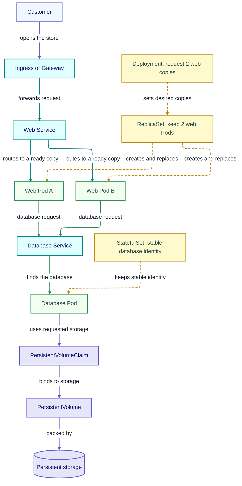
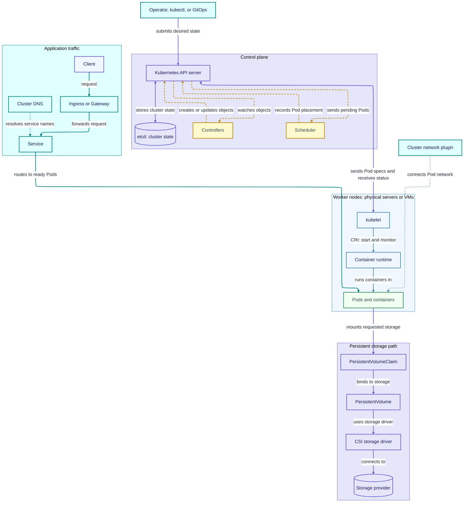

# Kubernetes: A Practical Introduction and Guide

## Table of contents

- [How to use this guide](#how-to-use-this-guide)
- [Background concepts](#background-concepts)
  - [Applications, containers, and images](#applications-containers-and-images)
  - [Linux processes and operating systems](#linux-processes-and-operating-systems)
  - [Networking basics](#networking-basics)
  - [YAML and configuration files](#yaml-and-configuration-files)
- [Kubernetes in one page](#kubernetes-in-one-page)
- [What people usually run on Kubernetes](#what-people-usually-run-on-kubernetes)
  - [Web applications and APIs](#web-applications-and-apis)
  - [Background workers and event-driven services](#background-workers-and-event-driven-services)
  - [Batch and scheduled jobs](#batch-and-scheduled-jobs)
  - [Databases, queues, and other stateful services](#databases-queues-and-other-stateful-services)
  - [Platform and developer services](#platform-and-developer-services)
  - [Simple example: a small online store](#simple-example-a-small-online-store)
- [Kubernetes versus bare metal, VMs, and system containers](#kubernetes-versus-bare-metal-vms-and-system-containers)
  - [Run applications directly on a host](#run-applications-directly-on-a-host)
  - [Run workloads in virtual machines](#run-workloads-in-virtual-machines)
  - [Use system containers such as LXC](#use-system-containers-such-as-lxc)
  - [Run Kubernetes on bare-metal or VM nodes](#run-kubernetes-on-bare-metal-or-vm-nodes)
  - [Tradeoffs and operational complexity](#tradeoffs-and-operational-complexity)
- [Comparison matrix: workload platforms at different layers](#comparison-matrix-workload-platforms-at-different-layers)
- [The core mental model](#the-core-mental-model)
  - [How the pieces fit together](#how-the-pieces-fit-together)
- [What runs in a Kubernetes cluster](#what-runs-in-a-kubernetes-cluster)
  - [Control plane](#control-plane)
  - [Worker nodes](#worker-nodes)
  - [Cluster add-ons and plugins](#cluster-add-ons-and-plugins)
- [The Kubernetes API and desired state](#the-kubernetes-api-and-desired-state)
- [Core objects and workloads](#core-objects-and-workloads)
  - [Namespaces and labels](#namespaces-and-labels)
  - [Pods](#pods)
  - [Deployments and ReplicaSets](#deployments-and-replicasets)
  - [StatefulSets](#statefulsets)
  - [DaemonSets](#daemonsets)
  - [Jobs and CronJobs](#jobs-and-cronjobs)
- [A first workload, from manifest to running application](#a-first-workload-from-manifest-to-running-application)
- [Networking](#networking)
  - [Pod networking and the CNI](#pod-networking-and-the-cni)
  - [Services and service discovery](#services-and-service-discovery)
  - [Ingress and Gateway APIs](#ingress-and-gateway-apis)
  - [Network policies](#network-policies)
  - [Multiple networks and multicast](#multiple-networks-and-multicast)
- [Storage and stateful applications](#storage-and-stateful-applications)
  - [Volumes, claims, and storage classes](#volumes-claims-and-storage-classes)
  - [The CSI and storage providers](#the-csi-and-storage-providers)
  - [Persistence, backup, and recovery](#persistence-backup-and-recovery)
- [Configuration and secrets](#configuration-and-secrets)
- [Security and access control](#security-and-access-control)
  - [Users, service accounts, and RBAC](#users-service-accounts-and-rbac)
  - [Pod security and admission](#pod-security-and-admission)
  - [Images, registries, and supply chain](#images-registries-and-supply-chain)
- [Scheduling and resource management](#scheduling-and-resource-management)
  - [Requests, limits, and quality of service](#requests-limits-and-quality-of-service)
  - [Placement rules and node maintenance](#placement-rules-and-node-maintenance)
  - [Autoscaling](#autoscaling)
- [Application health and rollout management](#application-health-and-rollout-management)
  - [Health probes](#health-probes)
  - [Rolling updates and rollbacks](#rolling-updates-and-rollbacks)
  - [Operators and custom resources](#operators-and-custom-resources)
- [Operating and observing a cluster](#operating-and-observing-a-cluster)
  - [Logs, metrics, events, and tracing](#logs-metrics-events-and-tracing)
  - [Troubleshooting common problems](#troubleshooting-common-problems)
  - [Upgrades and lifecycle management](#upgrades-and-lifecycle-management)
- [Availability and disaster recovery](#availability-and-disaster-recovery)
- [Virtual machines on Kubernetes](#virtual-machines-on-kubernetes)
- [Kubernetes distributions and support boundaries](#kubernetes-distributions-and-support-boundaries)
- [Useful kubectl commands](#useful-kubectl-commands)
- [Decision checklist: is Kubernetes a good fit?](#decision-checklist-is-kubernetes-a-good-fit)
- [Details to add later](#details-to-add-later)
- [Further reading](#further-reading)
- [Appendix: Acronyms and key terms](#appendix-acronyms-and-key-terms)
  - [Acronyms and abbreviations](#acronyms-and-abbreviations)
  - [Key terms](#key-terms)
- [Appendix: References used](#appendix-references-used)

## How to use this guide

Read the early sections first if you are deciding whether Kubernetes fits your
work. The later sections explain how a cluster is built and operated. You do
not need to read every chapter before understanding the basic model.

This is an introduction, not a production installation manual. Kubernetes
distributions, cloud providers, and vendors add their own setup steps and
support rules. Check the documentation for the cluster you actually use before
applying commands or manifests in production.

## Background concepts

### Applications, containers, and images

An application is software that performs a job, such as serving a website,
processing a queue, or storing data. A container image is a packaged template
for starting one or more application processes. A running container is an
instance created from an image.

Images usually come from a registry. They can include application files and
libraries, but they do not normally include a separate operating-system kernel.
Linux containers use the host's Linux kernel. A container is therefore lighter
than a VM, but it is not the same isolation boundary as a VM. [Kubernetes
containers](https://kubernetes.io/docs/concepts/containers/).

### Linux processes and operating systems

Kubernetes starts and supervises containers through the node's container
runtime. Containers are processes with isolation and resource controls; they
are not tiny independent servers with their own kernel. A VM runs a guest
operating system and kernel. A system container such as LXC looks more like a
small Linux system but still shares the host kernel.

### Networking basics

An IP address identifies an endpoint on a network. A port identifies an
application endpoint on that system. DNS gives names to addresses. Firewalls,
routes, network boundaries, and load balancers determine which endpoints can
communicate.

Kubernetes adds a pod network and stable service names, but it still depends on
the cluster's network implementation and the surrounding network. A working
connection inside one pod does not prove that a different pod, VM, or external
LAN device can reach it.

### YAML and configuration files

YAML is a human-readable format used for many Kubernetes manifests. Indentation
is meaningful. A manifest says what an object should look like; it is not a
shell script. Kubernetes validates the object and controllers act on it.

Use version control for manifests, review changes before applying them, and
avoid committing passwords, tokens, or private keys in plain text.

## Kubernetes in one page

Kubernetes is an open-source system for declaring and managing containerized
workloads across a group of machines. You describe the result you want—such as
three copies of a web service—and Kubernetes continually works to make the
running cluster match that description. It can place workloads, restart or
replace failed containers, provide service discovery, and coordinate updates.
It does not write or repair the application, choose a suitable storage or
network provider for you, or guarantee that an application is highly available.
[Kubernetes overview](https://kubernetes.io/docs/concepts/overview/).

Kubernetes is an orchestration layer. The machines beneath it can be physical
servers or VMs. The containers are launched by a node runtime, and the cluster
uses separate network and storage integrations. This is why “Kubernetes versus
VMs” is often a false choice: Kubernetes commonly runs on VM nodes.

The short version:

1. A person or automation submits the desired configuration to the Kubernetes
   API.
2. The control plane records that request and chooses where workloads should
   run.
3. Controllers compare the requested state with the observed state.
4. Node agents and runtimes start the needed containers.
5. If something changes or fails, controllers try again to reach the requested
   state.

## What people usually run on Kubernetes

Kubernetes is commonly used for applications made of containerized services
that need consistent deployment and operation across several machines. These
workloads can also run outside Kubernetes; Kubernetes is useful when its
automation and shared operating model solve a real need.

### Web applications and APIs

Web front ends and application programming interfaces (APIs) are common
Kubernetes workloads. Teams can run multiple replicas, expose them behind a
stable service, and update them in controlled steps.

### Background workers and event-driven services

Workers consume messages, process files, send notifications, or perform other
tasks without directly serving a user request. Kubernetes can run these
alongside the service that creates their work. The application still needs to
handle retries, duplicate messages, and durable queues correctly.

### Batch and scheduled jobs

One-time jobs run to completion; scheduled jobs start work on a recurring
schedule. Examples include reports, data imports, cleanup, and image processing.
Kubernetes can create and track these jobs, but the job code must still be safe
to retry and should report success or failure clearly.

### Databases, queues, and other stateful services

Databases, caches, message brokers, and search systems can run in Kubernetes.
They need durable storage, data-consistent backup, recovery procedures, and
careful upgrades. A StatefulSet can provide stable identities and storage
claims, but it does not make a database cluster reliable by itself. Some teams
prefer to run data services on managed services or dedicated VMs.

### Platform and developer services

Clusters often run shared services such as ingress controllers, certificate
management, monitoring, logging, build runners, and developer portals. These
services can simplify application delivery, but they become part of the
platform team's maintenance and security responsibilities.

### Simple example: a small online store

Imagine a small online store with a web front end and a database. A customer
request enters through an Ingress or Gateway, reaches a stable Service, and is
sent to one of the ready web Pods. The web application uses another Service to
reach the database. The database stores its durable files on a volume.



Violet marks the customer entry and persistent storage path, teal marks the web
request path, green marks database requests, and dashed gold marks controllers
keeping the requested number and identity of Pods in place. A Service gives each
group a stable name even if a Pod is replaced. A real database still needs its own
availability, backup, and restore plan. See the Kubernetes docs for
[Deployments](https://kubernetes.io/docs/concepts/workloads/controllers/deployment/)
and [StatefulSets](https://kubernetes.io/docs/concepts/workloads/controllers/statefulset/).

## Kubernetes versus bare metal, VMs, and system containers

These options solve different problems. Bare metal and VMs provide compute
environments. System containers and application containers package or isolate
processes. Compose, Swarm, and Kubernetes describe or coordinate applications
at different scales. They can be combined: for example, Kubernetes nodes can
be VMs on a hypervisor.

### Run applications directly on a host

An application can run as a normal operating-system service on a physical
server. This has few moving parts and can be a good choice for a small number of
stable services. The operator is responsible for installing dependencies,
configuring services, monitoring them, and handling failover or replacement.

### Run workloads in virtual machines

A hypervisor runs VMs, each with its own guest operating system and kernel.
VMs are useful when workloads need separate operating systems, stronger
isolation boundaries, or established VM management and recovery processes.
Kubernetes can run on VM nodes; the hypervisor manages those VMs while
Kubernetes manages the application containers inside its nodes.

### Use system containers such as LXC

LXC provides isolated Linux environments that share the host kernel. It is
closer to managing a small Linux system than packaging a single application.
This can be lighter than a VM, but it does not provide a separate kernel for
each container. The host platform or container manager owns the system
container lifecycle; that is different from Kubernetes managing pods.
[LXC introduction](https://linuxcontainers.org/lxc/introduction/).

### Run Kubernetes on bare-metal or VM nodes

Kubernetes needs worker machines, called nodes. A node can be a physical server
or a VM. The cluster then schedules pods onto those nodes. Choosing bare-metal
or VM nodes is a separate infrastructure decision from choosing Kubernetes as
the application orchestrator.

### Tradeoffs and operational complexity

Kubernetes is most useful when its scheduling, desired-state management,
service discovery, rollout controls, and multi-machine operation are worth the
extra platform work. A single small application on one server may be easier to
run as an operating-system service, a VM, or a container managed with Podman,
Docker, or Compose. Kubernetes adds a control plane, networking and storage
integrations, access policies, upgrades, and monitoring that someone must own.

## Comparison matrix: workload platforms at different layers

| Option | What it manages | Multi-machine behavior | Often a good fit for | Main tradeoff |
|---|---|---|---|---|
| Direct host execution | Operating-system services and processes | Managed by host tools or separate automation; no application scheduler by default | A few stable services on known servers | Operators manage installation, placement, recovery, and host differences |
| Virtual machines | Complete guest operating systems | Hypervisor tools can place, migrate, and restart VMs across hosts | Different guest OSs, VM-level isolation, or established VM operations | More operating-system overhead; application deployment is still a separate layer |
| LXC/system containers | Linux environments sharing the host kernel | Depends on the host/container management platform | Lightweight Linux system environments | Shared host kernel; not the same as application-pod orchestration |
| Docker Engine or Podman | Container images and containers on a host | Usually a host-level runtime; multi-host coordination needs another tool or platform | Building, testing, or running containers on one host | The runtime alone is not a multi-host application scheduler |
| Docker Compose | A group of application services, networks, and volumes described together | Primarily coordinates an application stack on a Docker host; it is not a Kubernetes-style cluster scheduler | Local development, testing, and straightforward multi-container deployments | Does not provide the same general multi-node reconciliation and scheduling model as Kubernetes |
| Docker Swarm mode | Docker services across a cluster of Docker Engines | Built-in cluster management, placement, service discovery, and scaling | Teams that want Docker's integrated cluster mode | Different platform and ecosystem from Kubernetes; compare current operational and support needs |
| Kubernetes | Desired state for pods and related cluster resources | Schedules workloads across nodes and continually reconciles them | Multiple services and teams needing a common deployment and operations platform | Most operational components and policies must be selected, configured, and maintained |

Docker Engine runs and manages containers on a host; Compose describes a
multi-container application; Swarm mode coordinates Docker Engines as a
cluster. Podman is another container tool. Kubernetes schedules and manages
Pods across nodes, and does not require Docker Engine on its worker nodes. It
uses a container runtime that implements the Container Runtime Interface
(CRI), such as containerd or CRI-O. Docker Engine can be connected through an
adapter, but Kubernetes' old built-in dockershim integration was removed in
Kubernetes 1.24. [Docker Engine](https://docs.docker.com/engine/), [Compose](https://docs.docker.com/compose/),
[Swarm mode](https://docs.docker.com/engine/swarm/), [Podman](https://docs.podman.io/en/latest/),
[Kubernetes container runtimes](https://kubernetes.io/docs/setup/production-environment/container-runtimes/).

This matrix is about operating models, not a benchmark or a claim that one
option is always better. Product support depends on versions, vendors,
integrations, and the workload.

## The core mental model

Kubernetes stores objects that describe desired state. Controllers watch those
objects and take action. If a Deployment asks for three replicas and only two
are running, the Deployment's controller creates another Pod. If a Pod is
deleted, the controller can create a replacement. The new Pod may have a
different name and IP address, so applications should normally connect through
a Service rather than rely on a specific Pod.

Kubernetes does not guarantee that a replacement will be immediately ready,
that the application has preserved its data, or that requests are retried
safely. Those depend on the application and its storage, network, and
operating design.

### How the pieces fit together



The diagram separates management, application traffic, node runtime, networking,
and storage paths. Purple shows management and storage; gold dashed lines show
controller and scheduler reconciliation; blue shows the node runtime; teal shows
application traffic; dotted teal and blue lines show service discovery and Pod
networking. The network and storage components come from the cluster distribution
or its chosen providers; Kubernetes APIs alone do not provide those implementations.

## What runs in a Kubernetes cluster

A cluster is made up of a control plane and worker nodes. In small learning
clusters these roles may share machines; production designs often separate
them. The details vary by distribution.

### Control plane

| Component | Plain-language role |
|---|---|
| API server | Front door for Kubernetes operations; validates and serves API objects. |
| etcd | Stores the cluster's API data. It needs a protected backup and recovery plan. |
| Scheduler | Chooses a suitable node for a Pod that has not been assigned yet. |
| Controller manager | Runs controllers that notice differences between desired and observed state and act on them. |
| Cloud controller manager | Optional integration with infrastructure providers for resources such as nodes and load balancers. |

These components may be managed by a cloud provider or distribution. Cluster
architecture and failure recovery depend on who operates them. [Cluster
architecture](https://kubernetes.io/docs/concepts/architecture/).

### Worker nodes

A worker node provides CPU, memory, storage, and networking for Pods. Its key
components include:

- **kubelet:** node agent that receives Pod assignments and makes sure the
  requested containers are running.
- **Container runtime:** downloads images and runs containers. It communicates
  with Kubernetes through CRI.
- **Network implementation:** connects Pods and Services. Depending on the
  distribution, parts may use CNI plugins, an eBPF dataplane, or other
  components.
- **Service dataplane:** routes traffic for Kubernetes Services. Many clusters
  use kube-proxy; some use a compatible replacement.

### Cluster add-ons and plugins

A usable cluster also needs integrations. Common examples include a CNI-based
network, a CSI storage driver, DNS, metrics, an ingress or Gateway controller,
and a cloud controller where needed. A Kubernetes API object may be accepted
even when the cluster lacks the plugin that would carry it out. Check which
components the distribution installs and who supports them.

## The Kubernetes API and desired state

The Kubernetes API is the control surface for a cluster. You can use a command
line tool, dashboard, automation, or another service to create and inspect API
objects. YAML is a common way to describe those objects.

A manifest commonly contains:

- `apiVersion`: API group and version for the object.
- `kind`: object type, such as `Deployment` or `Service`.
- `metadata`: name, namespace, labels, and annotations.
- `spec`: the desired configuration.

Controllers update status fields to report what has happened. The `spec` is
usually what you ask for; `status` is what the system currently observes. A
controller repeatedly compares them and attempts to reconcile a difference.
This pattern is often called declarative management.

## Core objects and workloads

Kubernetes has many API objects. Start with the few below, then add more only
when an application needs them. [Workload
concepts](https://kubernetes.io/docs/concepts/workloads/).

### Namespaces and labels

A namespace groups namespaced objects and provides a scope for access controls,
quotas, and default policies. Namespaces are not complete security boundaries
by themselves. Labels are key/value tags used to group objects and select
targets. Controllers and Services depend on selectors matching the intended
Pods.

### Pods

A Pod is Kubernetes' smallest deployable unit. It contains one or more
containers that share a network identity and can share storage volumes.
Containers in one Pod are placed together and commonly use a sidecar pattern
when they must work closely together. Most applications should be managed by a
controller rather than by creating individual Pods directly.

### Deployments and ReplicaSets

A Deployment describes a set of mostly interchangeable Pods and manages
replicas and updates. It creates and manages a ReplicaSet, which is responsible
for keeping a requested number of Pods alive. Update strategy and readiness
checks affect how safely a new version replaces an old one. [Deployments](https://kubernetes.io/docs/concepts/workloads/controllers/deployment/).

### StatefulSets

A StatefulSet manages Pods that need stable identities or persistent storage
claims. It can help run databases or queues, but it does not configure the
application's replication, consistency, backup, or failover behavior for you.
[StatefulSets](https://kubernetes.io/docs/concepts/workloads/controllers/statefulset/).

### DaemonSets

A DaemonSet runs a copy of a Pod on each selected node, or on each node that
matches its placement rules. It is commonly used for node-level agents such as
logging or network components.

### Jobs and CronJobs

A Job runs Pods until a task completes successfully or reaches its retry
limits. A CronJob creates Jobs on a schedule. The application should tolerate
retries and avoid assuming that a task runs exactly once. [Jobs](https://kubernetes.io/docs/concepts/workloads/controllers/job/).

## A first workload, from manifest to running application

This example creates two web-server Pods and one in-cluster Service. It assumes
you already have a working cluster and permission to create objects. `nginx:stable`
is convenient for a demonstration; production deployments should use an
approved, controlled image and a deliberate update policy.

Save as `web.yaml`:

```yaml
apiVersion: apps/v1
kind: Deployment
metadata:
  name: web
spec:
  replicas: 2
  selector:
    matchLabels:
      app: web
  template:
    metadata:
      labels:
        app: web
    spec:
      containers:
        - name: web
          image: nginx:stable
          ports:
            - containerPort: 80
---
apiVersion: v1
kind: Service
metadata:
  name: web
spec:
  selector:
    app: web
  ports:
    - name: http
      port: 80
      targetPort: 80
```

Apply it and inspect the result:

```sh
kubectl apply -f web.yaml
kubectl rollout status deployment/web
kubectl get deployment,pods,service
```

The Service is internal to the cluster by default. To reach it from your own
computer for this short demonstration, forward a local port:

```sh
kubectl port-forward service/web 8080:80
```

In another terminal, open `http://localhost:8080`. When finished, stop the
port-forward and remove the example resources:

```sh
kubectl delete -f web.yaml
```

This example demonstrates desired state, Pods, a Deployment, labels, and a
Service. It does not configure public access, TLS, persistent data, production
resource limits, image signing, or application health checks.

## Networking

Kubernetes networking is supplied by the cluster's network implementation and
infrastructure. The common model gives each Pod a routable IP within the
cluster and allows Pod-to-Pod communication, subject to routing and policy.
Pods are temporary: a replacement may receive a new IP. Use a Service to give
a group of matching Pods a stable name and virtual IP. [Networking
concepts](https://kubernetes.io/docs/concepts/services-networking/).

### Pod networking and the CNI

The Container Network Interface (CNI) is a common plugin interface for
configuring container network connections. Cluster distributions choose and
configure their own network implementation. It handles details such as Pod IP
allocation, node-to-node traffic, and sometimes policy. CNI is an interface;
it does not mean every CNI plugin has identical features or support.

### Services and service discovery

A Service selects Pods by label and gives clients a stable way to reach them.
Common types include:

- **ClusterIP:** reachable from within the cluster; the default.
- **NodePort:** exposes a port through node addresses, subject to cluster
  configuration and firewall rules.
- **LoadBalancer:** asks an integrated provider to provision or connect a load
  balancer.
- **ExternalName:** maps a Service name to an external DNS name; it does not
  proxy traffic itself.

Cluster DNS normally lets an application refer to a Service by name rather
than tracking individual Pod addresses. [Services](https://kubernetes.io/docs/concepts/services-networking/service/).

### Ingress and Gateway APIs

Ingress and Gateway APIs describe HTTP or network routes into a cluster. They
are APIs, not the proxy or load balancer itself; an implementation/controller
must act on them. The Kubernetes Ingress API remains supported but is frozen;
the Kubernetes project recommends Gateway API for new capabilities. Check
which controller and API versions your distribution supports. [Ingress](https://kubernetes.io/docs/concepts/services-networking/ingress/),
[Gateway API](https://gateway-api.sigs.k8s.io/).

### Network policies

NetworkPolicy objects describe which Pod connections should be allowed. They
only have effect if the cluster's network implementation enforces them. A
default-deny policy can help limit traffic, but it must be paired with the
required DNS, application, and monitoring rules. Do not assume that writing a
policy proves packets are blocked; test it with the selected network plugin.

### Multiple networks and multicast

The standard Pod model focuses on a primary Pod network. Some environments add
secondary interfaces through an additional plugin such as Multus, which lets a
Pod request extra interfaces and delegates their setup to other network
plugins. This is not part of every Kubernetes distribution and does not itself
provide the underlying networks.

Multicast is also implementation-dependent. Kubernetes does not automatically
make a workload's multicast traffic work across Pods, nodes, VMs, and an
external LAN. The network plugin, Pod permissions, IP family, membership
handling, physical switches, routers, and firewalls all matter. Treat multicast
as a requirement to verify against the exact distribution and network stack,
not as an automatic consequence of having a Pod network. [Cluster networking](https://kubernetes.io/docs/concepts/cluster-administration/networking/).

## Storage and stateful applications

The container's writable layer is temporary. If a Pod is replaced, data stored
only in that layer can disappear. Applications that need durable data should
use a volume backed by storage appropriate for the workload.

### Volumes, claims, and storage classes

A **PersistentVolume (PV)** represents storage available to a cluster. A
**PersistentVolumeClaim (PVC)** is an application's request for storage. A
**StorageClass** describes a type or provisioning policy, such as a performance
tier. The cluster binds a claim to suitable storage or provisions it through a
provider. Access modes and topology affect where a Pod can run. [Persistent
Volumes](https://kubernetes.io/docs/concepts/storage/persistent-volumes/).

### The CSI and storage providers

The Container Storage Interface (CSI) lets storage vendors integrate drivers
with Kubernetes. A PVC alone does not create a supported or highly available
storage system. Confirm the driver, storage class, snapshots, expansion,
failure behavior, and supported topology for the specific cluster.

### Persistence, backup, and recovery

Persistent storage is not the same as backup. A snapshot may be useful, but it
can share the same failure or deletion domain as the original. A complete plan
must identify application-consistent copies, Kubernetes resource manifests,
secrets and keys, retention, restore order, and a tested recovery destination.
Databases may need their own backup or replication tools. Test restoration;
having a backup job report success is not proof that the application can be
recovered.

## Configuration and secrets

ConfigMaps hold non-sensitive configuration. Secrets hold sensitive values such
as passwords or tokens and can be exposed to containers as files or
environment variables. A Secret's Base64 representation is an encoding, not
encryption. Restrict access with RBAC, configure encryption at rest where
appropriate, and consider an external secret manager. Do not bake credentials
into images or check them into source control. [ConfigMaps](https://kubernetes.io/docs/concepts/configuration/configmap/),
[Secrets](https://kubernetes.io/docs/concepts/configuration/secret/).

Configuration changes do not always update a running process automatically.
Some changes require a Pod restart or an application reload. Document which
mechanism your application uses.

## Security and access control

Kubernetes adds powerful APIs and shared infrastructure, so cluster security
depends on safe configuration and operations as well as secure containers.
Start with least privilege, limit network access, keep software patched, and
protect credentials and cluster state. [Security concepts](https://kubernetes.io/docs/concepts/security/).

### Users, service accounts, and RBAC

Role-Based Access Control (RBAC) grants permissions to users, groups, and
service accounts. Give each identity only the actions and namespaces it needs.
Avoid distributing cluster-admin access to applications or routine users.
Treat CI/CD credentials and kubeconfig files as sensitive credentials.

### Pod security and admission

Pod security settings control privileges, Linux capabilities, host access,
users, and filesystem behavior. Admission policies can reject objects that
violate cluster rules. Use the security controls supported by your
distribution, and check how they affect the images and workloads you run.

### Images, registries, and supply chain

Use maintained images from trusted registries. Prefer explicit versions or
digests for repeatable deployments, scan and sign images according to your
organization's policy, and remove unnecessary tools and packages from
production images. Image provenance and update ownership should be clear.

## Scheduling and resource management

The scheduler places Pods on nodes that meet their requirements. If no node
fits, a Pod can remain Pending. The scheduler uses resource requests and
placement rules; it does not create additional capacity unless an autoscaling
integration is configured.

### Requests, limits, and quality of service

CPU and memory **requests** tell Kubernetes what to reserve for placement.
**Limits** constrain resource use. Poorly chosen values can waste capacity,
cause CPU throttling, or lead to memory pressure and container termination.
Measure the workload and adjust requests and limits over time.

### Placement rules and node maintenance

Labels and selectors can guide placement. Affinity and anti-affinity express
preferences or requirements about where Pods run. Taints and tolerations help
reserve nodes for selected workloads. A PodDisruptionBudget can limit some
voluntary disruptions, but it does not prevent every outage or protect an
application from a hardware failure. [Scheduling](https://kubernetes.io/docs/concepts/scheduling-eviction/).

### Autoscaling

Horizontal Pod Autoscaling adjusts replica counts using metrics. Cluster
autoscaling integrations can add or remove nodes when workloads cannot be
placed or capacity is unused. Scaling only works when the application can use
more replicas, dependencies can handle the load, and the cluster has capacity
or a way to add it.

## Application health and rollout management

### Health probes

- **Startup probe:** gives a slow-starting application time to initialize.
- **Readiness probe:** tells Kubernetes whether the container should receive
  traffic.
- **Liveness probe:** tells Kubernetes when a container should be restarted.

Use probes to reflect actual application health. A liveness check that fails
during a normal slow operation can cause unnecessary restarts; readiness is
usually the right signal for temporarily removing an overloaded instance from
traffic. [Pod lifecycle and probes](https://kubernetes.io/docs/concepts/workloads/pods/pod-lifecycle/).

### Rolling updates and rollbacks

Deployments can replace old Pods gradually with new ones. Readiness and
availability settings influence how many old or new replicas run during the
change. A rollback changes the Deployment's template to an earlier revision;
it does not automatically undo database schema changes or external side
effects. Use application-level compatibility plans for those changes.

### Operators and custom resources

A Custom Resource Definition (CRD) adds a new kind of object to the Kubernetes
API. An Operator is software that watches such objects and automates
application-specific tasks, such as installation, backups, or upgrades.
Operators can encode useful expertise, but their behavior, support owner,
permissions, and upgrade policy must be understood before installation.

## Operating and observing a cluster

Kubernetes is a platform to operate, not a self-running application service.
Teams need ownership for cluster upgrades, access, capacity, networking,
storage, incident response, and application lifecycle.

### Logs, metrics, events, and tracing

Logs explain what a process reported. Metrics show how values change over time.
Events explain recent Kubernetes actions and scheduling decisions. Traces show
how a request moves through multiple services. Kubernetes provides some
interfaces and basic data, but a production monitoring and retention system
usually needs additional components or a managed service.

### Troubleshooting common problems

Start from the symptom and inspect both the object and its recent events:

| Symptom | First checks |
|---|---|
| Pod is `Pending` | `kubectl describe pod`; look for scheduling, resource, taint, storage, or image-pull events. |
| Container is restarting | `kubectl logs` and `kubectl describe pod`; check the exit reason, probes, resources, and application configuration. |
| Service has no traffic | Check Service selectors, Pod labels, readiness, endpoints, network policy, and the cluster dataplane. |
| Volume will not mount | Inspect the PVC and PV, StorageClass, CSI driver, access mode, topology, and events. |
| User cannot perform an action | Check current context, namespace, identity, and RBAC permissions. |

Useful commands are listed below. Avoid changing several settings at once;
make a small change, observe the result, and keep the evidence.

### Upgrades and lifecycle management

Kubernetes clusters have versions, supported upgrade paths, and lifecycle
limits. The control plane, nodes, network plugins, storage drivers, Operators,
and applications may have compatibility requirements. Follow the distribution
vendor's upgrade sequence and support matrix. Back up required data and verify
recovery before a major upgrade.

## Availability and disaster recovery

Availability comes from several layers: redundant control-plane components,
enough worker capacity, application replicas, health checks, storage, network
paths, and external dependencies. A controller can replace a failed Pod, but
that does not make its application state available or prove data is safe.

Plan for node and zone failures, API/control-plane outages, storage and network
failures, accidental deletion, credential loss, and a full-site outage. Back
up etcd or the managed control-plane state as appropriate, preserve manifests
and secrets safely, and back up application data using a consistent method.
Write down restore dependencies and practice recovery. Kubernetes does not
provide a universal application disaster-recovery plan.

## Virtual machines on Kubernetes

Kubernetes can manage VMs when an extension such as KubeVirt or a vendor's
OpenShift Virtualization is installed. The VM is represented through Kubernetes
resources, while the guest OS continues to run inside a VM. This lets a team
manage some VM and container workflows through one cluster, but adds operators,
storage, networking, licensing, and support dependencies. A VM managed by a
hypervisor outside Kubernetes is not automatically managed by the Kubernetes
API.

## Kubernetes distributions and support boundaries

Kubernetes is an upstream project. A distribution or managed service packages
it with installation, upgrades, networking, storage, security defaults, and
support. Those choices affect which versions and plugins are supported and who
responds when something breaks.

For any platform, identify who supports the control plane, worker operating
system, container runtime, network plugin, storage driver, Operators, guest
VMs, and application. An open-source project being available does not mean a
vendor supports every combination. Check current compatibility matrices and
lifecycle policies before deployment.

## Useful kubectl commands

`kubectl` is the standard command-line client for interacting with a cluster.
The current context selects a cluster and identity; a namespace scopes many
commands. Before making changes, check that you are connected to the intended
cluster.

```sh
kubectl config current-context
kubectl get nodes
kubectl get namespaces
kubectl get pods -A
kubectl get deployment,service
kubectl describe pod POD_NAME
kubectl logs POD_NAME
kubectl get events --sort-by=.metadata.creationTimestamp
kubectl apply -f manifest.yaml
kubectl delete -f manifest.yaml
```

For a live object, `kubectl explain deployment.spec` shows fields and their
meaning. Use `kubectl diff -f manifest.yaml` to preview differences where
supported. Be careful with commands that delete resources, change contexts, or
apply a manifest to a production cluster.

## Decision checklist: is Kubernetes a good fit?

Kubernetes may fit when several applications or teams need a common deployment
platform, workloads need to move among multiple nodes, and the organization can
operate the cluster or buy a managed service. It can be especially useful when
automated rollout, replica management, service discovery, and repeatable
configuration solve recurring operational problems.

A VM, system service, or single-host container tool may be simpler when there
are only a few stable services, the application cannot be split or scaled, or
no one can own cluster networking, storage, upgrades, and incident response.
Kubernetes is not a goal by itself; compare the effort and support model with
the problem you need to solve.

Before choosing, answer:

- How many services and environments need to be managed?
- Do applications support container images and safe replicas/rollouts?
- What availability, recovery, and data-loss targets are required?
- Who will patch and monitor the cluster and its plugins?
- Which network, storage, identity, and compliance integrations are required?
- Would a managed Kubernetes service reduce work, or is a VM/host runtime
  sufficient?

## Details to add later

This section is a bookmark for a future pass. Add details when the target
environment and intended readers are clearer:

- Target distribution or managed service, versions, and cluster setup path.
- A guided local learning cluster and cleanup instructions.
- More complete YAML examples with resources, probes, ConfigMaps, and
  Secrets.
- Production ingress, DNS, TLS, network-policy, and multi-network examples.
- A persistent application example with backup and tested restore steps.
- Security hardening and upgrade checklists for the selected platform.
- Troubleshooting exercises based on the errors readers actually encounter.

## Further reading

Start with the [official Kubernetes documentation](https://kubernetes.io/docs/)
and its [concepts overview](https://kubernetes.io/docs/concepts/). For
container tools, see the official [Docker Engine](https://docs.docker.com/engine/),
[Docker Compose](https://docs.docker.com/compose/),
[Docker Swarm mode](https://docs.docker.com/engine/swarm/),
[Podman](https://docs.podman.io/en/latest/), and
[LXC](https://linuxcontainers.org/lxc/) documentation.

## Appendix: Acronyms and key terms

### Acronyms and abbreviations

| Acronym or abbreviation | Full form | Meaning in this guide |
|---|---|---|
| API | Application programming interface | The interface clients and tools use to read or change Kubernetes objects. |
| CNI | Container Network Interface | A common plugin interface used by many cluster network implementations. |
| CRI | Container Runtime Interface | The interface between Kubernetes node agents and a container runtime. |
| CSI | Container Storage Interface | A plugin interface for connecting storage providers to Kubernetes. |
| DNS | Domain Name System | Resolves service and host names to network addresses. |
| HA | High availability | Design intended to keep a service usable through some failures; it does not mean zero downtime. |
| IP | Internet Protocol | The addressing and packet-delivery system used by cluster and application networks. |
| LXC | Linux Containers | Linux system-container tools and runtime that use the host kernel. |
| MLD | Multicast Listener Discovery | IPv6 protocol for hosts and network devices to track multicast group membership. |
| OCI | Open Container Initiative | Standards for container images and runtimes used by many tools. |
| RBAC | Role-Based Access Control | Permissions assigned to identities through roles and bindings. |
| RWX | ReadWriteMany | Storage access mode allowing read/write mounts by multiple nodes, when supported by the storage provider. |
| VM | Virtual machine | A software-defined computer with its own guest operating system. |
| YAML | YAML Ain't Markup Language | A human-readable data format commonly used for Kubernetes manifests. |

### Key terms

| Term | Plain-language definition | How it applies here |
|---|---|---|
| Admission control | Checks or changes an API request before Kubernetes stores it. | Policies and admission plugins can reject unsafe or invalid workload settings. |
| API object | A named piece of configuration stored through the Kubernetes API. | Deployments, Pods, Services, and ConfigMaps are different object kinds. |
| Container | A running application process isolated from other processes using operating-system features. | Kubernetes asks a container runtime on a node to start containers inside Pods. |
| Container image | A packaged template used to start a container. | Kubernetes pulls the image from a registry when a Pod needs it. |
| Container registry | A service that stores and distributes container images. | Nodes need access and credentials to pull private images. |
| Container runtime | Software on a node that downloads images and starts/stops containers. | Kubernetes talks to a runtime through CRI; common choices include containerd and CRI-O. |
| Controller | A control loop that watches API objects and takes action to move the cluster toward the requested state. | Deployments and Jobs use controllers to create and manage Pods. |
| Control plane | Components that accept cluster requests, store state, and coordinate actions. | It chooses where Pods should run and hosts controllers that reconcile objects. |
| CronJob | An object that creates Jobs on a recurring schedule. | Used for scheduled tasks such as reports, cleanup, and data imports. |
| Custom Resource Definition (CRD) | An extension that adds a new object type to the Kubernetes API. | Operators often define custom resources to describe application-specific desired state. |
| DaemonSet | A workload that runs a Pod on each selected node. | Often used for node-level monitoring, logging, or networking agents. |
| Desired state | The configuration that says what should be running or how an object should be configured. | Controllers compare this request with the observed cluster and try to close the difference. |
| Deployment | An object that manages replicas of a mostly interchangeable application Pod and supports controlled updates. | A common way to run web services and APIs. |
| EndpointSlice | A record of network endpoints for a Service, usually corresponding to ready Pods. | Kubernetes updates these records as matching Pods become ready or unavailable. |
| Gateway API | A set of Kubernetes APIs for describing network traffic routes. | Requires a Gateway controller; the API alone does not provide a proxy or load balancer. |
| Ingress | A Kubernetes API for describing HTTP(S) routes into a cluster. | Requires an Ingress controller. The API is stable but frozen; the project recommends Gateway API for new capabilities. |
| Job | A workload that runs Pods until a task completes or fails. | Used for finite tasks; job logic should tolerate retries. |
| Kubelet | The agent that runs on each node and manages the Pods assigned to it. | It communicates with the control plane and container runtime. |
| Manifest | A file describing one or more Kubernetes API objects, often written in YAML. | `kubectl apply -f` submits manifest objects to the API. |
| Namespace | A logical grouping for namespaced objects and some access or policy settings. | Useful for organizing teams and applications, but not a complete security boundary by itself. |
| Network policy | Rules describing which network connections are allowed between selected Pods or other endpoints. | It only filters traffic if the cluster network implementation enforces it. |
| Node | A physical or virtual machine that is part of a Kubernetes cluster. | Worker nodes provide resources where Pods run. |
| Operator | A controller that automates tasks for a particular application or service. | Operators extend Kubernetes APIs and may manage installation, upgrades, or backups. |
| PersistentVolume (PV) | A cluster resource representing a piece of durable storage. | A storage provider or administrator makes it available for workloads to claim. |
| PersistentVolumeClaim (PVC) | An application's request for storage with particular size and access needs. | Kubernetes binds the claim to a suitable PersistentVolume or provisions one through a StorageClass. |
| Pod | Kubernetes' smallest deployable unit, containing one or more related containers. | Controllers create and replace Pods; their IP addresses can change. |
| Replica | One running copy of a workload. | A Deployment with three replicas asks Kubernetes to keep three interchangeable Pods running. |
| Reconciliation | Repeatedly checking actual state and acting to make it match desired state. | This is how Deployments and other controllers maintain workloads. |
| Secret | An API object for sensitive values such as credentials or tokens. | Access must be restricted; Base64 encoding does not encrypt Secret data. |
| Service | A stable name and network endpoint for reaching a selected group of Pods. | Applications use a Service instead of tracking individual Pod addresses. |
| Stateful application | An application whose identity or important data must persist between process restarts. | Databases often need persistent storage and application-aware backup beyond a StatefulSet. |
| StatefulSet | A workload controller for Pods that need stable identities or storage claims. | Helps manage some stateful software but does not make the software highly available by itself. |
| StorageClass | A description of a type or policy for dynamically provisioning storage. | A PVC can request storage through a StorageClass when the CSI provider supports it. |
| System container | An isolated Linux environment that shares the host kernel and resembles a small OS. | LXC is a system-container option; it is distinct from an application container and Kubernetes Pod. |
| Volume | A storage location mounted into a container. | A Pod can use temporary or persistent volumes; the volume type determines what survives Pod replacement. |
| Workload | An application or task Kubernetes is asked to run. | Examples include a Deployment, StatefulSet, DaemonSet, Job, or CronJob. |

## Appendix: References used

Official documentation checked **2026-11-02**. These are the primary
references used for the concepts and tool distinctions in this guide. Check the
documentation version and your distribution's support matrix when applying
them to a specific cluster.

### Kubernetes project documentation

- [Overview](https://kubernetes.io/docs/concepts/overview/) and
  [cluster architecture](https://kubernetes.io/docs/concepts/architecture/)
- [Containers](https://kubernetes.io/docs/concepts/containers/) and
  [container runtimes](https://kubernetes.io/docs/setup/production-environment/container-runtimes/)
- [Workloads](https://kubernetes.io/docs/concepts/workloads/),
  [Deployments](https://kubernetes.io/docs/concepts/workloads/controllers/deployment/),
  [StatefulSets](https://kubernetes.io/docs/concepts/workloads/controllers/statefulset/),
  and [Jobs](https://kubernetes.io/docs/concepts/workloads/controllers/job/)
- [Services and networking](https://kubernetes.io/docs/concepts/services-networking/),
  [Service](https://kubernetes.io/docs/concepts/services-networking/service/),
  [Ingress](https://kubernetes.io/docs/concepts/services-networking/ingress/),
  and [cluster networking](https://kubernetes.io/docs/concepts/cluster-administration/networking/)
- [Gateway API project](https://gateway-api.sigs.k8s.io/)
- [Storage](https://kubernetes.io/docs/concepts/storage/) and
  [Persistent Volumes](https://kubernetes.io/docs/concepts/storage/persistent-volumes/)
- [ConfigMaps](https://kubernetes.io/docs/concepts/configuration/configmap/),
  [Secrets](https://kubernetes.io/docs/concepts/configuration/secret/),
  and [security](https://kubernetes.io/docs/concepts/security/)
- [Scheduling, preemption, and eviction](https://kubernetes.io/docs/concepts/scheduling-eviction/)
- [Pod lifecycle and probes](https://kubernetes.io/docs/concepts/workloads/pods/pod-lifecycle/)
- [Cluster administration](https://kubernetes.io/docs/concepts/cluster-administration/)

### Container tools and alternatives

- [Docker Engine](https://docs.docker.com/engine/)
- [Docker Compose](https://docs.docker.com/compose/)
- [Docker Swarm mode](https://docs.docker.com/engine/swarm/)
- [Podman documentation](https://docs.podman.io/en/latest/)
- [Linux Containers (LXC)](https://linuxcontainers.org/lxc/introduction/)
- [Multus CNI project](https://github.com/k8snetworkplumbingwg/multus-cni) and
  [usage guide](https://github.com/k8snetworkplumbingwg/multus-cni/blob/master/docs/how-to-use.md)
