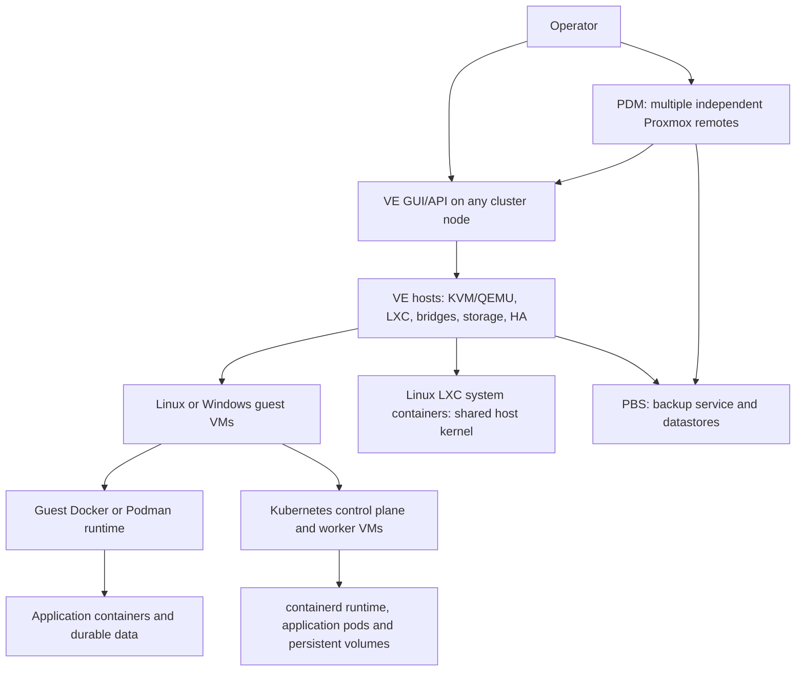

# Proxmox VE, Backup Server, and Datacenter Manager

Research cutoff and source access date: **2026-10-30**. Specification: r1.0.2.
Standalone research report; documented uncertainties remain explicit. No
deployment or live validation was performed. GUI means graphical user interface;
API means application programming interface; CLI means command-line interface;
CNI means Container Network Interface.

Document revision: **r1.0.1**. Baseline: unversioned `research-proxmox.md`
(r1.0.0 for preservation bookkeeping; archived in `99_Archive/`). Review date:
**2026-10-30**; research cutoff unchanged. Review status: independent claim
review recorded in
[research-review-r1.0.1.md](research-review-r1.0.1.md) and
[research-claim-audit-r1.0.1.tsv](research-claim-audit-r1.0.1.tsv); document
checks for this revision are recorded in
[research-verification-r1.0.1.md](research-verification-r1.0.1.md).
Supplemental Proxmox multi-network clarification added2026-11-02; selected
stack and research cutoff are unchanged. New upstream sources were accessed
during this targeted edit.

## Summary and fit

Proxmox Virtual Environment (VE) combines Kernel-based Virtual Machine
(KVM)/QEMU virtual machines (VMs), Linux Containers (LXC), cluster management,
storage, networking, migration, and high availability (HA). Its container
objects are primarily Linux system containers sharing the host kernel.
Application runtimes and Kubernetes normally belong inside guest VMs with their
own support arrangements; Open Container Initiative (OCI) image conversion to
LXC remains a technology preview. Proxmox Backup Server (PBS) is a separate
backup service, and Proxmox Datacenter Manager (PDM) is the current management
layer for independent Proxmox clusters and sites. [VE guide](#p1), [PDM
guide](#p3).

A single cluster has a distributed management plane accessible through any
surviving node. PDM adds fleet inventory, selected guest operations, updates,
migration, and software-defined networking (SDN); it does not combine
independent clusters into one HA domain or manage application pods. VMs can live
migrate subject to device/storage/CPU compatibility; LXC migration involves
stopping and restarting. Host failure recovery restarts registered HA guests
after quorum/fencing and storage checks. Application replicas, database
consistency, traffic redirection, and Kubernetes recovery require their own
design. [VE guide chapters 5, 10–11, 15](#p1), [PDM remotes](#p10).

The best evidenced multicast candidate is a Linux bridge/VLAN with directly
attached VM network adapters or LXC virtual Ethernet interfaces. Linux documents
IPv4 Internet Group Management Protocol (IGMP) and IPv6 Multicast Listener
Discovery (MLD) snooping. End-to-end application support remains **conditional**
on guest behavior, firewall rules, membership handling, physical
switches/queriers, and routing. This is not an unconditional Proxmox application
certification. [Linux bridge](#p12).

Fit is strongest for teams wanting open-source VM/system-container
infrastructure with integrated operations and published subscription prices,
while retaining responsibility for guest applications and Kubernetes. All
software features are available without a paid feature edition. Enterprise
repositories and commercial support are subscription services. Premium support
became 24/7 on October 19, 2026; Standard 24/7 remains announced for later in
2026\. [Pricing](#p7), [PBS pricing](#p8).

## Verified product baseline

| Product/path        | Current GA                                                                                            | Baseline / life                                                                                                                                                              | Compatibility                                                                                                                                                                                                                                                   |
| ------------------- | ----------------------------------------------------------------------------------------------------- | ---------------------------------------------------------------------------------------------------------------------------------------------------------------------------- | --------------------------------------------------------------------------------------------------------------------------------------------------------------------------------------------------------------------------------------------------------------- |
| VE / P-VM and P-LXC | VE 9.2, released 2026-05-21; downloadable ISO 9.2-1                                                   | x86-64 VE 9.2; release stack Debian 13.5, Linux 7.0, QEMU 11.0, LXC 7.0, ZFS 2.4. Downloaded guide is 9.2.13, dated 2026-09-24. VE 9 EOL not yet specified; VE 8 EOL 2026-08 | Use current enterprise updates on all nodes. ISO and documentation versions are not assertions of latest package version. Exact newest enterprise patch is not publicly verified here. [Release](#p4), [guide §§3.1,20](#p1)                                    |
| Integrated Ceph     | Tentacle 20.2 (20.2.1 named in the release announcement) stable alongside Squid 19.2 at VE 9.2 launch | Select Tentacle 20.2; guide calls it recommended and estimates EOL 2027-11. Squid estimated EOL 2026-09 has passed                                                           | Vendor repository matrix applies; do not select an arbitrary upstream Ceph version. [Guide §3.1.7](#p1)                                                                                                                                                         |
| PBS                 | PBS 4.2, released 2026-04-29; documentation 4.2.8-1, dated 2026-10-02                                 | Separate PBS 4.2 service, Debian 13.4/Linux 7.0/ZFS 2.4 release stack. PBS 4 EOL TBA; PBS 3 EOL 2026-08                                                                      | Proxmox documents integrated VE QEMU/LXC backup clients. No frozen exact VE/PBS patch-pair matrix established; keep both supported/current and validate actual deployment. S3 backend is supported in 4.2, previously preview. [Release](#p5), [PBS guide](#p2) |
| PDM                 | PDM 1.1, released 2026-05-28; documentation 1.1.9, dated 2026-10-14                                   | Separate Debian 13-based manager; PDM 1 EOL TBA                                                                                                                              | Initial GA minimum remotes VE 8.4/PBS 3.4 are historical compatibility floors, not a recommendation to run EOL versions. Select VE 9.2/PBS 4.2; latest remotes needed for newer token operations. [Release](#p6), [guide](#p3), [GA requirements](#p11)         |
| Arm64 alternative   | Official VE 9.2 Arm64 launched 2026-08-05                                                             | NVIDIA Grace Hopper/Vera supported; other UEFI/ACPI ARMv9-A hardware best effort; device-tree-only boards unsupported                                                        | x86 and Arm hosts may share a cluster, but running guests cannot migrate between CPU architectures. Enterprise Arm support is on request. Outside selected x86 baseline. [Arm release](#p15), [guide §2.1.3](#p1)                                               |

Assumptions: no inventory, hardware, host count, sites, storage design, budget,
support policy, or multicast application specification is supplied. Default
comparison uses x86-64 hosts, supported Linux/Windows guests, LXC system
containers, optional separate PBS/PDM, and application containers/Kubernetes in
Linux VMs. No live installation, performance, migration, recovery, or multicast
tests were performed. Commercial support is limited by the subscription
agreement; guest OS/runtime support is not inherited from Proxmox. Product
release trains are verified; package-level and guest Kubernetes compatibility
uncertainties are retained below.

Coordinator follow-up on2026-10-30 recovered the official public **HTTP**
no-subscription package indexes after HTTPS hostname validation failed. Highest
observed versions under Debian version comparison: `pve-manager 9.2.24`,
`qemu-server 9.2.13`, `pve-qemu-kvm 11.0.3-4`, `lxc-pve 7.0.0-2`,
`proxmox-backup-server 4.2.8-1`, and `proxmox-datacenter-manager 1.1.9`. These
are public-channel observations, not proof of the newest enterprise-repository
package set. Transport/package signatures were not independently authenticated
in this read-only inspection; use signed repository metadata for deployment. No
packages were installed. [Package metadata](#p31).

## Architecture and workload support

PDM and VE are infrastructure managers; PBS protects stored objects. Kubernetes
inside VMs has a distinct control plane. A Windows VM does not make Windows
containers native LXC objects. [VE guide chapters 10–11](#p1), [PBS
architecture](#p9).

| Path                | VM / guest                                   | Runtime / place                                                                                           | Needs / rights                                                                                                                                                   | Status / owner                                                                                                                                                                                                                                                                        |
| ------------------- | -------------------------------------------- | --------------------------------------------------------------------------------------------------------- | ---------------------------------------------------------------------------------------------------------------------------------------------------------------- | ------------------------------------------------------------------------------------------------------------------------------------------------------------------------------------------------------------------------------------------------------------------------------------- |
| P-VM                | VE 9.2 QEMU 11/KVM; Linux or Windows guest   | No runtime required; independent guest kernel                                                             | CPU virtualization, compatible devices/storage; VE features included; guest licenses separate                                                                    | **documented supported**, Proxmox infrastructure; guest vendor support must be checked separately. [P1](#p1)                                                                                                                                                                          |
| P-LXC               | VE 9.2 host; Linux template (e.g. Debian 13) | LXC 7 system container directly on host; no Kubernetes                                                    | Supported template, shared Linux host kernel; unprivileged containers preferred; included                                                                        | **documented supported**, Proxmox LXC integration; cannot run Windows/FreeBSD kernels. Application itself remains guest/operator responsibility. [P1 §§11.1–11.5](#p1)                                                                                                                |
| P-OCI               | VE 9.2 host; OCI image converted to LXC      | Application image uses LXC, not Docker Engine/containerd                                                  | Included technology-preview delivery; image compatibility must be tested                                                                                         | **conditional**: documented technology preview, and the subscription agreement states previews are not supported in production. Use outside production only; not main baseline. [P1 §11, §14](#p1), [agreement §2](#p16)                                                              |
| P-Docker            | VE 9.2 Linux VM; Debian 13 selected          | Docker Engine 29.9.2 (2026-10-20), bundled containerd; inside guest                                       | Docker supports Debian 13 install; Proxmox recommends QEMU VM for application containers/orchestration; separate guest/upstream support                          | **conditional**: documented guest installation, not Proxmox support for Docker software; Proxmox console sees the VM, not its application containers. Direct Engine install on VE host is not recommended by vendor. [P1 §20](#p1), [Docker install/release](#p17)                    |
| P-Podman            | VE 9.2 Linux VM; Debian 13 candidate         | Podman upstream latest observed 6.1.4; inside VM                                                          | Select guest-distribution supported package rather than infer latest upstream compatibility; separate guest/runtime support                                      | **not verified** for an exact commercially supported VE/guest/Podman combination; feasible deployment candidate, not a Proxmox product entitlement. [Podman releases](#p18), [agreement](#p16)                                                                                        |
| P-K8s               | VE 9.2; Debian 13 Linux VMs candidate        | kubeadm Kubernetes 1.37.1; containerd 2.4.2 candidate; Calico 3.33.0 candidate inside VMs                 | Separate Kubernetes/CNI/storage lifecycle, Container Runtime Interface (CRI) configuration, API endpoint and storage drivers; no Proxmox Kubernetes subscription | **not verified** for whole stack support. Individual current upstream versions do not establish a certified compatible combination or commercial support. Kubernetes, containerd, Calico are upstream/operator responsibility. [Upstream versions](#p19), [Calico requirements](#p20) |
| P-Windows-container | VE 9.2 Windows Server VM candidate           | Windows containers require compatible Windows host/image kernels and a supported Windows runtime; not LXC | Microsoft/runtime licensing and support; Linux container image requires Linux kernel elsewhere                                                                   | **not verified** for exact Proxmox/Microsoft/runtime support combination. Do not infer from Windows VM support. [P1 §11](#p1), [Windows compatibility](#p21)                                                                                                                          |

Docker/Podman nested in LXC, alternative Kubernetes distributions, Windows
Kubernetes workers, and bare-host runtimes are candidates outside the main
evaluated paths. Missing support evidence is **not verified**, not an
unsupported claim. No first-party Proxmox Kubernetes distribution or pod
lifecycle control was established in the catalog. [Catalog](#p14), [support
exclusions](#p16).

## Centralized and multi-host management

VE management is distributed: `pveproxy`/API services run on each node, while
the Proxmox Cluster File System (pmxcfs) replicates configuration using
Corosync. Create/join the cluster through GUI/`pvecm`, establish trusted
connectivity and synchronized time, and keep node versions aligned. Joining is
an infrastructure operation, not discovery of arbitrary existing VMware/Red Hat
hosts. The guide specifies reliable cluster latency below 5 ms, redundant
cluster links, and three nodes for reliable HA quorum; two-node deployments can
use an external QDevice third vote. There is no explicit node limit in the
guide; its historical large-cluster anecdotes are not a current tested scale
guarantee. Size against hardware, network, workload and support advice. [P1
chapter 5](#p1).

| Interface                                       | Scope / control                                                                                                                                                                                                                                        | Tools / limits                                                                                                                                                                                                                                                                   | Outage / rights                                                                                                                                                                                                                                                                             |
| ----------------------------------------------- | ------------------------------------------------------------------------------------------------------------------------------------------------------------------------------------------------------------------------------------------------------ | -------------------------------------------------------------------------------------------------------------------------------------------------------------------------------------------------------------------------------------------------------------------------------- | ------------------------------------------------------------------------------------------------------------------------------------------------------------------------------------------------------------------------------------------------------------------------------------------- |
| VE 9.2 GUI/API, distributed per-node            | One Proxmox cluster from any member: host inventory, VM/LXC creation and consoles, templates, migration, HA policies, storage/network configuration, backups, monitoring, identity/role-based access control (RBAC), tasks and logs                    | Guest containers/pods require guest runtime/Kubernetes access. GUI, `qm`, `pct`, `pvesm`, `pvecm`, REST API share infrastructure functions; guest configuration management is separate                                                                                           | Loss of access node: connect to another node. Loss of quorum makes cluster configuration read-only and HA may fence isolated nodes; existing workload fate depends on HA/quorum, not browser access. Included features, commercial support optional. [P1 chapters 4–5,14–15](#p1)           |
| PDM 1.1, separate centralized service           | Multiple independent VE clusters/standalone nodes and PBS instances across sites: inventory, start/stop/reboot/resume, snapshots, supported migration, fleet updates, selected EVPN management, subscription registry, unattended host-install answers | Register remotes with API credentials/tokens, TLS trust and network access. Full provisioning/storage/backup configuration still uses VE/PBS consoles; Ceph view is read-only. Does not inspect individual Docker containers or Kubernetes pods and is not a shared HA scheduler | **Technical inference:** PDM outage removes fleet entry point/automation through it, not execution of remote guests or each remote cluster HA. Recover manager/configuration or use remote UIs directly. Features free; enterprise update/support eligibility below. [P3](#p3), [P10](#p10) |
| PBS 4.2 GUI/API, separate client/server service | Backup datastores, retention/prune/garbage collection, verification, sync/tape jobs, users/tokens and logs; VE schedules guest backups                                                                                                                 | VM/LXC lifecycle in VE; application-aware backup inside guests or third-party tools. PDM aggregates PBS information but is not a replacement for all PBS administration                                                                                                          | Backup/restore jobs needing unavailable PBS/storage cannot progress; production guests continue absent another dependency. Recover PBS or use independent off-site copy. Separate software product and support subscription. [P2](#p2)                                                      |
| Guest runtime / Kubernetes interfaces           | Docker/Podman containers within each VM; Kubernetes API controls clusters/pods and applications                                                                                                                                                        | Separate credentials, upgrades, secrets, storage/CNI and observability. Multi-cluster tooling requires separate implementation                                                                                                                                                   | Runtime/control-plane outage follows guest/application design. **Not verified** as commercially supported Proxmox Kubernetes service. [P1 §20](#p1), [P19](#p19)                                                                                                                            |
| Mixed-vendor integrations                       | Veeam can unify supported backup workflows; Zabbix provides monitoring; Ansible can automate APIs through separately maintained collections                                                                                                            | Backup or monitoring scope does not imply ESXi/KVM/Proxmox full lifecycle parity. No first-party PDM support for non-Proxmox hypervisors established                                                                                                                             | Third-party products, consoles and entitlements; supported versions and owner vary. [P14](#p14), [Veeam](#p22), [Ansible](#p25)                                                                                                                                                             |

PDM documentation lists remote API versions/features rather than an all-versions
blanket guarantee. Initial GA accepted VE 8.4/PBS 3.4; current baseline avoids
their EOL branches. Newer token-based shell operations require VE 9.1/PBS 4.1 or
later. No fixed current tested PDM remote-count limit was established. Remote
certificate renewal can break a pinned fingerprint until independently verified
and updated; trusted certificate chains ease that operational dependency. [P3
roadmap/remotes](#p3), [P10](#p10), [P11](#p11).

You can manage one cluster's hosts, VMs and LXC containers from one place. Add
PDM for several Proxmox clusters/sites and selected fleet actions; retain VE/PBS
and guest/Kubernetes interfaces for deeper tasks. Independent cluster
scheduling, quorum and failover boundaries remain independent, and cross-vendor
management requires other integrations.

## Provisioning and orchestration

| Workload/path       | Provisioning                                                                                                                                                      | Control                                                                                                                                                                                                                 | Manual / extras                                                                                                                                                                                                                                                |
| ------------------- | ----------------------------------------------------------------------------------------------------------------------------------------------------------------- | ----------------------------------------------------------------------------------------------------------------------------------------------------------------------------------------------------------------------- | -------------------------------------------------------------------------------------------------------------------------------------------------------------------------------------------------------------------------------------------------------------- |
| P-VM                | GUI/`qm`/API create from ISO, template or clone; choose host, storage, bridge/VLAN, CPU model and devices; Cloud-Init supplies initial Linux guest configuration  | VE manages VM lifecycle; HA manages registered guest desired state; 9.2 dynamic Cluster Resource Scheduler (CRS) can rebalance HA guests. APIs and community Ansible/Terraform/OpenTofu tooling automate infrastructure | Guest patching, application rollout, secrets and scaling logic need guest/configuration tools. Cloning is not application replica coordination. Features included; community providers have separate support. [P1 chapters 10,15](#p1), [P4](#p4), [P25](#p25) |
| P-LXC               | GUI/`pct`/API download template, allocate rootfs/mounts, set networking/users/resources, start                                                                    | VE controls whole system container; HA may restart/relocate it, not reconcile application replicas; guest service manager supervises services                                                                           | Guest package updates and data consistency remain operator/application work; LXC migration restarts container. Included. [P1 chapter 11](#p1)                                                                                                                  |
| P-Docker / P-Podman | First provision Linux VM; install guest-supported runtime; pull pinned images, attach persistent data/network, inject secrets, start via runtime or service units | Runtime restart policy/service manager is local to VM; Docker Compose groups services but is not a Proxmox cluster scheduler                                                                                            | Operator builds deployment/update/rollback and data-backup workflows. Podman version compatibility/commercial contract remains unverified. [P17](#p17), [P18](#p18)                                                                                            |
| P-K8s candidate     | First provision control-plane/worker VMs, stable API endpoint and CNI/storage; use kubeadm and manifests/Helm/GitOps                                              | Kubernetes scheduler/controllers maintain pods and replicas, kubelet/runtime restarts containers; autoscaling and rolling updates require configured controllers and capacity                                           | Adding VM nodes is infrastructure work; Proxmox HA does not replace etcd quorum, pod anti-affinity, volume recovery or application DR. Kubernetes/distribution/CNI support separate. [P19](#p19), [P20](#p20), [P26](#p26)                                     |
| Hosts/fleet         | VE automated installer; PDM 1.1 serves prepared answers with tokens and tracks installations                                                                      | PDM centralizes host install configurations/subscriptions and update rollout                                                                                                                                            | Physical provisioning, firmware, storage/network design and approval/change procedure remain operator responsibilities. [P3 chapter 8](#p3)                                                                                                                    |

**VM workflow (proposed operating model):** operator clones a maintained
template in VE, attaches an approved VLAN and storage, initializes with
Cloud-Init and installs guest agents/application/secrets through guest tooling.
Register HA and backup schedules, monitor tasks and data integrity. On host
failure, quorum/fencing precedes restart on an eligible host with accessible
disks; boot/database recovery and client reconnection follow. Restore from PBS
when disks or data are lost. For retirement, stop application writes,
retain/export required data and backups, remove HA/replication references and VM
volumes deliberately, then expire backups under retention rules. [P1 chapters
10,15–16](#p1).

**Container application workflow (P-K8s candidate):** infrastructure operator
creates worker/control-plane VMs on distinct physical failure domains;
Kubernetes operator establishes API/etcd, containerd, Calico and storage, then
deploys manifests with image digests, secrets, replicas, probes and persistent
volume claims. Kubernetes handles pod rollouts/rollback and replica placement;
capacity and guest updates remain coordinated with VE. Back up objects/etcd and
application data with Kubernetes/application tools, plus VM protection where
appropriate. On physical host loss, Kubernetes may reschedule pods while VE
recovers the node VMs: prevent competing writers with storage/application
fencing and wait for volumes to detach/reattach. Service endpoints/load
balancers and multicast memberships must recover. Retire manifests and claims
according to data-retention policy; deleting a pod, claim, VM or backup has
different effects. This is a proposed workflow, not a tested or
Proxmox-certified stack. [P19](#p19), [P26](#p26), [P27](#p27).

## Networking and multicast

VE supports Linux bridges, bonds and virtual local area networks (VLANs); VM TAP
and LXC veth interfaces can attach to the same bridge. SDN adds
simple/VLAN/QinQ/VXLAN/EVPN zones and routing, with 9.2 BGP/WireGuard fabrics
and IPv6 EVPN underlay enhancements. Those features do not automatically
establish application multicast forwarding in an overlay. Corosync normally uses
Kronosnet UDP unicast; platform cluster traffic is a different question from
application multicast. [P1 §§3.4,5.7,12–13](#p1), [P4](#p4).

**What this means for Kubernetes nodes:** Proxmox VE can give a VM several
virtual network adapters and connect them to different bridges or VLANs. So a
Kubernetes node running in a VM can be given a second network connection at the
VM layer. The operator or automation must configure that connection on each
node; Proxmox does not thereby manage a Kubernetes cluster's node-network
settings as VKS does. For individual pods to use another network, a separate
Kubernetes component such as Multus can attach additional interfaces. Multus
is open source under Apache-2.0, but it is a networking add-on, not a complete
network implementation: it needs a primary CNI and another plugin to provide
each added network. The VM NIC capability is documented; the complete Proxmox,
Kubernetes, Multus and CNI combination in this report is **not verified** for
support or end-to-end multicast. [P1](#p1), [P31](#p31).

Rows below use **conditional** where upstream component capability is documented
but a Proxmox end-to-end application support statement is not established. “Same
host” means physical VE host; “external” means LAN participants sending and
receiving, not merely outbound traffic. Upstream Linux documents bridge snooping
and membership handling; observed defaults on the eventual release must be
checked. [P12](#p12).

In plain language, Multus lets a Kubernetes pod ask for one or more extra
network connections in addition to its normal pod network. It does not create
those networks by itself: it calls other CNI plugins that connect the pod to
the requested network. With Proxmox, that pod-level feature is separate from
attaching extra virtual NICs to the VM that runs a Kubernetes node. [P33](#p33).

| Path and endpoints                                                                | Host / LAN scope                                                                                           | IPv4                                                                                             | IPv6                                                                                      | Needs / evidence                                                                                                                                                                                                                                                                                                 |
| --------------------------------------------------------------------------------- | ---------------------------------------------------------------------------------------------------------- | ------------------------------------------------------------------------------------------------ | ----------------------------------------------------------------------------------------- | ---------------------------------------------------------------------------------------------------------------------------------------------------------------------------------------------------------------------------------------------------------------------------------------------------------------- |
| P-VM ↔ P-VM                                                                       | Same bridge; across hosts via matching bridged VLAN; both directions to LAN                                | **conditional**: IGMP memberships, snooping/querier and multicast UDP rules                      | **conditional**: MLD/ICMPv6 memberships, snooping/querier and appropriate scope/hop limit | VE 9.2 Linux 7.0 bridge, guest NIC/OS, physical Layer 2 switching. Linux bridge supports IGMPv2/v3 and MLDv1/v2; this is upstream capability, not application certification. Routing between subnets needs separately designed multicast routers and permitted groups. [P1 network/firewall](#p1), [P12](#p12)   |
| P-LXC ↔ P-LXC; P-VM ↔ P-LXC                                                       | Same host bridge; cross host matching VLAN; bidirectional external LAN                                     | **conditional**, IGMP in container/guest through veth/TAP/bridge/uplink                          | **conditional**, MLD in container/guest through same path                                 | Shared bridge infrastructure; correct container interface membership, capabilities and firewall required. Technical inference extends bridge capability to attached veth endpoints; Proxmox end-to-end multicast support promise **not verified**. No Kubernetes CNI involved. [P1 chapter 11](#p1), [P12](#p12) |
| P-Docker Linux host network inside VM ↔ VM/LXC/container/LAN                      | Guest's own network namespace, then P-VM bridge path; same/cross physical host and external conditional    | **conditional** with guest network stack and IGMP                                                | **conditional** with guest IPv6 and MLD                                                   | Docker Engine 29 Linux host driver shares the guest VM network namespace, not physical VE host. Upstream driver supported on Linux; end-to-end multicast conclusion is technical inference. Port conflicts/isolation and runtime privileges need review. [Docker host driver](#p23), [P12](#p12)                 |
| P-Docker default NAT bridge                                                       | Within one guest's Docker bridge differs from containers in separate guests; VM/LXC/LAN access crosses NAT | **not verified** across NAT/external path; same guest bridge requires membership/firewall checks | **not verified** across guest/NAT; IPv6 bridge configuration differs                      | Docker published UDP ports do not establish group subscription/forwarding. Do not promise same-LAN multicast on default NAT. [P17](#p17), [P23](#p23)                                                                                                                                                            |
| P-Docker macvlan or ipvlan L2 inside VM                                           | Layer 2 attachment candidate across same/cross-host bridge and LAN                                         | **conditional**, no end-to-end certification established                                         | **conditional**, dual stack documented upstream; multicast validation still required      | Guest parent NIC, additional MACs for macvlan, VE MAC filtering/firewalls and physical port-security must permit path. macvlan host-parent communication has isolation constraints. **Not verified** for a commercial complete stack. [Docker macvlan/ipvlan](#p24)                                              |
| P-Docker ipvlan L3                                                                | All endpoint locations                                                                                     | **documented unsupported** for multicast by driver                                               | **documented unsupported** for multicast by driver                                        | Upstream Docker explicitly says L3 mode drops all broadcast/multicast; do not recommend as a multicast solution. [P24](#p24)                                                                                                                                                                                     |
| P-K8s Calico 3.33.0 primary network, containerd 2.4.2/Kubernetes 1.37.1 candidate | Pod↔pod, pod↔VM/LXC, and pod↔external, same/cross-host                                                     | **not verified** for selected end-to-end path                                                    | **not verified** for selected end-to-end path                                             | Calico documents routed/IPIP/VXLAN/WireGuard connectivity and tested Kubernetes versions, but no applicable positive multicast support evidence was established. Hypervisor multicast cannot fill this gap. [P20](#p20)                                                                                          |
| P-K8s hostNetwork or secondary bridge/macvlan candidate                           | Pods use guest network or additional LAN interface; same/cross-host/external                               | **not verified** as supported complete configuration                                             | **not verified** as supported complete configuration                                      | Requires exact distribution/CNI/plugin/security compatibility and application/interface selection. Promising a supported alternative from technical feasibility alone would be unsound. [P26](#p26), [P24](#p24)                                                                                                 |
| P-K8s VM node NIC + Multus secondary pod network                                   | VM node can have a second bridge/VLAN-backed vNIC; pods can request additional interfaces                  | **not verified** end to end                                                                        | **not verified** end to end                                                               | VE documents multiple VM NICs. Multus is Apache-2.0 open source; it connects pod requests to other CNI plugins, which provide the networks. Exact Proxmox/Kubernetes/CNI support and multicast behavior remain unverified. [P1](#p1), [P33](#p33) |
| VE SDN VXLAN/EVPN overlay                                                         | VM/LXC through overlay; across sites or toward LAN gateway                                                 | **not verified** for application multicast replication/routing                                   | **not verified**; IPv6 underlay is not proof of IPv6 application multicast                | Check broadcast/unknown-unicast/multicast handling, tunnel membership, gateway and router capabilities for exact design. No blanket claim from SDN feature list. [P1 chapter 12](#p1), [P4](#p4)                                                                                                                 |

For bridged paths, forwarding requires a consistent Layer 2 segment or an
explicit multicast routed design. Snooping needs valid membership state and an
appropriate querier; receiving arbitrary unknown groups or disabling snooping is
not a universal design. Inspect guest/runtime rules, VE datacenter/host/guest
firewalls, bridge membership databases, switch snooping, multicast-router ports
and router policies. VE guide default DROP/REJECT policy contains
multicast-related drops and cluster exceptions; cluster IGMP/Corosync allowances
do not permit arbitrary application multicast. Allow the actual data
groups/ports and IPv4 IGMP or IPv6 MLD/required ICMPv6 at the correct layers.
[P1 §13.8](#p1), [P12](#p12).

**Conditional conclusion:** bridge/VLAN-attached VMs and LXC endpoints provide
the clearest component-documented candidate for an external-LAN multicast
requirement. Linux runtime host networking in a VM is another candidate with
reduced network isolation. Obtain support confirmation for the complete
application/network stack before calling it commercially supported. Default NAT,
arbitrary Kubernetes CNI, SDN overlay or ipvlan L3 must not be treated as
equivalent paths.

**Proposed proof of concept, not performed:** obtain IP family,
any-source/source-specific group semantics, groups/UDP ports, hop limit,
sender/receiver count, topology, rate, packet-loss/rejoin tolerance and security
requirements. Place independent sender/receivers in VM, LXC, guest runtime/pod
and physical LAN. Exercise both directions for same-host, cross-host and
external paths separately for IPv4/IPv6, then separately routed subnets if
needed. Inspect socket/interface memberships (`ip maddr`, application joins),
bridge MDB and physical IGMP/MLD tables; capture at veth/TAP, guest NIC, VE
bridge/uplink and LAN using packet capture. Confirm query/report/leave exchange,
data forwarding, policy drops and unwanted flooding. Repeat after VM live
migration, LXC restart migration, host HA restart and pod rescheduling,
including a membership-aging interval and failure of a network path/querier.
Measure application recovery and packet loss against acceptance criteria rather
than assuming VM availability proves multicast continuity.

## Availability, failover, and maintenance

HA Manager uses a cluster resource manager and per-node local resource managers,
with quorum and watchdog-based self-fencing. The guide calls for at least three
nodes for reliable HA quorum, while a two-node cluster can use an external
QDevice vote. The recommended resilient design also needs enough surviving
capacity, independent failure domains, redundant low-latency
Corosync/storage/LAN paths, and shared disks or supported replicas accessible on
eligible recovery nodes. QDevice supplies a vote, not storage or application
capacity. Integrated Ceph has its own monitor/storage quorum and placement
requirements; the guide recommends at least three nodes and 12 evenly
distributed object storage daemons for its described deployment, not as a
universal workload sizing rule. [P1 chapters 5,9,15](#p1).

| Event / layer                                   | Recovery                                                                                                                                 | Needs / impact                                                                                                                        | Failback / limits                                                                                                                                                              |
| ----------------------------------------------- | ---------------------------------------------------------------------------------------------------------------------------------------- | ------------------------------------------------------------------------------------------------------------------------------------- | ------------------------------------------------------------------------------------------------------------------------------------------------------------------------------ |
| Application process/container failure inside VM | Guest service manager/runtime or Kubernetes probes/controllers restart or replace process; automatic only if configured                  | Application replicas, health checks, storage consistency and service endpoints. VE may see healthy VM while app is failed             | Application recovery; no VM HA health inference. [P26](#p26)                                                                                                                   |
| VM or LXC start failure                         | HA retries/restarts then relocates according to configured limits and allowed nodes; operator investigates errors                        | HA registration, quorum, disks, devices and spare capacity; restart interrupts service and loses in-memory state                      | Node affinity and `failback` setting govern return. Does not correct broken guest filesystem/application. [P1 §15.6](#p1)                                                      |
| Unexpected physical host loss                   | Corosync membership, HA ownership and watchdog fencing protect against concurrent ownership; eligible node restarts guests               | Shared/replicated storage and valid CPU/device placement. VMs reboot; LXC restarts; uncommitted guest state lost                      | Repair/validate host, then migrate according to affinity/failback policy. No lockstep VM fault tolerance documented. [P1 chapter 15](#p1)                                      |
| Cluster partition/quorum loss                   | Majority partition may operate; isolated nodes cannot safely retain HA locks and may self-fence; pmxcfs becomes read-only without quorum | Independent quorum links/votes; capacity in surviving partition. Intentional protective outage is possible                            | Restore connectivity/quorum, verify storage and ownership before return. Do not force quorum as routine recovery. [P1 chapters 5,15](#p1)                                      |
| Storage node/disk/path failure                  | Ceph/storage system replication, redundant paths or external array protection handle data access; VE does not recreate missing disks     | Failure-domain placement, replicas, storage quorum and multipathing as applicable                                                     | Repair/rebuild under storage procedures; HA restart cannot fix unavailable storage. ZFS async replication exposes writes after last successful replica. [P1 chapters 7–9](#p1) |
| LAN link/switch/service endpoint loss           | Bonding/redundant switching or application load balancer reroutes where configured                                                       | Physically independent links, consistent VLANs, multicast memberships/queriers, application listener recovery                         | Repair paths; unicast reachability does not prove multicast recovery. [P1 §§3.4,13](#p1), [P12](#p12)                                                                          |
| VE access node, PDM or management WAN failure   | Use surviving VE node UI/API or remote local interface; recover PDM and TLS/token connectivity                                           | Workloads need not stop just because browser/manager is unreachable; HA/control-plane partitions are separate events                  | PDM rebuild/restore is operator work; no native redundant PDM service topology was verified. [P1](#p1), [P3](#p3)                                                              |
| Kubernetes API/etcd failure inside VMs          | Existing pod processes may run; scheduling/controllers require healthy API/etcd quorum                                                   | Multiple control-plane VMs on distinct physical hosts, resilient API/load balancing, storage and backups; separate support            | Restore quorum/data following Kubernetes procedure; VM restarts alone do not repair etcd logical loss. [P26](#p26), [P27](#p27)                                                |
| Planned host maintenance                        | Evacuate compatible VMs by live migration; LXC restart migration; HA maintenance/shutdown policy controls movement                       | CPU model, storage/network compatibility, migration bandwidth; passthrough/virtiofs and some device configurations restrict migration | Return host after updates/tests, then controlled migration/failback. VM migration is not recovery from an already failed host. [P1 §§10.14,11.10,15](#p1)                      |
| Site loss                                       | Separate recovery plan: restore/sync backups or bring up validated replicated data, networks and application dependencies                | Independent compute, backup keys/copies, infrastructure and documented recovery order                                                 | Operator-controlled DR/failback; PDM cross-cluster migration is not automatic site DR. [P1 chapters 8,16](#p1), [P2](#p2)                                                      |

VE 9.2 dynamic balancing operates on HA-managed guests under configured affinity
rules; it does not scale application replicas. HA node affinity `failback`
defaults to enabled and can move a recovered service to a higher-priority node;
choose policy to avoid premature or unnecessary return. Previous HA groups are
deprecated in favor of affinity rules. Maintenance mode/evacuation and rolling
host work preserve capacity; cluster-wide HA disarm suspends protection and must
be a deliberate maintenance choice, followed by re-arm and verification.
Kubernetes drains, PodDisruptionBudgets and storage/application replica quorum
must be coordinated separately; do not drain all members of a stateful quorum
together. [P1 chapter 15](#p1), [P4](#p4), [P26](#p26).

**Host-failure walkthrough:** for P-VM, HA confirms safe ownership after host
failure/fencing, selects an allowed survivor, opens shared disks or latest
replicated copies, starts VM and allows guest/database recovery; network/IP
identity may persist, but sessions reconnect and multicast must rejoin. For
P-K8s, surviving control-plane members first need quorum and persistent storage
access; controllers replace affected pods on eligible workers, volume
attachment/fencing prevents simultaneous writers, and Services/load balancers
update endpoints. VE may independently reboot lost worker VMs. Application
replicas across physical failure domains can improve continuity; one
VM/container restart cannot provide it. [P1](#p1), [P26](#p26).

Recovery time objective (RTO) is the target time to restore service; recovery
point objective (RPO) is tolerated data loss measured back from failure. Neither
is guaranteed by this report. Local shared-storage restart exposes
crash/in-flight application state; asynchronous ZFS replication can lose writes
after last successful sync; backup recovery loses later changes unless
application logs/replication cover them. Live migration preserves running VM
state under supported conditions but is not a zero-interruption application
guarantee. Establish measured targets for the actual workload and site plan.

## Backup, restore, and disaster recovery

VE `vzdump` schedules guest backups from GUI/API/CLI to file storage or
integrated PBS. PBS deduplicates/compresses chunks, optionally encrypts at
client, verifies backups, prunes snapshots and garbage-collects unreferenced
chunks; sync jobs and tape provide separate copies. Retention, verification and
restore testing are distinct tasks. PBS 4.2 supports S3-compatible datastores
with persistent local cache and HTTPS, provider credentials/bucket and
API/egress/storage costs; a cloud object target is not automatically immutable
or independent of compromised credentials. [P1 chapter 16](#p1), [P2 chapters
4–5,9–10](#p2), [P5](#p5).

| Layer / tool                                                                  | Content / consistency                                                                                                                                                                                                                                                       | Copies / retention                                                                                                                                             | Restore / gaps                                                                                                                                                                                                                                                                                     |
| ----------------------------------------------------------------------------- | --------------------------------------------------------------------------------------------------------------------------------------------------------------------------------------------------------------------------------------------------------------------------- | -------------------------------------------------------------------------------------------------------------------------------------------------------------- | -------------------------------------------------------------------------------------------------------------------------------------------------------------------------------------------------------------------------------------------------------------------------------------------------- |
| P-VM / vzdump to file or PBS                                                  | VM config and selected managed virtual disks. QEMU Guest Agent freeze/thaw improves filesystem consistency; Windows Volume Shadow Copy Service integration depends on guest. Excluded disks, passthrough/external data and application guarantees require separate handling | File storage or PBS datastore; schedule/keep policies. PBS verify/prune/GC, remote sync and tape. Local snapshot alone is not backup                           | Full VM; PBS file/directory restore and conditional live restore. Native application-consistent database/Kubernetes recovery is not established by VM capture. [P1 §§10.3.9,16](#p1), [P2](#p2)                                                                                                    |
| P-LXC / vzdump to file or PBS                                                 | Config/rootfs and storage-backed mountpoints selected for backup; **bind/device mount content excluded**. Stop/suspend/snapshot modes have different interruption/consistency behavior                                                                                      | Same retention/copy machinery; guest application must flush/quiesce or use application backups                                                                 | `pct restore`/GUI restores container to selected storage; separately recover excluded mounts and correct UID/GID mappings. [P1 §§11.7–11.8,16](#p1)                                                                                                                                                |
| Host, pmxcfs, network and management configuration / operator file protection | Guest backups include guest configuration, not a full bare-metal VE host or independently recoverable PDM service. Protect `/etc/pve`, relevant host network/storage configuration, identities, PDM remotes/views and PBS configuration/secrets                             | Separate protected export/file backup; Linux PBS client can protect explicitly selected files. Store credentials/encryption keys independently                 | Reinstall correct product, restore validated configuration, rejoin/reconstruct infrastructure deliberately. Do not copy cluster databases blindly between live clusters. Complete automated bare-metal/PDM restore **not verified**. [P1 chapter 6](#p1), [P2 client](#p2), [P3 config files](#p3) |
| Docker/Podman application data / guest/application tools                      | VM disk backup captures stored bytes on included disks; external volumes, registry, secret sources and database transaction consistency need explicit coverage                                                                                                              | Guest file/database backup, logs/replicas plus independent repository; policy selected by operator                                                             | Recreate runtime/images/manifests and restore durable data; verify permissions and application recovery. No Proxmox per-application backup inventory. [P1 chapter 16](#p1), [P17](#p17)                                                                                                            |
| Kubernetes / etcd, object and application protection                          | Kubernetes API objects/etcd state plus persistent volumes and databases require coordinated protection. Independent node VM backups are not a consistent cluster snapshot                                                                                                   | etcd snapshot, application-native exports and candidate tools such as Velero plus compatible storage/object backend; commercial support/compatibility separate | Restore cluster control plane/objects, storage and applications in dependency order. Specific complete VE/Kubernetes/Velero combination **not verified**. [P27](#p27), [P28](#p28)                                                                                                                 |
| Mixed-vendor VM backup / Veeam                                                | Third-party VM protection, guest processing for listed OS/QEMU agent combinations                                                                                                                                                                                           | Veeam repositories/retention and separate license/support; exact features per plug-in/build                                                                    | Current matrix covers VE 8.2–9.2 official-ISO x86-64 KVM, explicitly excludes Arm; does not establish LXC/pod protection. VBR build/plug-in pair must match. [P22](#p22)                                                                                                                           |

**Restore workflow:** operator chooses a verified backup/recovery point, unlocks
independently retained keys, checks target capacity/network isolation and
restores VM through VE/PBS or container through `pct restore`. Reattach/restore
excluded external data, validate guest/application integrity, then enable
traffic and reconcile replication. PBS live restore can start a VM while data is
restored but depends on the backup server and storage remaining available;
interruption/data exposure must be tested rather than given a universal RTO. For
Kubernetes restore control-plane state using a supported procedure, recover
manifests/secrets and persistent data consistently, validate application quorum
and then expose Services. [P1 chapter 16](#p1), [P2 client/restore](#p2),
[P27](#p27).

PBS protects snapshots against routine prune/removal with a protected flag and
RBAC, but that is not an administrator-proof immutable guarantee. Use separate
credentials and an independently secured remote destination; review
`remove-vanished`/retention behavior so deletion is not copied unintentionally.
Offline tape and supported write-once-read-many (WORM) media are options; PBS
documents no distinct WORM mode, so use dedicated media pools and naming. S3
support does not establish Object Lock compatibility/immutability for the entire
datastore; that remains **not verified** here. [P2 §§4,9–10](#p2).

Snapshots are short-term states tied to the storage domain; HA restarts
workloads; replication supplies another current or lagged copy; backup retains
recoverable historical points; disaster recovery (DR) restores an entire service
at another site. **Proposed site order:** recover management/access/identity and
keys, backup availability and network/VLAN/routing, target storage and compute,
guest/control-plane services, databases and applications, then traffic/multicast
memberships. Validate recovered writes before failback; reverse/reseed
replication, perform an agreed switchover and retain recovery copies. PDM can
assist planned cross-cluster migrations but does not supply automatic site
failover/failback orchestration. No RTO/RPO value is promised. PBS formats are
optimized for Proxmox; moving to another hypervisor normally requires a VM/disk
export or guest/application migration and validation, not direct universal
backup restore. [P1](#p1), [P2](#p2), [P10](#p10).

## Other capabilities and operations

| Area                                  | Capabilities                                                                                                                                                                                                         | Evidence / limits                                                                                                                                                                                                                                                            |
| ------------------------------------- | -------------------------------------------------------------------------------------------------------------------------------------------------------------------------------------------------------------------- | ---------------------------------------------------------------------------------------------------------------------------------------------------------------------------------------------------------------------------------------------------------------------------- |
| Compute and hardware                  | KVM VM isolation, CPU/memory controls, hotplug, secure boot/virtual Trusted Platform Module (vTPM), passthrough and selected NVIDIA virtual graphics processing unit (vGPU) configurations                           | Hardware/firmware/device compatibility governs migration and support; vGPU software/entitlements separate. Official Arm64 support has the platform limits described above. [P1 chapters 2,10](#p1), [P15](#p15)                                                              |
| Storage                               | Local ZFS/LVM/LVM-thin and directory storage, NFS/CIFS/iSCSI and shared LVM, integrated or external Ceph, supported provider plug-ins                                                                                | Storage type determines snapshots, clones, replication and concurrent access. ZFS/Ceph should use direct disk access; guide warns against ZFS atop hardware RAID. Replicated local ZFS is asynchronous, not equivalent to synchronous shared storage. [P1 chapters 7–9](#p1) |
| Security/identity                     | RBAC/access control lists (ACLs), API tokens, PAM/Proxmox realms, LDAP/Active Directory/OpenID Connect, two-factor authentication, TLS certificates, guest/host/datacenter firewall, LXC namespaces/AppArmor/seccomp | Keep VE/PBS/PDM/guest permissions distinct and protect infrastructure credentials separately from backups. LXC shares host kernel; choose VM isolation for stronger guest separation requirements. [P1 chapters 11,13–14](#p1), [P2](#p2), [P3](#p3)                         |
| Updates and lifecycle                 | Debian/APT packages, enterprise versus no-subscription/test repositories, GUI updates, unattended installer, Proxmox Offline Mirror                                                                                  | Coordinate host reboots/rolling work with capacity, HA, Kubernetes disruption budgets and supported Ceph version. Preview features are outside production support; support agreement covers latest stable release. [P1 chapter 3](#p1), [P16](#p16), [P29](#p29)             |
| APIs and infrastructure as code (IaC) | REST/JSON API and CLI cover infrastructure; Cloud-Init and API tokens support repeatable workflows                                                                                                                   | Community Ansible `community.proxmox` 2.0.0 (ansible-core ≥2.17) documents cluster/VM/LXC/storage/backup operations. Terraform/OpenTofu availability does not create first-party provider support; pin and validate provider/API versions. [P1](#p1), [P25](#p25)            |
| Monitoring and auditing               | Node/guest/resource graphs, task history, syslog/journal, notifications and external metrics integrations; PDM fleet views; third-party Zabbix                                                                       | API permissions and guest-level application observability require separate scope. No native application performance monitoring or universal compliance guarantee inferred. [P1 §§3,4](#p1), [P3](#p3), [P14](#p14)                                                           |
| Scaling and operations                | Add hosts/storage, distribute VMs/LXC, configure HA affinities and dynamic rebalancing; PDM aggregates sites                                                                                                         | No automatic application capacity planning or certified universal node ceiling established. Separate cluster quorum/network constraints favor PDM rather than stretching a cluster over arbitrary WAN latency. [P1 chapter 5](#p1), [P3](#p3)                                |
| Migration/portability                 | ESXi import wizard, OVF/OVA/disk import, guest VirtIO driver changes, templates and backup restore                                                                                                                   | Guide still identifies import wizard as technology preview. Test firmware, drivers, encrypted disks, MAC/IP identity, application licensing and rollback. Live migration is not cross-architecture workload conversion. [P1 §§10.13–10.14](#p1)                              |

Operational tradeoff: the integrated console reduces infrastructure management
components, while guest OS support, application lifecycle and Kubernetes remain
separate responsibilities. Enterprise support can diagnose repository packages,
including integrated Ceph, but the agreement excludes infrastructure design,
third-party software, security-rule design, backup strategy, data recovery and
HA design. A feature existing does not mean its architecture is delivered as a
managed service. [P16](#p16).

## Licensing, subscriptions, and support

VE, PBS and PDM use GNU Affero General Public License version 3 (AGPLv3);
component licenses also apply. Software use/source rights are distinct from
subscription services, guest OS/application licenses and support contracts. Free
software has the full feature set; subscriptions buy repository access and
specified support, not additional HA/container/backup features. Community is
positioned for non-production/self-service use on the current pricing pages;
that positioning is not a new restriction on AGPL software rights. [P1
license](#p1), [P2 license](#p2), [P3 license](#p3), [P16](#p16).

Published prices verified **2026-10-30**, currency **EUR**, Proxmox Austrian
vendor's English online offering, **net of VAT**, **one year** from purchase;
confirm taxation and regional reseller currency before purchase. VE metric is
**each occupied physical CPU socket**, not core; all nodes in a cluster require
the same subscription level for subscribed service. PBS metric is **each backup
server**, with unlimited clients/storage in software. Storage hardware, cloud
charges, guest licenses and third-party tools are additional. [VE pricing](#p7),
[PBS pricing](#p8), [agreements](#p16).

| Offering               | VE €/socket/year | PBS €/server/year | Added support                                                                                           |
| ---------------------- | ---------------- | ----------------- | ------------------------------------------------------------------------------------------------------- |
| Free / no subscription | €0 software      | €0 software       | Full features; public/community assistance; no commercial ticket entitlement or enterprise repository   |
| Community              | €120             | €560              | Enterprise repository; forum support; no enterprise tickets                                             |
| Basic                  | €370             | €1,120            | VE 3 / PBS 5 tickets/year; first response 1 business day                                                |
| Standard               | €550             | €2,240            | VE 10 / PBS 15 tickets/year; 4-hour critical first response within coverage; SSH and offline activation |
| Premium                | €1,100           | €4,480            | Unlimited tickets; 2-hour critical first response; SSH/offline activation; 24/7 since 2026-10-19        |

These are support tiers above the same software baseline, not a linear
feature-edition ladder. Response is an initial response for critical severity,
not a resolution time or application availability guarantee. As of cutoff
Standard's 24/7 transition is scheduled for the end of 2026; do not treat it as
already delivered. Current pricing FAQ describes North American and Eastern
Australian regional business hours from October 19; other regions use Austrian
business days 07:00–17:00 CET/CEST. Confirm actual business-hours coverage and
local partner services for the buying entity. [P7](#p7), [P8](#p8).

**Source conflict retained:** downloadable VE agreement v4.5 and PBS agreement
v2.5 (2026-01-12, price validity through 2027-01-10) describe the older
business-day response wording; current pricing pages explicitly add the October
2026 support transition. Use current web terms for the stated availability and
confirm incorporation into the signed agreement; do not silently merge them.
Support is for latest stable release/repository packages, and technology
previews are excluded from production support. Third-party provider integration
support has scope/entitlement conditions, not support for every upstream
application. [P16](#p16).

PDM has no separate subscription key or per-host feature charge. Its
documentation says enterprise repository eligibility requires **at least 80% of
configured remote nodes with valid Basic-or-higher subscriptions**; enterprise
support is tied to active qualifying remote subscriptions. Community alone is
insufficient. Arm64 enterprise support is available on request: **quote
required**. Proxmox Offline Mirror requires its **own mirror subscription key**
for offline activation and enterprise repository mirroring in addition to valid
product subscriptions. Organizations with a majority of hosts on
Standard/Premium may qualify for a free mirror subscription; sales confirmation
is required. Its price is **quote required**. [P3 FAQ](#p3), [P15](#p15),
[P29](#p29), [P16](#p16).

No total cost of ownership is calculated: CPU socket count, backup
servers/copies, support tier, spare capacity, storage/network hardware, operator
skills, runtime/distribution subscriptions and DR targets are unknown.
Veeam/other third-party storage, backup or Kubernetes contracts are separate and
**quote required** unless specifically published for the selected configuration.

## Modules, add-ons, and integrations

Coverage was established from the first-party product/download catalog,
VE/PBS/PDM manuals, and current Solution Provider directory plus October 29
Lightbits announcement. First-party scope includes all modules below directly
relevant to the requested decision. Proxmox Mail Gateway is excluded because
mail filtering is unrelated to the selected virtualization/container stack. No
separate first-party Kubernetes distribution, container registry, pod security
suite or turnkey site-DR orchestrator was established; arbitrary guest tools and
every ecosystem plug-in are outside scope. [Catalog](#p14), [P1](#p1),
[P2](#p2), [P3](#p3), [Lightbits](#p30).

| Module/product                                                         | Capabilities / needs                                                                                                                         | Rights / support                                                                                                                                                                                                                                                                                  |
| ---------------------------------------------------------------------- | -------------------------------------------------------------------------------------------------------------------------------------------- | ------------------------------------------------------------------------------------------------------------------------------------------------------------------------------------------------------------------------------------------------------------------------------------------------- |
| VE KVM/QEMU and Proxmox Container Toolkit                              | VM/LXC lifecycle and templates; supported architecture/guest constraints                                                                     | First party integration, included full feature set; Proxmox support on eligible subscription. OCI images preview, no production support. [P1](#p1)                                                                                                                                                |
| Cluster/pmxcfs, HA Manager, CRS                                        | Shared config, quorum/fencing, HA restart, affinity and 9.2 dynamic balancing; disks/capacity required                                       | Included first party; no application continuity/replica orchestration promise. [P1](#p1), [P4](#p4)                                                                                                                                                                                               |
| Storage library, ZFS replication, integrated Ceph                      | Local/shared/distributed disks, snapshots/clones, asynchronous replicas; select supported repository/version                                 | Included first party integration; Ceph packages in support scope; storage hardware and design separate. [P1](#p1), [P16](#p16)                                                                                                                                                                    |
| SDN/fabrics/IP address management (IPAM), firewall                     | Zones/VNets, VLAN/VXLAN/EVPN, BGP/WireGuard fabrics, IPAM and distributed IPv4/IPv6 firewall                                                 | Included; external DNS/IPAM/network infrastructure may be required. Preview subfeatures and application multicast require exact validation. [P1](#p1), [P4](#p4)                                                                                                                                  |
| Cloud-Init, templates, automated installer, ESXi/OVF import            | Guest bootstrap, host automation and VM migration                                                                                            | Included; guest tooling remains separate; ESXi import wizard preview status retained. [P1](#p1)                                                                                                                                                                                                   |
| vzdump and PBS 4.2                                                     | Guest backup, deduplication, encryption, verification, restore, sync, tape and supported S3 targets                                          | vzdump included VE; PBS separate free software/service/support subscription, storage/keys/network needed. [P1](#p1), [P2](#p2)                                                                                                                                                                    |
| PDM 1.1                                                                | Multi-cluster/site operations, update/installation/subscription workflows and fleet views                                                    | Separate first-party service; free features, qualifying subscriptions for enterprise updates/support; limited guest/backup/storage operations. [P3](#p3)                                                                                                                                          |
| Offline Mirror 0.8.0                                                   | Repository snapshots and offline subscription keys/media, Debian repositories and disconnected networks                                      | First-party AGPL tool; separate mirror key plus valid product subscriptions for enterprise mirroring/activation, possible free eligibility with majority Standard/Premium; quote required. [P29](#p29)                                                                                            |
| Identity, certificates, API, notifications and mobile app              | RBAC/realms/two-factor authentication, tokens, ACME TLS, email/Gotify/webhooks, Android infrastructure access                                | Included first-party interfaces; external identity/notification services separate; audit/access scope must be configured. [P1](#p1)                                                                                                                                                               |
| Veeam Backup & Replication (VBR) / Proxmox plug-in                     | Supported mixed-infrastructure VM backup; current page applies VBR 13.1.2.57, lists plug-in 4 build 13.4.0.300 with VBR 13.1.1.18/13.1.0.411 | Third party separate entitlement. Use a listed compatible pair, obtain clarification for newest VBR patch absent explicit matrix row. Official ISO x86-64 VE 8.2–9.2; not Arm/LXC/pod certification. [P22](#p22)                                                                                  |
| NAKIVO, Vinchin, Bacula Enterprise, SEP sesam                          | Directory-recognized backup alternatives filling broader backup/ecosystem requirements                                                       | Separate third-party products/support. Directory establishes integration existence, not every current version/features; exact VE 9.2 support/pricing **not verified** here, so not selected baseline. [P14](#p14)                                                                                 |
| Lightbits; StorPool; Blockbridge; Dell PowerFlex                       | External shared/disaggregated storage alternatives                                                                                           | Separate third-party storage/licenses/support. Lightbits current announcement and provider release verify plug-in 1.0.0 GA with Lightbits 3.21.1; exact deployed VE/hardware matrix still required. Other directory listings do not establish universal version support. [P14](#p14), [P30](#p30) |
| Zabbix                                                                 | Proxmox infrastructure monitoring plus other supported infrastructure vendors                                                                | Third-party monitoring integration; not VM/pod lifecycle control. Version/template/support contract must be selected separately. [P14](#p14)                                                                                                                                                      |
| NVIDIA vGPU/Mission Control; Omnissa Horizon; Kasm Workspaces          | Accelerated VM/AI operations and desktop/workspace integrations relevant to specialized workload needs                                       | Separate third-party entitlements/hardware and compatibility. Directory/announcements establish availability, not inclusion in Proxmox subscription or blanket current release certification. [P14](#p14), [P1](#p1)                                                                              |
| Lenovo, Cisco, Fsas/Fujitsu hardware partners                          | Validated/supported hardware options rather than new hypervisor features                                                                     | Hardware contracts and specific models/firmware separate; not all servers inferred certified. [P14](#p14)                                                                                                                                                                                         |
| Ansible community.proxmox; Terraform/OpenTofu; guest Kubernetes/Velero | API-driven infrastructure, pod orchestration and Kubernetes data protection                                                                  | Upstream/community/third-party delivery and separate support; no Proxmox entitlement inferred. Exact provider/distribution/storage combinations require validation. [P25](#p25), [P19](#p19), [P28](#p28)                                                                                         |

**Use-case stacks:** VM/LXC infrastructure needs VE plus suitable
storage/network; resilient local service adds quorum/fencing/spare capacity and
application-level redundancy. Durable recovery adds a separate PBS
instance/datastores and independent sync/tape/object copies and keys; fleet
administration adds PDM. A Kubernetes application adds guest OS, runtime,
Kubernetes distribution, CNI, Container Storage Interface (CSI) driver/storage,
ingress/load balancing, secrets and application/Kubernetes backups with
identified support providers. Multicast adds the specific bridge/VLAN/interface
and physical membership/routing design from the matrix; no universal Kubernetes
entitlement is implied. [P1](#p1), [P2](#p2), [P3](#p3), [P19](#p19).

## Limitations, risks, and open questions

1. **Exact package freshness:** GA trains and dated documentation snapshots are
   verified. The HTTPS package index failed certificate hostname validation;
   unauthenticated public HTTP indexes were then read (see the baseline
   section), but no copy of them was retained and signatures were not checked.
   Enterprise patch availability cannot be equated to those observations, git
   master or third-party release trackers. Confirm the signed enterprise package
   set at purchase/deployment; no TLS validation was disabled.
1. **Guest support:** P-K8s is a named candidate, not a verified
   Proxmox-certified or commercially supported whole stack. Calico 3.33
   documents testing Kubernetes 1.35–1.37 and Debian ≥10, but that does not
   certify the complete selected VM/runtime/storage stack. Select a support
   provider and verify exact guest/runtime/CNI/CSI versions. Podman and Windows
   container combinations have analogous gaps.
1. **Multicast:** component documentation supports bridge membership mechanisms,
   not end-to-end commercial application support, throughput or continuity.
   Obtain the missing IP family/group/port/topology/rejoin/loss requirements and
   support confirmation; run the proposed tests.
1. **Availability/recovery:** inventory disks, bind/device mounts, passthrough,
   persistent volumes, quorum members and external services before choosing
   HA/backup. Define RTO/RPO and retention, off-site independence,
   immutable-copy needs and restoration order. No live tests or numerical
   guarantees are claimed.
1. **Lifecycle and contracts:** avoid VE 8/PBS 3 (EOL August 2026); use current
   recommended Ceph rather than launch-time Squid. Clarify current support
   coverage versus January agreements, PDM qualifying-subscription threshold,
   Arm support and third-party version/entitlement matrices.
1. **Migration:** test guest drivers, virtual firmware/TPM, applications,
   databases, MAC/IP and license reactivation. ESXi import preview status and
   backup portability are material; open formats do not remove
   conversion/validation work.
1. **Evidence access:** pve web endpoints rejected the browser, but full
   administration-guide PDFs were downloaded and read locally. Inaccessible
   endpoints and Veeam migration-PDF landing-page issue are retained below. No
   third-party authentication or paywall was bypassed. PDFs unrelated to the
   selected stack/hardware that appeared incidentally in broad search results
   were excluded rather than treated as sources.

## References

Core research sources accessed **2026-10-30**. P33 was accessed **2026-11-02**
as supplemental evidence for the unchanged selected stack and cutoff. Unless a
date appears below, the online
source does not expose a clear publication date in the retrieved material.
Dynamic pages reflect the accessed content, not an asserted immutable snapshot.
Full Proxmox guides are licensed under the GNU Free Documentation License.
Relevant public PDFs encountered were saved; failed PDF responses are listed
unresolved rather than retained with misleading extensions.

### P1

**P1 — Core operations and support:** Proxmox Server Solutions, *Proxmox VE
Administration Guide*, release 9.2.13, 2026-09-24. Detailed primary source for
architecture, clustering, storage/networking, QEMU/LXC, HA, backup, identity and
lifecycle. [Original PDF](https://pve.proxmox.com/pve-docs/pve-admin-guide.pdf),
[local PDF](reference/proxmox-ve-9-admin-guide.pdf). Browser fetch failed;
direct verified download succeeded and text was read locally.

### P2

**P2 — Backup architecture and operations:** Proxmox Server Solutions, *Proxmox
Backup Documentation*, 4.2.8-1, 2026-10-02. Datastores/S3, clients, encryption,
retention, verification, sync, tape/WORM, restore and lifecycle.
[Documentation](https://pbs.proxmox.com/docs/), [original
PDF](https://pbs.proxmox.com/docs/proxmox-backup.pdf), [local
PDF](reference/proxmox-backup-4-2-guide.pdf).

### P3

**P3 — Multi-cluster management and subscription conditions:** Proxmox Server
Solutions, *Proxmox Datacenter Manager Documentation*, 1.1.9, 2026-10-14.
Remotes, guests/snapshots, updates, prepared installs, Ceph read-only views,
configuration files and FAQ. [Documentation](https://pdm.proxmox.com/docs/),
[FAQ](https://pdm.proxmox.com/docs/faq.html), [roadmap/release
history](https://pdm.proxmox.com/docs/roadmap.html), [original
PDF](https://pdm.proxmox.com/docs/proxmox-datacenter-manager.pdf), [local
PDF](reference/proxmox-datacenter-manager-1-1-guide.pdf). Active/standby
resilience remains a roadmap investigation, not a delivered guarantee.

### P4

**P4 — Current VE release:** Proxmox Server Solutions, *Proxmox Virtual
Environment 9.2 with Dynamic Load Balancer released*, 2026-05-21. Release
components, CRS, HA maintenance and SDN changes. [Release
page](https://www.proxmox.com/en/about/company-details/press-releases/proxmox-virtual-environment-9-2),
[original release
PDF](https://www.proxmox.com/images/proxmox/press/Release-Proxmox-Virtual-Environment-9-2-20260521-en.pdf),
[local release PDF](reference/proxmox-ve-9-2-release.pdf). Companion *VE 9.2
Datasheet*, 2026-05-21: [original
PDF](https://proxmox.com/images/download/pve/docs/Proxmox-VE-9.2-datasheet.pdf),
[local PDF](reference/proxmox-ve-9-2-datasheet.pdf). Marketing continuity claims
are qualified by technical guide restrictions.

### P5

**P5 — Current PBS release:** Proxmox Server Solutions, *Proxmox Backup Server
4.2 released*, 2026-04-29. S3 support transition, sync encryption and release
stack. [Release
page](https://proxmox.com/en/about/company-details/press-releases/proxmox-backup-server-4-2),
[original release
PDF](https://proxmox.com/images/proxmox/press/2026-04_pressrelease-proxmox-backup-server-4-2-en.pdf),
[local release PDF](reference/proxmox-backup-4-2-release.pdf). Companion *PBS
4.2 Datasheet*: [original
PDF](https://proxmox.com/images/download/pbs/docs/Proxmox-Backup-Server-4-2-datasheet.pdf),
[local PDF](reference/proxmox-backup-4-2-datasheet.pdf).

### P6

**P6 — Current PDM release:** Proxmox Server Solutions, *Proxmox Datacenter
Manager 1.1 available*, 2026-05-28. Prepared installations, subscription
registry, Ceph monitoring and guest/snapshot features. [Release
page](https://www.proxmox.com/en/about/company-details/press-releases/proxmox-datacenter-manager-1-1),
[original
PDF](https://www.proxmox.com/images/proxmox/press/Release-Proxmox-Datacenter-Manager-1-1-20260528-en.pdf),
[local PDF](reference/proxmox-pdm-1-1-release.pdf).

### P7

**P7 — VE commercial terms/prices:** Proxmox Server Solutions, *Pricing for
Subscription Plans — Proxmox Virtual Environment*. [Current pricing and support
FAQ](https://www.proxmox.com/en/products/proxmox-virtual-environment/pricing).
Source for EUR/occupied-socket/year prices, no feature gating, common cluster
subscription tier, and October 2026 coverage transition.

### P8

**P8 — PBS commercial terms/prices:** Proxmox Server Solutions, *Pricing for
Subscription Plans — Proxmox Backup Server*. [Current pricing and support
FAQ](https://www.proxmox.com/en/products/proxmox-backup-server/pricing). Source
for EUR/server/year prices, ticket allowances, unlimited software capacity and
coverage transition.

### P9

**P9 — Backup responsibility boundaries:** Proxmox Server Solutions,
*Introduction — Proxmox Backup 4.2.8-1*. [Primary
architecture/introduction](https://pbs.proxmox.com/docs/introduction.html).
Integrated QEMU/LXC clients versus Linux file client and separate PBS service.

### P10

**P10 — PDM remote operations and outage recovery:** Proxmox Server Solutions,
*Remotes — Proxmox Datacenter Manager 1.1.9*. [Primary remotes
documentation](https://pdm.proxmox.com/docs/remotes.html). Operations,
updates/SDN, PBS visibility and certificate-fingerprint recovery.

### P11

**P11 — Historical minimum remote versions:** Proxmox project announcement,
*Proxmox Datacenter Manager 1.0 (stable)*, 2025-12-04. [Official
announcement/FAQ](https://forum.proxmox.com/threads/proxmox-datacenter-manager-1-0-stable.177321/).
Minimum VE 8.4/PBS 3.4; newer supported branches selected here. Historical
minimum is not current lifecycle support.

### P12

**P12 — Upstream multicast bridge evidence:** Linux kernel project, *Ethernet
Bridging*. [Kernel networking
documentation](https://www.kernel.org/doc/html/latest/networking/bridge.html).
Bridge multicast snooping/querier controls and IGMP/MLD versions; source for
component facts, not complete Proxmox commercial certification.

### P14

**P14 — Catalog and ecosystem coverage:** Proxmox Server Solutions, [official
downloads/product catalog](https://www.proxmox.com/en/downloads), [current
press-release
catalog](https://proxmox.com/en/about/company-details/press-releases), [Solution
Provider
directory](https://www.proxmox.com/en/partners/find-partner/all/filter/partner-type-filter/partner-type/solution-provider).
Establishes product family and significant recognized
backup/storage/hardware/monitoring/workspace integrations; each integration's
detailed version/contract still needs its own evidence.

### P15

**P15 — Arm64 availability/support:** Proxmox Server Solutions, *Proxmox Virtual
Environment launches official Arm64 Support*, 2026-08-05. [Release
page](https://proxmox.com/en/about/company-details/press-releases/proxmox-virtual-environment-launches-official-arm64-support),
[original
PDF](https://proxmox.com/images/proxmox/press/Proxmox-VE-launches-official-Arm64-20260805.pdf),
[local PDF](reference/proxmox-ve-arm64-release.pdf). Hardware detail comes from
P1; commercial support on request.

### P16

**P16 — Entitlement and exclusions:** Proxmox Server Solutions, *Subscription
Agreement for Proxmox VE*, v4.5, and *Subscription Agreement for Proxmox Backup
Server*, v2.5, both updated 2026-01-12; price lists valid 2026-01-12 through
2027-01-10. [VE original
PDF](https://proxmox.com/images/download/pve/agreements/Proxmox_VE-Subscription-Agreement_V4.5.pdf),
[VE local PDF](reference/proxmox-ve-subscription-agreement-v4-5.pdf); [PBS
original
PDF](https://www.proxmox.com/images/download/pbs/agreements/Proxmox-Backup-Server-Subscription-Agreement-V2.5.pdf),
[PBS local PDF](reference/proxmox-backup-subscription-agreement-v2-5.pdf).
Scope/exclusions and pricing; old coverage wording conflicts with current pages
as discussed.

### P17

**P17 — Docker guest/runtime candidate:** Docker, [*Install Docker Engine on
Debian*](https://docs.docker.com/engine/install/debian/) and [*Docker Engine
version 29 release notes*](https://docs.docker.com/engine/release-notes/29/),
latest listed 29.9.2 dated 2026-10-20. Debian 13 installation support and
bundled runtime; no Proxmox commercial-stack certification inferred.

### P18

**P18 — Podman candidate freshness:** Podman upstream project, [*v6.1.4
release*](https://github.com/podman-container-tools/podman/releases/tag/v6.1.4).
Latest-release redirect resolved here; package/guest support must be established
independently.

### P19

**P19 — Kubernetes/runtime candidate versions:** Kubernetes project,
[*Releases*](https://kubernetes.io/releases/) (1.37.1 dated 2026-09-15; active
minor branches 1.35–1.37); containerd project,
[*Downloads*](https://containerd.io/downloads/), [*2.4.2
release*](https://github.com/containerd/containerd/releases/tag/v2.4.2) dated
2026-10-13 and [support/release policy](https://containerd.io/releases/).
Current components are not a verified whole Proxmox stack.

### P20

**P20 — Named CNI candidate/compatibility:** Tigera/Calico upstream, [*Calico
3.33 System
requirements*](https://docs.tigera.io/calico/latest/getting-started/kubernetes/requirements)
and [*Component
versions*](https://docs.tigera.io/calico/latest/reference/component-versions).
Linux kernel/distribution and Kubernetes testing boundaries; multicast support
for chosen path not established.

### P21

**P21 — Windows kernel/container constraints:** Microsoft, [*Windows container
version
compatibility*](https://learn.microsoft.com/en-us/virtualization/windowscontainers/deploy-containers/version-compatibility).
Readable article and OS/image compatibility tables; does not establish Proxmox
hypervisor support for the whole Windows runtime stack.

### P22

**P22 — Veeam integration support and version pairings:** Veeam, [*Proxmox VE —
Veeam Backup & Replication User
Guide*](https://helpcenter.veeam.com/docs/vbr/userguide/platform_support_proxmox.html),
updated 2026-10-22, page applies build 13.1.2.57. Exact supported VE
architecture/install path, guest-processing and plug-in matrix. Linked complete
*Veeam Backup & Replication 13 User Guide* [original
PDF](https://www.veeam.com/veeam_backup_13_user_guide_pg.pdf), [local
PDF](reference/proxmox-veeam-backup-13-user-guide.pdf), PDF metadata date
2026-10-17. Full guide saved because publicly linked; selected integration
claims use the more recently updated web page, not an assertion all 11,511 pages
were reviewed.

### P23

**P23 — Guest Linux host networking:** Docker, [*Host network
driver*](https://docs.docker.com/engine/network/drivers/host/). Namespace
sharing and Linux support; Proxmox guest multicast implication labeled
inference.

### P24

**P24 — Alternate network mode constraints:** Docker, [*Macvlan network
driver*](https://docs.docker.com/engine/network/drivers/macvlan/) and [*IPvlan
network driver*](https://docs.docker.com/engine/network/drivers/ipvlan/).
Linux/dual-stack conditions, parent-interface isolation and explicit ipvlan-L3
multicast drop.

### P25

**P25 — API automation integration:** Ansible community, [*Community.Proxmox
collection
2.0.0*](https://docs.ansible.com/projects/ansible/latest/collections/community/proxmox/index.html).
Community ownership, supported ansible-core floor and operation inventory; not
Red Hat/Proxmox support entitlement.

### P26

**P26 — Separate Kubernetes lifecycle/availability responsibilities:**
Kubernetes project,
[*Deployments*](https://kubernetes.io/docs/concepts/workloads/controllers/deployment/),
[*Options for Highly Available
Topology*](https://kubernetes.io/docs/setup/production-environment/tools/kubeadm/ha-topology/)
and [*Safely Drain a
Node*](https://kubernetes.io/docs/tasks/administer-cluster/safely-drain-node/).
Replica/update control, quorum topology, draining and disruption controls rather
than VM HA guarantees.

### P27

**P27 — Control-plane backup and restore:** Kubernetes project, [*Operating etcd
clusters for
Kubernetes*](https://kubernetes.io/docs/tasks/administer-cluster/configure-upgrade-etcd/).
Separate control-plane state protection; VM image backup not proof of
application/cluster-consistent recovery.

### P28

**P28 — Kubernetes backup candidate:** Velero project, [*Velero 1.18
overview*](https://velero.io/docs/v1.18/). Kubernetes resources/persistent
volumes backup and restore; versioned stable documentation used after
development documentation warning. Exact Proxmox/Kubernetes/storage combination
not selected as supported.

### P29

**P29 — Offline updates and separate entitlement:** Proxmox Server Solutions,
*Proxmox Offline Mirror Documentation*, 0.8.0, 2026-10-20.
[Documentation](https://pom.proxmox.com/),
[introduction](https://pom.proxmox.com/introduction.html), [offline keys and
eligibility](https://pom.proxmox.com/offline-keys.html), [original
PDF](https://pom.proxmox.com/proxmox-offline-mirror.pdf), [local
PDF](reference/proxmox-offline-mirror-0-8-guide.pdf).

### P30

**P30 — Current storage addition:** Proxmox Server Solutions, [*Proxmox and
Lightbits partner on native storage integration for Proxmox
VE*](https://proxmox.com/en/about/company-details/press-releases/proxmox-ve-lightbits-storage-integration),
2026-10-29; Lightbits, [*Lightbits v3.21.1
Release*](https://www.lightbitslabs.com/blog/lightbits-v3-21-1-release-predictable-and-even-more-resilient-recovery-production-ready-eviction-and-a-growing-platform-ecosystem/),
2026-10-29. Establishes GA plug-in 1.0.0/Lightbits 3.21.1 and integration
purpose; exact customer stack/hardware validation remains necessary.

### P31

**P31 — Public patch observations:** Proxmox, Debian Trixie no-subscription
`Packages.gz` indexes:
[VE](http://download.proxmox.com/debian/pve/dists/trixie/pve-no-subscription/binary-amd64/Packages.gz),
[PBS](http://download.proxmox.com/debian/pbs/dists/trixie/pbs-no-subscription/binary-amd64/Packages.gz),
[PDM](http://download.proxmox.com/debian/pdm/dists/trixie/pdm-no-subscription/binary-amd64/Packages.gz).
Accessed2026-10-30 by authorized public HTTP downloads, gzip parsing and
`dpkg --compare-versions`; version observations recorded above. No TLS bypass or
installation. Not an authenticated enterprise-patch attestation.

### P32

**P32 — r1.0.1 review snapshots:** saved 2026-10-30 during the independent
review, each with a Markdown extraction (`.html.md`) beside it: [VE
pricing](reference/web/proxmox-ve-pricing-2026-10-30.html) and [PBS
pricing](reference/web/proxmox-pbs-pricing-2026-10-30.html) (page metadata
2026-10-19), [Veeam Proxmox support
page](reference/web/veeam-proxmox-support-2026-10-30.html), [Docker 29
notes](reference/web/docker-engine-29-release-notes-2026-10-30.html),
[Kubernetes releases](reference/web/kubernetes-releases-2026-10-30.html),
[containerd
2.4.2](reference/web/containerd-v2.4.2-release-2026-10-30.html), [Podman
6.1.4](reference/web/podman-v6.1.4-release-2026-10-30.html), [Calico
requirements](reference/web/calico-requirements-2026-10-30.html), [Linux
bridge](reference/web/linux-kernel-bridge-2026-10-30.html), [Docker
ipvlan](reference/web/docker-ipvlan-driver-2026-10-30.html). Original URLs are
the P7/P8/P12/P17–P20/P22/P24 links. Every local PDF cited above also has a
MarkItDown text extraction saved as `reference/<name>.pdf.md`; the PDF remains
the citable original.

P13 is not assigned; numbering was preserved from the baseline.

### P33

**P33 — Multus multi-network behavior and license:** Kubernetes Network
Plumbing Working Group, [Multus CNI repository](https://github.com/k8snetworkplumbingwg/multus-cni)
and [usage guide](https://github.com/k8snetworkplumbingwg/multus-cni/blob/master/docs/how-to-use.md),
accessed2026-11-02. The repository identifies Apache-2.0 licensing; the guide
describes Multus as a meta-plugin that delegates additional interfaces to other
CNI plugins. Does not establish a supported Proxmox stack or multicast behavior.

### References - unresolved

All attempts below occurred **2026-10-30**. Errors are access observations, not
claims that products are unsupported.

| Source / question                                                                                                                                                                                                                                                                                                                                                                                                                                              | Access / limits                                                                                                                                                                                                            | Next step / source                                                                                                                                                              |
| -------------------------------------------------------------------------------------------------------------------------------------------------------------------------------------------------------------------------------------------------------------------------------------------------------------------------------------------------------------------------------------------------------------------------------------------------------------- | -------------------------------------------------------------------------------------------------------------------------------------------------------------------------------------------------------------------------- | ------------------------------------------------------------------------------------------------------------------------------------------------------------------------------- |
| [VE documentation index](https://pve.proxmox.com/pve-docs/), [HTML administration guide](https://pve.proxmox.com/pve-docs/pve-admin-guide.html), [cluster chapter](https://pve.proxmox.com/pve-docs/chapter-pvecm.html), [LXC chapter](https://pve.proxmox.com/pve-docs/chapter-pct.html), [HA chapter](https://pve.proxmox.com/pve-docs/chapter-ha-manager.html)                                                                                              | Browser 403/timeout/502; HTML endpoints not resolved. Intended operations/support evidence                                                                                                                                 | Full valid primary PDF recovered by direct HTTPS download; P1 supplies substantive evidence, so no inference from error status                                                  |
| [LXC wiki](https://pve.proxmox.com/wiki/Linux_Container), [cluster wiki](https://pve.proxmox.com/wiki/Cluster_Manager), [HA wiki](https://pve.proxmox.com/wiki/High_Availability), [SDN wiki](https://pve.proxmox.com/wiki/Software-Defined_Network), [VE roadmap](https://pve.proxmox.com/wiki/Roadmap)                                                                                                                                                       | Browser 403; current wiki and granular patch details not read                                                                                                                                                              | P1/release/catalog used; retry via normal public browser/direct download in future                                                                                              |
| [Public pve-manager package index](https://download.proxmox.com/debian/pve/dists/trixie/pve-no-subscription/binary-amd64/Packages.gz)                                                                                                                                                                                                                                                                                                                          | Direct curl TLS certificate hostname validation failed; browser inaccessible. Public HTTP indexes were later read (P31) without signature checks and without a retained copy; signed enterprise patch freshness unresolved | Do not disable TLS verification; inspect authenticated subscription repository/package metadata through normal authorized channel later; baseline remains verified GA 9.2 train |
| [Veeam VMware-to-Proxmox migration guide](https://www.veeam.com/whitepapers/veeam-hypervisor-migration-guide-vmware-proxmox-ve_wp.pdf)                                                                                                                                                                                                                                                                                                             | Official web PDF extraction read2026-11-02. Version1.0 describes restoring VMware backups to Proxmox with conversion; it says cross-hypervisor on-the-fly conversion only works with Proxmox as the source. Direct download returned HTML, so no valid local PDF was retained. | Use this as a scoped migration reference. Its version1.0 limitation and the lack of a locally validated PDF remain; keep supported Veeam build/plug-in pairing subject to vendor confirmation. |
| [PDM guessed pricing URL](https://www.proxmox.com/en/proxmox-datacenter-manager/pricing)                                                                                                                                                                                                                                                                                                                                                                       | 404; no pricing page there                                                                                                                                                                                                 | Resolved commercial question through PDM FAQ/P3: no dedicated subscription, eligibility threshold specified                                                                     |
| [Guessed VE release shorthand](https://www.proxmox.com/en/about/company-details/press-releases/proxmox-ve-9-2), [guessed Lightbits shorthand](https://www.proxmox.com/en/about/company-details/press-releases/lightbits), [generic products path](https://www.proxmox.com/en/products), [Offline Mirror guessed product path](https://www.proxmox.com/en/products/proxmox-offline-mirror/overview), [Podman guessed releases path](https://podman.io/releases) | Browser inaccessible/404. Discovery URLs retained for audit; not evidence for claims                                                                                                                                       | Correct release/catalog/POM/Podman URLs recovered in P4/P14/P18/P29/P30; no material claim remains dependent on guessed paths                                                   |

PDF browser cache/fetch failures for P1 and the PBS datasheet/release were
resolved through successful public direct downloads. The Veeam guide was read
through the official web PDF extraction on2026-11-02, but its direct endpoint
still returns HTML to download attempts and no local PDF is retained. Initial
sandbox DNS failures were resolved with authorized network execution. No
login-gated source was used for an entitlement claim. Current contract wording
for the October support transition and newest Veeam build/plug-in pairing still
require vendor confirmation even though the public pages are readable.
