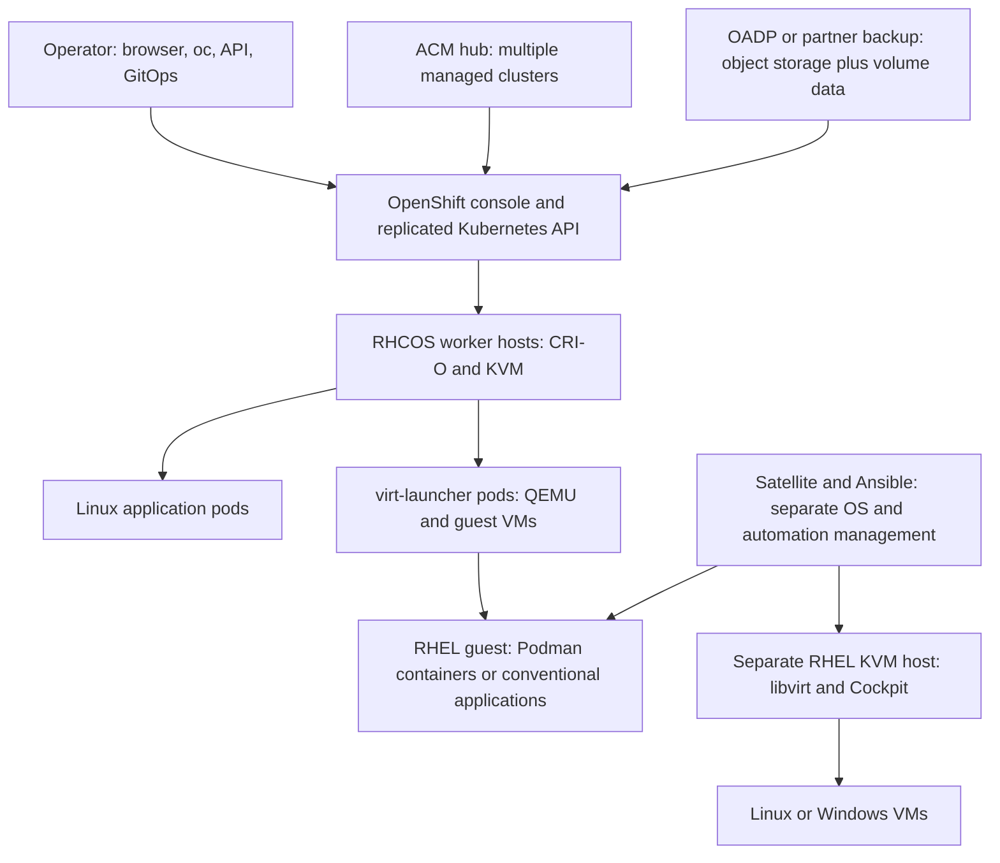

# Red Hat VM and container platform research

Research cutoff and source access date: **2026-10-30**. Request revision:
r1.0.2. Desk research reviewed; deployment-specific qualifications and
unresolved sources are retained below. No deployment or live tests were
performed.

Document revision: **r1.0.1**. Baseline: unversioned `research-rhel.md`
(r1.0.0 for preservation bookkeeping; archived in `99_Archive/`). Review date:
**2026-10-30**; research cutoff unchanged. Review status: independent claim
review recorded in
[research-review-r1.0.1.md](research-review-r1.0.1.md) and
[research-claim-audit-r1.0.1.tsv](research-claim-audit-r1.0.1.tsv); document
checks for this revision are recorded in
[research-verification-r1.0.1.md](research-verification-r1.0.1.md).

## Summary and fit

Red Hat Enterprise Linux (RHEL) supplies Kernel-based Virtual Machine (KVM)
virtualization and Podman application containers. RHEL alone suits individually
managed hosts and small services; it does not provide the integrated Kubernetes
control plane, fleet scheduler, or multi-cluster virtual machine (VM) console of
OpenShift. For mixed workloads, the selected path is bare-metal OpenShift
Container Platform (OCP) 4.22 with matching OpenShift Virtualization 4.22.
OpenShift Virtualization Engine (OVE) is a VM-only commercial alternative; user
application containers require another OpenShift edition. [R1], [R3], [R4].

The OpenShift console controls hosts, VMs and application pods within one
cluster. Advanced Cluster Management (ACM) adds fleet governance, observability
and documented VM operations across clusters. Satellite manages RHEL
operating-system content/provisioning; Ansible Automation Platform (AAP)
automates tasks across products. These management domains remain distinct.
Kubernetes schedules pods and VM launcher pods; application replicas, database
replication and traffic management determine service continuity. Fencing and
accessible persistent storage are essential to safe VM restart after host loss.
[R5], [R6], [R7].

Backup requires separate policies for control-plane configuration, workload
resources, disks and application data. OpenShift APIs for Data Protection (OADP)
and optional partner products cover workloads; an etcd backup covers cluster
configuration. Multicast has documented conditional paths: per-project
OVN-Kubernetes pod multicast and additional Single Root I/O Virtualization
(SR-IOV) pod interfaces. Neither establishes unrestricted multicast between
every VM, container and external LAN endpoint. [R8], [R9], [R10], [R11].

## Verified product baseline

“Latest verified” means the newest generally available (GA) line established by
the cited current source, not an assertion that every architecture/update
channel has an identical newest patch. Use the supported update graph and
current errata before implementation.

**Errata and minor-release cadence (policy reread2026-11-02):** Red Hat does
not publish RHEL package errata on a fixed monthly schedule; qualifying errata
are released as they become available. During Full Support, minor releases are
planned about every six months and include cumulative, qualified errata. The
published release table lists RHEL10.2 and9.8 as the latest minor releases,
both GA on2026-05-19. This describes the base OS cadence; each selected
OpenShift operator or add-on still needs its own supported channel and
lifecycle check. [R59], [R60].

| Product                                    | Release / stack                                                                                                         | Lifecycle / limits                                                                                                                                                                                                                                                                                                                                                                                                   |
| ------------------------------------------ | ----------------------------------------------------------------------------------------------------------------------- | -------------------------------------------------------------------------------------------------------------------------------------------------------------------------------------------------------------------------------------------------------------------------------------------------------------------------------------------------------------------------------------------------------------------- |
| RHEL                                       | **10.2**, GA 2026-05-19; **9.8** is a current parallel major line                                                       | Host/guest OS for path RH1. Ten-year major-release lifecycle is distinct from minor-release Extended Update Support (EUS) rights. RHEL 10.2 container tools document Podman **5.8.2**, Buildah **1.43.1**, Skopeo **1.22.2**; the same notes also contain an earlier "buildah rebased to 1.41.8-1" entry, so check the installed package. Rolling AppStream updates require tracking. [R2], [R12] PDF pp89–90, [R13] |
| OCP                                        | **4.22**, Kubernetes **1.35**, CRI-O **1.35** family; English notes verify **4.22.18** issued Oct19                     | Use bundled Red Hat Enterprise Linux CoreOS (RHCOS), not arbitrary RHEL 10.2 worker installation. A later MicroShift 4.22.20 page cites OCP advisory RHSA-2026:89198; newest OCP erratum needs confirmation because sources lag differently. No4.23/5.0 GA established. [R14], [R15]                                                                                                                                 |
| OpenShift Virtualization                   | **4.22.9**, latest stable named in Oct29 documentation                                                                  | Supported only with corresponding OCP 4.22 and current required patches. KubeVirt uses KVM/QEMU in privileged launcher pods on RHCOS hosts. [R4]                                                                                                                                                                                                                                                                     |
| ODF / ACM / ACS / Quay / OADP              | OpenShift Data Foundation **4.22**; ACM **2.17**; Advanced Cluster Security (ACS) **4.11**; Quay **3.18**; OADP **1.6** | Current Operator lifecycle lists each compatible with OCP 4.22. These are separate release streams; install supported stable channels, not a presumed shared patch number. ODF 4.22 GA Jul9; ACM 2.17 Jun18; ACS 4.11 Jun15; Quay 3.18 Jul29; OADP 1.6 Jun9. [R16]                                                                                                                                                   |
| AAP / Satellite                            | **AAP 2.7** GA; **Satellite 6.19** GA May6                                                                              | AAP automates APIs; Satellite is a separate RHEL estate service. Satellite 6.20 limited-availability announcements and a mislabeled English6.19 page do not establish6.20 GA. Server OS versions must follow each product’s installation matrix, not the RHEL 10.2 workload baseline. [R17], [R18], [R19]                                                                                                            |
| Migration Toolkit for Virtualization (MTV) | **2.12**                                                                                                                | Planning matrix includes OCP/Virtualization4.22,4.21,4.20 and VMware, RHV, OpenStack, Hyper-V source combinations. This is migration, not mixed-vendor continuous management. [R20]                                                                                                                                                                                                                                  |
| Red Hat build of MicroShift                | **4.22**; current page lists **4.22.20**                                                                                | Lightweight single-host edge Kubernetes alternative; select documented RHEL 9.8 compatibility, not an assumed RHEL 10.2 pairing. Does not replace a multi-host OpenShift HA design. [R15], [R21]                                                                                                                                                                                                                     |
| Optional partner backup                    | Veeam Kasten **9.0.9**, Oct22                                                                                           | Current support matrix explicitly lists OCP 4.22/Kubernetes 1.35. Separate vendor entitlement; storage and application hooks still require qualification. [R22]                                                                                                                                                                                                                                                      |

The supported reference combination is **OCP 4.22 with matching Virtualization 4.22
and OADP 1.6**, optionally **ODF 4.22 + ACM 2.17**, on certified x86-64 bare
metal; RHEL 10.2/Podman 5.8.2 run as a separate host/guest path. Exact component
patch selection remains a deployment check. OCP 4.22 is an even-numbered EUS
release; additional EUS terms require qualifying subscriptions. Legacy Red Hat
Virtualization (RHV)4.4 reached the end of its published extended-life period
**2026-08-31** and is excluded as a new-platform baseline. [R4], [R14], [R16],
[R23].

No hardware, workload inventory, host count, budget, sites, entitlement or
multicast application specification was supplied. Assumptions: certified
hardware, Linux OCI application images, redundant networks, supported storage,
commercial support when required. Non-x86 architectures, public-cloud bare metal
and hosted control planes are alternatives with separate matrices. Preview
features, arbitrary nested virtualization, and community plugins are outside the
recommendation. Package license freedom does not confer Red Hat support.

## Architecture and workload support

Statuses in this report are **documented supported** (vendor documents the
path), **conditional** (documented capability subject to stated requirements),
**documented unsupported** (explicit exclusion), and **not verified**
(insufficient applicable evidence). Sources establish facts; statements labeled
*inference*, *recommendation* or *proposed validation* do not establish support.

| Path | Execution path                                                                                                    | K8s / needs                                                                                                    | Status / rights                                                                                                                                                                                                    | Boundaries                                                                                                                                                  |
| ---- | ----------------------------------------------------------------------------------------------------------------- | -------------------------------------------------------------------------------------------------------------- | ------------------------------------------------------------------------------------------------------------------------------------------------------------------------------------------------------------------ | ----------------------------------------------------------------------------------------------------------------------------------------------------------- |
| RH1  | RHEL 10.2 KVM/libvirt host → certified Linux/Windows guest; RHEL 10.2 guest → Podman 5.8.2 / OCI Linux containers | No Kubernetes implied; compatible guest kernel/CPU and certified hardware                                      | **conditional**, Red Hat host and its RHEL tools; guest vendor/application vendor own their layers. RHEL subscriptions per applicable host/guest metric. [R3], [R12], [R24]                                        | Guest certification must be checked; VM boot success does not certify a runtime or application. RHEL guest containers share that guest’s Linux kernel       |
| RH2  | Bare-metal RHCOS/OCP 4.22 → CRI-O 1.35 Linux pods; KVM/QEMU launcher pods → certified guest VMs                   | OCP 4.22 + Virtualization4.22; hardware virtualization, suitable CSI storage and CNI network                   | **documented supported**, Red Hat platform; OKE/OCP/Platform Plus or VM-only OVE. [R4], [R25]                                                                                                                      | RHEL 8/9/10 and Windows Server2016/2019/2022/2025 appear in current certified guest table; OS/app support remains with its provider                         |
| RH3  | RH2 VM with RHEL 10.2 → Podman 5.8.2 containers                                                                   | Guest RHEL support, image/host architecture/kernel compatibility                                               | **conditional**, Red Hat Podman/RHEL; separate application support. OKE/OCP/Plus guide includes applicable RHEL guest rights; OVE requires guest subscriptions. [R1], [R3], [R25]                                  | VM console does not expose each guest container as a Kubernetes workload                                                                                    |
| RH4  | OCP 4.22 Linux control plane + Windows Server2022/2025 compute node → containerd → Windows containers             | Windows Machine Config Operator **10.22.1** release notes; see version caveat in U11 below                     | **conditional**, Red Hat OpenShift support for Windows Containers plus Microsoft OS/app responsibilities. [R26]                                                                                                    | Windows containers require Windows kernel/image compatibility. Windows-node features differ; no automatic Linux-container equivalence; multicast unverified |
| RH5  | RHEL 9.8 host → MicroShift 4.22/CRI-O Kubernetes pods                                                             | Device Edge/MicroShift entitlement and selected supported OS combination                                       | **conditional**, Red Hat product; separately operated edge path. [R15], [R21]                                                                                                                                      | Single host; lacks multi-host HA; not a VM fleet manager                                                                                                    |
| RH6  | RHEL 10 guest/host → Docker Engine or containerd / upstream Kubernetes, RKE2 or other distribution                | Independently qualified third-party stack                                                                      | Docker Engine: **documented unsupported by Red Hat** on RHEL 10; Docker’s own RHEL install path exists. Other runtime/Kubernetes combinations: **not verified** for commercial support in this report. [R3], [R27] | Docker-compatible Podman CLI/API is not Docker Engine. OCP’s supported Linux runtime is CRI-O                                                               |
| RH7  | LXC/LXD system containers on RHEL 10                                                                              | No selected documented Red Hat system-container product                                                        | **not verified**, upstream/third party if independently qualified; not included as supported RHEL system-container management                                                                                      | Historical libvirt-LXC removal is not evidence of every present third-party combination. Use RH1 VMs when full guest kernels are required                   |

OCI images can move between Podman and OpenShift when security, architecture,
entrypoint, storage and network assumptions fit. Linux containers do not supply
a Windows kernel. An OpenShift VM remains a VM, even though Kubernetes
represents it with custom resources.

## Centralized and multi-host management

| Interface                                 | Scope                                                                                           | Actions / tools                                                                                                                                                      | Needs / outage                                                                                                                                                                                                                                                         |
| ----------------------------------------- | ----------------------------------------------------------------------------------------------- | -------------------------------------------------------------------------------------------------------------------------------------------------------------------- | ---------------------------------------------------------------------------------------------------------------------------------------------------------------------------------------------------------------------------------------------------------------------- |
| RHEL web console (Cockpit), libvirt/virsh | Host-oriented service/API; remote access to another host is not a distributed cluster scheduler | VM creation/power/console/storage/network and planned migration; Podman tools/guest console for application containers                                               | Host authentication/privileges and connectivity. Console loss leaves guests running; use another administrative channel. Included RHEL components. [R24], [R28]                                                                                                        |
| OCP console, oc/API                       | Replicated per-cluster control plane; nodes join one cluster and etcd configuration domain      | Host inventory, VM lifecycle/migration/templates/disks/NICs, pod deployments, identities, metrics, Operator and OS updates; guest OS administration remains separate | API/ingress/DNS, role-based access control (RBAC), quorum and supported versions. Browser-console failure does not stop API; API/quorum loss prevents new desired-state operations while existing execution may continue. OCP entitlement. [R4], [R29]                 |
| ACM 2.17 + multicluster engine            | Hub cluster and managed-cluster agents, across clusters/sites                                   | Fleet inventory/search/policy/observability, supported cluster lifecycle and multicluster VM operations; each cluster retains scheduler/HA/storage domains           | Import/onboard clusters with credentials/agents, RBAC and hub connectivity. Hub loss interrupts fleet operations; individual clusters retain local control. ACM subscription or qualifying Platform Plus; third-party Kubernetes scope is matrix-specific. [R5], [R30] |
| Satellite 6.19 + Capsules                 | Central server; Capsules distribute content and provisioning services across sites              | RHEL inventory, content views, patches, provisioning, remote execution and audit; not general Kubernetes/pod desired-state orchestration                             | Separate subscription; RHEL clients, supported server OS, DNS/content connectivity. Server outage delays jobs/content orchestration; running workloads continue. Preserve backups and local access. [R18]                                                              |
| AAP 2.7                                   | Automation controller/platform gateway and execution nodes; jobs reach many vendors’ APIs/hosts | Templates, workflows, credentials, approvals/RBAC, event-driven automation; supported collections determine individual product actions                               | Separate AAP subscription and credentials/content compatibility. Controller/link loss blocks new/ongoing automation according to job connectivity; target workloads are independent. [R17]                                                                             |

The OpenShift API reconciles node onboarding, manifests, storage classes,
network attachments, templates, policies and RBAC. Monitoring and audit records
are cluster-level; centralized logs/security/fleet policy may add Operators or
products. OADP backup resources are administered through Kubernetes APIs and
backup tooling, not an implied universal backup page. RHEL guest updates can use
Satellite/AAP while RHCOS cluster OS updates belong to OpenShift’s Machine
Config/Cluster Version Operators. [R4], [R8], [R29].

For mixed vendors, ACM manages supported Kubernetes resources rather than
arbitrary VMware/Proxmox hypervisor lifecycle. AAP can coordinate
vendor-specific automation; a successful playbook is not a merged
inventory/scheduling/HA domain. MTV imports workloads but does not administer
the source as a permanent destination platform. Platform Plus component rights
generally cover Plus-entitled nodes; managing other clusters can require
separate ACM/ACS rights. [R1], [R20], [R30].

Scale is workload dependent: OCP 4.22 publishes tested maxima including **2,000
nodes** and **150,000 test pods**, with explicit qualifications; these are
neither VM density guarantees nor quantities that can all be reached
simultaneously. Use Virtualization-specific limits and ACM support/sizing
matrices before fleet design. Exact ACM 2.17 maximum cluster count was not
verified. [R31].

**Plain-language answer:** one OpenShift console manages hosts, VMs and
Kubernetes containers in a cluster; ACM extends many fleet operations across
clusters. RHEL-only hosts, guest Podman processes, backup services and
mixed-vendor infrastructure retain separate management responsibilities. Losing
the dashboard does not inherently stop workloads, but losing the authoritative
control plane limits recovery and changes.

## Provisioning and orchestration

| Path/workload      | Provisioning                                                                                                                                                                        | Control / updates                                                                                                                                                           | Manual / rights                                                                                                                                                                                                                            |
| ------------------ | ----------------------------------------------------------------------------------------------------------------------------------------------------------------------------------- | --------------------------------------------------------------------------------------------------------------------------------------------------------------------------- | ------------------------------------------------------------------------------------------------------------------------------------------------------------------------------------------------------------------------------------------ |
| RH1 KVM VM         | Cockpit/virt-install/libvirt create disk/network/CPU configuration from ISO/image; cloud-init or OS installer initializes guest                                                     | libvirt manages VM state; virsh migration; AAP can automate repeatable tasks                                                                                                | Administrator chooses host/storage/capacity and guest updates; no automatic cluster HA without separately engineered HA stack. RHEL; AAP optional. [R24], [R28]                                                                            |
| RH1/RH3 Podman app | Buildah/Podman build/pull image; mount volumes, attach network, configure secrets; systemd Quadlet starts container                                                                 | systemd restart/health/update policies and Podman API; RHEL system roles/AAP automate many hosts                                                                            | No fleet scheduler/replica placement; administrator supplies cross-host recovery, load balancer and data protection. [R3], [R32]                                                                                                           |
| RH2 VM             | Console/template/instance type or declarative VirtualMachine resource; Containerized Data Importer imports/clones disk into PVC; cloud-init and network attachment initialize guest | Kubernetes schedules launcher; Virtualization controllers enforce runStrategy and migration policy; GitOps/AAP can manage manifests                                         | Hardware, storage class, CPU compatibility and failure fencing are operator design. Guest patching and application consistency remain separate. OpenShift edition + optional companions. [R4], [R33]                                       |
| RH2 Linux app      | Install/provision cluster first; deploy image/manifests, Secrets, Services, Routes and PVCs through console/oc/API                                                                  | Deployment/StatefulSet/Operators reconcile pods; replica/HPA rules scale apps; Machine API/autoscaler scale supported infrastructure; GitOps controls desired configuration | Bare-metal capacity procurement/onboarding and application/database operations remain operator tasks; HPA needs metrics and suitable workloads. OKE core runtime versus OCP developer tools; GitOps/Pipelines where entitled. [R29], [R34] |

**VM workflow (RH2):** operator selects a certified guest/template, imports a
boot disk to a supported storage class, sets CPU/memory, network attachments,
cloud-init credentials and runStrategy, then applies a VirtualMachine resource.
The scheduler places its launcher pod. Monitor guest-agent/VM/application
health; patch the guest through its tools and the host through OpenShift.
Schedule OADP/partner backups with quiescing. For maintenance, drain/evacuate
only migratable VMs; for failed hosts, safe fencing precedes restart elsewhere
and volume reattachment. Retire the VM after application shutdown, deliberately
deciding whether to retain/delete PVCs, snapshots, backups, DNS and credentials.
[R4], [R7], [R8], [R33].

**Container workflow (RH2):** provision supported cluster/storage/network first;
build and scan an image, store it in a registry, apply a Deployment/StatefulSet
with resource requests, Secrets, replicas, readiness probes, Service/Route and
PVCs. Kubernetes places pods; GitOps reconciles approved manifests, Operators
manage supported application lifecycle, and rollout settings govern
updates/rollback. OADP/partner policies protect resources and data using
application hooks. A failed node causes replacement pods only when storage,
scheduling and control plane permit; Service endpoints follow ready
replacements, while databases need their own replication/recovery. Retirement
removes application resources intentionally; preserve required PVCs/backups
under policy and revoke secrets. [R8], [R29], [R34].

Podman `kube play` consumes selected Kubernetes YAML; it is not a Kubernetes
control plane. Kubernetes rolling replacement of an application pod and live
migration of a VM solve different problems. Application rollbacks may also
require database schema and data rollback planning.

## Networking and multicast

RHEL KVM commonly gives guests a libvirt virtual network or Linux bridge; a LAN
bridge is a different deployment from default NAT. Podman 5.8 uses Netavark,
with pasta for rootless default networking; old CNI tutorials are not the RHEL
10 baseline. OpenShift 4.22 uses the OVN-Kubernetes overlay by default; Multus
adds secondary networks, while NMState configures host interfaces/bridges.
SR-IOV requires supported hardware and its Operator. Layer2 user-defined
overlays and physical localnet/bridge attachments are different paths. [R12],
[R24], [R35].

The matrix evaluates **application** traffic. Platform discovery, IPv6 neighbor
discovery or an internal fabric’s use of multicast is not proof of application
group support. “Same/cross/external” identifies physical-host scope; every row
requires a sender and receiver actually joined to the same applicable
group/network.

| Path / endpoints                                                                 | Scope                                                                                        | IPv4                                                                                                    | IPv6                                                                                                | Needs / evidence                                                                                                                                                                                                                                                                                                                          |
| -------------------------------------------------------------------------------- | -------------------------------------------------------------------------------------------- | ------------------------------------------------------------------------------------------------------- | --------------------------------------------------------------------------------------------------- | ----------------------------------------------------------------------------------------------------------------------------------------------------------------------------------------------------------------------------------------------------------------------------------------------------------------------------------------- |
| RH1 KVM VM ↔ VM through a LAN-attached Linux bridge                              | Same host; cross host; external LAN within VLAN                                              | **conditional**                                                                                         | **conditional**                                                                                     | RHEL documents guest LAN bridge; upstream Linux bridge documents IGMP/MLD snooping. End-to-end multicast forwarding is a **technical inference**, not a Red Hat application guarantee. Red Hat host + guest vendor + network owner. Check bridge multicast database, switch snooping/querier, VLAN, NIC/filter and firewall. [R24], [R36] |
| RH1 VM ↔ VM behind libvirt NAT; VM/container ↔ external LAN through NAT          | Same host versus routed boundary                                                             | Same-host feasibility **conditional**; external path **not verified**                                   | Same-host feasibility **conditional** if configured; external path **not verified**                 | No multicast router/proxy established by default address translation. Do not infer routable groups from unicast NAT success. Guest/container namespace adds another boundary. [R24]; inference                                                                                                                                            |
| RH1/RH3 Podman rootless pasta; rootful Netavark bridge                           | Container ↔ container in same guest/host; cross guest/host; external LAN                     | **not verified** as an end-to-end external-LAN multicast solution; local feasibility depends on network | **not verified**                                                                                    | Supported runtime/network modes do not establish group forwarding across pasta/NAT. Old RHEL 8/9 rootless multicast support article is gated and not applied to RHEL 10.2. [R3], [R37], unresolved source U1                                                                                                                              |
| RH1/RH3 Podman `--network=host`                                                  | Container ↔ VM application in same guest OS; containers in different VMs/hosts ↔ LAN         | **conditional**, technical inference                                                                    | **conditional**, technical inference                                                                | Container shares its execution OS network namespace; in a VM that means the **guest**, not the physical host. Requires guest NIC/bridge/physical network multicast, OS membership/firewall and security acceptance. Supported mode; complete app path not vendor-certified here. [R38]                                                    |
| RH1/RH3 rootful Podman macvlan                                                   | Container ↔ container across hosts or external LAN; host ↔ its own macvlan container differs | **conditional**, technical inference                                                                    | **not verified** end-to-end                                                                         | RHEL documents rootful physical-network attachment and host isolation; rootless macvlan is **documented unsupported**. VM-backed macvlan adds hypervisor multiple-MAC/filter prerequisites. No generic IPv6 multicast endorsement. [R3]                                                                                                   |
| RH2 Linux pod ↔ pod on default OVN-Kubernetes 4.22                               | Same physical host / cross physical hosts **within enabled project**                         | **documented supported**, conditional configuration                                                     | **not verified** by applicable family-specific evidence                                             | Red Hat: enable namespace multicast annotation; off by default; intended for low-bandwidth coordination. UDP4 vendor test establishes IPv4 path. It bypasses namespace NetworkPolicy filtering, including deny-all; assess isolation separately. [R10]                                                                                    |
| RH2 default-overlay pod ↔ external LAN / VM on a different network               | Same host is insufficient; cross-host/external boundary                                      | **not verified**                                                                                        | **not verified**                                                                                    | Per-project pod multicast does not document LAN bridging/routing or all VM interface bindings. Services/Routes are not multicast gateways. [R10], [R35]; inference                                                                                                                                                                        |
| RH2 additional SR-IOV pod interface ↔ another VF pod or external LAN participant | Same host / cross host / physical LAN according to NIC and fabric topology                   | **documented supported** capability, **conditional** selected hardware/topology                         | **not verified** family-specific end-to-end support                                                 | Red Hat documents high-performance multicast and sending/receiving through additional interface; physical fabric decides routing. Configure membership, supported VF/all-multicast/tuning settings, NIC drivers and switch rules. No entitlement to arbitrary NIC behavior. [R11]                                                         |
| RH2 VM ↔ VM / pod ↔ VM on secondary Linux bridge/localnet or SR-IOV attachment   | Same host, cross host and external VLAN                                                      | **conditional**, end-to-end technical inference                                                         | Network attachment supports IPv6 in documented combinations; application multicast **not verified** | Red Hat documents VM secondary networks and single-stack IPv6 for localnet, Linux bridge and SR-IOV. That is not explicit multicast certification for every endpoint pairing. Validate same LAN/VLAN and filters. Passthrough may restrict live migration. [R35]                                                                          |
| RH4 Windows containers; RH5 MicroShift; community CNI                            | Any requested scope                                                                          | **not verified** for full application path                                                              | **not verified**                                                                                    | WMCO/containerd or MicroShift multicast-DNS support does not establish arbitrary groups, multicast routing, or cross-host multicast. Obtain product-specific confirmation before selection. [R21], [R26]                                                                                                                                  |

For Layer2 multicast, check Internet Group Management Protocol (IGMP) for IPv4
and Multicast Listener Discovery (MLD) for IPv6 at the endpoint, virtual
bridge/NIC and physical switch. Snooping without an effective querier can age
memberships out. Routed multicast requires appropriately configured routers,
routing protocol/proxy, source/group policy and sufficient TTL/hop limit;
neither a VLAN trunk nor Kubernetes unicast routing provides this automatically.
Source-specific groups, multicast address scope, firewalls and guest offload/NIC
filtering must match the application. These are network design conditions, not
tested findings. [R36].

**Conclusion:** for low-bandwidth IPv4 pod-to-pod traffic in one project,
enabled OVN-Kubernetes is a documented path. For physical LAN participants or
higher-bandwidth pod traffic, the documented SR-IOV additional-interface path is
the strongest candidate, conditional on supported NIC/fabric and application
requirements. A RHEL VM LAN bridge plus host-network Podman is a simpler
engineering candidate, with explicit inference/support qualification. No
universal external-LAN or IPv6 multicast recommendation is established by the
sources.

**Proposed validation, not executed:** record groups, ports, IPv4/IPv6,
source-specific versus any-source membership, throughput, loss/rejoin tolerance
and subnets. Place instrumented sender/receivers (1) in same-host VMs/pods, (2)
on separate hosts and (3) on external LAN; test both sending directions and
VM-to-container pairing. Inspect `ip maddr`, IGMP/MLD captures, bridge multicast
database and switch membership/querier state; capture at container/guest NIC,
tap/OVS/VF, uplink and external receiver. Repeat across routed subnet if needed.
Test leave/rejoin, deny policy expectations, migration, host restart, fencing
and pod rescheduling; record packet loss, rejoin behavior and address changes
against the application’s acceptance criteria. Test physical multicast after
every materially different network path rather than extrapolating from one
success.

## Availability, failover, and maintenance

OpenShift’s replicated control plane and storage/network resilience protect
infrastructure. They do not keep a single in-memory guest process executing
after its CPU host disappears. A VM restarts after safe remediation; a
Deployment creates replacement pods. Continuous service generally requires
multiple healthy application instances, stable endpoints/load balancing, and
consistent replicated state. [R7], [R29].

Minimum and recommended topology differ. Single-node OpenShift Virtualization is
supported but lacks HA/live migration. The documented HA topology requires three
control-plane nodes; multiple workers are necessary for migration, with three
workers recommended. A compact three-node cluster is a documented installation
alternative but has different capacity/failure-domain tradeoffs.
**Recommendation:** reserve capacity for one failed/drained node, spread
replicas/control plane/storage failure domains, use redundant links/power and
test storage quorum; these are design recommendations, not blanket minimums.
[R39], [R40].

| Event / layer                              | Recovery                                                                                                                                                                                   | Needs / rights                                                                                                                                                                                    | Impact / failback                                                                                                                                                                                                                                 |
| ------------------------------------------ | ------------------------------------------------------------------------------------------------------------------------------------------------------------------------------------------ | ------------------------------------------------------------------------------------------------------------------------------------------------------------------------------------------------- | ------------------------------------------------------------------------------------------------------------------------------------------------------------------------------------------------------------------------------------------------- |
| Pod process or guest-container failure     | Kubelet restart policy and controllers recreate pods; Podman/systemd restarts configured units. Application probes affect readiness                                                        | Correct probes/policies; app replicas, data store and resource capacity; RHEL/OpenShift entitlement                                                                                               | Process state may be lost. Local restart is not cross-host HA. Roll back bad image/config deliberately; application operator handles data repair. [R3], [R29], [R32]                                                                              |
| VM OS/application failure                  | VM runStrategy/controllers can restart VM; guest/service monitor or application cluster detects faults inside guest                                                                        | Guest agent/monitoring and configured policies; application licenses/support separate                                                                                                             | OS reboot/application recovery interrupt single-instance service; guest app failure need not look like VM failure. Failback follows app recovery policy. [R4], [R33]                                                                              |
| Worker host crash or partition             | Node Health Check detects configured unhealthy conditions; Fence Agents Remediation (FAR), Self Node Remediation or supported provider safely remediates, then VM restarts/pods reschedule | Safe fencing, supported platform, healthy control-plane quorum, spare resources, storage access. Current docs require FAR for hyperconverged storage; reachable management interface. [R7], [R41] | No live migration from dead host. Single VM loses memory state; replicas may preserve service if designed. Recover and verify failed node before returning it; optional manual placement/migration, no inherent automatic return to original host |
| Storage failure                            | CSI/storage cluster detects; replication/multipath may maintain access; restore if data lost                                                                                               | Storage-specific quorum, replica placement, supported driver; ODF or external-storage entitlement                                                                                                 | Unavailable volume can prevent restart even when compute is healthy. Resynchronize/validate data before failback; replication alone is not backup. [R42]                                                                                          |
| Network path failure                       | Bonding/routing/load balancing and readiness endpoints can redirect traffic; partition can require fencing                                                                                 | Redundant supported fabric, API/ingress/DNS paths and multicast membership restoration                                                                                                            | Existing connections may break. Application sessions/retries and group rejoin are application responsibilities. Repair link, verify routes/membership, then return traffic. [R35], [R41]                                                          |
| Console, ACM hub, API/control-plane outage | Console-only outage allows CLI/API; ACM hub loss leaves local clusters; etcd majority needed for writes and reconciliation                                                                 | Distributed control plane/etcd quorum, backups, independent access; ACM separately entitled                                                                                                       | Existing execution may continue, but provisioning/scheduling/failover automation can be impaired. Restore connectivity/quorum; recover etcd only using supported procedure. [R5], [R9], [R29]                                                     |
| Planned host maintenance                   | Cordon/drain; eligible VMs live migrate, pods roll/reschedule under disruption budgets; cluster Operators roll OS updates                                                                  | Shared RWX storage, compatible CPU, bandwidth, spare memory; passthrough/local disks can prevent migration                                                                                        | Live migration preserves VM execution with constraints; pod replacement restarts process. Unmigratable VM may require shutdown. Uncordon repaired node after checks; placement return is policy/operator controlled. [R28], [R43]                 |
| Entire site loss                           | Site DR plan activates remote data/workloads or restores backups, with DNS/LB cutover                                                                                                      | Second site/cloud, surviving identity/DNS/registry/storage/backup services; ODF DR/ACM or partner tooling and entitlements                                                                        | Distinct from local HA. RPO follows replication/backup consistency and lag; failback requires fence-old-primary, reverse replication/restore and planned traffic cutback. [R44]                                                                   |

**Host-failure walkthrough:** on RH2 a node stops reporting; configured health
detection and fencing establish that it cannot continue writing. Virtualization
controllers restart an eligible always-running VM on surviving capacity and
reattach its accessible PVC; the guest boots and applications recover.
DNS/Service/load-balancer readiness or LAN identity must direct traffic to the
recovered instance. For a container app, a controller creates a replacement pod;
CSI must attach/mount state, startup/readiness gates traffic, and database
replication/leader election decides safe promotion. An existing replica may keep
serving, but this is application-specific. A physical multicast interface needs
valid placement, NIC resources and new membership registration. [R7], [R29],
[R41].

RHEL-only KVM can use the **separate High Availability Add-On**
(Pacemaker/Corosync, fencing, VirtualDomain resource) for a deliberately
designed cluster; it is not enabled by installing libvirt. Storage/quorum design
and supported resource-agent use are required; two-node and witness arrangements
must follow that stack’s guidance. [R45].

Recovery time objective (RTO) is the acceptable service-recovery duration;
recovery point objective (RPO) is acceptable lost data/time. Detection timers,
fencing, available capacity, storage attach, guest boot and application recovery
all affect RTO. Replication lag, write acknowledgment and backup
interval/consistency affect RPO. No measured RTO/RPO or zero-loss guarantee is
claimed. Fault-tolerant continued VM execution comparable to a separately
licensed lockstep facility was **not verified**; live migration and restart
should not be described that way.

## Backup, restore, and disaster recovery

Snapshots retain a point in a storage system; replication supplies another
current copy; HA restarts execution; backups preserve independent recoverable
versions; disaster recovery coordinates an alternate environment. Each solves a
different failure mode.

| Layer/path                  | Tool / content                                                                                                                                     | Copies / retention                                                                                                                                                      | Restore / gaps                                                                                                                                                                                                                 |
| --------------------------- | -------------------------------------------------------------------------------------------------------------------------------------------------- | ----------------------------------------------------------------------------------------------------------------------------------------------------------------------- | ------------------------------------------------------------------------------------------------------------------------------------------------------------------------------------------------------------------------------ |
| RHEL host / RH1 KVM         | OS/configuration backup plus disk and libvirt XML protection; shut down/quiesce or use a qualified backup product                                  | Administrator-managed backup repository/retention and independent off-site copy                                                                                         | Rebuild host, restore definitions/disks then guest; raw disk copy during writes is not application-consistent. RHEL supplies virtualization tools, not an inferred enterprise backup service. [R24], [R45]                     |
| Podman RH1/RH3              | Image/build/Quadlet/configuration/secrets plus bind mounts/volumes and native database backup                                                      | Registry preserves image, separate repository protects data; schedule, retain and protect keys externally                                                               | Recreate unit/container then restore data/permissions/SELinux labels; container export/image save does not include all attached persistent data. Guest backup must be coordinated. [R3], [R32]                                 |
| OCP control plane           | Supported etcd backup captures cluster state/configuration and static pod resources; does not capture all application volume contents              | Scheduled/manual backup per documented release/support status; off-cluster protected copy, retention and encryption keys                                                | Supported same-version control-plane recovery; recreate dependencies/Operators as required. OADP explicitly does **not** provide full-cluster/etcd/Operator DR. [R9], [R46]                                                    |
| RH2 VM snapshot             | VirtualMachineSnapshot plus CSI-supported disk snapshots; guest agent freeze/thaw hooks for qualified app consistency; otherwise crash consistency | Storage backend, not inherently independent/off-site or immutable                                                                                                       | Stop VM and restore configuration/PVCs from snapshot; not every volume/device state is captured. RAM continuity is not backup recovery. [R8]                                                                                   |
| RH2 VM / Kubernetes app     | OADP 1.6: resources, selected PVC data/internal images via Velero plugins/CSI snapshots/data mover; hooks for application consistency              | Supported object storage and CSI/data-mover destinations; Schedule/retention policy; off-site replication and object-lock compatibility must be engineered and verified | Restore resources/selected namespace/volumes and VM; dependencies, CRDs, cluster services, external databases and credentials require recovery order. Snapshot-only protection may stay in source failure domain. [R46], [R47] |
| Optional partner protection | Kasten 9.0.9 on OCP 4.22: application/VM policy protection, integration-specific hooks/export and restore                                          | Partner-supported storage/object export; choose independent off-site/immutable destination and key custody                                                              | Separate subscription/support. Verify CSI/app support and file/VM recovery behavior; incremental changed-block-tracking preview is excluded from baseline guarantees. [R22], [R48]                                             |
| Site recovery               | ODF DR with ACM/ODF/Ceph components, or partner restore-based recovery                                                                             | Metro/Regional topology and replication-specific data paths; backups retained independently                                                                             | Application failover/relocate, storage promotion and traffic cutover. Advanced DR entitlement and compatible sites are separate from base Essentials storage. [R44], [R49]                                                     |

**VM restore:** operator chooses a clean restore point, confirms guest
quiesce/application hooks and included disks, restores VM resource and PVCs
through OADP/partner workflow, checks storage/network mappings, then starts VM
in isolation and validates the application before enabling production traffic.
With snapshot restore, stop the VM first. Do not start a restored second writer
against shared production data. [R8], [R47].

**Persistent application restore:** rebuild or select a compatible target
cluster, storage classes, Operators/CRDs and namespace dependencies; restore
secrets/resources and data through OADP/partner/native database tools; hold
workload startup as needed for consistency, validate state and services, then
redirect ingress. A backup of VMs that happen to host Kubernetes is insufficient
evidence of complete, application-consistent cluster recovery. [R46].

**Site recovery order (recommendation):** recover network/DNS/time/identity/key
services and backup access, then cluster/control plane/registry and storage,
then Operators/configuration, database/stateful tiers, applications and ingress.
ODF Metro-DR and Regional-DR use different synchronous/asynchronous storage
designs and require documented topology, fencing and orchestration. Failback
needs a controlled relocate/reverse-replication process with verified data
authority. Backup-based recovery’s RPO follows last usable backup; asynchronous
replication can lose unreplicated writes. Product-specific zero-data-loss
wording is not adopted as an end-to-end application guarantee. [R44], [R49].

Backup formats/manifests are not universally portable: storage classes, CSI
snapshots, guest firmware/drivers, network attachment definitions, Secrets and
Operator versions can bind recovery to a platform. Preserve declarative
configuration, application-native data exports and independently tested restore
procedures. This report does not verify any default immutability setting or
actual restore.

## Other capabilities and operations

| Area                  | RHEL host/guest path                                                                              | OpenShift path                                                                                                                  | Material tradeoff                                                                                                                                                                                       |
| --------------------- | ------------------------------------------------------------------------------------------------- | ------------------------------------------------------------------------------------------------------------------------------- | ------------------------------------------------------------------------------------------------------------------------------------------------------------------------------------------------------- |
| Compute/hardware      | KVM/libvirt CPU/memory/NUMA/passthrough on supported host/guest hardware                          | Kubernetes resource requests/limits, VM instance types, placement/anti-affinity and qualified device Operators                  | CPU compatibility affects migration; GPU/NIC passthrough can constrain evacuation. Check certified hardware and virtualization limits; no benchmark comparison inferred. [R4], [R24], [R33]             |
| Storage               | Guest disk images/block storage, operator-managed file systems and backup                         | CSI StorageClasses/PVCs; external certified array or separately entitled ODF, snapshots/clones                                  | Local storage simplifies deployment but binds data to a failure domain; RWX/migration and fencing must be validated. [R42], [R43]                                                                       |
| Identity/security     | Linux permissions, SELinux, sudo, Identity Management/AD integration, firewall and signed updates | OAuth/external identity, RBAC, service accounts, Security Context Constraints, network controls and audit                       | Cluster administrators control powerful VM/pod APIs. Guest and application security remain separate; host-network containers and multicast policy exemption require explicit design. [R3], [R10], [R29] |
| Updates/lifecycle     | DNF, image mode/bootc, Satellite content views and Ansible system roles                           | Cluster Version/Machine Config Operators and Operator Lifecycle Manager; GitOps app configuration                               | Coordinate guest/container-image/host/Operator upgrade schedules; latest individually released components are not automatically compatible. [R12], [R16], [R18]                                         |
| Monitoring/automation | Cockpit, logs/metrics agents, Podman/libvirt APIs, AAP                                            | Cluster monitoring/alerts, VM metrics, optional logging/network observability/ACS/ACM, oc/REST/GitOps                           | Multi-cluster visibility does not create one scheduling domain or replace application telemetry. Qualified IaC provider/collection versions must match target APIs. [R5], [R17], [R29]                  |
| Operational effort    | Fewer control-plane components; more manual placement and cross-host integration                  | Integrated desired-state platform for both pods and VMs; larger control-plane, registry, CSI/CNI and upgrade skill requirements | Conditional qualitative assessment; no staffing/TCO or density estimates are justified without inventory                                                                                                |

RHV migration requires reworking storage/network/identity/backup operations into
Kubernetes resources, not merely importing disks. MTV supports mappings and
migration plans for documented sources; guest conversion, drivers, firmware,
licensing, downtime/cutover and rollback still require application-specific
testing. Cross-cluster live migration is documented in4.22 but requires the
specific migration network/MTV/provider configuration; it is not generic live
migration from every external hypervisor. [R20], [R43].

## Licensing, subscriptions, and support

Open-source component licenses, subscription rights and commercial support are
distinct. RHEL packages retain their individual open-source licenses; Red Hat
subscriptions provide content/services and support according to terms. Community
KVM/Podman/KubeVirt/OKD are not interchangeable Red Hat production entitlements.
Higher support tiers change coverage rather than automatically adding product
features. [R50], [R51].

| Offering                                       | Capabilities                                                                                                             | Rights / support                                                                                                                                                                                                                                                                                                                                                                               |
| ---------------------------------------------- | ------------------------------------------------------------------------------------------------------------------------ | ---------------------------------------------------------------------------------------------------------------------------------------------------------------------------------------------------------------------------------------------------------------------------------------------------------------------------------------------------------------------------------------------- |
| RHEL Server Self-support / Standard / Premium  | RHEL OS/KVM/Podman; support level alternatives, not three virtualization feature editions                                | Server model commonly2 sockets or2 virtual nodes per subscription; validate SKU. Self-support entry is physical-only, unstackable, no Red Hat technical cases and not intended for production. Standard business-hours support; Premium24x7 for severity1/2, business hours for severity3/4. Updates/content while subscribed. OpenShift/enterprise backup are separate. [R50], [R51]          |
| RHEL for Virtual Datacenters                   | Unlimited RHEL guests on subscribed hypervisor hosts                                                                     | Physical socket-pair coverage and virtualization reporting; does not license VMware or Kubernetes. Qualify all potential migration hosts and support level. Quote required. [R50]                                                                                                                                                                                                              |
| No-cost Developer Subscription for Individuals | RHEL for individual development/test and permitted small production                                                      | Up to16 physical/virtual systems; individual terms, self-support, not enterprise support or an unrestricted organization-wide free tier. [R52]                                                                                                                                                                                                                                                 |
| OVE                                            | VM management on bare metal                                                                                              | Per bare-metal node only; no end-user app-container entitlement except qualified infrastructure workloads. RHEL guest rights separate. Operator table lists OADP, MTV, OpenShift Virtualization and node remediation as included; DR Hub/Cluster Operators are Platform Plus only. Changing entitlement to OKE/OCP/Plus does not require cluster redeploy. Quote required. [R1] pp7, 15, 28–29 |
| OpenShift Kubernetes Engine (OKE)              | Kubernetes runtime and included Virtualization for VMs+containers                                                        | Core-pair or eligible bare-metal node; Standard/Premium. Less developer tooling than OCP. Confirm guest/VM/container counting under selected model. Quote required. [R1], [R53]                                                                                                                                                                                                                |
| OCP                                            | OKE plus application platform/developer lifecycle features                                                               | Same eligible measurement alternatives; RHEL guest entitlement per current guide, not general standalone infrastructure RHEL rights. Satellite/ODF/ACM/ACS/AAP generally separate. Quote required. [R1], [R53]                                                                                                                                                                                 |
| Platform Plus                                  | OCP plus ACM, ACS, Quay and ODF Essentials                                                                               | Component scope restricted by bundle terms; current guide limits included ODF Essentials to256TB per cluster and Plus available for x86 clusters. DR/greater storage entitlement separately confirm. Quote required. [R1], [R53]                                                                                                                                                               |
| ODF Essentials / Advanced                      | Storage; Advanced adds DR/security/deployment options relative to Essentials                                             | Separate product or qualifying bundle; metrics/capacity/usage need quote. Public detailed subscription PDF is Aug2024: treat exact Advanced terms as procurement confirmation, corroborate current availability via4.22 catalog/2026 OpenShift guide. [R49]                                                                                                                                    |
| Separate companions                            | ACM, ACS, Quay, Satellite, AAP, Device Edge/MicroShift, RHEL High Availability/Resilient Storage, EUS and partner backup | Product-specific metric, term and supported integration; not gained merely by installing an Operator. AAP counts managed-node entitlements under selected contract; obtain current scope/price. [R16], [R17], [R45], [R50]                                                                                                                                                                     |

OpenShift product types cannot be mixed within one cluster: every node is
subscribed as OVE, OKE, OCP or Platform Plus, although core-pair and node
subscriptions of that one type may be combined. A cluster cannot host VMs on
OVE nodes and containerized applications on Platform Plus nodes; a split
requires separate clusters or one product type for the whole cluster. [R1] p7.

Self-managed OpenShift’s core-pair definition is2 physical cores or4 vCPUs;
bare-metal node subscriptions are per physical server and cannot span servers.
Control-plane/infrastructure treatment and VM-hosted container rights depend on
documented workload use. A separate AI accelerator metric appears in the current
guide; do not silently apply historical core-only sizing to accelerator
workloads. Standard8x5 and Premium24x7 options apply to OpenShift; confirm
severity/response terms in the contract. [R1].

**Published price evidence:** the US-dollar Red Hat web-store page
accessed2026-10-30 lists **one-year** RHEL Server SKUs **RH00005 Self-support
US$383.90**, **RH00004 Standard US$878.90**, **RH00003 Premium US$1,428.90**. It
also lists separate Standard add-on selections including High Availability
US$438.90 and Extended Update Support US$273.90. These are the displayed US
storefront SKU selections, excluding unverified taxes/discounts and not a
complete cluster quote; verify exact physical/virtual quantity and regional
purchase eligibility. No OpenShift/complete-stack list price was verified:
**quote required**. [R51].

Guest Windows licenses/support, storage arrays, switches, off-site object
storage, partner backup, application/database rights and integration support may
add costs. Without workload/core/node/socket counts, storage capacity, sites and
retention, no total cost is calculated.

## Modules, add-ons, and integrations

Coverage was established against Red Hat’s current products catalog and
OpenShift Operator lifecycle inventory, supplemented by product and subscription
documentation. An Operator’s presence in the catalog does not establish
entitlement. The following is the relevant first-party inventory; “conditional”
requires the selected product/version/platform matrix and active entitlement.
Components not selected for the reference stack are identified as alternatives,
not silently assumed deployed. [R16], [R54].

| Product/module                                                                                    | Capabilities / needs                                                                                    | Rights / support                                                                                                                                                                                                                                                                                                                                                                           |
| ------------------------------------------------------------------------------------------------- | ------------------------------------------------------------------------------------------------------- | ------------------------------------------------------------------------------------------------------------------------------------------------------------------------------------------------------------------------------------------------------------------------------------------------------------------------------------------------------------------------------------------ |
| RHEL KVM/libvirt/Cockpit, Podman/Buildah/Skopeo, system roles, image mode                         | Hypervisor/host tools, application containers, image build/distribution and repeatable OS configuration | First party included RHEL components; **documented supported** for documented use. Not a Kubernetes fleet scheduler. [R3], [R12], [R24]                                                                                                                                                                                                                                                    |
| RHEL High Availability, Resilient Storage, Extended Update/Life support; real-time offerings      | Pacemaker/fencing, qualifying shared storage, lifecycle extension or latency-specific kernel            | First party separate add-ons/qualified RHEL offerings; **conditional**. Availability varies by OS/release and contract, not inferred from RHEL base. [R45], [R50]                                                                                                                                                                                                                          |
| OpenShift Virtualization / MTV 2.12                                                               | VM custom resources, KVM/QEMU launchers, disk import/clone; external-source migration                   | Virtualization included in current self-managed editions; MTV applicable OpenShift entitlement; **conditional**, current matching minor/guest/source matrices. [R4], [R20]                                                                                                                                                                                                                 |
| Multicluster engine / ACM 2.17 / hosted control planes                                            | Cluster lifecycle; ACM policy/search/observability/VM fleet operations; decoupled hosted control planes | First party. MCE capabilities included where documented, ACM separate or Plus. Hosted control planes have hosting/hosted-version/platform constraints; not implicit fault isolation. **conditional**. [R5], [R16], [R30]                                                                                                                                                                   |
| Satellite 6.19, Lightspeed services / AAP 2.7                                                     | OS content/provisioning/advisory and broad API/host automation                                          | First party, Satellite/AAP separate subscriptions or specific bundle. Lightspeed service scope differs by product. Certified collection support differs from Galaxy community content. **conditional**. [R17], [R18], [R55]                                                                                                                                                                |
| ODF 4.22, Multicloud Object Gateway, OpenShift DR Operators; external Ceph Storage                | Persistent block/file/object storage, data mobility and qualified Metro/Regional DR                     | First party separate ODF/Ceph/ACM rights or limited Plus Essentials; Advanced for qualified DR. Exact Ceph release/topology for a selected DR design must be checked; no standalone Ceph deployment selected. **conditional**. [R42], [R44], [R49]                                                                                                                                         |
| OADP 1.6, CSI snapshots/data mover; etcd protection                                               | Workload data/resource protection versus control-plane recovery                                         | First-party Operators/tools with separate storage services; **conditional** support/edition. The January 2026 subscription guide lists OADP as included for OVE, OKE, OCP and Plus ([R1] p29). The Operator life-cycle page names only OKE/OCP/Plus, but it names OVE for no Operator at all, so this is not a conflicting exclusion. Confirm in the order. [R1], [R8], [R9], [R16], [R46] |
| OVN-Kubernetes, Multus, NMState, SR-IOV, MetalLB, network observability / observability Operators | Primary/secondary networking, physical attachments, load balancing and flow/metrics inspection          | First-party supported Operators/components with release/hardware limits; distinguish app UDP multicast from IP-failover internals. **conditional**. [R10], [R11], [R16], [R35]                                                                                                                                                                                                             |
| ACS 4.11, Quay 3.18, Compliance Operator, logging/monitoring and secrets-store integrations       | Security policy/scanning, registry, configuration compliance, telemetry and external secrets            | First-party core/optional components; ACS/Quay separately or Plus as entitled; external key/identity/storage services separate. **conditional**, not evidence of universal VM application scanning. [R16], [R53]                                                                                                                                                                           |
| OpenShift GitOps, Pipelines, Builds, Service Mesh, Serverless; Developer Hub/Dev Spaces           | Application deployment/build/delivery, traffic and developer experience                                 | First party, selected by edition/product terms; not all OKE/OVE entitlements include all OCP tooling. Current per-Operator channel compatibility required; versions not independently selected here. **conditional** inventory, not a claimed installed stack. [R16], [R53], [R54]                                                                                                         |
| Windows support/WMCO 10.22.0; Device Edge/MicroShift 4.22                                         | Windows compute/container support; small edge Kubernetes                                                | First-party separate/qualified offering; Microsoft OS license and platform restrictions; no arbitrary multicast/HA equivalence. **conditional**. [R15], [R21], [R26]                                                                                                                                                                                                                       |
| OpenStack Services on OpenShift; ROSA, Azure Red Hat OpenShift, OpenShift Dedicated/IBM Cloud     | Alternative private-cloud infrastructure/service delivery or managed public-cloud platform              | First-party/partner catalog alternatives, separate subscription/cloud charges. Not deployed in reference stack; full versions, cloud LAN multicast and cloud virtualization limitations are **not verified** here. Bare-metal VM path is not portable by assumption. [R54]                                                                                                                 |
| Veeam Kasten 9.0.9; certified storage/CSI, NVIDIA GPU/network Operators                           | Kubernetes/VM backup and qualified hardware/storage gaps                                                | Third-party integration, separate contract; Kasten 4.22 matrix verified. Specific hardware/array versions need vendor certification. **conditional**. Veeam backup architecture PDFs retained as context, current support comes from live matrix. [R22], [R48]                                                                                                                             |

For **simple supported Linux services**, choose RHEL 10.2 + Podman 5.8.2 +
systemd plus an explicitly designed backup target; add RHEL HA/AAP only if the
operational requirement justifies them. For **VM-only fleet**, OVE + certified
storage/network + backup (OADP is listed as included for OVE) + guest
subscriptions is a complete commercial starting point. Adding containerized
applications later means re-entitling the whole cluster or using a separate
cluster, because product types cannot be mixed in one cluster. For **VMs plus
Linux Kubernetes applications**, select OKE or
OCP/Plus4.22 + Virtualization4.22 + CSI storage + OADP/partner backup; add ACM
for fleet operations, ODF or an existing certified array for data, and DR
products for second-site recovery. External-LAN pod multicast additionally
requires the documented SR-IOV network path and physical multicast design. These
are conditional stack recommendations, not quotations.

Excluded: unrelated middleware/databases/AI application products, every
ecosystem plugin, and unsupported previews. Hardware acceleration is inventoried
only as an optional infrastructure capability. Legacy RHV/CloudForms/oVirt are
not assumed current Red Hat management alternatives. Community Proxmox Ansible
collection support must not be presented as Red Hat certified cross-vendor
support. [R23], [R55].

## Limitations, risks, and open questions

The report covers all required decision topics and preserves the following
limits; these are evidence gaps, not claims that products lack the capability.

1. Confirm newest OCP 4.22 erratum/update-channel build and exact
   RHCOS/CRI-O/operator patch set. English release notes verify4.22.18 while
   later MicroShift notes cite4.22.20-related advisory. Virtualization4.22.9 is
   verified in current PDF, but arbitrary patch mixing is not supported.
   Companion tables establish compatible minor lines rather than every newest
   erratum.
1. Obtain subscriber support matrices for exact KVM guests, ACM third-party
   distributions/scale, infrastructure combinations and prospective Ceph/DR
   topology. RH1 is conditional until host/guest certification is checked;
   cross-vendor management is qualified accordingly.
1. Confirm all procurement terms: OVE guest rights, Platform Plus component
   scope, ODF Advanced/DR/capacity and subscription metric. OADP for OVE is
   documented as included in [R1] p29; confirm it in the order rather than
   treating it as unknown. The Aug2024 ODF guide is historical support for
   edition distinctions, not final2026 pricing/rights.
1. Supply application inventory, CPU/storage/network features, Linux/Windows
   kernels, sites, expected RTO/RPO and support needs. Local storage,
   passthrough and quorum affect failover/live migration and product choice.
1. Supply multicast groups/ports/IP family/topology/throughput and validate
   every chosen endpoint path. IPv6 and external-LAN multicast claims remain
   **not verified** where only generic networking/UDP4 evidence exists.
1. Qualify database consistency, object-store immutability, backup retention/key
   recovery and application restore. No network, failover or backup test was
   executed. No universal service-availability or performance guarantee is
   inferred.

Documentation conflict retained: English Satellite 6.19 HTML contains6.20
headings while the downloaded6.19 PDF and official GA announcement identify6.19.
Product marketing announces6.20 limited availability;6.20 is excluded. Public
sources can also contain future support rows; preview/nightly5.0 material is
excluded from GA baseline.

## References

Every entry below was accessed **2026-10-30**. “Rolling” means no reliable
publication/update date was displayed; the applicable version is part of the
title/URL. References sharing a book identify distinct chapters; their local PDF
is stored once. Current technical documentation is generally CC-BY-SA with Red
Hat’s notice in the original PDFs; this report paraphrases and links the
originals.

| Key | Source / date                                                                                                                                                                                                                                                                                                                                                               | Original / local                                                                                                                                                                                                                                                                                                                                                                                                                                                   |
| --- | --------------------------------------------------------------------------------------------------------------------------------------------------------------------------------------------------------------------------------------------------------------------------------------------------------------------------------------------------------------------------- | ------------------------------------------------------------------------------------------------------------------------------------------------------------------------------------------------------------------------------------------------------------------------------------------------------------------------------------------------------------------------------------------------------------------------------------------------------------------ |
| R1  | Red Hat, *Self-managed OpenShift subscription guide*, Jan23 2026: edition/metric/guest and bundle entitlements                                                                                                                                                                                                                                                              | [HTML][r1]; [original PDF](https://www.redhat.com/rhdc/managed-files/cl-self-managed-openshift-subscription-guide-3202913pr-202601-en.pdf); [local](reference/rhel-openshift-subscription-guide-202601.pdf)                                                                                                                                                                                                                                                        |
| R2  | Red Hat, *Enterprise Linux Release Dates*, updated May21 2026:10.2/9.8 availability                                                                                                                                                                                                                                                                                         | [Release table][r2]                                                                                                                                                                                                                                                                                                                                                                                                                                                |
| R3  | Red Hat, *RHEL 10 Building, running, and managing containers*, rolling: supported Podman tools, Docker exclusion, network modes                                                                                                                                                                                                                                             | [Guide][r3]; [original PDF](https://docs.redhat.com/en/documentation/red_hat_enterprise_linux/10/pdf/building_running_and_managing_containers/Red_Hat_Enterprise_Linux-10-Building_running_and_managing_containers-en-US.pdf); [local](reference/rhel-10-container-guide.pdf)                                                                                                                                                                                      |
| R4  | Red Hat, *OCP 4.22 Virtualization*, PDF updated Oct29 2026: supported matching minor,4.22.9 and VM architecture                                                                                                                                                                                                                                                             | [Book][r4]; [original PDF](https://docs.redhat.com/en/documentation/openshift_container_platform/4.22/pdf/virtualization/OpenShift_Container_Platform-4.22-Virtualization-en-US.pdf); [local](reference/rhel-openshift-4.22-virtualization.pdf)                                                                                                                                                                                                                    |
| R5  | Red Hat, *ACM 2.17 documentation*, rolling: console, cluster and multicluster VM management                                                                                                                                                                                                                                                                                 | [Documentation index][r5]                                                                                                                                                                                                                                                                                                                                                                                                                                          |
| R6  | Red Hat, *AAP 2.7 documentation*, rolling: enterprise automation architecture and lifecycle                                                                                                                                                                                                                                                                                 | [Documentation][r6]                                                                                                                                                                                                                                                                                                                                                                                                                                                |
| R7  | Red Hat, *OCP 4.22 Virtualization: Nodes*, rolling: VM HA, remediation and fencing                                                                                                                                                                                                                                                                                          | [Nodes][r7]; local book at R4                                                                                                                                                                                                                                                                                                                                                                                                                                      |
| R8  | Red Hat, *OCP 4.22 Virtualization: Backup and restore*, rolling: VM snapshots, quiescing, OADP and restore                                                                                                                                                                                                                                                                  | [Chapter][r8]; local book at R4                                                                                                                                                                                                                                                                                                                                                                                                                                    |
| R9  | Red Hat, *OCP 4.22 Control plane backup and restore*, rolling: etcd/configuration protection                                                                                                                                                                                                                                                                                | [Chapter][r9]                                                                                                                                                                                                                                                                                                                                                                                                                                                      |
| R10 | Red Hat, *OCP 4.22 OVN-Kubernetes network plugin*, rolling: namespace multicast and NetworkPolicy exception                                                                                                                                                                                                                                                                 | [Guide][r10]; [original PDF](https://docs.redhat.com/en/documentation/openshift_container_platform/4.22/pdf/ovn-kubernetes_network_plugin/OpenShift_Container_Platform-4.22-OVN-Kubernetes_network_plugin-en-US.pdf); [local](reference/rhel-openshift-4.22-ovn-kubernetes.pdf)                                                                                                                                                                                    |
| R11 | Red Hat, *OCP 4.22 Hardware networks*, rolling: additional SR-IOV interfaces/high-performance multicast                                                                                                                                                                                                                                                                     | [Guide][r11]; [original PDF](https://docs.redhat.com/en/documentation/openshift_container_platform/4.22/pdf/hardware_networks/OpenShift_Container_Platform-4.22-Hardware_networks-en-US.pdf); [local](reference/rhel-openshift-4.22-hardware-networks.pdf)                                                                                                                                                                                                         |
| R12 | Red Hat, *RHEL 10.2 Release Notes*,2026 rolling: Podman 5.8.2 and related package/network changes                                                                                                                                                                                                                                                                           | [HTML][r12]; [original PDF](https://docs.redhat.com/en/documentation/red_hat_enterprise_linux/10/pdf/10.2_release_notes/Red_Hat_Enterprise_Linux-10-10.2_Release_Notes-en-US.pdf); [local](reference/rhel-10.2-release-notes.pdf)                                                                                                                                                                                                                                  |
| R13 | Red Hat, *Container Tools AppStream — Content Availability*, rolling: RHEL 9/10 rolling-stream/EUS policy                                                                                                                                                                                                                                                                   | [Policy][r13]                                                                                                                                                                                                                                                                                                                                                                                                                                                      |
| R14 | Red Hat, *OCP 4.22 release notes*, GA2026, current English errata section Oct19: Kubernetes/runtime/OS and updates                                                                                                                                                                                                                                                          | [Notes][r14]; [original PDF](https://docs.redhat.com/en/documentation/openshift_container_platform/4.22/pdf/release_notes/OpenShift_Container_Platform-4.22-Release_notes-en-US.pdf); [local](reference/rhel-openshift-4.22-release-notes.pdf)                                                                                                                                                                                                                     |
| R15 | Red Hat, *MicroShift 4.22 release notes*, rolling: supported RHEL 9.8 and asynchronous releases; French chapter exposes later4.22.20 advisory                                                                                                                                                                                                                               | [English][r15]; [French release chapter](https://docs.redhat.com/fr/documentation/red_hat_build_of_microshift/4.22/html/red_hat_build_of_microshift_release_notes/microshift-4-22-release-notes)                                                                                                                                                                                                                                                                   |
| R16 | Red Hat, *OpenShift Operator Life Cycles*, rolling: GA dates, latest operator minor lines, OCP compatibility and entitlement labels                                                                                                                                                                                                                                         | [Lifecycle/compatibility tables][r16]                                                                                                                                                                                                                                                                                                                                                                                                                              |
| R17 | Red Hat, *AAP 2.7 release notes*,2026: GA capabilities and platform components                                                                                                                                                                                                                                                                                              | [Notes][r17]; [original PDF](https://docs.redhat.com/en/documentation/red_hat_ansible_automation_platform/2.7/pdfs/aap-whats-new-2-7-pdf.pdf); [local](reference/rhel-aap-2.7-whats-new.pdf)                                                                                                                                                                                                                                                                       |
| R18 | Red Hat, *Satellite 6.19 Release Notes*, PDF updated Sep11 2026: architecture/server/Capsule responsibilities                                                                                                                                                                                                                                                               | [HTML, conflicting6.20 headings][r18]; [original PDF](https://docs.redhat.com/en/documentation/red_hat_satellite/6.19/pdf/release_notes/Red_Hat_Satellite-6.19-Release_notes-en-US.pdf); [local](reference/rhel-satellite-6.19-release-notes.pdf)                                                                                                                                                                                                                  |
| R19 | Red Hat, *Delivers Post-Quantum Readiness and AI-Powered Automation…*, May6 2026; Satellite 6.19 GA. Satellite product page advertises6.20 limited availability                                                                                                                                                                                                             | [GA announcement][r19]; [Satellite product page](https://www.redhat.com/en/technologies/management/satellite)                                                                                                                                                                                                                                                                                                                                                      |
| R20 | Red Hat, *MTV 2.12 Planning your migration*,2026: supported source/target combinations and migration limits                                                                                                                                                                                                                                                                 | [Original PDF][r20]; [local](reference/rhel-mtv-2.12-planning.pdf)                                                                                                                                                                                                                                                                                                                                                                                                 |
| R21 | Red Hat, *MicroShift 4.22 Networking*,2026: small edge networking/mDNS and secondary networks                                                                                                                                                                                                                                                                               | [Original PDF][r21]; [local](reference/rhel-microshift-4.22-networking.pdf)                                                                                                                                                                                                                                                                                                                                                                                        |
| R22 | Veeam, *Kasten 9.0.9 Support and Troubleshooting*, rolling; *Release Notes*, Oct22 2026: OCP 4.22/Kubernetes 1.35 support and newest GA                                                                                                                                                                                                                                     | [Support matrix][r22]; [release notes](https://docs.kasten.io/latest/releasenotes/)                                                                                                                                                                                                                                                                                                                                                                                |
| R23 | Red Hat, *Virtualization Life Cycle*, rolling; *Ceased Renewal of Infrastructure SKUs*,2025/current: legacy lifecycle and Aug31 2026 EOL                                                                                                                                                                                                                                    | [Lifecycle][r23]; [explicit EOL statement](https://access.redhat.com/solutions/7118759)                                                                                                                                                                                                                                                                                                                                                                            |
| R24 | Red Hat, *RHEL 10 Configuring and managing Linux virtual machines*, rolling: host/guest, provisioning, networking and limits                                                                                                                                                                                                                                                | [Original PDF][r24]; [local](reference/rhel-10-linux-virtual-machines.pdf)                                                                                                                                                                                                                                                                                                                                                                                         |
| R25 | Red Hat, *Certified Guest Operating Systems in OpenShift Virtualization*, rolling: RHEL/Windows guest and support responsibility                                                                                                                                                                                                                                            | [Matrix][r25]                                                                                                                                                                                                                                                                                                                                                                                                                                                      |
| R26 | Red Hat, *OCP 4.22 Windows Container Support*, WMCO 10.22.0 notes May20 2026: containerd, OS builds/platform and feature restrictions                                                                                                                                                                                                                                       | [Guide][r26]                                                                                                                                                                                                                                                                                                                                                                                                                                                       |
| R27 | Docker, *Install Docker Engine on RHEL*, rolling: Docker’s own RHEL installation path; does not establish Red Hat support                                                                                                                                                                                                                                                   | [Documentation][r27]                                                                                                                                                                                                                                                                                                                                                                                                                                               |
| R28 | Red Hat, *RHEL 10 Linux virtual machines*, migration/console chapters: planned libvirt migration conditions                                                                                                                                                                                                                                                                 | [Original book][r28]; local PDF at R24                                                                                                                                                                                                                                                                                                                                                                                                                             |
| R29 | Red Hat, *OCP 4.22 Architecture*, rolling: cluster/control plane/RHCOS management model                                                                                                                                                                                                                                                                                     | [Architecture][r29]                                                                                                                                                                                                                                                                                                                                                                                                                                                |
| R30 | Red Hat, *ACM 2.17 Clusters* and *GitOps overview*, rolling: onboarding/fleet boundaries and third-party imported Kubernetes resources                                                                                                                                                                                                                                      | [Clusters][r30]; [GitOps](https://docs.redhat.com/en/documentation/red_hat_advanced_cluster_management_for_kubernetes/2.17/html/gitops/gitops-overview). Detailed matrix is U2                                                                                                                                                                                                                                                                                     |
| R31 | Red Hat, *OCP 4.22 Scalability and performance — tested maximums*, rolling: workload-qualified limits                                                                                                                                                                                                                                                                       | [Scale guidance][r31]                                                                                                                                                                                                                                                                                                                                                                                                                                              |
| R32 | Podman upstream, *podman-systemd.unit5.8.2*, rolling: Quadlet/systemd ownership and restart/configuration                                                                                                                                                                                                                                                                   | [Manual][r32]; RHEL system-role support corroborated by R3                                                                                                                                                                                                                                                                                                                                                                                                         |
| R33 | Red Hat, *OCP 4.22 Virtualization: Managing VMs*, rolling: placement/lifecycle/instance policies                                                                                                                                                                                                                                                                            | [Chapter][r33]; local book at R4                                                                                                                                                                                                                                                                                                                                                                                                                                   |
| R34 | Kubernetes upstream, *Deployments*, version1.35 documentation, rolling: replicas/rollouts/rollback and desired-state controller                                                                                                                                                                                                                                             | [Versioned documentation][r34]; application examples are recommendations                                                                                                                                                                                                                                                                                                                                                                                           |
| R35 | Red Hat, *OCP 4.22 Virtualization: Networking*, rolling: default/secondary networks and IPv6 platform distinctions                                                                                                                                                                                                                                                          | [Chapter][r35]; local book at R4                                                                                                                                                                                                                                                                                                                                                                                                                                   |
| R36 | Linux kernel project, *Ethernet Bridging*, rolling: IGMP/MLD snooping/querier controls; upstream mechanism, not a Red Hat app certification                                                                                                                                                                                                                                 | [Documentation][r36]                                                                                                                                                                                                                                                                                                                                                                                                                                               |
| R37 | Red Hat, *RHEL 10 Configuring and managing networking*, rolling: bridge/network configuration                                                                                                                                                                                                                                                                               | [Original PDF][r37]; [local](reference/rhel-10-networking.pdf)                                                                                                                                                                                                                                                                                                                                                                                                     |
| R38 | Podman upstream, *podman-run5.8.2*, rolling: network namespace/host networking semantics                                                                                                                                                                                                                                                                                    | [Manual][r38]                                                                                                                                                                                                                                                                                                                                                                                                                                                      |
| R39 | Red Hat, *OCP 4.22 Preparing for bare-metal installation*, rolling: HA control-plane/worker and live-migration requirements                                                                                                                                                                                                                                                 | [Requirements][r39]                                                                                                                                                                                                                                                                                                                                                                                                                                                |
| R40 | Red Hat, *OCP 4.22 Agent-based Installer planning*, rolling: single/compact/standard topology options                                                                                                                                                                                                                                                                       | [Planning][r40]                                                                                                                                                                                                                                                                                                                                                                                                                                                    |
| R41 | Red Hat, *Workload Availability4.22-0 New features*, rolling: remediation/fencing Operator family; detailed VM requirements at R7                                                                                                                                                                                                                                           | [Notes][r41]                                                                                                                                                                                                                                                                                                                                                                                                                                                       |
| R42 | Red Hat, *ODF 4.22 documentation catalog*, rolling: storage architecture, supported deployment modes and DR                                                                                                                                                                                                                                                                 | [Documentation][r42]                                                                                                                                                                                                                                                                                                                                                                                                                                               |
| R43 | Red Hat, *OCP 4.22 Virtualization: Live migration*, rolling: RWX/CPU/capacity/passthrough and cross-cluster conditions                                                                                                                                                                                                                                                      | [Chapter][r43]; local book at R4                                                                                                                                                                                                                                                                                                                                                                                                                                   |
| R44 | Red Hat, *ODF 4.22 Metro-DR* and *Regional-DR solutions*, rolling: components/topology/failover/relocate                                                                                                                                                                                                                                                                    | [Metro-DR][r44]; [Regional-DR](https://docs.redhat.com/en/documentation/red_hat_openshift_data_foundation/4.22/html/configuring_openshift_data_foundation_disaster_recovery_for_openshift_workloads/rdr-solution)                                                                                                                                                                                                                                                  |
| R45 | Red Hat, *RHEL 10 Configuring and managing HA clusters*, rolling: Pacemaker, fencing, VirtualDomain resource                                                                                                                                                                                                                                                                | [HTML][r45]; [original PDF](https://docs.redhat.com/en/documentation/red_hat_enterprise_linux/10/pdf/configuring_and_managing_high_availability_clusters/Red_Hat_Enterprise_Linux-10-Configuring_and_managing_high_availability_clusters-en-US.pdf); [local](reference/rhel-10-high-availability.pdf)                                                                                                                                                              |
| R46 | Red Hat, *OCP 4.22 OADP Application backup and restore*, rolling: workload scope and full-cluster/etcd exclusions                                                                                                                                                                                                                                                           | [Chapter][r46]                                                                                                                                                                                                                                                                                                                                                                                                                                                     |
| R47 | Red Hat, *OCP 4.22 Backup and restore*, rolling: OADP schedules/storage/resources/restore and VM data protection                                                                                                                                                                                                                                                            | [Guide][r47]                                                                                                                                                                                                                                                                                                                                                                                                                                                       |
| R48 | Veeam, *Enhancing OpenShift Virtualization with Kasten* and *Reference Architecture*, undated saved collateral: architectural context, support revalidated at R22                                                                                                                                                                                                           | [Enhancing PDF](https://www.veeam.com/solution-briefs/enhancing-red-hat-openshift-virtualization-with-veeam-kasten-for-kubernetes_wp.pdf), [local](reference/rhel-veeam-kasten-enhancing-virtualization.pdf); [architecture PDF][r48], [local](reference/rhel-veeam-kasten-reference-architecture.pdf)                                                                                                                                                             |
| R49 | Red Hat, *ODF Subscription Guide*, Aug19 2024: historical Essentials/Advanced distinctions, requires2026 entitlement confirmation                                                                                                                                                                                                                                           | [Original PDF][r49]; [local](reference/rhel-odf-subscription-guide-202408.pdf)                                                                                                                                                                                                                                                                                                                                                                                     |
| R50 | Red Hat, *RHEL Subscription Guide*, Jul21 2026: socket/virtual-node/unlimited-guest and support models                                                                                                                                                                                                                                                                      | [Guide][r50] (print-to-PDF link, no separate source PDF supplied)                                                                                                                                                                                                                                                                                                                                                                                                  |
| R51 | Red Hat, *Buy RHEL Server*, rolling storefront checked Oct30 2026: US-dollar one-year prices and tier terms                                                                                                                                                                                                                                                                 | [Store][r51]                                                                                                                                                                                                                                                                                                                                                                                                                                                       |
| R52 | Red Hat Developer, *No-cost Individual Subscription FAQ*, rolling:16-system eligibility and individual production terms                                                                                                                                                                                                                                                     | [FAQ][r52]; [terms](https://developers.redhat.com/terms-and-conditions)                                                                                                                                                                                                                                                                                                                                                                                            |
| R53 | Red Hat, *OpenShift Platform Plus*, rolling: edition/catalog capabilities, used with authoritative subscription guide R1 for rights                                                                                                                                                                                                                                         | [Product comparison][r53]                                                                                                                                                                                                                                                                                                                                                                                                                                          |
| R54 | Red Hat, *All products*, rolling catalog: relevant first-party products and alternatives; not entitlement evidence                                                                                                                                                                                                                                                          | [Catalog][r54]                                                                                                                                                                                                                                                                                                                                                                                                                                                     |
| R55 | Red Hat, *AAP Certified and Validated Content*, updated Jul20 2026: support distinctions for mixed-vendor automation                                                                                                                                                                                                                                                        | [Support/content policy][r55]                                                                                                                                                                                                                                                                                                                                                                                                                                      |
| R56 | Red Hat/OpenShift, *stable and stable-4.22 client release manifests*, fetched Oct30 2026: both identify4.22.18; web parser failed but curl text retrieval succeeded                                                                                                                                                                                                         | [stable-4.22][r56]; [stable](https://mirror.openshift.com/pub/openshift-v4/clients/ocp/stable/release.txt). Transient /tmp copies are not durable reference artifacts; product version recorded in baseline                                                                                                                                                                                                                                                        |
| R57 | Red Hat, *OpenShift Virtualization Architecture Guide*, Apr2 2025: historical architecture context only, current behavior corroborated at R4                                                                                                                                                                                                                                | [Original PDF][r57]; [local](reference/rhel-openshift-virtualization-architecture-guide.pdf)                                                                                                                                                                                                                                                                                                                                                                       |
| R58 | r1.0.1 review snapshots saved 2026-10-30, each with a `.html.md` extraction beside it: release dates (R2), Operator life cycles (R16), stable-4.22 manifest (R56), RHEL store (R51), RHV life cycle and EOL solution (R23), Kasten support (R22). Every local PDF above also has a MarkItDown extraction at `reference/<name>.pdf.md`; the PDF remains the citable original | [dates](reference/web/rhel-release-dates-2026-10-30.html); [operators](reference/web/rhel-openshift-operator-lifecycle-2026-10-30.html); [manifest](reference/web/rhel-ocp-stable-4.22-release-2026-10-30.txt); [store](reference/web/rhel-store-rhel-server-2026-10-30.html); [RHV](reference/web/rhel-rhv-lifecycle-2026-10-30.html), [EOL](reference/web/rhel-rhv-eol-solution-7118759-2026-10-30.html); [Kasten](reference/web/kasten-support-2026-10-30.html) |
| R59 | Red Hat Customer Portal, *How often Red Hat releases the RHEL patches and upgrades?*, updated2026-09-28: no fixed errata schedule; minor releases planned about every six months during Full Support                                                                                                                                                | [Policy clarification][r59]                                                                                                                                                                                                                                                                                                                                                                                                                                          |
| R60 | Red Hat Customer Portal, *Red Hat Enterprise Linux Release Dates*, updated2026-05-21: published RHEL10.2/9.8 release dates and shipped kernels                                                                                                                                                                                                                              | [Release dates][r60]                                                                                                                                                                                                                                                                                                                                                                                                                                                 |

### References - unresolved

All attempts below occurred **2026-10-30**. No login/paywall was bypassed.
Initial RHEL 10.2 PDF503/DNS failures and hardware-network PDF timeout were
resolved by subsequent authorized downloads; they are **not outstanding PDF
gaps**. Version/entitlement questions remain as specified.

| Source                                                                                                                                                                                                                                                                                                                                                                                                                         | Access / limits                                                                                                                                                                                                                         | Next step                                                                                                                                |
| ------------------------------------------------------------------------------------------------------------------------------------------------------------------------------------------------------------------------------------------------------------------------------------------------------------------------------------------------------------------------------------------------------------------------------ | --------------------------------------------------------------------------------------------------------------------------------------------------------------------------------------------------------------------------------------- | ---------------------------------------------------------------------------------------------------------------------------------------- |
| U1 [Rootless Podman multicast](https://access.redhat.com/solutions/7033979)                                                                                                                                                                                                                                                                                                                                                    | Public RHEL 8/9 issue summary visible; complete subscriber solution not read. Does not establish RHEL 10.2 rootless external multicast                                                                                                  | Subscriber review/current10.2 confirmation; mode semantics at R3/R38, leave end-to-end path not verified                                 |
| U2 [ACM 2.17 support matrix](https://access.redhat.com/articles/7142376)                                                                                                                                                                                                                                                                                                                                                       | Updated Aug24 2026, subscriber-exclusive body. Exact non-OpenShift distribution/version/operation and scale limits unverified                                                                                                           | Obtain entitled matrix; public compatibility at R16 and operation docs R5/R30 still usable                                               |
| U3 [KVM guest matrix candidate](https://access.redhat.com/articles/973303) and [virtualization support-limit candidate](https://access.redhat.com/articles/973563)                                                                                                                                                                                                                                                             | Tool could not resolve content; no claim these article bodies were read. RH1 exact host/guest certification remains conditional                                                                                                         | Follow current portal links with entitled access; use R24 and separately verified OpenShift guest matrix R25                             |
| U4 [RHEL 10 lifecycle candidate](https://access.redhat.com/support/policy/updates/rhel10)                                                                                                                                                                                                                                                                                                                                      | Unresolved URL in web tool; specific minor/EUS term needs current lifecycle/SKU confirmation                                                                                                                                            | General policy/guide R13/R50; do not infer exact EUS entitlement from latest minor release                                               |
| U5 [OVE overview PDF](https://www.redhat.com/rhdc/managed-files/cl-openshift-virtualization-engine-overview-1689750pr-202502-en_0.pdf)                                                                                                                                                                                                                                                                                         | Initial HTTP503 resolved by final public download; valid four-page PDF saved as [local overview](reference/rhel-openshift-virtualization-engine-overview-2025.pdf), metadata May13 2025. Historical overview does not settle2026 rights | Current subscription guide R1 supplies edition evidence, including OADP listed for OVE (p29); confirm in the order                       |
| U6 [OCP later erratum](https://access.redhat.com/errata/RHSA-2026:89198)                                                                                                                                                                                                                                                                                                                                                       | Web tool failed; MicroShift later release reference does not establish newer OCP GA/channel alone                                                                                                                                       | Mirror manifests R56 and current English notes verify4.22.18; recheck architecture-specific supported update graph/errata before install |
| U7 [Satellite 6.19 HTML][r18]                                                                                                                                                                                                                                                                                                                                                                                                  | Accessible but incorrectly contains6.20 headings; unresolved publisher inconsistency affects latest-release interpretation                                                                                                              | Correctly labeled local6.19 PDF and official6.19 GA announcement prevail;6.20 LA remains excluded                                        |
| U8 [Initial OCP networking URL](https://docs.redhat.com/en/documentation/openshift_container_platform/4.22/html-single/networking/index) and [initial HA URL](https://docs.redhat.com/en/documentation/openshift_container_platform/4.22/html/virtualization/high-availability)                                                                                                                                                | Failed/unresolved old or guessed documentation routes; not used as evidence                                                                                                                                                             | Topic resolved via R7/R10/R11/R35; retained here for failed-link transparency                                                            |
| U9 [RHEL bridge HTML](https://docs.redhat.com/en/documentation/red_hat_enterprise_linux/10/html/configuring_and_managing_networking/configuring-a-network-bridge), [OCP architecture chapter](https://docs.redhat.com/en/documentation/openshift_container_platform/4.22/html/architecture/architecture), [OCP VM about](https://docs.redhat.com/en/documentation/openshift_container_platform/4.22/html/virtualization/about) | Web timeouts; full individual routes not read through web                                                                                                                                                                               | Relevant content available in downloaded R24/R37/R4 and architecture index R29; no resulting extra support claim                         |
| U11 [Windows Container Support][r26], [tested maximums][r31], [bare-metal preparation][r39]                                                                                                                                                                                                                                                                                                                                    | Re-read via normal public browser2026-11-02. Current release notes list WMCO10.22.1 (issued2026-07-28). Windows Server2025 support was added in10.22.0 (issued2026-05-20). The detailed platform/build support table is explicitly labeled WMCO10.20.0, so it is not evidence of the exact10.22.1 matrix. WMCO-managed Windows nodes require hybrid OVN-Kubernetes; dual NIC is unsupported. OCP4.22 tested maxima are2,000 nodes and150,000 pods, with workload/configuration caveats; maxima are not simultaneous guarantees. Bare-metal OVE HA requires three control-plane nodes at install; live migration requires multiple workers and recommends at least three, plus shared RWX storage. | HTML body read successfully despite direct-curl403. Keep exact Windows platform/build support conditional on the version-matched operator matrix; no Red Hat subscriber-only entitlement claims inferred. |
| U12 [No-cost developer FAQ][r52] and [terms](https://developers.redhat.com/terms-and-conditions)                                                                                                                                                                                                                                                                                                                               | r1.0.1 rerun: HTTP403 to HEAD and GET; the 16-system individual-subscription terms were not re-read                                                                                                                                     | Retry through a normal browser; claim keeps its baseline wording                                                                         |
| U10 [ACM about HTML](https://docs.redhat.com/en/documentation/red_hat_advanced_cluster_management_for_kubernetes/2.17/html-single/about/index) and [building apps HTML](https://docs.redhat.com/en/documentation/openshift_container_platform/4.22/html-single/building_applications/index)                                                                                                                                    | Web resolution/503 failure                                                                                                                                                                                                              | Public ACM index/cluster docs R5/R30, Kubernetes 1.35 primary documentation R34; exact vendor add-on rights from R1/R16                  |

Other remaining evidence questions: latest per-product errata beyond verified
minor/stable lines;2026 detailed ODF Advanced metrics/DR terms (public detailed
guide is2024); order confirmation of the documented OVE OADP inclusion;
application-specific IPv6/external
multicast; hardware/array/backup immutability and measured recovery. These do
not prevent conditional architectural comparison, but they prevent an
unconditional deployment/support recommendation.

**r1.0.1 rerun (2026-10-31 01:03–01:04 UTC, same review day local time):**
216 unique URLs; 140 HEAD 2xx, 9 GET 2xx after HEAD failure, 67 unresolved.
docs.redhat.com returned HTTP 403 to every scripted request (54 URLs), including
documents whose PDFs are saved and were read locally. That is an access
observation, not evidence against those sources. Per-URL results are in the
link-check log. The table below is the baseline probe, kept for history.

Final link verification on **2026-10-30** also observed the following
unsuccessful **HTTP HEAD** probes. These do not revoke earlier successful
content reads or valid local PDF copies. A HEAD response is a link-availability
observation, not a support determination. Full methods/results, including
successful GET retries and uncollected preliminary requests, are retained in
[the link-check log](research-link-checks-r1.0.1.tsv). Retry normal public
access or
use the cited local PDF; deployment-specific support gaps remain as stated
above.

| URL                                                                                                                                                                                                                                       | Final probe result        | Evidence effect / next step                                                                                                              |
| ----------------------------------------------------------------------------------------------------------------------------------------------------------------------------------------------------------------------------------------- | ------------------------- | ---------------------------------------------------------------------------------------------------------------------------------------- |
| [Source endpoint](https://docs.redhat.com/en/documentation/openshift_container_platform/4.22/html-single/hardware_networks/index)                                                                                                         | Timed out after18 seconds | Live HEAD unresolved; previously read content/local PDF remains usable where cited. Retry vendor endpoint; no additional claim inferred. |
| [Source endpoint](https://docs.redhat.com/en/documentation/openshift_container_platform/4.22/html/backup_and_restore/control-plane-backup-and-restore)                                                                                    | Timed out after18 seconds | Live HEAD unresolved; previously read content/local PDF remains usable where cited. Retry vendor endpoint; no additional claim inferred. |
| [Source endpoint](https://docs.redhat.com/en/documentation/openshift_container_platform/4.22/observability/scalability_and_performance/comparing-cluster-configurations)                                                                  | Timed out after18 seconds | Live HEAD unresolved; previously read content/local PDF remains usable where cited. Retry vendor endpoint; no additional claim inferred. |
| [Source endpoint](https://docs.redhat.com/en/documentation/openshift_container_platform/4.22/pdf/hardware_networks/OpenShift_Container_Platform-4.22-Hardware_networks-en-US.pdf)                                                         | Timed out after18 seconds | Live HEAD unresolved; previously read content/local PDF remains usable where cited. Retry vendor endpoint; no additional claim inferred. |
| [Source endpoint](https://docs.redhat.com/en/documentation/openshift_container_platform/4.22/pdf/ovn-kubernetes_network_plugin/OpenShift_Container_Platform-4.22-OVN-Kubernetes_network_plugin-en-US.pdf)                                 | Timed out after18 seconds | Live HEAD unresolved; previously read content/local PDF remains usable where cited. Retry vendor endpoint; no additional claim inferred. |
| [Source endpoint](https://docs.redhat.com/en/documentation/red_hat_advanced_cluster_management_for_kubernetes/2.17/html-single/clusters/index)                                                                                            | HTTP503                   | Live HEAD unresolved; previously read content/local PDF remains usable where cited. Retry vendor endpoint; no additional claim inferred. |
| [Source endpoint](https://docs.redhat.com/en/documentation/red_hat_advanced_cluster_management_for_kubernetes/2.17/html/gitops/gitops-overview)                                                                                           | HTTP503                   | Live HEAD unresolved; previously read content/local PDF remains usable where cited. Retry vendor endpoint; no additional claim inferred. |
| [Source endpoint](https://docs.redhat.com/en/documentation/red_hat_ansible_automation_platform/2.7)                                                                                                                                       | HTTP503                   | Live HEAD unresolved; previously read content/local PDF remains usable where cited. Retry vendor endpoint; no additional claim inferred. |
| [Source endpoint](https://docs.redhat.com/en/documentation/red_hat_ansible_automation_platform/2.7/whats_new-overview_of_redhat_ansible_intro)                                                                                            | HTTP503                   | Live HEAD unresolved; previously read content/local PDF remains usable where cited. Retry vendor endpoint; no additional claim inferred. |
| [Source endpoint](https://docs.redhat.com/en/documentation/red_hat_build_of_microshift/4.22/html-single/red_hat_build_of_microshift_release_notes/index)                                                                                  | HTTP503                   | Live HEAD unresolved; previously read content/local PDF remains usable where cited. Retry vendor endpoint; no additional claim inferred. |
| [Source endpoint](https://docs.redhat.com/en/documentation/red_hat_build_of_microshift/4.22/pdf/networking/Red_Hat_build_of_MicroShift-4.22-Networking-en-US.pdf)                                                                         | HTTP503                   | Live HEAD unresolved; previously read content/local PDF remains usable where cited. Retry vendor endpoint; no additional claim inferred. |
| [Source endpoint](https://docs.redhat.com/en/documentation/red_hat_enterprise_linux/10/html-single/building_running_and_managing_containers/building_running_and_managing_containers)                                                     | HTTP503                   | Live HEAD unresolved; previously read content/local PDF remains usable where cited. Retry vendor endpoint; no additional claim inferred. |
| [Source endpoint](https://docs.redhat.com/en/documentation/red_hat_enterprise_linux/10/html-single/configuring_and_managing_high_availability_clusters/index)                                                                             | HTTP503                   | Live HEAD unresolved; previously read content/local PDF remains usable where cited. Retry vendor endpoint; no additional claim inferred. |
| [Source endpoint](https://docs.redhat.com/en/documentation/red_hat_enterprise_linux/10/pdf/10.2_release_notes/Red_Hat_Enterprise_Linux-10-10.2_Release_Notes-en-US.pdf)                                                                   | HTTP503                   | Live HEAD unresolved; previously read content/local PDF remains usable where cited. Retry vendor endpoint; no additional claim inferred. |
| [Source endpoint](https://docs.redhat.com/en/documentation/red_hat_enterprise_linux/10/pdf/building_running_and_managing_containers/Red_Hat_Enterprise_Linux-10-Building_running_and_managing_containers-en-US.pdf)                       | HTTP503                   | Live HEAD unresolved; previously read content/local PDF remains usable where cited. Retry vendor endpoint; no additional claim inferred. |
| [Source endpoint](https://docs.redhat.com/en/documentation/red_hat_enterprise_linux/10/pdf/configuring_and_managing_high_availability_clusters/Red_Hat_Enterprise_Linux-10-Configuring_and_managing_high_availability_clusters-en-US.pdf) | HTTP503                   | Live HEAD unresolved; previously read content/local PDF remains usable where cited. Retry vendor endpoint; no additional claim inferred. |
| [Source endpoint](https://docs.redhat.com/en/documentation/red_hat_enterprise_linux/10/pdf/configuring_and_managing_linux_virtual_machines/Red_Hat_Enterprise_Linux-10-Configuring_and_managing_Linux_virtual_machines-en-US.pdf)         | HTTP503                   | Live HEAD unresolved; previously read content/local PDF remains usable where cited. Retry vendor endpoint; no additional claim inferred. |
| [Source endpoint](https://docs.redhat.com/en/documentation/red_hat_enterprise_linux/10/pdf/configuring_and_managing_networking/Red_Hat_Enterprise_Linux-10-Configuring_and_managing_networking-en-US.pdf)                                 | HTTP503                   | Live HEAD unresolved; previously read content/local PDF remains usable where cited. Retry vendor endpoint; no additional claim inferred. |
| [Source endpoint](https://docs.redhat.com/en/documentation/red_hat_openshift_data_foundation/4.22)                                                                                                                                        | HTTP503                   | Live HEAD unresolved; previously read content/local PDF remains usable where cited. Retry vendor endpoint; no additional claim inferred. |
| [Source endpoint](https://docs.redhat.com/en/documentation/red_hat_openshift_data_foundation/4.22/html/configuring_openshift_data_foundation_disaster_recovery_for_openshift_workloads/metro-dr-solution)                                 | HTTP503                   | Live HEAD unresolved; previously read content/local PDF remains usable where cited. Retry vendor endpoint; no additional claim inferred. |
| [Source endpoint](https://docs.redhat.com/en/documentation/red_hat_satellite/6.19/html-single/release_notes/index)                                                                                                                        | HTTP503                   | Live HEAD unresolved; previously read content/local PDF remains usable where cited. Retry vendor endpoint; no additional claim inferred. |
| [Source endpoint](https://docs.redhat.com/en/documentation/red_hat_satellite/6.19/pdf/release_notes/Red_Hat_Satellite-6.19-Release_notes-en-US.pdf)                                                                                       | HTTP503                   | Live HEAD unresolved; previously read content/local PDF remains usable where cited. Retry vendor endpoint; no additional claim inferred. |
| [Source endpoint](https://docs.redhat.com/en/documentation/workload_availability_for_red_hat_openshift/4.22-0/whats_new-rhwa_rel_notes_new_features)                                                                                      | HTTP503                   | Live HEAD unresolved; previously read content/local PDF remains usable where cited. Retry vendor endpoint; no additional claim inferred. |
| [Source endpoint](https://docs.redhat.com/fr/documentation/red_hat_build_of_microshift/4.22/html/red_hat_build_of_microshift_release_notes/microshift-4-22-release-notes)                                                                 | HTTP503                   | Live HEAD unresolved; previously read content/local PDF remains usable where cited. Retry vendor endpoint; no additional claim inferred. |

[r1]: https://www.redhat.com/en/resources/self-managed-openshift-subscription-guide
[r10]: https://docs.redhat.com/en/documentation/openshift_container_platform/4.22/html-single/ovn-kubernetes_network_plugin/index
[r11]: https://docs.redhat.com/en/documentation/openshift_container_platform/4.22/html-single/hardware_networks/index
[r12]: https://docs.redhat.com/en/documentation/red_hat_enterprise_linux/10/html-single/10.2_release_notes/index
[r13]: https://access.redhat.com/support/policy/updates/containertools
[r14]: https://docs.redhat.com/en/documentation/openshift_container_platform/4.22/html/release_notes/ocp-4-22-release-notes
[r15]: https://docs.redhat.com/en/documentation/red_hat_build_of_microshift/4.22/html-single/red_hat_build_of_microshift_release_notes/index
[r16]: https://access.redhat.com/support/policy/updates/openshift_operators
[r17]: https://docs.redhat.com/en/documentation/red_hat_ansible_automation_platform/2.7/whats_new-overview_of_redhat_ansible_intro
[r18]: https://docs.redhat.com/en/documentation/red_hat_satellite/6.19/html-single/release_notes/index
[r19]: https://www.redhat.com/en/about/press-releases/red-hat-delivers-post-quantum-readiness-and-ai-powered-automation-latest-versions-red-hat-enterprise-linux
[r2]: https://access.redhat.com/articles/red-hat-enterprise-linux-release-dates
[r20]: https://docs.redhat.com/en/documentation/migration_toolkit_for_virtualization/2.12/pdf/planning_your_migration_to_red_hat_openshift_virtualization/Migration_Toolkit_for_Virtualization-2.12-Planning_your_migration_to_Red_Hat_OpenShift_Virtualization-en-US.pdf
[r21]: https://docs.redhat.com/en/documentation/red_hat_build_of_microshift/4.22/pdf/networking/Red_Hat_build_of_MicroShift-4.22-Networking-en-US.pdf
[r22]: https://docs.kasten.io/latest/operating/support/
[r23]: https://access.redhat.com/support/policy/updates/rhev
[r24]: https://docs.redhat.com/en/documentation/red_hat_enterprise_linux/10/pdf/configuring_and_managing_linux_virtual_machines/Red_Hat_Enterprise_Linux-10-Configuring_and_managing_Linux_virtual_machines-en-US.pdf
[r25]: https://access.redhat.com/articles/4234591
[r26]: https://docs.redhat.com/en/documentation/openshift_container_platform/4.22/html-single/windows_container_support_for_openshift/index
[r27]: https://docs.docker.com/engine/install/rhel/
[r28]: https://docs.redhat.com/en/documentation/red_hat_enterprise_linux/10/pdf/configuring_and_managing_linux_virtual_machines/Red_Hat_Enterprise_Linux-10-Configuring_and_managing_Linux_virtual_machines-en-US.pdf
[r29]: https://docs.redhat.com/en/documentation/openshift_container_platform/4.22/html-single/architecture/index
[r3]: https://docs.redhat.com/en/documentation/red_hat_enterprise_linux/10/html-single/building_running_and_managing_containers/building_running_and_managing_containers
[r30]: https://docs.redhat.com/en/documentation/red_hat_advanced_cluster_management_for_kubernetes/2.17/html-single/clusters/index
[r31]: https://docs.redhat.com/en/documentation/openshift_container_platform/4.22/observability/scalability_and_performance/comparing-cluster-configurations
[r32]: https://docs.podman.io/en/v5.8.2/markdown/podman-systemd.unit.5.html
[r33]: https://docs.redhat.com/en/documentation/openshift_container_platform/4.22/html/virtualization/managing-vms
[r34]: https://v1-35.docs.kubernetes.io/docs/concepts/workloads/controllers/deployment/
[r35]: https://docs.redhat.com/en/documentation/openshift_container_platform/4.22/html/virtualization/networking
[r36]: https://docs.kernel.org/networking/bridge.html
[r37]: https://docs.redhat.com/en/documentation/red_hat_enterprise_linux/10/pdf/configuring_and_managing_networking/Red_Hat_Enterprise_Linux-10-Configuring_and_managing_networking-en-US.pdf
[r38]: https://docs.podman.io/en/v5.8.2/markdown/podman-run.1.html
[r39]: https://docs.redhat.com/en/documentation/openshift_container_platform/4.22/html/installing_on_bare_metal/preparing-to-install-on-bare-metal
[r4]: https://docs.redhat.com/en/documentation/openshift_container_platform/4.22/html/virtualization/index
[r40]: https://docs.redhat.com/en/documentation/openshift_container_platform/4.22/html/installing_an_on-premise_cluster_with_the_agent-based_installer/preparing-to-install-with-agent-based-installer
[r41]: https://docs.redhat.com/en/documentation/workload_availability_for_red_hat_openshift/4.22-0/whats_new-rhwa_rel_notes_new_features
[r42]: https://docs.redhat.com/en/documentation/red_hat_openshift_data_foundation/4.22
[r43]: https://docs.redhat.com/en/documentation/openshift_container_platform/4.22/html/virtualization/live-migration
[r44]: https://docs.redhat.com/en/documentation/red_hat_openshift_data_foundation/4.22/html/configuring_openshift_data_foundation_disaster_recovery_for_openshift_workloads/metro-dr-solution
[r45]: https://docs.redhat.com/en/documentation/red_hat_enterprise_linux/10/html-single/configuring_and_managing_high_availability_clusters/index
[r46]: https://docs.redhat.com/de/documentation/openshift_container_platform/4.22/html/backup_and_restore/oadp-application-backup-and-restore
[r47]: https://docs.redhat.com/en/documentation/openshift_container_platform/4.22/html-single/backup_and_restore/index
[r48]: https://www.veeam.com/solution-briefs/veeam-kasten-and-red-hat-openshift-virtualization-reference-architecture_wp.pdf
[r49]: https://access.redhat.com/system/files/openshift_data_foundation_subscription_guide_4.pdf
[r5]: https://docs.redhat.com/en/documentation/red_hat_advanced_cluster_management_for_kubernetes/2.17
[r50]: https://www.redhat.com/en/resources/red-hat-enterprise-linux-subscription-guide
[r51]: https://www.redhat.com/en/store/red-hat-enterprise-linux-server
[r52]: https://developers.redhat.com/articles/faqs-no-cost-red-hat-enterprise-linux
[r53]: https://www.redhat.com/en/technologies/cloud-computing/openshift/platform-plus
[r54]: https://www.redhat.com/en/products
[r55]: https://access.redhat.com/articles/ansible-automation-platform-certified-content
[r56]: https://mirror.openshift.com/pub/openshift-v4/clients/ocp/stable-4.22/release.txt
[r57]: https://access.redhat.com/sites/default/files/attachments/openshift_virtualization_architecture_guide_v1.0.0.pdf
[r6]: https://docs.redhat.com/en/documentation/red_hat_ansible_automation_platform/2.7
[r7]: https://docs.redhat.com/en/documentation/openshift_container_platform/4.22/html/virtualization/nodes
[r8]: https://docs.redhat.com/en/documentation/openshift_container_platform/4.22/html/virtualization/backup-and-restore
[r9]: https://docs.redhat.com/en/documentation/openshift_container_platform/4.22/html/backup_and_restore/control-plane-backup-and-restore
[r59]: https://access.redhat.com/solutions/3711551
[r60]: https://access.redhat.com/articles/red-hat-enterprise-linux-release-dates
