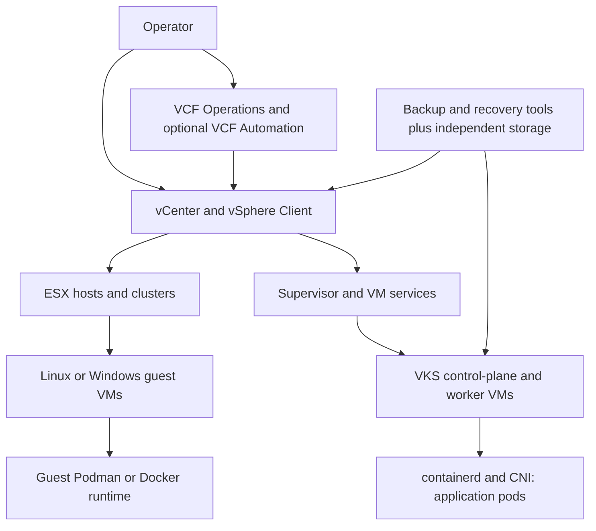

# VMware VM and container platform research

Research cutoff and source access date: **2026-10-30**. Request revision:
r1.0.2. Reviewed desk research; deployment qualifications and unresolved
evidence remain explicit. No infrastructure changes or live tests were
performed.

Document revision: **r1.0.1**. Baseline: unversioned `research-vmware.md`
(r1.0.0 for preservation bookkeeping; archived in `99_Archive/`). Review date:
**2026-10-30**; research cutoff unchanged. Review status: independent claim
review recorded in
[research-review-r1.0.1.md](research-review-r1.0.1.md) and
[research-claim-audit-r1.0.1.tsv](research-claim-audit-r1.0.1.tsv); document
checks for this revision are recorded in
[research-verification-r1.0.1.md](research-verification-r1.0.1.md).
Plain-language VKS multi-network explanation added2026-11-02; research cutoff
and selected stack are unchanged. Its official source was published before the
cutoff and accessed during this supplemental edit.

## Summary and fit

VMware vSphere provides virtual machine (VM) infrastructure. VMware vSphere
Kubernetes Service (VKS) provisions Kubernetes clusters through vSphere
Supervisor; application containers normally execute in those clusters' guest
VMs. A container runtime inside an ordinary guest is another, separately
supported path. VMware Cloud Foundation (VCF) and VMware vSphere Foundation
(VVF) both include vSphere and VKS, but VCF adds NSX networking, VCF Automation
and broader fleet services. Current standalone Standard/Enterprise Plus
offerings stop at vSphere8 Update3; they are not alternate editions of
vSphere9.1. [V1](#v1), [V6](#v6), [V12](#v12).

vCenter manages hosts, clusters and VMs; VCF Operations adds fleet management,
and VCF Automation supplies organization/self-service workflows. Kubernetes APIs
still own individual pod deployments and application desired state.
Multi-cluster visibility does not merge schedulers, storage ownership or
failover domains. Neither vCenter nor an infrastructure dashboard provides
unrestricted lifecycle management of Proxmox/Red Hat hosts. [V2](#v2),
[V3](#v3), [V9](#v9).

Host high availability (HA) normally **restarts** a VM after safe failure
detection; planned vMotion transfers running state between eligible hosts.
Kubernetes replaces pods, while application replicas, database recovery,
persistent storage and traffic redirection determine continuity. VM backup,
Kubernetes resource/data backup, replication and site recovery are different
protection layers. Native snapshots/replication and separate recovery
entitlements must be distinguished from a complete independent backup service.
[V2](#v2), [V3](#v3), [V11](#v11).

Multicast is deployment-specific. VLAN-attached VMs have documented
virtual-switch multicast mechanisms; VKS has documented IPv4/Linux Antrea paths
and a materially different secondary-network/VPC VLAN Extension path to external
multicast. These require configuration and physical-network support. Antrea 2.7
does not support IPv6 or Windows multicast; this does not imply that every
VMware VM path lacks IPv6 multicast. [V2](#v2), [V3](#v3), [V8](#v8).

Fit is strongest where existing vSphere skills, certified appliances, VM
operations and integrated private-cloud services justify the management
footprint and commercial terms. VVF is the narrower VM/Kubernetes infrastructure
choice; VCF suits broader private-cloud automation/network services. Guest OS,
applications, backup integrations and advanced services still need their own
support and entitlement checks. Prices are **quote required**; no total cost is
calculated.

## Verified product baseline

“Current” means primary evidence available by the cutoff, not an assertion that
every independently latest component can be combined arbitrarily. ESX is
VMware's9.x naming; ESXi remains the8.x name. General availability (GA), bill of
materials (BOM), asynchronous releases and patches are recorded separately.

| Product                         | Release / stack                                                                                                              | Lifecycle / limits                                                                                                                                                                                                                                                                                        |
| ------------------------------- | ---------------------------------------------------------------------------------------------------------------------------- | --------------------------------------------------------------------------------------------------------------------------------------------------------------------------------------------------------------------------------------------------------------------------------------------------------- |
| VCF/VVF                         | **9.1.1**, GA2026-09-03; BOM updated2026-10-29                                                                               | Select9.1.1 release family, supported per-component patches and certified hardware. BOM states listed components are interoperable; installation/upgrade dependencies still apply. [V2](#v2)                                                                                                              |
| ESX / vCenter                   | **9.1.1.0100**,2026-10-12; builds **25782009 /25784172** respectively                                                        | Latest entries verified in official build tables. GA BOM lists9.1.1.0 builds; patch policy permits component patches without a new complete BOM. Do not confuse newest patch with GA BOM numbers. [V4](#v4), [V2](#v2)                                                                                    |
| NSX / vSAN / management         | NSX9.1.1 family, vSAN9.1.1 family; latest listed vSAN File Services **9.1.1.0200**,2026-10-26                                | File Services update supersedes earlier9.1.x versions. Operations/Automation patch indexes include9.1.1.0200; verify each selected dependency/build. This is not a single shared patch number. [V2](#v2)                                                                                                  |
| VKS / Kubernetes releases (VKr) | Independently current **VKS 3.8.0+v1.37** and **VKr 1.37.1+vmware.4-vkr.1**,2026-10-22                                       | VKS 3.8 requires Supervisor Kubernetes>=1.33, correct9.1 Software Depot service YAML and applicable interoperability. Upgrade starts from VKS>=3.5. Control-plane-zone selection requires Supervisor 9.1.1.0100+. GA VCF BOM instead lists VKS 3.7.0+v1.36/VKr 1.34.2; retain that distinction. [V5](#v5) |
| VKS node components             | VKr 1.37.1: Photon OS5.0 or Ubuntu22.04/24.04; **containerd 2.4.0**, **Antrea 2.7.0** or **Calico 3.32.2**, vSphere CSI3.9.0 | Use the shipped release image and supported configuration, not independently newest runtime/CNI packages. Container Network Interface (CNI) and Container Storage Interface (CSI) versions are part of the path. [V5](#v5)                                                                                |
| Recovery / databases            | Protection and Recovery **9.1.1.0**; Data Services Manager (DSM) **9.1.1.0** in compatible add-on BOM                        | Separate entitlement. DSM/VKS dependencies need their own matrix; VKS 3.8 does not automatically certify every DSM pairing. [V2](#v2), [V5](#v5)                                                                                                                                                          |
| Older / free alternatives       | Standard and Enterprise Plus:8U3 or earlier; FAQ permits free ESXi downloads through8U3                                      | Free host software is not the centrally managed9.x commercial baseline; backup/API/support restrictions need separate verification. Historical Essentials/perpetual/Tanzu labels do not establish current orderability. [V12](#v12)                                                                       |

The reference path is VVF/VCF 9.1.1 with supported ESX/vCenter patches and
Supervisor, then the separately documented VKS 3.8/VKr 1.37.1 path when its
prerequisites are met. A deployment may retain the BOM's older Kubernetes
release while validating an asynchronous upgrade. The service-administration PDF
lags current3.8 HTML; newer dated release notes govern3.8 claims. VKS add-ons
have tier-specific support and shorter lifecycles than core VCF under the
June2026 terms. Exact end-of-support dates for every asynchronous service were
not independently established; consult the current lifecycle matrix before
ordering. [V5](#v5), [V6](#v6).

Assumptions: no hardware, inventory, scale, sites, budget, entitlements, support
hours, application multicast specification or recovery objectives were supplied.
Assume certified x86-64 hardware, supported storage/networking and licensed
guest OSs. Workload guest certification, CPU/device compatibility and
application support must be checked individually. Preview paths and arbitrary
nested hypervisors are outside the recommendation.

## Architecture and workload support

Status vocabulary: **documented supported**, **conditional**, **documented
unsupported**, **not verified**. A status applies to the named path/layer, not
all applications on that vendor. Sources establish documented facts;
*inference*, *recommendation* and *proposed validation* are labeled separately.

Supervisor provisions infrastructure and Kubernetes clusters; guest Kubernetes
schedules application pods. vSphere Pod Service is another catalog capability
and is not ordinary Docker installed on ESX. The Oct14 comparison marks it in
VVF and VCF; older NSX-only entitlement assumptions must not override the
current catalog, but the exact chosen Pod Service deployment prerequisites
remain to be verified. [V1](#v1), [V3](#v3).

| Path           | Execution path                                                                                                  | Needs / rights                                                                                                                                                   | Status / limits                                                                                                                                                                                                        |
| -------------- | --------------------------------------------------------------------------------------------------------------- | ---------------------------------------------------------------------------------------------------------------------------------------------------------------- | ---------------------------------------------------------------------------------------------------------------------------------------------------------------------------------------------------------------------- |
| W-VM           | ESX 9.1.1 VMware hypervisor → certified Linux/Windows VM                                                        | vCenter, certified CPU/devices and guest matrix; VVF/VCF host entitlement plus guest licensing                                                                   | **conditional** on exact guest/hardware certification; Broadcom supports infrastructure, guest/application vendors their layers. [V2](#v2), [V4](#v4)                                                                  |
| W-VKS          | Supervisor 9.1 → VKS 3.8/VKr 1.37.1 guest cluster → containerd 2.4.0 Linux pods                                 | Shipped Photon/Ubuntu images, Supervisor>=Kubernetes 1.33, supported CNI/CSI, storage classes, namespace permissions and load balancing; VKS included in VVF/VCF | **documented supported** product path under prerequisites; Broadcom platform support, application/provider support separate. Add-on support tier and matrix still apply. [V3](#v3), [V5](#v5), [V6](#v6)               |
| W-Pod          | vSphere Pod Service → container execution integrated with Supervisor/ESX                                        | Catalog marks included service; hardware/network/service prerequisites must be selected from current docs                                                        | **not verified** for an exact end-to-end9.1.1 workload combination in this report; not the selected application baseline. [V1](#v1)                                                                                    |
| W-Guest-Docker | ESX VM → supported Linux guest (Debian13 candidate) → Docker Engine29.9.2 and bundled runtime                   | Provision guest first; Docker/guest support and licenses separate. ESX does not become a Docker host                                                             | **conditional** guest deployment; exact guest-on-ESX 9.1 certification not verified. Infrastructure console sees VM, not individual containers. [V10](#v10)                                                            |
| W-Guest-Podman | ESX VM → RHEL 10.2/Podman 5.8.2 candidate                                                                       | Red Hat guest/runtime entitlement and certified hypervisor matrix required; upstream latest Podman is not automatically the supported RHEL package               | **not verified** for the exact full ESX 9.1.1/RHEL 10.2 combination; Red Hat owns runtime support when guest conditions met. [V10](#v10)                                                                               |
| W-Guest-K8s    | ESX Linux VMs → upstream containerd/Kubernetes or another distribution                                          | Independent guest/distribution/CNI/CSI support, control-plane quorum and backups                                                                                 | **not verified** as a whole commercial stack; a bootable VM does not certify OpenShift/RKE2/other products. VMware VKS is the evaluated first-party path. [V2](#v2), [V5](#v5)                                         |
| W-Windows      | Windows VM → compatible Windows container runtime/image; alternatively documented VKS Windows node-pool options | Windows kernel/image compatibility, supported worker/CNI combination, Microsoft/runtime licensing                                                                | **not verified** for an exact current Windows container combination here. Linux VKS image table is not Windows runtime certification; Antrea multicast excludes Windows. [V3](#v3), [V8](#v8), [V10](#v10)             |
| W-System       | LXC/LXD/system containers inside a Linux VM candidate                                                           | Separate upstream/vendor product; shares guest Linux kernel                                                                                                      | **not verified** as a Broadcom-supported system-container platform. Native ESX LXC/Docker/Podman installation is not an established supported path. Missing evidence is not a blanket unsupported statement. [V2](#v2) |

Linux containers share their runtime host's Linux kernel; Windows images need a
compatible Windows host. Docker Engine, containerd and Podman are
runtimes/tools, while VKS/Kubernetes supplies multi-node desired-state control.
Open Container Initiative (OCI) image portability does not confer application
certification.

## Centralized and multi-host management

| Interface                                     | Scope / visibility                                                                                                                | Actions / limits                                                                                                                                                                                              | Outage / rights                                                                                                                                                                                              |
| --------------------------------------------- | --------------------------------------------------------------------------------------------------------------------------------- | ------------------------------------------------------------------------------------------------------------------------------------------------------------------------------------------------------------- | ------------------------------------------------------------------------------------------------------------------------------------------------------------------------------------------------------------ |
| vCenter/vSphere Client, centralized appliance | Multiple ESX hosts/clusters per vCenter; VM and Supervisor/VKS infrastructure inventory                                           | Host onboarding, templates/content libraries, placement, migration, policies, storage/networking, monitoring, lifecycle updates, role-based access control (RBAC), tasks/audit; guest administration separate | Existing VMs and configured host HA can continue without vCenter; provisioning/DRS/central changes need manager recovery. Included component subject to licensed infrastructure rights. [V2](#v2), [V6](#v6) |
| VCF Operations / fleet services               | Multiple vCenters/VCF instances across sites; operations/inventory/licensing and fleet lifecycle, not one shared scheduler        | Credentials, certificates, identity, connectivity and compatible managed releases.9.1 vCenter Groups replace deprecated Enhanced Linked Mode for current grouping. VVF receives a narrower capability set     | Operations outage removes its fleet/licensing workflows; does not by itself power off VMs. Licensing compliance deadlines remain material. [V2](#v2), [V7](#v7), [V9](#v9)                                   |
| VCF Automation                                | Organization/provider self-service, VM and VKS lifecycle across supported VCF resources                                           | Catalog/IaC/API, quotas, policies, placement, namespaces and integrations; Supervisor and supported VCF services required. Individual apps still use Kubernetes manifests/APIs                                | Automation outage blocks its workflows; existing workloads depend on underlying control planes. Included VCF, not equivalent VVF entitlement. [V1](#v1), [V2](#v2)                                           |
| Supervisor / VKS API, kubectl and VCF CLI     | Supervisor manages infrastructure namespaces and cluster VMs; each VKS cluster controls its own application pods/volumes/services | Federation/identity, RBAC, API endpoints, CNI/CSI and registries; VM hosting does not imply one console for every guest container process                                                                     | Existing pods may run during API outage; scheduling/reconciliation needs quorum/API. Included VKS platform, add-on tier conditions. [V3](#v3), [V5](#v5)                                                     |
| NSX, storage, recovery and backup interfaces  | Network/storage/recovery domains and third-party backup inventories                                                               | Some workflows integrated, others retain NSX, recovery, guest or backup consoles. Do not infer feature parity from a dashboard tile                                                                           | Separate service redundancy and entitlements; operations scope varies. [V2](#v2), [V11](#v11)                                                                                                                |
| Mixed-vendor automation/monitoring            | Supported third-party adapters, Ansible collections and Veeam protection can span products                                        | API workflows/backup/metrics are limited scopes; no first-party full Proxmox/Red Hat host lifecycle established                                                                                               | Third-party/provider rights and exact versions required. Operations appliance on Proxmox is explicitly unsupported in Broadcom KB425448. [V9](#v9), [V11](#v11), [V16](#v16)                                 |

Centralization requires DNS/time/identity/TLS trust, reachable APIs, adequate
manager sizing, supported host versions and storage/network consistency. Cluster
policies govern each cluster independently; stretching inventory across sites
does not create site availability. The service guide publishes up to500 VKS
clusters/4,000 total nodes per Supervisor for its3.6.1 validated configuration;
this is not a current3.8 universal sizing promise. Exact9.1.1 limits and
simultaneous maxima require Configuration Maximums and hardware/workload sizing.
[V2](#v2), [V3](#v3), [V15](#v15).

Management-plane protection is described below. In the selected VCF design,
vSphere HA protects the vCenter VM; **vCenter HA and Fault Tolerance for that
management VM are marked unsupported**. Do not apply an old
active/passive/witness vCenter HA recipe as a generic VCF 9.1 design. Direct
host access may help recovery but is not a full substitute for vCenter/VCF
services. [V2](#v2).

**Plain-language answer:** hosts and VMs have a central vCenter entry point; VCF
adds fleet/self-service services, and VKS adds Kubernetes management. Multiple
sites, application containers inside ordinary guests, backup systems and other
vendors retain separate boundaries and often separate interfaces.

## Provisioning and orchestration

| Path                     | Provisioning                                                                                                                         | Control / updates                                                                                                                                                     | Manual / extras                                                                                                                                                                     |
| ------------------------ | ------------------------------------------------------------------------------------------------------------------------------------ | --------------------------------------------------------------------------------------------------------------------------------------------------------------------- | ----------------------------------------------------------------------------------------------------------------------------------------------------------------------------------- |
| W-VM                     | vSphere Client/API/PowerCLI clones template/content-library image or installs OS; attaches network/storage and initializes guest     | vCenter/DRS placement and resource balancing, vMotion, configured HA; VCF Automation adds catalogs/IaC/self-service                                                   | Guest secrets/configuration/patching, application replicas and data policy remain operator tools; infrastructure scaling needs capacity. [V2](#v2)                                  |
| W-VKS infrastructure     | Enable Supervisor, storage/network/load-balancer services and namespace quotas; provision Cluster API/ClusterClass-defined VKS nodes | VKS controllers maintain node VM topology/health; supported upgrades reconcile node images/add-ons; cluster autoscaler needs configuration and capacity               | Upgrade prerequisite/matrix checks, failure-domain placement, CNI/CSI/storage and registry credentials. VKS included; broader VCF automation differs from VVF. [V3](#v3), [V5](#v5) |
| W-VKS application        | Push approved image; apply Deployment/StatefulSet/Operator, Secrets, Service/Ingress and persistent volume claims                    | Kubernetes scheduler/controllers place/replace pods; replica/horizontal scaling and rolling update/rollback are app-level features; GitOps/add-ons depend on offering | Database consistency, health/readiness design, storage fencing, traffic and application version compatibility remain application responsibility. [V3](#v3), [V5](#v5)               |
| Ordinary guest runtime   | Provision VM first, install supported guest/runtime, pull images, attach volumes/network and start service                           | Docker/Podman/service manager controls local processes; separate orchestrator required for cross-host application desired state                                       | vCenter cannot scale/roll back every guest container; guest automation and backup separate. [V10](#v10)                                                                             |
| Physical/fleet lifecycle | VCF Installer, host onboarding, configuration profiles, vSphere Lifecycle Manager and supported VCF fleet updates                    | APIs/SDK/CLI and versioned Terraform/Ansible integrations support repeatability                                                                                       | Firmware/hardware matrices, spare capacity, maintenance windows, credentials and rollback plan still required. [V2](#v2), [V16](#v16)                                               |

**VM lifecycle example:** operator selects a certified template and host policy,
allocates disks/VLAN/identity, initializes the guest, installs
application/agent/secrets and registers HA/backup. Observe app health and patch
host/guest through their respective tools. On host loss, configured HA selects a
safe survivor and restarts the VM against accessible storage; the guest/database
then recovers and clients reconnect. For lost data, restore the chosen backup
point. Retire only after stopping writes and deciding retention of disks,
backups, IP/DNS, keys and licenses. [V2](#v2), [V11](#v11).

**Container application example:** provision supported
Supervisor/VKS/CNI/CSI/registry first; place control-plane and worker VMs across
physical failure domains. Apply manifests with replicas, probes,
Service/Ingress, Secrets and persistent data. Kubernetes handles pod
scheduling/rollouts; VKS handles node-cluster lifecycle; vSphere handles the
underlying VMs/hosts. Back up Kubernetes resources and persistent data
consistently. Host loss can trigger both VM HA and pod replacement; storage
fencing, app replicas and endpoint updates must prevent two writers and restore
service. Retirement removes manifests deliberately while retaining required
volumes/backups and revoking credentials. [V3](#v3), [V5](#v5).

## Networking and multicast

The physical path is guest/pod interface → guest CNI/runtime → VM adapter →
vSphere switch or NSX → physical uplinks/switches/routers → receiver.
Application multicast differs from any multicast used by an underlay/fabric.
Layer2 delivery requires consistent membership/forwarding; inter-subnet traffic
additionally requires a multicast routing design, correct source routes, group
scope and hop limits. Internet Group Management Protocol (IGMP) is IPv4
membership handling; Multicast Listener Discovery (MLD) is IPv6. [V2](#v2),
[V8](#v8).

**VKS multi-network in plain terms:** VCF 9.1 with VKS 3.6 introduced the
ability to give each Kubernetes node extra network adapters. The primary
interface carries normal cluster management and Kubernetes traffic; an extra
interface can connect the node to a separate network, for example for storage
or traffic that must reach the physical LAN. This creates another path; it does
not make pods use that path automatically. Workloads need additional network
configuration to send traffic over it. Connecting a whole node to another
network is also different from giving an individual pod its own extra
interface. The feature is available with NSX VPC and vSphere Distributed Switch
(VDS), subject to the release and network prerequisites. [V21](#v21).
Choose the primary network carefully: it cannot be changed after cluster
creation. Secondary interfaces can be added later, but are not removable
without recreating the cluster. [V21](#v21).

| Path / endpoints                                                               | Host / LAN scope                                                                                 | IPv4                                                                                                                                                                                        | IPv6 / owner                                                                                                                                                                                                                                                                            |
| ------------------------------------------------------------------------------ | ------------------------------------------------------------------------------------------------ | ------------------------------------------------------------------------------------------------------------------------------------------------------------------------------------------- | --------------------------------------------------------------------------------------------------------------------------------------------------------------------------------------------------------------------------------------------------------------------------------------- |
| W-VM↔VM on vSphere Distributed Switch (vDS)/VLAN                               | Same host, cross host on consistent VLAN, bidirectional external LAN                             | **conditional**: guest joins, vDS filtering/IGMP, physical snooping/querier and UDP/firewall rules                                                                                          | **conditional** for documented switch/MLD mechanisms; preserve ICMPv6 membership/control traffic. Exact application and router support remain separate. Broadcom switch/guest vendors. [V2](#v2), [V17](#v17)                                                                           |
| W-Guest runtime↔VM/container/LAN, Linux host network                           | Runtime shares guest VM network namespace; same/cross host and external through VM path          | **conditional**, technical inference from guest network sharing plus documented VM path                                                                                                     | **conditional** inference, requires guest IPv6/MLD and exact application/runtime qualification; no complete commercial-stack guarantee. [V10](#v10), [V17](#v17)                                                                                                                        |
| Docker default bridge/NAT in VM                                                | Same guest bridge differs from cross-guest/external traffic                                      | **not verified** for end-to-end external multicast; published UDP ports do not establish memberships/routing                                                                                | **not verified**; IPv6 enabled in guest does not establish multicast through NAT/runtime. [V10](#v10)                                                                                                                                                                                   |
| Guest macvlan / ipvlan L2                                                      | Secondary MAC/L2 traffic must pass guest NIC, vDS/security and physical port controls            | **conditional** upstream capability, whole supported stack not established                                                                                                                  | **conditional** upstream dual-stack candidate, not end-to-end certification. Host-parent isolation/anti-spoofing need validation. ipvlan L3 explicitly drops multicast: **documented unsupported** for both families. [V10](#v10)                                                       |
| W-VKS, Antrea 2.7 primary network, Linux pods                                  | Pod↔pod on same/cross physical hosts; pod↔VM/external when node network forwards/routes          | **conditional**, vendor VKS hybrid support plus upstream Antrea enable flag, memberships, selected interfaces and network mode                                                              | **documented unsupported** by Antrea 2.7 for IPv6 multicast and Windows multicast. Broadcom product path plus upstream implementation evidence; do not generalize to other networks. [V3](#v3), [V8](#v8)                                                                               |
| W-VKS additional interfaces / VPC VLAN Extension                               | Pod↔external LAN documented; pod↔VM/pod on attached VLAN requires matched endpoint configuration | **conditional**, vendor documents multi-network external multicast; compatible VKS/Antrea, secondary interfaces, NSX/VPC VLAN extension and physical design required                        | **not verified** for end-to-end IPv6 application multicast. This is a materially different path from default overlay. VKS 3.8 newly supports VLAN-backed VPC; older3.7.1 and earlier do not. [V3](#v3), [V5](#v5)                                                                       |
| NSX9.1 tier0/tier1 routed VM path                                              | VM↔VM across segments and bidirectional external routed networks                                 | **conditional** documented IPv4 Protocol Independent Multicast sparse mode (PIM-SM)/IGMPv2; Edge, enabled tier0/tier1, upstream rendezvous point/router, reverse-path reachability required | **not verified**: the NSX routed-multicast feature is documented "for an IPv4 network" only; no equivalent IPv6 routed multicast is documented there. Dual-stack unicast/neighbor discovery is not evidence. Not available as VVF's base L3 service. [V2](#v2) printed p3509, [V1](#v1) |
| Calico 3.32.2 VKS default path / vSphere Pod Service / arbitrary secondary CNI | Pod↔pod/VM/LAN, same/cross-host                                                                  | **not verified** for the selected end-to-end multicast configuration                                                                                                                        | **not verified**; inclusion of a CNI/Pod Service does not establish group forwarding. [V3](#v3), [V5](#v5)                                                                                                                                                                              |

Antrea supports encap/noEncap/hybrid but not networkPolicyOnly multicast; encap
uses source NAT and restricts selected egress interfaces. Its multicast ingress
policy is not supported, and link-local224.0.0.0/24 is not an external routed
group range. Validate groups and security semantics, not just successful unicast
ping. [V8](#v8).

NSX's documented routed multicast excludes Federation/multi-site, multi-VRF and
a Layer2 bridge on a downlink; it applies to ESX hosts and NSX Edge only, and
east-west replication covers up to four VTEP segments. Gateway Firewall does
not protect multicast, while Distributed/Bridge Firewall have documented
support. Physical snooping
requires a querier and the routed path needs valid reverse routes and upstream
PIM. IPv6 MLD can be blocked by distributed firewall rules; neighbor discovery
working does not prove high-bandwidth application multicast. [V2](#v2),
[V17](#v17).

**Conclusion:** qualify VLAN VM paths or the specifically documented VKS IPv4
Linux/secondary-VLAN path for an external-LAN requirement. Do not recommend a
turnkey dual-stack container multicast service from this evidence. The full
application/hardware/feature combination needs support confirmation and the
proposed validation, particularly after migration/recovery.

**Proposed validation, not performed:** record IP family,
any-source/source-specific groups, UDP ports, scope/hop limit, endpoint count,
topology, rate and loss/rejoin tolerance. Place senders/receivers in VM, pod and
external LAN; exercise both directions on same host, cross host and external
paths, then routed subnets separately. Inspect application joins, IGMP/MLD
queries/reports/leaves, Antrea group/routes, virtual-switch membership, physical
switch/router tables and firewall rules. Capture at pod/guest NIC, node VM
adapter, virtual switch/uplink and LAN. Repeat after vMotion, VM HA restart, pod
rescheduling and link/querier failure, waiting for membership aging. Measure
application continuity and packet loss against acceptance criteria; no such
measurements are claimed here.

## Availability, failover, and maintenance

vSphere HA requires configured admission control, host failure/isolation
detection and suitable accessible storage. A two-host vSphere HA design is not
the same as a supported complete VCF topology. The documented VCF vSAN OSA HA
deployment example requires **four hosts** despite a misleading installer
message showing three for one failure tolerated. Storage type, management size,
witness/zone placement and converged/edge models change requirements. Recommend
independent spare capacity and redundant management/storage/LAN paths; obtain
the exact deployment blueprint before sizing. [V2](#v2).

| Event / layer                        | Recovery                                                                                                                                            | Needs / impact                                                                                                                               | Failback                                                                                                                                   |
| ------------------------------------ | --------------------------------------------------------------------------------------------------------------------------------------------------- | -------------------------------------------------------------------------------------------------------------------------------------------- | ------------------------------------------------------------------------------------------------------------------------------------------ |
| App/process/pod failure              | Runtime/kubelet restart, Kubernetes probes/controllers replace pods; app replicas/load balancer serve healthy endpoints                             | Automatic only when configured; persistent state and database replication remain app design                                                  | Rollouts/replicas do not repair corrupt data; use application restore/rollback as needed. [V3](#v3)                                        |
| Guest VM failure                     | VM monitoring/guest tools or application tooling may trigger restart; investigate guest/app cause                                                   | Requires configured monitoring; VM liveness is not application health                                                                        | Restart loses volatile state and may repeat broken guest failure. [V2](#v2)                                                                |
| Unexpected host failure              | HA host agents detect loss/isolation and restart eligible VMs; Kubernetes may replace pods on surviving nodes                                       | HA/storage locks/isolation policy, eligible capacity and persistent disks; service interruption includes boot/app recovery                   | Repair host, validate network/storage, then controlled migration/DRS rebalance; no automatic app transaction continuity. [V2](#v2)         |
| Partition/storage path loss          | HA isolation/partition policy, datastore heartbeats/locks and storage policies prevent unsafe ownership; storage multipathing/replicas handle paths | Safe restart depends on accessible disks and valid ownership; storage quorum/failure domains separate from VM HA                             | Do not force simultaneous disk owners; repair quorum/storage and reconcile authority. [V2](#v2)                                            |
| Planned maintenance                  | vMotion/DRS evacuation, storage migration and supported rolling patches                                                                             | CPU/device/network/storage compatibility and spare capacity; passthrough/vGPU/shared-disk and app constraints matter                         | Return host after validation; live migration preserves running state under conditions but is not unexpected-failure recovery. [V2](#v2)    |
| Fault Tolerance (FT) option          | Eligible VM has a synchronized secondary on another host                                                                                            | Feature included in comparison; workload/CPU/device/scale/network limits must be checked. Does not replace application/storage/DR protection | Exact eligibility not validated here; **not supported for vCenter in selected VCF design**. [V1](#v1), [V2](#v2)                           |
| vCenter/Operations/Automation outage | Existing VMs/host HA may continue; manager VM can restart through vSphere HA; recover configuration/services or backups                             | Central placement/new cluster/provisioning/license workflows affected. VCF design marks vCenter HA and FT unsupported                        | Recover management dependencies/certificates/DNS/identity; no blanket claim all automation continues. [V2](#v2), [V7](#v7)                 |
| Supervisor/VKS control-plane outage  | Replicated API/etcd and controllers require quorum; existing pod processes may survive temporarily                                                  | Separate control-plane VMs/failure domains, network/API endpoints and consistent storage/backup; no quorum means no normal scheduling        | Restore control plane using supported state recovery; underlying VM restart alone cannot repair logical cluster loss. [V3](#v3), [V5](#v5) |
| Network/service endpoint loss        | NIC/switch/path redundancy, NSX Edge/load-balancer HA, Kubernetes Service/Ingress and app listeners recover where configured                        | Each layer needs failure-domain design; multicast memberships must recover separately                                                        | Repair/rejoin/reconcile; working VM is not proof clients can reach the app. [V2](#v2), [V8](#v8)                                           |
| Site loss                            | Recovery service promotes replicas/restores backups and follows recovery plan                                                                       | Separate site resources, licenses, data copies, network/identity and application dependencies                                                | Planned failback/reprotection/reverse replication or restore, with data-authority checks; not ordinary local HA. [V11](#v11)               |

**Host failure walkthrough:** HA confirms a failed/isolated host under
configured policies and safe storage ownership, selects a survivor and reboots
its VM. Guest filesystem/database recovery follows; retained IP identity does
not preserve sessions or multicast membership. For W-VKS, surviving Kubernetes
control plane may schedule replacement pods while vSphere recovers node VMs. CSI
detach/attach and application fencing must prevent competing writers; ready
endpoints/load balancers redirect traffic. Replicas must span physical failure
domains, not just different VM names on one host. [V2](#v2), [V3](#v3).

Drain/evacuate nodes before planned work; respect Kubernetes disruption budgets,
database quorum, migration restrictions and spare capacity. Some patches are
live/quick-patch capable, but eligibility and rollback remain product-specific.
Never infer a zero-interruption service guarantee from a marketing
live-migration claim. Recovery time objective (RTO) is desired service
restoration time; recovery point objective (RPO) is tolerated data-loss
exposure. Actual RTO includes detection, fencing, storage, boot, data recovery
and client routing; actual RPO depends on committed state, replication and
usable backup points. No numerical service target is invented.

Current material risk: the Oct9 Broadcom advisory requires vLCM/VUM schema
verification before affected8U3/9.0.x upgrades to9.1/9.1.1 after a depot reset,
because Supervisor VMs/load balancers can be lost. An Oct28 SDDC Manager
security advisory lists patch-pending conditions; review the current vendor
mitigation before deployment. These are recorded risks, not claims that fixes or
checks were applied. [V13](#v13).

## Backup, restore, and disaster recovery

Snapshots retain a storage state; HA restarts execution; replication moves data;
backup supplies retained recovery points; disaster recovery restores a
service/site in dependency order. An immutable local snapshot still shares a
storage/failure domain unless independently copied. VM protection does not by
itself establish a consistent Kubernetes/application recovery. [V2](#v2),
[V3](#v3), [V11](#v11).

| Layer / tool                                                    | Content / consistency                                                                                                                                            | Copies / retention                                                                                                                                  | Restore / gaps                                                                                                                                                                                                        |
| --------------------------------------------------------------- | ---------------------------------------------------------------------------------------------------------------------------------------------------------------- | --------------------------------------------------------------------------------------------------------------------------------------------------- | --------------------------------------------------------------------------------------------------------------------------------------------------------------------------------------------------------------------- |
| vCenter/VCF management configuration                            | Native supported configuration backups; not all guest disks/applications                                                                                         | Supported protected file target; schedule/retention and credentials separately. Preserve certificates, keys, network/identity and fleet configs     | Redeploy compatible appliance and restore configuration in supported order. Manager protection is separate from VM/application backup. [V2](#v2)                                                                      |
| W-VM / Veeam or other supported VADP/VDDK integration           | VM configuration/selected virtual disks; guest quiesce/application-aware processing only where supported/configured; external/passthrough/excluded data separate | Backup repository with policy, independent copy and product-specific immutable target; separate license/storage                                     | Full VM/disk/file/app restore depends on tool and guest; vSphere9.1 supported by current Veeam matrix. Qualify exact VBR build/platform/guest pair. [V11](#v11)                                                       |
| Local vSAN protection / Protection and Recovery                 | Supported VM snapshots/protection groups and retained disk states, not generic app-consistent Kubernetes export                                                  | Local snapshot schedules/immutability subject to service/storage rights; remote protection needs separate entitlement                               | Recover selected point with app validation; primary storage dependency remains for local copies. VVF/VCF feature and recovery entitlement wording must be reconciled. [V1](#v1), [V11](#v11), [V12](#v12)             |
| Supervisor state                                                | Supported Supervisor control-plane state backup                                                                                                                  | Protected backup location/credentials and matched restore procedure                                                                                 | Recover Supervisor state, not arbitrary guarantee of all workload persistent data. Preserve before upgrades. [V2](#v2), [V13](#v13)                                                                                   |
| W-VKS / Velero Plugin for vSphere or qualified partner          | Kubernetes objects and supported persistent volumes; application hooks/database exports needed for consistency                                                   | Service guide documents plugin1.8.x, Data Manager, namespace/operator and S3-compatible object store; retention/copy security configured separately | Restore compatible objects/CRDs/storage/data in dependency order. Exact plugin/VKS 3.8/VKr 1.37 pair and guest/application support **not verified**; do not imply latest versions automatically compatible. [V3](#v3) |
| Guest Docker/Podman                                             | Included guest disk bytes from VM backup; external volumes/registry/secrets may be excluded                                                                      | Guest/app-native database backups/logs plus independent repository and retention                                                                    | Recreate runtime/manifests/images, restore consistent durable data and ownership, validate before traffic. No vCenter per-container backup entitlement implied. [V10](#v10)                                           |
| Site / SRM, Protection and Recovery, ACC or Live Recovery Cloud | VM replicas/protection plans and recovery orchestration according to selected service                                                                            | Separate recovery site/cloud capacity, retention, licenses, supported vSAN/array/replication path; independent backups still needed                 | Test recovery plans, promotion/network mapping/app order, then reprotection/failback. Data Services/application-specific recovery remains separate. [V11](#v11), [V14](#v14)                                          |

**VM restore:** choose a verified clean point, recover independently held
keys/credentials, map target storage/network and restore in isolation; validate
guest/data/application before reconnecting clients. **Persistent Kubernetes
restore:** recover compatible cluster/control-plane prerequisites, storage
classes/CSI and Operators/CRDs, then resources/secrets and consistent
volume/database state; control startup order and only then expose
Services/Ingress. Restoring worker VM snapshots independently is not a
substitute for that sequence. [V2](#v2), [V3](#v3), [V11](#v11).

**Site recovery recommendation:** restore identity/DNS/time/keys and management
access, backup/recovery services, target compute/storage/network,
cluster/control planes, databases/applications and finally traffic. Planned
migration, local HA and site failover use different mechanisms. Validate
writable data authority, reverse/reseed replicas and perform controlled
failback; asynchronous replicas/backups can lose later writes. No recovery
time/data-loss guarantee is derived from an advertised replication interval.

**Entitlement caution:** the current feature comparison (columns VVF, VCF Edge
and VCF) marks vSphere Replication, Fault Tolerance, Snapshot Manager and
Immutable Snapshots in all three offerings. It lists Site Recovery Manager
(SRM) and Live Recovery Cloud under *Advanced Services (Add-ons)*, which its
footnote 13 says are separate purchases not included in core VCF or VVF;
Any-to-vSAN Replication requires an SRM license (footnote 14). The VCF
recovery documentation distinguishes included local protection/standalone
replication from separately entitled remote/cyber recovery. The May14 vendor
explanation requires SRM or ACC for its described
remote vSAN protection. Obtain order-specific rights for VVF recovery and any
RPO tier; a feature checkmark or an interoperable BOM row is not a license
grant. [V1](#v1), [V6](#v6), [V11](#v11).

## Other capabilities and operations

| Area              | Capability and operational implication                                                                                    | Evidence / limits                                                                                                                                                                 |
| ----------------- | ------------------------------------------------------------------------------------------------------------------------- | --------------------------------------------------------------------------------------------------------------------------------------------------------------------------------- |
| Compute           | VM resource controls, DRS/vMotion, hardware acceleration, vGPU/passthrough, security and host profiles                    | Device/CPU/firmware support and migration limits matter; NVIDIA/guest entitlements separate. No performance benchmark asserted. [V1](#v1), [V2](#v2)                              |
| Storage           | vSAN ESA/OSA, VMFS/NFS and supported external storage; policy-based placement, CSI for VKS                                | Storage topology determines snapshots, replication, shared access and fencing. vSAN capacity rights differ by bundle; hardware/array certification separate. [V2](#v2), [V6](#v6) |
| Identity/security | vCenter/VCF RBAC, identity federation/broker, certificates, encryption/key management, secure boot/vTPM; NSX segmentation | Guest and Kubernetes identities/policies separate. Advanced firewall/threat/compliance/confidential-computing features may need add-ons. [V1](#v1), [V14](#v14)                   |
| Updates           | VCF Installer/lifecycle services, vSphere Lifecycle Manager, software depots, host image/configuration policies           | Supported upgrade sequence, backups, vendor notices, air-gapped content and compatible add-ons required. Core and VKS update independently. [V2](#v2), [V5](#v5)                  |
| Observability     | Operations capacity/metrics/logs/diagnostics and network visibility; Kubernetes/app metrics via appropriate tools         | Infrastructure monitoring is not complete application observability. VVF receives limited Operations scope; advanced services separate. [V1](#v1), [V9](#v9)                      |
| APIs/IaC          | PowerCLI, VCF CLI/SDK/APIs, Cluster API/manifests, Terraform and Ansible integrations                                     | Pin provider/collection/SDK versions; community code does not acquire commercial support because it calls a licensed API. [V2](#v2), [V16](#v16)                                  |
| Hardware/scaling  | Certified hardware, guest and configuration maximums; separate manager/storage sizing                                     | No universal host count/density inferred. Multiple clusters/sites preserve independent failure domains. [V15](#v15)                                                               |
| Portability       | OVF/OVA/disk and guest/app export, Kubernetes manifests/images                                                            | Firmware/drivers/vTPM/encryption, CNI/CSI/storage classes, licenses and recovery formats require conversion/testing; no cross-hypervisor live-migration promise. [V2](#v2)        |

## Licensing, subscriptions, and support

Commercial software rights, open-source component licenses, product support and
application certification are distinct. The June2026 VCF/VVF Specific Program
Documentation (SPD) establishes subscription per physical core, **minimum16
cores per processor**, including applicable disabled cores. It also restricts
component use to entitled infrastructure and specifies compliance reporting. Do
not treat a reseller order minimum or a support response as a software feature.
[V6](#v6), [V7](#v7).

| Offering                                                  | Capabilities                                                                                                 | Rights / support                                                                                                                                                                                                                                           |
| --------------------------------------------------------- | ------------------------------------------------------------------------------------------------------------ | ---------------------------------------------------------------------------------------------------------------------------------------------------------------------------------------------------------------------------------------------------------- |
| VVF 9.1.1                                                 | vSphere/vCenter, VKS, selected Operations/logging and vSAN allowance; narrower than VCF                      | Core subscription/min16 per CPU; **0.25 TiB raw vSAN per licensed core** under current terms. No base NSX/VCF Automation equivalent; capacity/add-ons/guest licenses separate. Support/maintenance for licensed software. [V6](#v6), [V12](#v12)           |
| VCF 9.1.1                                                 | Adds full private-cloud NSX, Automation, fleet/network operations and broader services to named VVF baseline | Core/min16 per CPU; **1 TiB vSAN per licensed core** subject to pooling/use restrictions. Advanced services remain separate. Cloud portability/hosting rights are contract-specific, not general rights for any provider. [V6](#v6)                        |
| VCF Edge                                                  | Non-hierarchical optimized VCF configuration for edge sites                                                  | Edge-only limitations and commercial scale/minimums require FAQ/order confirmation; not a general small-datacenter discount. Latest independently separate patch not established. [V9](#v9), [V12](#v12)                                                   |
| Standard / Enterprise Plus                                | Standalone VM offerings limited through8U3; product comparison differentiates HA/DRS/networking features     | Current public catalog lists them, but exact new-order region/term/availability needs reseller confirmation. No9.1 standalone entitlement inferred. Standard February2026 SPD has per-core terms and legacy upgrade restrictions. [V12](#v12), [V18](#v18) |
| Free ESXi 8U3 / evaluation                                | Limited host/lab/evaluation alternatives, not9.x central stack                                               | Free availability described in current FAQ. Exact central management/API/backup/commercial support rights not verified here; do not recommend it as an equivalent production cluster. [V12](#v12)                                                          |
| ACC, advanced security, load balancing and other services | Add cyber/compliance, recovery, security/network/application/data/operations services according to SKU       | Separate subscriptions/metrics/prerequisites; May2026 ACC SPD supersedes saved Dec2025 historical copy. Confirm quote, covered cores/recovery sites and third-party rights. [V14](#v14), [V9](#v9)                                                         |

The9.x license-file workflow requires VCF Operations and vCenter even for
isolated/standalone hosts; disconnected registration is a documented workflow,
not a return to direct25-character host keys. June SPDs require periodic
compliance files (180-day interval specified) and describe degraded/blocked
management functionality/support on noncompliance. Preserve the distinction
between manager connectivity failure and the contract's reporting deadline; no
immediate VM power-off behavior is inferred. [V6](#v6), [V7](#v7).

Support/maintenance is included for the software covered by the agreement; exact
support tier, severity hours, escalation/response commitments and regional
access were **not publicly verified for a specific order**. Ask for applicable
maintenance policy and support schedule; do not infer an SLA from a feature
page. All selected-stack prices are **quote required** as of2026-10-30; no
verified currency/region/term price is presented. Cost drivers include
cores/minimums, vSAN capacity, manager footprint, support tier, guest licenses,
application/container support, backup/recovery services, independent sites and
operating skills.

## Modules, add-ons, and integrations

Scope is based on the current first-party VCF product catalog, Oct14 feature
comparison,9.1.1 BOM and SPDs. Rows distinguish inclusion from separately
purchasable advanced services. Product categories are inventoried without
asserting unverified independent latest releases. Unrelated desktop/end-user
products and every ecosystem plug-in are excluded. [V1](#v1), [V2](#v2),
[V6](#v6), [V9](#v9).

| Module/product                                                                            | Capabilities / needs                                                                         | Rights / support                                                                                                                                                                                                                                                       |
| ----------------------------------------------------------------------------------------- | -------------------------------------------------------------------------------------------- | ---------------------------------------------------------------------------------------------------------------------------------------------------------------------------------------------------------------------------------------------------------------------- |
| vSphere/ESX/vCenter; DRS/HA/vMotion/FT; lifecycle/configuration profiles                  | VM compute, restart/mobility, images/updates and resource policies                           | First party included according to edition; FT/device and management-VM exclusions remain. [V1](#v1), [V2](#v2)                                                                                                                                                         |
| vSAN/storage/CSI                                                                          | Policy storage, Kubernetes volumes, file services/snapshots                                  | Included capacity differs; extra vSAN capacity separately licensed. File Services9.1.1.0200 and hardware/CSI matrix apply. [V2](#v2), [V6](#v6)                                                                                                                        |
| NSX / VPC / Edge networking                                                               | Overlay/VLAN networking, routing, segmentation and network services                          | VCF included baseline, advanced firewall/threat services separate; not equivalent base VVF entitlement. [V1](#v1), [V2](#v2)                                                                                                                                           |
| Supervisor, VM/Pod/Storage/Network Services and VKS                                       | Kubernetes/VM infrastructure APIs and application runtime clusters                           | VKS included VVF/VCF; exact service/network availability varies. VKS 3.8/VKr 1.37 current asynchronous path. [V3](#v3), [V5](#v5)                                                                                                                                      |
| Harbor, foundational load balancing, external DNS, service mesh, VKS add-ons              | Registry, endpoints, service integration and cluster/application components                  | Catalog includes relevant services; some regional/fleet capabilities limited to VCF. Add-on tier/support and versions need per-service selection. [V1](#v1), [V3](#v3)                                                                                                 |
| VCF Operations, logging, diagnostics, fleet services, Installer/Depot/identity/encryption | Fleet lifecycle, inventory/capacity, license delivery, identity/key workflows                | Included at different VVF/VCF scopes; not unrestricted cross-vendor licensed use. [V2](#v2), [V6](#v6), [V9](#v9)                                                                                                                                                      |
| VCF Automation, migration/HCX, ArgoCD and secret/configuration services                   | Self-service, organizations, mobility, desired-state and infrastructure application services | VCF capabilities; migration and guest/app prerequisites remain. VVF does not inherit every feature. [V1](#v1), [V2](#v2)                                                                                                                                               |
| Protection and Recovery/SRM; Live Recovery Cloud                                          | VM/site recovery orchestration, replication, cloud recovery                                  | SRM and Live Recovery Cloud are catalogued as separately purchased Advanced Services for VVF, VCF Edge and VCF; compatible9.1.1 recovery add-on listed in BOM. Confirm SKUs, RPO tiers and cloud resource charges in the quote. [V1](#v1) footnotes 13–14, [V11](#v11) |
| Advanced Cyber Compliance / VMware Salt                                                   | Active compliance/configuration remediation, cyber/recovery and enhanced security features   | Separate first-party advanced service; VCF dependency. Current May2026 SPD plus FAQ, quote required. [V14](#v14)                                                                                                                                                       |
| Advanced Security                                                                         | Distributed/Gateway Firewall threat prevention and advanced security services                | Separate first-party service; features and multicast firewall exclusions are specific. [V9](#v9), [V2](#v2)                                                                                                                                                            |
| Load Balancing / Avi                                                                      | Advanced application delivery beyond foundational load balancing                             | Separate advanced service; specific license/NSX/network model required. [V1](#v1), [V9](#v9)                                                                                                                                                                           |
| Application Services / Tanzu application-platform offerings                               | Application delivery/operations beyond VKS infrastructure                                    | Catalog confirms category; exact current product edition/version/entitlement **not verified**, not selected. Do not equate historical Tanzu products with VKS. [V9](#v9)                                                                                               |
| Data Services / DSM                                                                       | Managed database services                                                                    | Separate entitlement; DSM9.1.1 BOM compatibility does not waive VKS/database-specific matrix. [V2](#v2), [V5](#v5)                                                                                                                                                     |
| Network Observability, Business Operations, Identity Security                             | Additional network/financial/identity operations                                             | Separate catalog advanced services; individual product/build/support schedule **not verified**; no entitlement inferred from Operations visibility. [V9](#v9)                                                                                                          |
| Private AI services / Deep Learning VM                                                    | Specialized workloads on the same platform                                                   | Relevant included catalog/BOM components; NVIDIA/application licenses and hardware separate. AI-specific evaluation excluded from this VM/container decision. [V2](#v2)                                                                                                |
| Veeam; F5 BIG-IP integration; certified storage/NVIDIA; Ansible/Terraform                 | Material backup, ingress, storage/accelerator and automation integrations                    | Third-party entitlements/support. Veeam matrix supports vSphere through9.1; F5 March2026 validated architecture is an example, not all-current-version certification. Provider matrices required. [V11](#v11), [V16](#v16), [V19](#v19)                                |

**Complete use-case stacks:** VM operations require entitled
ESX/vCenter/Operations plus certified hardware/storage/network and guest
licenses; independent backup adds qualified protection/repository/copies. VKS
adds Supervisor, compatible VKS/VKr/CNI/CSI, load balancing/registry,
cluster/application backup and app operations. Private-cloud
self-service/network services select VCF/Automation/NSX. Site/cyber recovery
adds the entitled recovery service, destination capacity, independent data/keys
and tested recovery plan. External multicast selects the exact path from the
matrix; default Kubernetes is not a universal multicast solution.

## Limitations, risks, and open questions

1. Exact hardware, guest OS, application, CNI/CSI/storage and optional-service
   certification remains deployment-specific. GA BOM and latest async VKS are
   separately evidenced; arbitrary latest-version mixing is not recommended.
1. Latest patch/lifecycle/support schedules were not independently established
   for every optional catalog service. Current core/VKS releases are verified;
   commercial advanced-service packaging/order availability and exact end dates
   require vendor confirmation.
1. Application multicast requirements and complete stack support need
   confirmation; IPv6 external-container and Windows paths remain unverified or
   explicitly excluded where shown. NSX/Antrea policy exceptions and routing
   restrictions are material.
1. SRM and Live Recovery Cloud are documented as separately purchased Advanced
   Services for VVF and VCF ([V1](#v1) footnote 13). Order-specific SKUs, RPO
   tiers and remote/cyber recovery rights still need procurement
   reconciliation; feature inclusion does not grant every recovery capability.
1. Verify guest/data consistency, independent immutable copies, keys, excluded
   disks and Kubernetes restore compatibility. No backup, migration, failover,
   performance or multicast test was performed.
1. Review current security/upgrade advisories and supported upgrade sequencing
   before implementation; latest release numbers are not a claim of a risk-free
   deployment.
1. Agents reached a usage limit before handoff; coordinator completed this
   report from saved primary PDFs/HTML and reviewed evidence. Browser403
   failures recovered by normal direct public downloads are distinguished below
   from unresolved claims. No authentication or paywall was bypassed.

## References

Core research sources accessed **2026-10-30**. V21 was accessed **2026-11-02**
as a supplemental explanation of material published before the unchanged
research cutoff. Broadcom/VMware publishes vendor sources
unless another publisher is named. Dates are publication/update dates where
visible; otherwise not exposed. Direct public PDFs were validated and read
selectively for the relevant sections; saving a full manual does not mean every
page was reviewed.

### V1

**V1 — Current capability catalog:** *VCF/VVF 9.1.1 Feature Comparison & Upgrade
Paths*,2026-10-14. Edition/service/add-on distinctions. [Original
PDF](https://www.vmware.com/docs/vmware-cloud-foundation-9-1-feature-comparison-and-upgrade-paths),
[local PDF](reference/vmware-vcf-vvf-9-1-1-feature-comparison-2026-10-14.pdf).

### V2

**V2 — Technical architecture, management, availability, storage/network and
recovery:** *VMware Cloud Foundation9.1.x Documentation*, current public full
manual; BOM page updated2026-10-29. [Original
PDF](https://techdocs.broadcom.com/content/dam/broadcom/techdocs/us/en/pdf/vmware/vcf/vcf-90/vmware-cloud-foundation-9-1.pdf),
[local PDF](reference/vmware-cloud-foundation-9-1-technical-documentation.pdf).
[9.1.1 release
notes](https://techdocs.broadcom.com/us/en/vmware-cis/vcf/vcf-9-0-and-later/9-1/release-notes/vmware-cloud-foundation-9-1-1-0-release-notes.html),
[compatible
BOM](https://techdocs.broadcom.com/us/en/vmware-cis/vcf/vcf-9-0-and-later/9-1/release-notes/vmware-cloud-foundation-9-1-1-0-release-notes/vmware-cloud-foundation-9-1-1-0-bill-of-material.html),
[patch
index](https://techdocs.broadcom.com/us/en/vmware-cis/vcf/vcf-9-0-and-later/9-1/release-notes/patch-releases-9-1-1-x.html).
Browser403 recovered through direct public HTML/PDF; no login required. Selected
topics include vCenter management availability, VM HA/migration, NSX multicast,
Supervisor state backup and Protection and Recovery.

### V3

**V3 — Workload services, VKS workflows/network alternatives/backup:** *VCF
Service Administration and Development9.1*. [Original
PDF](https://techdocs.broadcom.com/content/dam/broadcom/techdocs/us/en/pdf/vmware/vcf/Supervisor-Async/vmware-cloud-foundation-service-administration-and-development-9-1.pdf),
[local PDF](reference/vmware-vcf-service-administration-development-9-1.pdf).
Current downloaded PDF includes3.7-era notes and lags V5's3.8 HTML;
architecture/network/Velero instructions used with that qualification.

### V4

**V4 — Current component releases:** [ESX/ESXi build
table](https://knowledge.broadcom.com/external/article/316595/build-numbers-and-versions-of-vmware-esx.html),
[vCenter build
table](https://knowledge.broadcom.com/external/article/326316/build-numbers-and-versions-of-vmware-vce.html).
Oct12 patch versions/builds; page update dates not consistently exposed.

### V5

**V5 — Current asynchronous Kubernetes and shipped components:** [VKS 3.8
release
notes](https://techdocs.broadcom.com/us/en/vmware-cis/vcf/vcf-service-administration-and-development/9-1/release-notes/vks-release-notes/vmware-tanzu-kubernetes-grid-service-38-release-notes.html)
and [VKr release
notes](https://techdocs.broadcom.com/us/en/vmware-cis/vcf/vcf-service-administration-and-development/9-1/release-notes/vmware-vkr-release-notes.html),
release2026-10-22. Direct HTML retrieved/read; node OS/runtime/CNI/CSI table,
prerequisites and VLAN-backed VPC support. Linked public PDF is V3 and has
freshness discrepancy.

### V6

**V6 — Contractual subscription rights:** June2026 *VCF SPD*
[original](https://ftpdocs.broadcom.com/cadocs/0/VCF_SPD_June2026.pdf),
[local](reference/vmware-vcf-spd-june-2026.pdf); June2026 *VVF SPD*
[original](https://ftpdocs.broadcom.com/cadocs/0/VVF_SPD_June2026.pdf),
[local](reference/vmware-vvf-spd-june-2026.pdf). Core minima, vSAN capacity,
component-use restrictions, support/reporting and add-on scope. [Current VCF SPD
register](https://support.broadcom.com/web/ecx/support-content-notification/-/external/content/LegalNotices/VMware-Cloud-Foundation--VCF--SPD/24359),
[VVF
register](https://support.broadcom.com/web/ecx/support-content-notification/-/external/content/LegalNotices/VMware-vSphere-Foundation--VVF--SPD/24361),
both updated2026-06-19.

### V7

**V7 — License delivery and counting:** KB313548 [core/vSAN
counting](https://knowledge.broadcom.com/external/article/313548/counting-cores-for-vmware-cloud-foundati.html),
updated2026-06-17; KB428638 [9.x licensing
workflow](https://knowledge.broadcom.com/external/article/428638/licensing-workflow-for-vsphere-9x-and-vm.html),2026-02-10;
KB458772 [standalone9.1 licensing
dependencies](https://knowledge.broadcom.com/external/article/458772/licensing-standalone-esxi-hosts-in-vmwar.html),2026-10-21.

### V8

**V8 — Exact upstream multicast implementation:** Antrea project, [*Antrea 2.7
Multicast User Guide*](https://antrea.io/docs/v2.7.0/docs/multicast-guide/). IP
families, Linux/Windows, modes, external paths, memberships and policy
restrictions. Vendor support overview *Container Networking with
Antrea*,May2026: [original
PDF](https://www.vmware.com/content/dam/digitalmarketing/vmware/en/pdf/products/vmware-container-networking-antrea-datasheet.pdf),
[local PDF](reference/vmware-antrea-datasheet.pdf). Upstream mechanism is not an
unconditional app support guarantee.

### V9

**V9 — Current first-party catalog and fleet scope:** [VCF product/catalog
page](https://www.vmware.com/products/cloud-infrastructure/vmware-cloud-foundation).
*VCF Operations Datasheet*,September2026: [original
PDF](https://www.vmware.com/docs/vmw-vcf-operations-datasheet), [local
PDF](reference/vmware-vcf-operations-datasheet.pdf). Categories and
included/separate offering descriptions; order-specific rights from V6.

### V10

**V10 — Guest/runtime boundaries:** Docker, [Debian installation
support](https://docs.docker.com/engine/install/debian/), [Engine29 release
notes](https://docs.docker.com/engine/release-notes/29/),
[host](https://docs.docker.com/engine/network/drivers/host/),
[macvlan](https://docs.docker.com/engine/network/drivers/macvlan/),
[ipvlan](https://docs.docker.com/engine/network/drivers/ipvlan/). Red Hat, [RHEL
10.2 release
notes](https://docs.redhat.com/en/documentation/red_hat_enterprise_linux/10/html/10.2_release_notes/index),
Podman 5.8.2 package baseline; Microsoft, [Windows container version
compatibility](https://learn.microsoft.com/en-us/virtualization/windowscontainers/deploy-containers/version-compatibility).
These sources do not establish exact ESX guest certification.

### V11

**V11 — Backup/recovery scope:** Veeam, [current vSphere support
matrix](https://helpcenter.veeam.com/docs/vbr/userguide/platform_support_vm.html),
vSphere9.x through9.1; [VBR13.1 hypervisor
changes](https://helpcenter.veeam.com/docs/vbr/wn/hypervisor_protection.html).
Broadcom, [vSAN Protection and Recovery
enhancements](https://blogs.vmware.com/cloud-foundation/2026/05/14/vmware-vsan-protection-and-recovery-enhancements-for-vcf-9-1/),2026-05-14;
remote-protection entitlement and recovery-site workflow. Technical detail also
at V2/V3; exact newest Veeam build/add-on pairing remains a deployment check.

### V12

**V12 — Offering/availability context:** *VCF 9.1 General FAQs*, saved
version2026-09-03: [original
PDF](https://www.vmware.com/docs/vmware-cloud-foundation-9-1-general-faqs),
[local PDF](reference/vmware-vcf-9-1-general-faqs.pdf). *vSphere9.1
FAQ*,May2026: [original PDF](https://www.vmware.com/docs/vsphere-9-1-faq),
[local PDF](reference/vmware-vsphere-9-1-faq-may-2026.pdf). *VVF FAQ*: [original
PDF](https://www.vmware.com/docs/vmware-vsphere-foundation-faqs), [local
PDF](reference/vmware-vvf-9-1-faq.pdf). *vSphere Product Line Comparison*:
[original
PDF](https://www.vmware.com/docs/vmw-datasheet-vsphere-product-line-comparison),
[local PDF](reference/vmware-vsphere-product-line-comparison-2026.pdf), original
URL matched saved SHA256. Companion *Version Comparison*: [original
PDF](https://www.vmware.com/docs/vmw-version-comparison), [local
PDF](reference/vmware-vsphere-version-comparison-2026.pdf). Current
standalone8U3/9.x bundle boundary; FAQ marketing is subordinate to SPDs.

### V13

**V13 — Current lifecycle/security risks:** [Supervisor/VKS upgrade
advisory](https://blogs.vmware.com/cloud-foundation/2026/10/09/critical-advisory-pre-upgrade-verification-required-for-vsphere-supervisor-and-vks-environments-upgrading-to-vcenter-9-1-0-or-9-1-1/),2026-10-09,
references KB455737/457944; [SDDC Manager security
advisory](https://support.broadcom.com/web/ecx/support-content-notification/-/external/content/SecurityAdvisories/0/39445),2026-10-28,
re-read2026-11-02. It covers CVE-2026-111497, a Node.js Brotli decoder
out-of-bounds write that can allow remote code execution. SDDC Manager9.1.1.x
is rated Critical (CVSS9.8);9.0.x/9.1.0 and5.2.x are Important (CVSS7.5).
The advisory still lists patches as pending and provides version-specific
workarounds (KB460732 for9.1.1.x; KB460734 for the older listed releases).
No remediation performed. [Broadcom advisory](https://support.broadcom.com/web/ecx/support-content-notification/-/external/content/SecurityAdvisories/0/39445).

### V14

**V14 — Advanced Cyber Compliance scope/rights:** [Current SPD
register](https://support.broadcom.com/web/ecx/support-content-notification/-/external/content/LegalNotices/Advanced-Cyber-Compliance-SPD/36306),
updated2026-05-29. *ACC SPD*,May2026:
[original](https://ftpdocs.broadcom.com/cadocs/0/Advanced_Cyber_Compliance_SPD_May2026.pdf),
[local](reference/vmware-advanced-cyber-compliance-spd-may-2026.pdf). Saved
Dec2025 predecessor is historical only:
[original](https://ftpdocs.broadcom.com/cadocs/0/Advanced_Cyber_Compliance_SPD_December2025.pdf),
[local](reference/vmware-advanced-cyber-compliance-spd-december-2025.pdf). *ACC
FAQs*: [original PDF](https://www.vmware.com/docs/291), [local
PDF](reference/vmware-advanced-cyber-compliance-faq.pdf); *Solution Brief*:
[original
PDF](https://www.vmware.com/docs/vmware-advanced-cyber-compliance-solution-brief),
[local PDF](reference/vmware-advanced-cyber-compliance-solution-brief.pdf).
Active compliance/Salt/recovery distinctions, not a quoted price.

### V15

**V15 — Deployment qualification resources:** [Broadcom Compatibility
Guide](https://compatibilityguide.broadcom.com/), [Configuration
Maximums](https://configmax.broadcom.com/), [Product
Lifecycle](https://support.broadcom.com/group/ecx/productlifecycle). Lookup
resources; exact workload-specific matrix/results and every optional-service
date not retrieved, as retained below.

### V16

**V16 — Automation and mixed-vendor support:** Red Hat, [Ansible Certified
Content FAQ](https://access.redhat.com/articles/4916901), updated2026-09-25;
Broadcom KB425448 [Operations on Proxmox/third-party
hypervisors](https://knowledge.broadcom.com/external/article/425448/compatibility-and-support-policy-for-vmw.html);
VMware, [VCF Terraform
provider](https://registry.terraform.io/providers/vmware/vcf/latest/docs),
version/compatibility lookup rather than blanket provider certification.

### V17

**V17 — Membership/firewall dependence:** Broadcom KB427335 [IPv6 connectivity
on NSX VLAN
segments](https://knowledge.broadcom.com/external/article/427335/ipv6-connectivity-issues-on-nsx-vlan-seg.html);
KB420048 [MLD blocked by distributed
firewall](https://knowledge.broadcom.com/external/article/420048/ipv6-traffic-disconnects-randomly-on-lin.html).
Control-plane examples support querier/MLD handling, not arbitrary routed
application multicast.

### V18

**V18 — Older standalone terms:** *vSphere Standard SPD*,February2026: [original
PDF](https://ftpdocs.broadcom.com/cadocs/0/VMware_vSphere_Standard_SPD_February2026.pdf),
[local PDF](reference/vmware-vsphere-standard-spd-february-2026.pdf).8.x legacy
upgrade restrictions and subscription terms; exact current regional orderability
remains quote-specific.

### V19

**V19 — Platform/integration context:** *VKS Solution Overview*: [original
PDF](https://www.vmware.com/docs/the-unified-platform-for-all-workloads), [local
PDF](reference/vmware-vks-solution-overview.pdf). *F5 BIG-IP Container Ingress
Services on VKS Reference Architecture*,March2026: [original
PDF](https://www.vmware.com/docs/isv-f5-vks), [local
PDF](reference/vmware-f5-vks-validated-solution-march-2026.pdf). Example
integration, not a substitute for current exact support matrix.

### V20

**V20 — r1.0.1 review snapshots:** saved 2026-10-30 during the independent
review, each with a Markdown extraction (`.html.md`) beside it: [VKS 3.8
notes](reference/web/vmware-vks-3-8-release-notes-2026-10-30.html), [VKr
notes](reference/web/vmware-vkr-release-notes-2026-10-30.html), [9.1.1
BOM](reference/web/vmware-vcf-9-1-1-bom-2026-10-30.html), [ESX
builds](reference/web/vmware-esx-build-numbers-2026-10-30.html), [vCenter
builds](reference/web/vmware-vcenter-build-numbers-2026-10-30.html),
[Supervisor
advisory](reference/web/vmware-supervisor-upgrade-advisory-2026-10-09.html),
[KB425448](reference/web/vmware-kb425448-operations-third-party-2026-10-30.html),
[KB458772](reference/web/vmware-kb458772-standalone-licensing-2026-10-30.html),
[Antrea 2.7 multicast
guide](reference/web/antrea-2-7-multicast-guide-2026-10-30.html). Original
URLs are the corresponding V2/V4/V5/V7/V8/V13/V16 links. Every local PDF
cited above also has a MarkItDown text extraction saved as
`reference/<name>.pdf.md`; the PDF remains the citable original.

### V21

**V21 — VKS multi-network overview:** Broadcom, [*VCF 9.1 Brings
Multi-Network Support to VMware vSphere Kubernetes Service*](https://blogs.vmware.com/cloud-foundation/2026/06/02/vcf-9-1-brings-multi-network-support-to-vsphere-kubernetes-service/),
published2026-06-02, accessed2026-11-02. Describes node-level secondary
interfaces, the distinction from pod-level multi-NIC, and NSX VPC/VDS scope.
Used for the feature overview; the selected current stack and release-specific
prerequisites remain V5.

### References - unresolved

All access attempts below occurred **2026-10-30**. Browser403 is an access
observation, not unsupported status. V2/V3/V5 direct public HTML/PDF recovery
resolved the original release-note access problem; those sources were actually
read.

| Source / question                                                                                                                                                                                                             | Access / limits                                                                                                                                                                                    | Next step                                                                                                                 |
| ----------------------------------------------------------------------------------------------------------------------------------------------------------------------------------------------------------------------------- | -------------------------------------------------------------------------------------------------------------------------------------------------------------------------------------------------- | ------------------------------------------------------------------------------------------------------------------------- |
| [Original3.7 release-note lead](https://techdocs.broadcom.com/us/en/vmware-cis/vcf/vcf-service-administration-and-development/9-1/release-notes/vks-release-notes/vmware-tanzu-kubernetes-grid-service-37-release-notes.html) | Browser403 initially; current PDF recovered relevant3.7 material but newer3.8 HTML controls latest release                                                                                         | Use V5; do not infer currentness from older PDF                                                                           |
| [Compatibility Guide](https://compatibilityguide.broadcom.com/), [Configuration Maximums](https://configmax.broadcom.com/), [Lifecycle lookup](https://support.broadcom.com/group/ecx/productlifecycle)                       | Exact target hardware/guest/add-on matrix and all independent service lifecycle dates not retrieved; some portal lookups require interactive/entitled access                                       | Obtain deployment-specific current results before order/upgrade; V2/V5 establish selected release/prerequisite facts only |
| [Protection/Recovery9.1 documentation](https://techdocs.broadcom.com/us/en/vmware-cis/live-recovery/protection-and-recovery/9-1.html)                                                                                         | r1.0.1 rerun returned HTTP404 for this route. Standalone HTML route/support/entitlement details not fully verified; core manual and current vendor blog provide scoped evidence, not all SKU terms | Confirm VVF/SRM/ACC rights, RPO tiers and exact VKS backup integration in quote/matrix                                    |
| [Application Services catalog](https://www.vmware.com/products/cloud-infrastructure/vmware-cloud-foundation)                                                                                                                  | Catalog readable, but independent current Tanzu/application-platform and other advanced-service build/edition/support schedules not fully established                                              | Vendor catalog/quote and per-product lifecycle follow-up; not selected baseline                                           |
| [Incorrect product-line URL lead](https://www.vmware.com/docs/vsphere-product-line-comparison)                                                                                                                                | HTTP404 on direct curl                                                                                                                                                                             | Correct V12 URL recovered and matched local file; no claim depends on failed route                                        |

Public material does not establish an unconditional dual-stack
external-container multicast stack, every guest/application certification, all
optional product latest patches or actual recovery performance. These are
explicit evidence gaps rather than invented support or availability guarantees.
