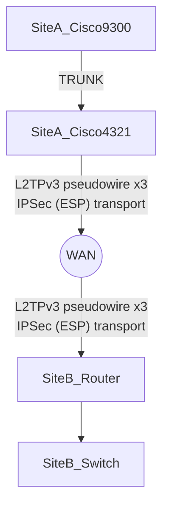

# Debian Linux Tools for Simple Network Diagrams (ASCII or UTF-8)

Reference for producing text-based (ASCII or Unicode box-drawing) network/graph
diagrams on Debian, for embedding in documentation, code comments, commit
messages, or terminal output. **Graph-Easy** is the recommended tool for
network topology sketches — it's packaged, requires no external renderer for
text output, and is verified working on Debian 13 (Trixie) below. PlantUML is
a heavier, JVM-based alternative for sequence/component/deployment diagrams;
its `nwdiag` network-diagram syntax specifically does *not* render usefully
as text (see §2) — use Graph-Easy for that instead.

## Contents

- [1. Graph-Easy (recommended)](#1-graph-easy-recommended)
  - [Top-down (vertical) layout — `flow: down`](#top-down-vertical-layout--flow-down)
  - [DOT + Graph-Easy for branching topologies](#dot--graph-easy-for-branching-topologies)
- [2. PlantUML](#2-plantuml)
- [3. Mermaid](#3-mermaid)
- [4. Other tools (unverified on this host)](#4-other-tools-unverified-on-this-host)
- [Quick tips](#quick-tips)

## 1. Graph-Easy (recommended)

- Package: `libgraph-easy-perl`

- Install:

  ```bash
  sudo apt update
  sudo apt install libgraph-easy-perl
  ```

- Takes a simple text description of nodes and edges and lays out ASCII art
  or Unicode box-drawing ("boxart").

**Examples** (verified on Debian 13, `libgraph-easy-perl` 0.76-3):

```bash
echo "[ Router ] -- eth0 --> [ Switch ] -- --> [ PC1 ], [ PC2 ]" | graph-easy
```

```text
+--------+  eth0   +--------+     +-----+
| Router | ------> | Switch | --> | PC1 |
+--------+         +--------+     +-----+
                     |
                     |
                     v
                   +--------+
                   |  PC2   |
                   +--------+
```

Unicode box-drawing output:

```bash
echo "[ Router ] -> [ Switch ] -> [ Server ]" | graph-easy --as=boxart
```

```text
┌────────┐     ┌────────┐     ┌────────┐
│ Router │ ──> │ Switch │ ──> │ Server │
└────────┘     └────────┘     └────────┘
```

### Top-down (vertical) layout — `flow: down`

By default Graph-Easy lays edges out left-to-right, which is fine for a
short chain but reads awkwardly once edge labels get long — a
multi-hop architecture diagram with descriptive link labels (protocol,
encapsulation, etc.) wants to read top-to-bottom instead, the same shape
as the diagram in [`flowchart/test.md`](flowchart/test.md). Add a `graph { flow: down; }`
attribute line ahead of the node/edge list to switch orientation; the rest
of the syntax is unchanged:

```bash
echo 'graph { flow: down; }
[ SiteA_Cisco9300 ] -- TRUNK --> [ SiteA_Cisco4321 ]
[ SiteA_Cisco4321 ] -- "L2TPv3 pseudowire x3 / IPSec (ESP) transport" --> [ WAN ]
[ WAN ] -- "L2TPv3 pseudowire x3 / IPSec (ESP) transport" --> [ SiteB_Router ]
[ SiteB_Router ] --> [ SiteB_Switch ]' | graph-easy --as=boxart
```

```text
┌─────────────────────────────────────────────────┐
│                 SiteA_Cisco9300                 │
└─────────────────────────────────────────────────┘
  │
  │ TRUNK
  ∨
┌─────────────────────────────────────────────────┐
│                 SiteA_Cisco4321                 │
└─────────────────────────────────────────────────┘
  │
  │ "L2TPv3 pseudowire x3 / IPSec (ESP) transport"
  ∨
┌─────────────────────────────────────────────────┐
│                       WAN                       │
└─────────────────────────────────────────────────┘
  │
  │ "L2TPv3 pseudowire x3 / IPSec (ESP) transport"
  ∨
┌─────────────────────────────────────────────────┐
│                  SiteB_Router                   │
└─────────────────────────────────────────────────┘
  │
  │
  ∨
┌─────────────────────────────────────────────────┐
│                  SiteB_Switch                   │
└─────────────────────────────────────────────────┘
```

This is the same L2TPv3-over-WAN topology used as the worked example in
`flowchart/test.md` — there it was hand-built with a short Python script for
exact alignment; here Graph-Easy lays it out automatically. Trade-offs
against the hand-built version: auto-layout gets box width and spacing
right for free, but Graph-Easy quotes any edge label containing spaces,
uses `∨`/`^` instead of `▼`/`▲` for down/up arrows, and — as seen above —
sizes every box in a column to the *widest* box or label in that column
rather than tightening each one individually, so a single long edge label
widens every box in the chain.

### DOT + Graph-Easy for branching topologies

`flow: down` is enough for a straight chain, but once a topology branches
(one router fanning out to several switches, redundant WAN links, etc.)
hand-writing the Graph-Easy source gets tedious fast — that's exactly the
case Graphviz's `dot` ranking algorithm is built for. Graph-Easy reads DOT
files directly, so you get `dot`'s auto-layout with Graph-Easy's text
renderer, no `dot` binary or image step required (though `graphviz` is a
useful package to have installed on its own, e.g. for `dot -Tsvg`):

```bash
cat <<'EOF' > topo.dot
digraph G {
  rankdir=TB;
  SiteA_Cisco9300 -> SiteA_Cisco4321 [label="TRUNK"];
  SiteA_Cisco4321 -> WAN [label="L2TPv3 pseudowire x3 / IPSec (ESP) transport"];
  WAN -> SiteB_Router [label="L2TPv3 pseudowire x3 / IPSec (ESP) transport"];
  SiteB_Router -> SiteB_Switch;
}
EOF
graph-easy --from=dot --as=boxart topo.dot
```

```text
┌───────────────────────────────────────────────┐
│                SiteA_Cisco9300                │
└───────────────────────────────────────────────┘
  │
  │ TRUNK
  ▼
┌───────────────────────────────────────────────┐
│                SiteA_Cisco4321                │
└───────────────────────────────────────────────┘
  │
  │ L2TPv3 pseudowire x3 / IPSec (ESP) transport
  ▼
┌───────────────────────────────────────────────┐
│                      WAN                      │
└───────────────────────────────────────────────┘
  │
  │ L2TPv3 pseudowire x3 / IPSec (ESP) transport
  ▼
┌───────────────────────────────────────────────┐
│                 SiteB_Router                  │
└───────────────────────────────────────────────┘
  │
  │
  ▼
┌───────────────────────────────────────────────┐
│                 SiteB_Switch                  │
└───────────────────────────────────────────────┘
```

`rankdir=TB` (top-to-bottom; DOT's default is actually `TB` already, so it
can be omitted — it's spelled out above for clarity) is what drives the
vertical layout; swap in `rankdir=LR` for the horizontal form instead. Note
the cleaner output versus the `flow: down` example above: going through DOT,
edge labels aren't quoted and Graph-Easy uses `▼` rather than `∨` — worth
the extra file-based step once a topology is non-trivial. For a topology
with actual branching, add a second edge out of the same source node (e.g.
a second `SiteA_Cisco4321 -> WAN2` line) and `dot`'s ranking will place the
branches side by side automatically, which `flow: down` alone won't do as
cleanly by hand.

Full list of `--as` output formats (`graph-easy --help`): `ascii`, `boxart`,
`html`, `svg`, `graphviz`/`dot`, `txt` (Graph::Easy's own format), `vcg`,
`gdl`, `graphml`, plus bitmap formats (`png`, `gif`, ...) piped through an
external renderer (default `dot`).

## 2. PlantUML

- Package: `plantuml` (`1:1.2020.2+ds-6`, PlantUML 1.2020.02) — **installed**
  on this host.

- Install:

  ```bash
  sudo apt install plantuml
  ```

- Supports sequence, component, deployment, and other UML-family diagrams —
  a broader diagram vocabulary than Graph-Easy, at the cost of a JVM
  dependency. It also has `nwdiag` network-diagram syntax, but see the
  caveat below: that syntax does **not** render usefully as text.

**Text output** — `-txt`/`-utxt` don't print to stdout; they write a sibling
file next to the input (`.atxt` for `-txt`, `.utxt` for `-utxt`):

```bash
plantuml -txt diagram.puml     # writes diagram.atxt (pure ASCII)
plantuml -utxt diagram.puml    # writes diagram.utxt (Unicode box-drawing)
```

**Verified working** — a sequence diagram renders cleanly as text:

```bash
cat <<'EOF' > seq.puml
@startuml
Router -> Switch : eth0
Switch -> Server : uplink
@enduml
EOF
plantuml -utxt seq.puml
cat seq.utxt
```

```text
     ┌──────┐          ┌──────┐          ┌──────┐
     │Router│          │Switch│          │Server│
     └──┬───┘          └──┬───┘          └──┬───┘
        │       eth0      │                 │
        │ ────────────────>                 │
        │                 │                 │
        │                 │      uplink     │
        │                 │ ────────────────>
     ┌──┴───┐          ┌──┴───┐          ┌──┴───┐
     │Router│          │Switch│          │Server│
     └──────┘          └──────┘          └──────┘
```

**Verified broken for this purpose** — `nwdiag` network syntax, the thing
you'd reach for to describe a router/switch/server topology, produces almost
nothing useful under `-txt`/`-utxt`: node labels with no connecting lines at
all, padded across a very wide, mostly blank canvas:

```text
@startuml
nwdiag {
  network internal {
    router;
    switch;
    server [address = "10.0.0.10"];
  }
}
@enduml
```

```text
     internal

                                                                 10.0.0.10

                       router                      switch                      server
```

So for an actual network topology sketch, use **Graph-Easy** (§1) — PlantUML
earns its place here for sequence/component/deployment diagrams instead,
where its text renderer works as expected.

## 3. Mermaid

Mermaid CLI renders diagram source to SVG, PNG, or PDF. Use the
[installation and setup guide](mermaid-install.md) for Node.js, npm, the compatible
Puppeteer browser, and troubleshooting. Keep installation instructions there.

For the CLI workflow described here, Mermaid produces image output rather than ASCII or
box-drawing text. GitHub can render fenced Mermaid blocks without a local installation;
use `mmdc` when you need local image exports. See the
[authoring and export reference](mermaid-reference.md) for more options.

**Verified on Debian 13** (`@mermaid-js/mermaid-cli` 12.0.0, re-verified October 4, 2026), using the
same L2TPv3-over-WAN topology as the worked example elsewhere on this page:

```bash
cat <<'EOF' > topo.mmd
flowchart TD
    A[SiteA_Cisco9300] -- TRUNK --> B[SiteA_Cisco4321]
    B -- "L2TPv3 pseudowire x3<br/>IPSec (ESP) transport" --> C((WAN))
    C -- "L2TPv3 pseudowire x3<br/>IPSec (ESP) transport" --> D[SiteB_Router]
    D --> E[SiteB_Switch]
EOF
mmdc -i topo.mmd -o topo.svg
```

```text
Generating single mermaid chart
```

`topo.svg` is produced cleanly (exit 0) — no manual layout, no alignment
math, `flowchart TD` gives top-down ranking natively. The same `topo.mmd`
content, dropped into a fence tagged ```` ```mermaid ```` instead of ```` ```text ````,
renders as a live diagram in GitHub's web view or a Claude Artifact, no
`mmdc` required — this actually renders on GitHub, unlike the code block
above it, which is deliberately tagged ```` ```bash ```` because it's a shell
command, not the diagram itself:



## 4. Other tools (unverified on this host)

These were not confirmed installable via `apt-cache policy`/`apt-cache search` on Debian 13 at time of writing — treat as leads to investigate, not
tested procedures. Prefer Graph-Easy or PlantUML above unless one of these
solves a specific need neither covers.

| Tool             | Type                                                                                    | Debian 13 packaging                                                                   | ASCII/UTF support                                                            |
| ---------------- | --------------------------------------------------------------------------------------- | ------------------------------------------------------------------------------------- | ---------------------------------------------------------------------------- |
| **Diagon**       | CLI (sequence, tree, flowchart, graph)                                                  | No `apt` package found; build from [GitHub](https://github.com/ArthurSonzogni/Diagon) | ASCII + Unicode styles                                                       |
| **Asciio**       | Interactive terminal editor (draw with mouse/keyboard)                                  | No `apt` package found; check CPAN (`App::Asciio`)                                    | Pure ASCII                                                                   |
| **ascii-draw**   | GUI app for ASCII diagrams                                                              | No `apt` package found; check Flatpak/Snap                                            | ASCII                                                                        |
| **Vim + DrawIt** | Editor plugin for manual ASCII drawing                                                  | No `apt` package found; install as a Vim plugin manually                              | Manual ASCII drawing                                                         |
| **ditaa**        | Reverse direction: renders hand-drawn ASCII art (`+`/`-`/`\|` box markup) into a bitmap | Real `apt` candidate (`ditaa` `0.10+ds1-1.4`); not installed on this host             | Consumes ASCII/Unicode as *input*, outputs PNG only — not a text-output tool |

`graphviz` itself (`sudo apt install graphviz`) is worth having independent of
the above — it's the standard DOT toolchain for PNG/SVG output, and pairs
with Graph-Easy for DOT-to-text conversion (§1). It does **not** produce
ASCII/text output on its own on this host, even though the AAlib runtime is
present: `libaa1` ("ASCII art library", package name `libaa1`, not `aalib`)
is installed, but `dot -T` with no argument prints the full list of supported
output formats and there is no AAlib/`vt100`/ASCII entry in it — only image
and vector formats (`png`, `svg`, `ps`, ...). Debian's `graphviz` build
doesn't link an AAlib output plugin, so having the library alone doesn't add
the capability. Route DOT through Graph-Easy
(`graph-easy --from=dot --as=ascii file.dot`) for text output instead of
relying on Graphviz directly.

## Quick tips

- Prefer **Graph-Easy** for the simplest network topology sketches (routers,
  switches, hosts, links) — it's packaged, fast, and needs no external
  renderer for ASCII/boxart output.
- For a **top-down/layered architecture diagram** — most multi-hop network
  topologies — add `graph { flow: down; }` to Graph-Easy source (§1) rather
  than hand-aligning boxes; once the topology actually branches (fan-out,
  redundant links), write it as a Graphviz DOT file with `rankdir=TB` and
  pipe it through `graph-easy --from=dot --as=boxart` (§1) instead — DOT's
  ranking algorithm handles branch placement that `flow: down` alone won't.
- Use **PlantUML** for sequence, component, or deployment diagrams that still
  need text output (`-utxt` renders these well) — but not for network
  topology sketches via `nwdiag`, which doesn't render usefully as text.
- Reach for **Mermaid** (`flowchart TD`, §3 — `mmdc` is installed on this
  host) instead of ASCII when the guide will be read in a browser (GitHub,
  Claude Artifacts) rather than a terminal — it isn't a text-output tool,
  but its top-down flowchart layout renders natively in both, no local
  install needed just to *view* it, and `mmdc` is there if you want to
  render an SVG/PNG locally instead.
- For purely manual drawing: any text editor, or a web tool like
  asciiflow.com, then paste the result into the doc.
- UTF-8 (boxart) looks much better in modern terminals that support Unicode;
  plain ASCII is more portable for old systems or strict ASCII-only
  environments.

These tools are lightweight, scriptable, and produce diagrams that can live
in documentation, code comments, or terminal output.
