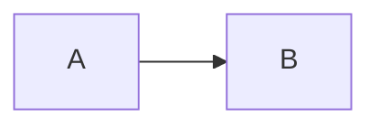

# Mermaid Installation and Setup Guide

This guide installs the tools needed to validate and export Mermaid diagrams on Linux. It is
standalone: no other document in this repository is required. This is the canonical guide for
Node.js, Mermaid CLI, Puppeteer, fonts, syntax validation, and browser troubleshooting.
For diagram authoring and export options, see the [authoring reference](mermaid-reference.md).

Mermaid diagrams embedded in GitHub-flavored Markdown do not require a local installation when
viewed on GitHub. Install the tools below when you need local syntax checks or SVG, PNG, and PDF
exports.

## Contents

- [What gets installed](#what-gets-installed)
- [Check an existing installation](#1-check-for-an-existing-installation)
- [Install Node.js](#2-install-nodejs-with-nvm)
- [Quick installer](#quick-installer-cli-browser-and-a-render-check)
- [Manual CLI and browser installation](#3-install-mermaid-cli)
- [Project-local CLI with system Chromium](#project-local-cli-with-system-chromium-debian-13)
- [Verify the installation](#4-verify-the-installation)
- [Optional linter](#5-install-and-run-the-optional-linter)
- [Optional emoji fonts](#6-optional-emoji-font-support)
- [Troubleshooting](#troubleshooting)
- [Updating or removing tools](#updating-or-removing-the-tools)

## What gets installed

- Node.js and npm, managed per user with `nvm`
- Official npm Mermaid CLI (`@mermaid-js/mermaid-cli`, executable `mmdc`) for rendering diagrams
- Puppeteer plus either its compatible browser or an explicitly selected system Chromium
- Optionally, `@mermaid-lint/cli` for parser-based validation
- Optionally, an emoji font for diagrams that contain Unicode icons

The commands in this guide assume Bash on Debian or Ubuntu. Run npm as your normal user when using
`nvm`; do not prefix npm commands with `sudo`.

## 1. Check for an existing installation

```bash
node --version
npm --version
mmdc --version
type -a mmdc
```

The upstream CLI 12.0.0 requires Node.js 22.13.0 or newer; this guide uses Node.js 24.
If all three commands succeed, the Node.js requirement is met, and `mmdc` is the official npm CLI, skip to
[Verify the installation](#4-verify-the-installation). Node.js 24 LTS is recommended for the CLI
and linter described here.

A command named `mmdc` alone does not identify the implementation. In the October 25, 2026
setup notes, `/home/sysadmin/.venv/bin/mmdc` was Python package `mermaid_cli` 0.1.3 using
Playwright, rather than the official npm CLI. Its `executable_path` browser setting differs
from Puppeteer's `executablePath`. Invoke `./node_modules/.bin/mmdc` for a project-local npm
installation to avoid a Python wrapper earlier on `PATH`.

If `npm` is not found, complete section 2 before attempting any npm package installation.
Installing nvm alone does not install Node.js or npm.

## 2. Install Node.js with nvm

Install basic download tools if needed:

```bash
sudo apt update
sudo apt install curl ca-certificates
```

Download the official `nvm` installer to a temporary file so it can be reviewed before it runs:

```bash
curl -fsSL https://raw.githubusercontent.com/nvm-sh/nvm/v0.40.8/install.sh -o /tmp/nvm-install.sh
less /tmp/nvm-install.sh
bash /tmp/nvm-install.sh
```

Open a new shell, or reload the Bash configuration that the installer updated:

```bash
source "$HOME/.bashrc"
```

Use the home-qualified path. Running `source .bashrc` inside a project looks in the current
working directory and can fail with `No such file or directory`.

Alternatively, load `nvm` directly into the current Bash session:

```bash
export NVM_DIR="$HOME/.nvm"
[ -s "$NVM_DIR/nvm.sh" ] && . "$NVM_DIR/nvm.sh"
```

Verify that the shell function is available. Use `command -v`, because `nvm` is not a standalone
executable:

```bash
command -v nvm
```

Install and select Node.js 24, then make it the default for new shells:

```bash
nvm install 24
nvm alias default 24
nvm use 24
```

Confirm the active runtime and its location:

```bash
node --version
npm --version
command -v node
```

The `node` path should normally be below `$NVM_DIR/versions/node/`. If `nvm` is already installed,
the shorter `nvm install 24` command installs or selects the newest available Node.js 24 release.
On the Debian 13 host inspected for these instructions, the configured apt repositories offered
Node.js 20.19, which is below CLI 12.0.0's minimum. Check your repository's candidate rather
than assuming `apt install nodejs npm` supplies a sufficiently recent runtime.

Node.js installed by nvm includes npm. Do not continue until both version commands succeed.
An npm self-update notice is optional; updating npm is not a prerequisite for installing Mermaid.

## Quick installer: CLI, browser, and a render check

After completing the Node.js setup above, save the following as `install-mermaid.sh`
and run `bash install-mermaid.sh` as your normal user. It requires Node.js 24 or
newer with a user-writable npm global prefix (the `nvm` setup provides this).
It installs Mermaid CLI, explicitly downloads the browser expected by its bundled
Puppeteer, and renders a small SVG. Re-running installs the requested CLI version again.

The default pins CLI **12.0.0**, the version used for the September 25, 2026 layout
checks. Override it with `MERMAID_CLI_VERSION=<reviewed-version>` when upgrading.
This pins the CLI release, not its entire dependency tree; use a project lock file
when exact dependency reproduction matters.

```bash
#!/usr/bin/env bash
set -euo pipefail

die() { printf 'ERROR: %s\n' "$*" >&2; exit 1; }
(( EUID != 0 )) || die 'Run as your normal user, not with sudo.'
command -v node >/dev/null || die 'Install Node.js with nvm first (section 2).'
command -v npm >/dev/null || die 'npm is missing; check the Node.js installation.'
node_major=$(node -p 'Number(process.versions.node.split(".")[0])')
(( node_major >= 24 )) || die 'Select Node.js 24 or newer before running this script.'
npm_prefix=$(npm prefix --global)
[[ -d "$npm_prefix" && -w "$npm_prefix" ]] ||
    die 'The npm global prefix is not writable; use the nvm setup in section 2.'

cli_version=${MERMAID_CLI_VERSION:-12.0.0}
# Download only the required headless browser in the explicit step below.
PUPPETEER_SKIP_DOWNLOAD=true npm install --global "@mermaid-js/mermaid-cli@${cli_version}"
cli_root="$(npm root --global)/@mermaid-js/mermaid-cli"
puppeteer_bin="$cli_root/node_modules/.bin/puppeteer"
[[ -x "$puppeteer_bin" ]] || die "Bundled Puppeteer CLI not found: $puppeteer_bin"
"$puppeteer_bin" browsers install chrome-headless-shell
"$puppeteer_bin" browsers list

# Use the CLI just installed, even if another mmdc comes earlier on PATH.
mmdc_bin="$npm_prefix/bin/mmdc"
[[ -x "$mmdc_bin" ]] || die "Mermaid CLI not found: $mmdc_bin"
verify_dir=$(mktemp -d /tmp/mermaid-install.XXXXXX)
printf '%s\n' 'flowchart LR' '    SOURCE[Source] --> OUTPUT[Rendered SVG]' \
    > "$verify_dir/smoke.mmd"
if ! "$mmdc_bin" -i "$verify_dir/smoke.mmd" -o "$verify_dir/smoke.svg"; then
    die "Render failed. See browser troubleshooting below; files retained in $verify_dir"
fi
[[ -s "$verify_dir/smoke.svg" ]] || die 'Render returned no SVG.'
"$mmdc_bin" --version
printf 'Installed CLI: %s\nReview SVG: %s\n' "$mmdc_bin" "$verify_dir/smoke.svg"
```

On a minimal Debian 13 or Ubuntu 24.04 host, first install the runtime libraries
listed in [section 3](#install-browser-runtime-libraries-on-minimal-debian-systems).
For readable text and optional emoji, install fonts separately:

```bash
sudo apt update
sudo apt install fonts-liberation fonts-noto-color-emoji fontconfig
```

The script leaves system package installation explicit and keeps browser sandboxing
enabled. It does not change the current repository or install the optional linter.
The smoke test proves browser startup and rendering, not the layout of other diagrams.
See the official [Mermaid CLI installation instructions](https://github.com/mermaid-js/mermaid-cli)
and [Puppeteer configuration guide](https://pptr.dev/guides/configuration).

## 3. Install Mermaid CLI

Use this manual procedure if you did not run the quick installer. If its SVG render succeeded,
continue with [verification](#4-verify-the-installation).

Install the official Mermaid CLI package globally for the active `nvm` Node.js version:

```bash
npm install --global @mermaid-js/mermaid-cli
```

Confirm that the executable is available:

```bash
mmdc --version
mmdc --help
```

Global npm packages belong to the active Node.js version. If `mmdc` disappears after changing
versions with `nvm`, select the intended version and install the package again.

### Optional project-local installation

For automation or a shared repository, pinning Mermaid CLI as a development dependency gives more
repeatable builds than relying on each user's global package:

```bash
npm install --save-dev @mermaid-js/mermaid-cli
npx mmdc --version
```

Commit the resulting `package.json` and lock file when the repository intentionally uses this
method. Do not run this command merely to render a one-off diagram, because it changes the current
project.

### Project-local CLI with system Chromium (Debian 13)

Use this route when Chromium is already installed or you prefer the operating system's browser.
It is an alternative to downloading Puppeteer's expected browser. The selected Puppeteer and
system Chromium versions still need a successful render test to establish compatibility.
Complete the Node.js setup in section 2 first, then install the browser and its sandbox package
from a normal terminal:

```bash
sudo apt update
sudo apt install chromium chromium-sandbox fonts-liberation
command -v chromium
chromium --version
```

Run Chromium as your normal user with its sandbox enabled. Installing `chromium-sandbox` does
not override restrictions imposed by a container, host, or agent execution sandbox.

Change to the project where you want to maintain the npm development dependencies. This example
uses the ZTA repository; substitute your own project path when applying the procedure elsewhere:

```bash
cd "$HOME/projects/zta-decomposition"
PUPPETEER_SKIP_DOWNLOAD=true npm install --save-dev @mermaid-js/mermaid-cli puppeteer
./node_modules/.bin/mmdc --version
```

Explicitly installing Puppeteer makes the dependency visible alongside the CLI. This route
intentionally skips Puppeteer's browser download because it uses system Chromium. Review and
retain the resulting `package.json` and `package-lock.json` for the project.

Create `puppeteer-config.json` in that project using the path reported by `command -v chromium`:

```json
{
  "executablePath": "/usr/bin/chromium"
}
```

For the official npm CLI, the key is camel-case `executablePath`, not the Python wrapper's
`executable_path`. Keep browser sandboxing enabled; do not add `--no-sandbox` as a routine fix.
The [official existing-browser instructions](https://github.com/mermaid-js/mermaid-cli/blob/master/docs/already-installed-chromium.md)
describe this setting.

Render a small standalone source to confirm that the CLI and browser actually work together:

```bash
mkdir -p /tmp/mermaid-smoke-test
printf '%s\n' 'flowchart TB' '  SOURCE["Source"] --> OUTPUT["Rendered output"]' \
  > /tmp/mermaid-smoke-test/test.mmd
./node_modules/.bin/mmdc \
  -i /tmp/mermaid-smoke-test/test.mmd \
  -o /tmp/mermaid-smoke-test/test.svg \
  -p puppeteer-config.json \
  -b white
test -s /tmp/mermaid-smoke-test/test.svg && echo "SVG render succeeded"
```

After that succeeds, render the embedded ZTA logical-topology diagram to SVG and PNG:

```bash
./node_modules/.bin/mmdc \
  -i 020_architecture/logical-topology.md \
  -o /tmp/zta-logical.svg \
  -p puppeteer-config.json \
  -b white
./node_modules/.bin/mmdc \
  -i 020_architecture/logical-topology.md \
  -o /tmp/zta-logical.png \
  -p puppeteer-config.json \
  -b white -s 2
```

Markdown inputs containing multiple diagrams produce numbered image artifacts. Inspect the
reported output paths and open the PNGs to check labels, containment, arrows and contrast;
CLI version output alone does not prove browser startup or correct layout.

### Observed installation results

The console notes supplied for the October 25, 2026 update show that installing nvm alone left
`npm` unavailable. Running `nvm install 24` resolved that and produced:

```console
Now using node v24.22.1 (npm v11.19.1)
```

The subsequent project-local command installed 195 packages. A later optional npm self-update
installed npm 12.2.1. These are recorded local results, not required exact versions. The supplied
notes contain no completed Mermaid render; CLI/browser interoperability remains unverified by
that console record. Read the install-script warning guidance below before interpreting npm
warnings as browser failures.

### Install Puppeteer's compatible browser if needed

Mermaid CLI uses Puppeteer and a compatible Chrome Headless Shell. The npm installation normally
provides the required browser, but some installations omit the download and later report
`Could not find chrome-headless-shell`.

For a global installation under the active `nvm` Node.js version, locate the bundled Puppeteer
executable and install the browser it expects:

```bash
puppeteer_bin="$(npm root --global)/@mermaid-js/mermaid-cli/node_modules/.bin/puppeteer"
"${puppeteer_bin}" browsers install chrome-headless-shell
"${puppeteer_bin}" browsers list
```

For a project-local installation:

```bash
./node_modules/.bin/puppeteer browsers install chrome-headless-shell
./node_modules/.bin/puppeteer browsers list
```

Run these commands as the same unprivileged account that runs `mmdc`; do not use `sudo`. Puppeteer
stores the browser in that user's cache, and a browser downloaded into root's cache will not fix a
missing browser for the normal user. The download requires network access and may be large. Repeat
it after an upgrade if Puppeteer requests a different browser release.

### Install browser runtime libraries on minimal Debian systems

Chrome Headless Shell still depends on operating-system libraries. On a minimal Debian 13 system,
install the common runtime dependencies with:

```bash
sudo apt update
sudo apt install \
  libnspr4 \
  libnss3 \
  libatk1.0-0t64 \
  libatk-bridge2.0-0t64 \
  libatspi2.0-0t64 \
  libxdamage1 \
  libxkbcommon0 \
  libasound2t64
```

The `t64` names apply to Debian 13; older Debian and Ubuntu releases may use package names without
that suffix. Copy the current executable path from `puppeteer browsers list`, then check for
unresolved libraries:

```bash
browser_path=/path/reported/by/puppeteer/chrome-headless-shell
ldd "${browser_path}" | awk '/not found/ {print}'
```

No output means all directly linked libraries were resolved. Do not hard-code the versioned cache
path in automation because it changes when Puppeteer is upgraded.

## 4. Verify the installation

Create a small standalone Mermaid source in a temporary directory:

```bash
mkdir -p /tmp/mermaid-smoke-test
printf '%s\n' 'flowchart LR' '    A[Source] --> B[Rendered output]' \
  > /tmp/mermaid-smoke-test/test.mmd
```

Render it to SVG:

```bash
mmdc \
  --input /tmp/mermaid-smoke-test/test.mmd \
  --output /tmp/mermaid-smoke-test/test.svg
```

Verify that the output exists and is nonempty:

```bash
test -s /tmp/mermaid-smoke-test/test.svg \
  && echo "Mermaid CLI installation succeeded"
```

For normal work, render a standalone `.mmd` file like this:

```bash
mmdc --input architecture.mmd --output architecture.svg
```

Mermaid CLI can also extract and render fenced `mermaid` blocks from Markdown:

```bash
mkdir -p exports
mmdc \
  --input architecture.md \
  --output exports/architecture-rendered.md \
  --artefacts exports \
  --outputFormat svg
```

### Verify every Mermaid-bearing Markdown file

For a repository-wide check, discover only Markdown files containing Mermaid fences and render
them into a temporary directory. Run this block in a dedicated shell or script because its final
`exit` returns the combined result:

````bash
verify_dir=$(mktemp -d /tmp/mermaid-verify.XXXXXX)
verification_failed=0

while IFS= read -r source_file; do
  relative_file=${source_file#./}
  output_file="${verify_dir}/${relative_file}"
  error_file="${verify_dir}/${relative_file//\//_}.error.log"

  mkdir -p "${output_file%/*}"
  if mmdc --quiet --input "${source_file}" --output "${output_file}" 2>"${error_file}"; then
    printf 'PASS %s\n' "${source_file}"
    rm -f "${error_file}"
  else
    printf 'FAIL %s\n' "${source_file}" >&2
    sed -n '1,200p' "${error_file}" >&2
    verification_failed=1
  fi
done < <(rg -l '^```mermaid$' --glob '*.md' . | sort)

printf 'Rendered output: %s\n' "${verify_dir}"
exit "${verification_failed}"
````

If `rg` is unavailable, use this discovery command in place of the process substitution above:

````bash
find . -type f -name '*.md' -exec grep -l '^```mermaid$' {} + | sort
````

Inspect the printed temporary directory, then remove that exact directory when it is no longer
needed. Resolve the path before removing it; do not use a broad wildcard or recursively remove
`/tmp` itself.

### Review verification results

For each Markdown input, confirm that the command succeeded, the output Markdown exists,
and one image was generated for each Mermaid block. Inspect stderr for parse, browser,
or resource-loading errors. When checking an exit status interactively, capture `$?`
immediately after `mmdc`; a later `echo` or other command replaces that status.

The batch procedure returns a combined failure status. To keep an interactive shell open,
replace its final `exit "${verification_failed}"` with `test "${verification_failed}" -eq 0`.

Open the generated images and check labels, arrows, subgraph placement, fonts, and contrast.
Compare the diagram against the configuration or workflow it documents; a successful render
does not establish architectural accuracy. See the
[output review checklist](mermaid-reference.md#review-generated-output).

## 5. Install and run the optional linter

The linter checks Mermaid syntax without launching Chromium. Select the published scoped package
explicitly with `npx`:

```bash
npx --yes --package @mermaid-lint/cli mermaid-lint architecture.md
```

A successful check exits with status zero.

For repeatable offline or CI use, install it in the project and invoke the locked version:

```bash
npm install --save-dev @mermaid-lint/cli
npx mermaid-lint architecture.md
```

Linting checks source structure, not visual layout. Render important diagrams as well to inspect
text wrapping, link placement, fonts, colors, and clipping.

## 6. Optional emoji-font support

Mermaid CLI renders through a Chromium-based browser. Install an emoji font if exported diagrams
show empty boxes in place of Unicode icons:

```bash
sudo apt update
sudo apt install fonts-noto-color-emoji fontconfig
fc-cache -f -v
```

Confirm that Fontconfig can find it:

```bash
fc-match 'Noto Color Emoji'
fc-match -s emoji | head
```

Restart any persistent Chromium or Mermaid CLI process and render the diagram again. Emoji style
can still differ across operating systems and browser versions.

## Troubleshooting

### `nvm: command not found`

Open a new terminal. If the problem remains, load `nvm` explicitly:

```bash
export NVM_DIR="$HOME/.nvm"
[ -s "$NVM_DIR/nvm.sh" ] && . "$NVM_DIR/nvm.sh"
```

Then run `command -v nvm`. Check that the installer added equivalent lines to the Bash startup
file used by the account.

### `npm: command not found`

Install and activate Node.js, even if the `nvm` command already works:

```bash
source "$HOME/.nvm/nvm.sh"
nvm install 24
nvm alias default 24
nvm use 24
node --version
npm --version
```

If the source command cannot find `nvm.sh`, complete the nvm installation in section 2. If nvm
uses a custom install directory, load `nvm.sh` from that directory instead. In a new terminal,
`source "$HOME/.bashrc"` loads the startup changes made by the installer; `source .bashrc`
searches the current directory.

### npm reports a blocked Puppeteer install script

The supplied npm output reports that Puppeteer's postinstall script was not covered by
`allowScripts`. That warning is distinct from a package download failure or Chromium launch
failure. On npm versions supporting these commands, inspect the policy with:

```bash
npm install-scripts ls
```

For the system Chromium route, the browser download is intentionally omitted and the explicit
`executablePath` selects the existing browser; the blocked download script does not itself
establish that this setup is unusable. Run the render smoke test. Do not approve a script merely
to silence the warning. If you deliberately choose Puppeteer's downloaded browser, review the
script before approval or run the explicit browser installer described in section 3.
See [npm's install-script documentation](https://docs.npmjs.com/cli/v12/commands/npm-install-scripts/).

Funding notices, optional npm upgrade notices and audit findings are separate from installation
or rendering success. Review audit findings with `npm audit`; do not automatically apply
`npm audit fix --force`, which can introduce breaking dependency changes.

### `mmdc: command not found`

Confirm the expected Node.js version is active, then reinstall the global package for that version:

```bash
nvm use 24
npm install --global @mermaid-js/mermaid-cli
command -v mmdc
```

### Chromium fails to start

Mermaid CLI depends on Puppeteer and a Chromium-based browser. Read the full error first; missing
shared libraries, a blocked browser download, and an operating-system sandbox failure require
different fixes.

In a trusted, isolated environment only, a Puppeteer configuration can disable the Chromium
sandbox:

```json
{
  "args": ["--no-sandbox", "--disable-setuid-sandbox"]
}
```

Save that JSON as `puppeteer-config.json`, then run:

```bash
mmdc \
  --input architecture.mmd \
  --output architecture.svg \
  --puppeteerConfigFile puppeteer-config.json
```

Disabling Chromium's sandbox reduces process isolation. Do not make this the default on a shared or
Internet-facing system, and render only trusted Mermaid source with this workaround.

If the error says `Could not find chrome-headless-shell`, install Puppeteer's compatible browser as
described above. If the browser exists but reports a missing shared library, use `ldd` on the
executable and install the corresponding packages from the operating system's approved
repositories. A sandbox error such as `Operation not permitted` is different: prefer rendering as
an ordinary user on a host where Chromium's sandbox can operate, or use the reviewed escape
mechanism supplied by the surrounding automation platform.

An observed browser failure in the ZTA agent session was `setsockopt: Operation not permitted`
in Chromium's crashpad during startup, even with `--no-sandbox`. This indicates an execution
restriction rather than a Mermaid parse failure. Installing npm packages or disabling Chromium's
own sandbox does not remove restrictions imposed by the surrounding runtime. Test from a normal
terminal on the host; rendering inside the agent requires a runtime permitted to launch Chromium
and perform the required process/socket operations. If it still fails there, retain the full
browser log for diagnosis rather than treating more package installation as a proven fix.

### Use an existing system Chromium as a fallback

If downloading Puppeteer's browser is prohibited, install Chromium from the approved operating
system repository and point Puppeteer to it:

```bash
sudo apt update
sudo apt install chromium chromium-sandbox
command -v chromium
```

Create a configuration containing the path returned by `command -v`:

```json
{
  "executablePath": "/usr/bin/chromium"
}
```

Then pass it to Mermaid CLI:

```bash
mmdc \
  --input architecture.mmd \
  --output exports/architecture.svg \
  --puppeteerConfigFile puppeteer-config.json
```

Puppeteer guarantees compatibility with its expected bundled browser, so a system Chromium is a
fallback rather than the preferred configuration.

### Verified fallback: an installed Brave browser

During the September 25, 2026 checks, `mmdc 12.0.0` was installed but its
expected Chrome Headless Shell was absent. The existing Brave executable worked
as a fallback through the same `executablePath` setting:

```json
{
  "executablePath": "/opt/brave.com/brave/brave"
}
```

Save it as a separate local configuration and pass `-p` to `mmdc`. Check the path
on your own machine; this is a recorded local result, not a guarantee that every
Brave/Puppeteer combination works. The tested restricted environment additionally
needed `--no-sandbox` and execution outside the surrounding filesystem/process
sandbox through its approval mechanism. Those are separate controls: disabling
Chromium's own sandbox does not bypass restrictions imposed by the host or agent.

In a sandbox with no browser installed at all, the npm package `@sparticuz/chromium`
ships a usable Chromium binary. Point `executablePath` at the binary it extracts and
add `--no-sandbox` to `args`, with the same caution as above. This was reported from a
separate sandboxed session and has not been tested on this host.

| Error                                   | What to check                                                                                           |
| --------------------------------------- | ------------------------------------------------------------------------------------------------------- |
| `Could not find chrome-headless-shell`  | Install the browser expected by the CLI's bundled Puppeteer, or explicitly select an installed browser. |
| Missing shared library                  | Check the selected executable with `ldd` and install the missing OS package.                            |
| `Operation not permitted` during launch | Inspect host/container restrictions and use the environment's approved execution mechanism.             |
| Launch timeout                          | Test the browser configuration; a timeout alone is not proof of a Mermaid syntax error.                 |

The CLI forwards this file to Puppeteer's launch options; see the official
[existing-browser instructions](https://github.com/mermaid-js/mermaid-cli/blob/master/docs/already-installed-chromium.md).

### Rendering works for `.mmd` but fails for Markdown

Ensure each embedded diagram uses an exact Mermaid fence and that Markdown input produces a
Markdown output filename:

````markdown

````

```bash
mmdc --input architecture.md --output /tmp/architecture-rendered.md
```

### An upgrade leaves the browser incompatible

After upgrading Mermaid CLI, inspect the installed versions and reinstall the browser expected by
the bundled Puppeteer release:

```bash
mmdc --version
node -p "require('$(npm root --global)/@mermaid-js/mermaid-cli/node_modules/puppeteer/package.json').version"

puppeteer_bin="$(npm root --global)/@mermaid-js/mermaid-cli/node_modules/.bin/puppeteer"
"${puppeteer_bin}" browsers install chrome-headless-shell
```

### npm reports permissions errors

Do not work around permissions errors with `sudo npm`. Confirm that the `node` and `npm` commands
come from the active `nvm` installation:

```bash
command -v node
command -v npm
nvm current
```

Reload `nvm`, select Node.js 24, and retry the install as the normal user.

## Updating or removing the tools

Update the globally installed CLI for the active Node.js version:

```bash
npm update --global @mermaid-js/mermaid-cli
```

Remove it:

```bash
npm uninstall --global @mermaid-js/mermaid-cli
```

List installed Node.js versions or temporarily return to the operating system's Node.js:

```bash
nvm ls
nvm use system
```

## Security and maintenance

- Run Mermaid CLI and Puppeteer's browser installer as an unprivileged user.
- Treat npm packages and downloaded browser binaries as executable supply-chain dependencies. Pin
  versions and review lock-file changes when reproducibility matters.
- Use temporary output directories for validation so generated images and rewritten Markdown do
  not clutter the repository.
- Treat Mermaid source and generated SVG from untrusted repositories as untrusted content. SVG can
  contain links or other active content; review it before publishing or opening it in a privileged
  context.
- Re-run linting and visual rendering whenever diagram source or the Mermaid CLI version changes.

## Further reading

- [Mermaid CLI repository and usage](https://github.com/mermaid-js/mermaid-cli)
- [Puppeteer installation and browser downloads](https://pptr.dev/guides/installation)
- [Puppeteer configuration](https://pptr.dev/guides/configuration)
- [Mermaid CLI with an existing Chromium](https://github.com/mermaid-js/mermaid-cli/blob/master/docs/already-installed-chromium.md)
- [npm install-script policy](https://docs.npmjs.com/cli/v12/commands/npm-install-scripts/)
- [nvm installation and usage](https://github.com/nvm-sh/nvm)
- [Mermaid documentation](https://mermaid.js.org/)
- [Diagram authoring and export reference](mermaid-reference.md)
