# Mermaid Architecture Diagrams for System and Network Administrators

This guide explains how to create maintainable infrastructure and network architecture diagrams
with Mermaid. Its primary example is embedded in
[`architecture/architecture.md`](architecture/architecture.md). Standalone `.mmd` files in
this guide are generated working copies; they are not included in the repository.

For new diagrams, follow the [code conventions](mermaid-best-practices-r1.1.0.md) for IDs,
classes, and source organization. Older examples below retain their original names.

For Node.js, CLI, browser, font, and linter setup, use the
[installation and setup guide](mermaid-install.md).

VS Code can display the embedded diagram in `architecture.md` with its built-in Markdown preview;
the preferred third-party **Mermaid Preview — 100% Offline** extension is not required for that
workflow. The extension remains useful when previewing the standalone `architecture.mmd` file.

The examples are written for GitHub-flavored Markdown. Most also work in other Mermaid-capable
renderers, but supported Mermaid versions and security settings can differ.

## Table of contents

- [Why use Mermaid?](#why-use-mermaid)
- [Your first architecture diagram](#your-first-architecture-diagram)
- [The basic flowchart model](#the-basic-flowchart-model)
  - [Diagram direction](#diagram-direction)
  - [Node IDs and displayed labels](#node-ids-and-displayed-labels)
  - [Useful node shapes](#useful-node-shapes)
  - [Comments](#comments)
- [Representing sites and logical boundaries](#representing-sites-and-logical-boundaries)
- [Connecting infrastructure](#connecting-infrastructure)
  - [Common link types](#common-link-types)
  - [Connection labels](#connection-labels)
  - [Multiline labels](#multiline-labels)
- [Representing network concepts](#representing-network-concepts)
  - [VLANs and subnets](#vlans-and-subnets)
  - [Routing VLAN subnets versus extending VLANs](#routing-vlan-subnets-versus-extending-vlans)
  - [Interfaces and transit networks](#interfaces-and-transit-networks)
  - [WANs, tunnels, and clouds](#wans-tunnels-and-clouds)
  - [Repeated endpoint devices](#repeated-endpoint-devices)
- [Layout and spacing](#layout-and-spacing)
  - [Make edge-label boxes wider](#make-edge-label-boxes-wider)
- [Styling](#styling)
  - [Maintainable dark styles for a code architecture diagram](#maintainable-dark-styles-for-a-code-architecture-diagram)
- [Icons, emoji, and portability](#icons-emoji-and-portability)
- [When HTML is appropriate](#when-html-is-appropriate)
- [Architecture building blocks](#architecture-building-blocks)
- [Reusable templates](#reusable-templates)
- [Exporting diagrams to SVG and PNG](#exporting-diagrams-to-svg-and-png)
  - [Install Mermaid CLI](#install-mermaid-cli)
  - [Export diagrams directly from Markdown](#export-diagrams-directly-from-markdown)
  - [Create a standalone Mermaid source from Markdown](#create-a-standalone-mermaid-source-from-markdown)
  - [Export a single Mermaid source file](#export-a-single-mermaid-source-file)
  - [Choose SVG or PNG](#choose-svg-or-png)
  - [Control PNG resolution and background](#control-png-resolution-and-background)
  - [Match a GitHub or VS Code dark appearance](#match-a-github-or-vs-code-dark-appearance)
  - [Embed an exported image in Markdown](#embed-an-exported-image-in-markdown)
  - [Review generated output](#review-generated-output)
  - [Troubleshoot missing emoji icons](#troubleshoot-missing-emoji-icons)
  - [Troubleshoot headless-browser errors](#troubleshoot-headless-browser-errors)
- [Linting Mermaid diagrams](#linting-mermaid-diagrams)
  - [Set up and run the linter](#set-up-and-run-the-linter)
  - [Understand linting limits](#understand-linting-limits)
- [Compatibility and sharing](#compatibility-and-sharing)
- [Troubleshooting](#troubleshooting)
- [Design checklist](#design-checklist)
- [Quick reference](#quick-reference)
- [Further reading](#further-reading)

## Why use Mermaid?

Mermaid represents a diagram as text, either in a standalone `.mmd` file or in a fenced block
inside Markdown. This has several advantages for infrastructure documentation:

- Diagrams can be reviewed in pull requests alongside configuration and documentation changes.
- Text is easier to search, copy, compare, and version than a binary diagram file.
- Administrators can update addresses, interfaces, VLANs, and device names without a drawing tool.
- GitHub renders Mermaid diagrams directly in Markdown files.
- The source remains readable even when a particular viewer cannot render Mermaid.

Mermaid is best for logical and conceptual architecture. Use a dedicated diagramming tool when
you need exact physical rack placement, precise cable paths, vendor stencils, or pixel-perfect
layout.

## Your first architecture diagram

Place Mermaid source in a fenced code block whose language is `mermaid`:

````markdown
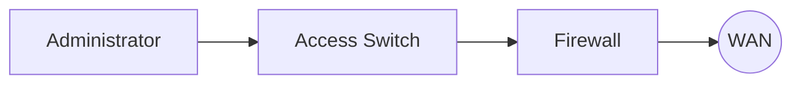
````

Rendered result:


In this source:

- `flowchart LR` selects a flowchart laid out from left to right.
- `SITE_A_ADMIN_01`, `SITE_A_SW_01`, `SITE_A_FW_01`, and `WAN_CARRIER` are stable node IDs used
  by later relationships.
- Text inside brackets is the displayed label; the doubled parentheses around `WAN_CARRIER` select
  a circular shape.
- `-->` creates a directional connection. After a node is declared, later connections can refer to
  its ID alone, as `SITE_A_SW_01` and `SITE_A_FW_01` do here.

The source describes relationships. Mermaid calculates the final positions.

## The basic flowchart model

For most system and network architecture diagrams, start with `flowchart`. A flowchart consists
of nodes, links, labels, and optional subgraphs.

### Diagram direction

Choose a direction that matches the main traffic or dependency flow:

| Declaration | Direction | Typical use |
| -- | -- | -- |
| `flowchart TD` | Top to bottom | Access, distribution, and WAN layers |
| `flowchart BT` | Bottom to top | Reverse dependency or escalation views |
| `flowchart LR` | Left to right | Site-to-site paths and request flows |
| `flowchart RL` | Right to left | Reverse flows |

`TD` and `TB` both mean top to bottom.

The IPsec example uses `flowchart TD` because each site is organized vertically: endpoints,
switching, routing or firewalling, and WAN connectivity.

### Node IDs and displayed labels

Every node has an ID used by Mermaid source and an optional displayed label:

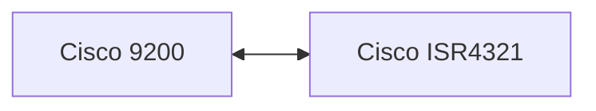

In this example:

- `SITE_A_SW_01` and `SITE_A_RTR_01` are stable internal IDs.
- `Cisco 9200` and `Cisco ISR4321` are the displayed labels.

Changing a displayed label does not require changing every link that references the node.

Mermaid does not provide predefined IDs for network devices; you choose them. This collection
uses uppercase words separated by underscores, in the order scope, role, then number:
`SITE_A_SW_01`, `SITE_B_FW_01`, `WAN_CARRIER`. Subgraph IDs start with `SG_`. The
[naming conventions](mermaid-best-practices-r1.1.0.md#naming) give the full scheme, including edge and
class names.

Spell out a role rather than using a bare abbreviation that can be confused with a product
family. For example, Cisco uses `ASR` for Aggregation Services Router, so `SITE_A_RTR_01` is
clearer than `ASR` when you mean "Site A router." IDs must be unique within a diagram and should
remain stable even if the displayed device name changes.

### Useful node shapes

Common flowchart shapes are sufficient for most infrastructure diagrams:

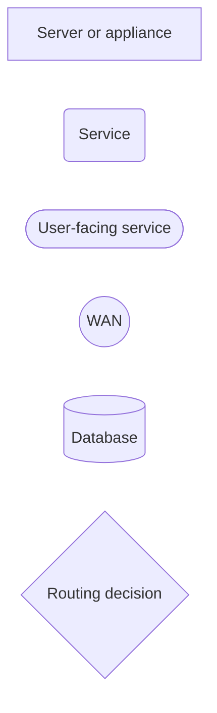

Use shapes consistently. If firewalls are rectangles in one site, make them rectangles in other
sites too. Shape should communicate meaning rather than decoration.

Recent Mermaid releases include an expanded `cloud` shape:

```text
WAN_CARRIER@{ shape: cloud, label: "WAN" }
```

Before using newer syntax, verify that every target renderer supports the required Mermaid
version.

### Comments

Start a comment with `%%`. The comment must be on its own line; Mermaid ignores everything from
the `%%` through the end of that line:

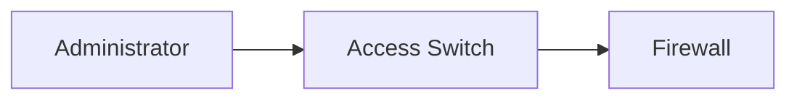

Always put text after `%%`. A comment line containing only `%%` can make the parser merge the
lines that follow it and fail with `Parse error on line 1`; use `%% ---` for a visual separator.
`grep -nE '^\s*%%\s*$' file.md` should print nothing. See the
[lessons](mermaid-lessons-r1.0.6.md#known-bugs--hard-limitations).

Use comments to record intent, assumptions, or maintenance notes that help someone edit the source.
Comments do not appear in the rendered diagram. Put information that readers need to see in node or
connection labels, or in the surrounding Markdown text.

## Representing sites and logical boundaries

Use a `subgraph` for a site, security zone, cloud account, data center, cluster, or administrative
boundary:

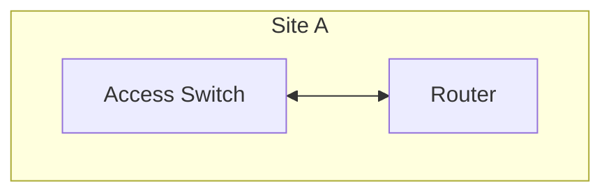

Give the subgraph an explicit ID and title:

```text
subgraph SG_SITE_A["Site A"]
```

The ID `SG_SITE_A` can be referenced by styles or external links. The text `Site A` is what readers
see.

A subgraph can have its own direction:

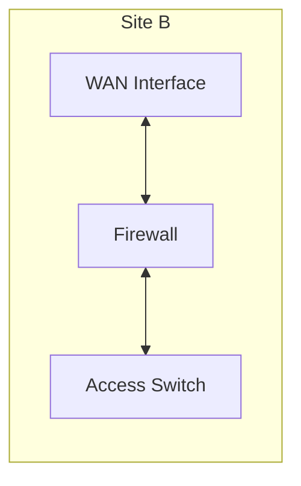

Mermaid may ignore a subgraph direction when nodes inside it connect to nodes outside it. Treat
direction as a layout preference, not an absolute placement command.

## Connecting infrastructure

### Common link types

| Source | Appearance | Meaning |
| -- | -- | -- |
| `A --> B` | One-way arrow | Dependency or directional flow |
| `A <--> B` | Double-ended arrow | Bidirectional communication |
| `A --- B` | Line without arrows | Physical or neutral association |
| `A -.-> B` | Dotted arrow | Optional, management, or callout relationship |
| `A ==> B` | Thick arrow | Primary or emphasized path |

Use arrows according to what the diagram claims. A double-ended arrow is appropriate when the
diagram represents bidirectional Ethernet or IP communication. It does not prove that policy,
routing, or stateful inspection permits both directions.

### Connection labels

Put a label between pipe characters:

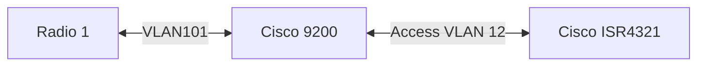

Useful connection labels include:

- VLAN or VRF names
- Interface names
- Link speed or media
- Routed transit subnet
- Protocol or tunnel type
- Trust or security-zone transition

Avoid turning every link into a paragraph. Put detailed configuration in prose or a table below
the diagram when the label would dominate the architecture.

### Multiline labels

Mermaid Markdown Strings support line breaks without HTML `<br/>` elements. Place the label
between backticks inside the quoted node or edge label:

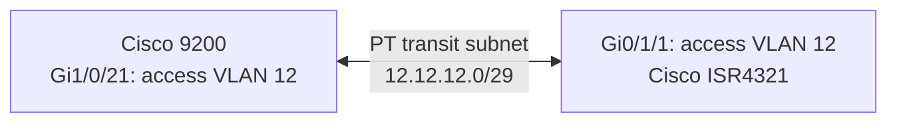

Markdown Strings also support emphasis:

```text
SITE_A_FW_01["`**Firewall**
Management: 10.31.31.10`"]
```

Prefer native multiline strings over HTML for ordinary labels. They are easier to read and less
dependent on a renderer's HTML security settings.

Markdown Strings wrap automatically by default. `wrappingWidth` gives Mermaid a preferred maximum
label width, but it does not guarantee that every label will use that full width. An edge label may
wrap sooner when the calculated link and surrounding nodes provide less horizontal space.

To preserve only the line breaks written in the source, disable Markdown auto-wrapping globally:

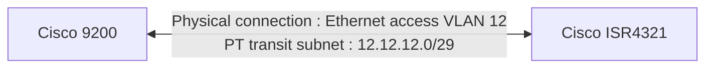

With `markdownAutoWrap: false`, explicit newlines remain, but Mermaid stops inserting additional
line breaks. Long labels can consequently make the diagram wider.

## Representing network concepts

### VLANs and subnets

Show a VLAN on the link when it identifies the Layer-2 relationship:

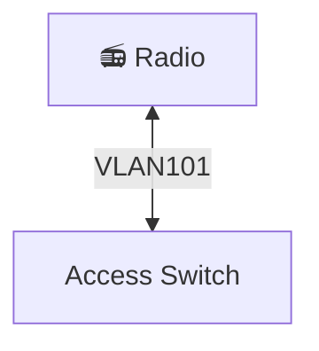

Show a subnet inside a node when it describes an interface or routed boundary:

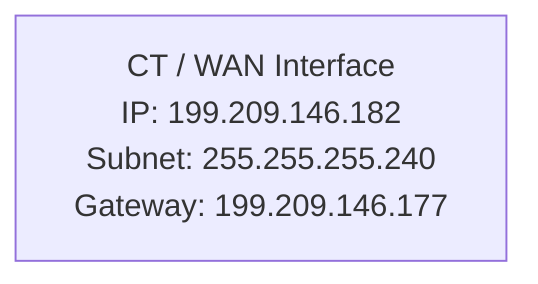

Use CIDR consistently when possible. If the operational source uses dotted-decimal masks, it is
reasonable to preserve them, but do not alternate formats without a reason.

### Routing VLAN subnets versus extending VLANs

An 802.1Q trunk carries tagged Ethernet frames between directly connected devices. A route-based
IPsec VTI carries IP packets selected by the routing table; it does not carry the original VLAN
tags or extend the broadcast domain to the remote site.

For most site-to-site designs, terminate each VLAN locally and route its distinct subnet through
the VPN:

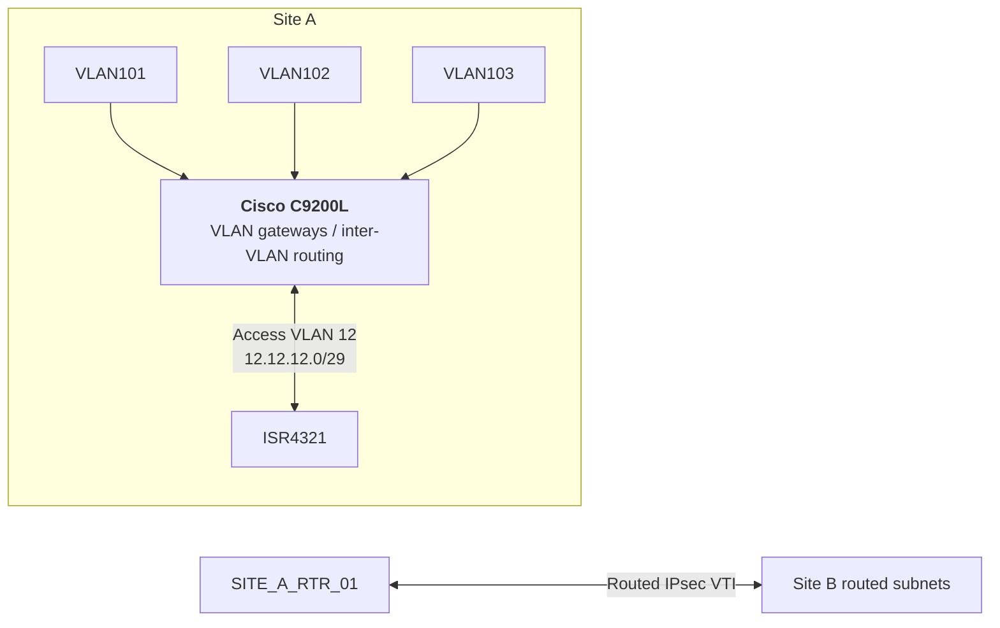

In this pattern:

- The Catalyst SVIs are the local gateways for endpoint VLANs.
- A single transit VLAN connects the Catalyst to the VPN router.
- Both physical ports use the same access VLAN configuration.
- Static or dynamic routes carry several VLAN subnets over one Layer-3 tunnel.
- Site A and Site B use distinct, non-overlapping IP subnets.

If the same VLAN must remain one broadcast domain at both sites, a Layer-2 overlay such as
L2TPv3, VXLAN, or an Ethernet pseudowire is required. That is a different architecture with larger
failure domains, broadcast propagation, MTU overhead, and additional operational complexity.

### Interfaces and transit networks

Put endpoint-specific details inside the appropriate device node and shared network details on the
link. Ordering the interface line nearest the connected side can also make a vertical diagram
easier to read:

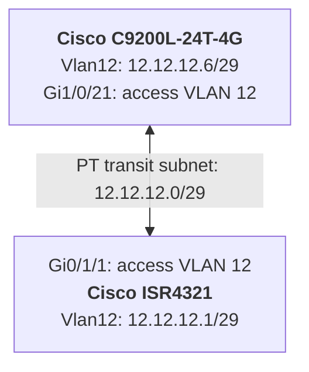

Here, interface modes and addresses belong to devices; the shared transit subnet belongs to the
relationship. The Catalyst routes local VLAN subnets toward `12.12.12.1`, while the ISR routes
those Site A subnets toward `12.12.12.6`.

### WANs, tunnels, and clouds

A simple circle with a cloud character is widely portable:

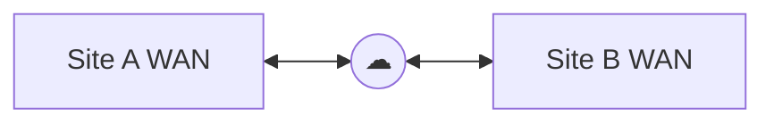

Label the tunnel on its connection:

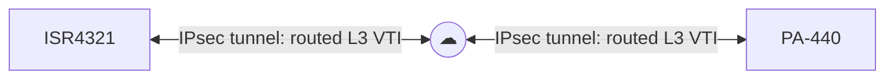

Do not imply that the cloud is a device unless it represents an actual service or routed domain.
It may stand for a carrier, the Internet, a WAN, or an administratively separate network.

### Repeated endpoint devices

Use numbered IDs and labels for repeated endpoints:

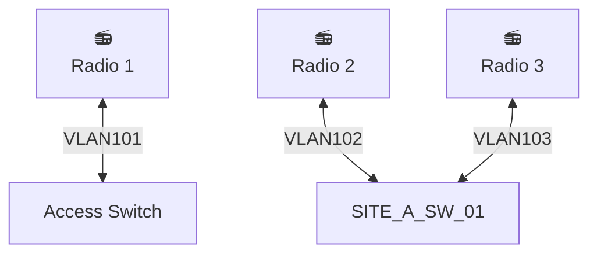

If dozens of identical endpoints exist, show a representative group instead of every device:

```text
SITE_A_RADIO_GROUP["Radio endpoints (x24)"]
```

## Layout and spacing

Mermaid calculates layout automatically. Configure spacing before resorting to invisible nodes or
manual HTML offsets:

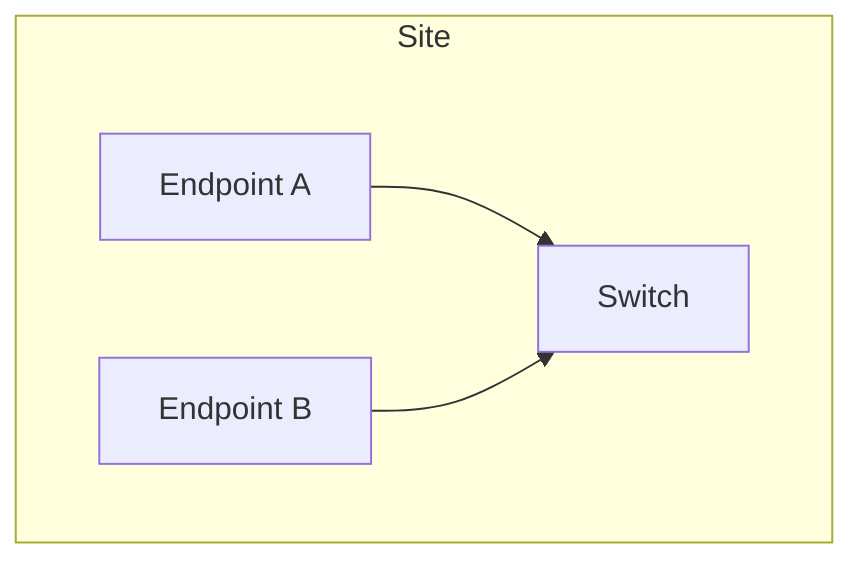

Key flowchart settings:

| Setting | Purpose |
| -- | -- |
| `nodeSpacing` | Space between nodes on the same rank |
| `rankSpacing` | Space between levels or ranks |
| `wrappingWidth` | Preferred maximum width used when automatically wrapping labels |
| `subGraphTitleMargin.top` | Space above subgraph titles |
| `subGraphTitleMargin.bottom` | Space below subgraph titles |
| `curve` | Link routing style such as `basis`, `linear`, or `step` |

`markdownAutoWrap` is a global Mermaid setting rather than a flowchart-only setting:

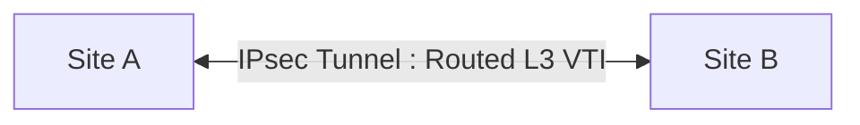

Use `markdownAutoWrap: false` when manually controlled line breaks are more important than a
compact, automatically adjusted layout. Leave it enabled when labels should adapt to different
viewport widths and renderers.

For course lists that become a tall column or a wide row, see the
[two-column layout example](mermaid-lessons-r1.0.6.md#two-columns-for-long-lists-a-measured-example).
It keeps layout constraints separate from actual prerequisite connections.

### Make edge-label boxes wider

Mermaid does not provide a built-in per-edge minimum-width setting such as `edgeLabelWidth`. The
background box around a connection label is calculated from the rendered text, so its width is
normally determined by the longest line in that label.

`wrappingWidth` is a preferred maximum for automatic wrapping, not a requested or minimum label
width. Increasing it does not widen a label whose explicit lines are already shorter than that
value.

The most portable way to create a wider interface-link label is to keep each device and its
interface on one line. Put the shared network on its own line and use the Unicode box-drawing
character `│` to separate the sections visually:

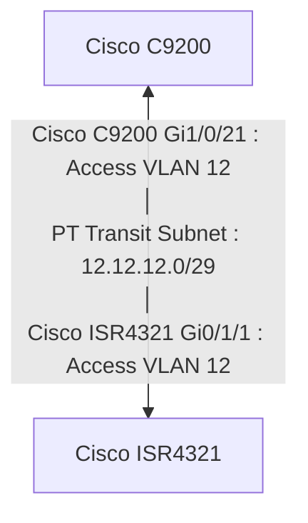

For a dedicated management connection:

```mermaid
flowchart TD
    SITE_A_SW_01["Cisco C9200"] <-->|"`Cisco C9200 Gi1/0/13 : Access VLAN 31
│
Management Network : 10.31.31.0/24
│
Cisco ISR4321 GE MGMT / GigabitEthernet0`"| SITE_A_RTR_01["Cisco ISR4321"]
```

Use the Unicode box-drawing character `│` (U+2502). Unlike the ordinary pipe (`|`), it will not
conflict with Mermaid's edge-label delimiters.

On Windows, turn on Num Lock, hold `Alt`, type `179` on the numeric keypad, and release `Alt` to
insert `│`. In applications that support hexadecimal Unicode conversion, such as Microsoft Word,
you can instead type `2502` and press `Alt+X`. If neither method is supported by the editor, copy
and paste `│` from this reference or use Windows Character Map.

Mermaid sizes each label background from its longest line. Keeping the device and interface
together makes the label wider while clearly separating both endpoints from the shared network.
If a three-section form becomes too wide, omit the visual separator lines and make the middle
description more explicit:

```text
Cisco C9200 : Gi1/0/21 : Access VLAN 12
Physical Connection / PT Transit Subnet : 12.12.12.0/29
Cisco ISR4321 : Gi0/1/1 : Access VLAN 12
```

Avoid forcing edge-label width with padding spaces, nonbreaking spaces, fixed-width HTML `<div>`
elements, or CSS selectors targeting Mermaid's generated SVG. These techniques are fragile across
GitHub, VS Code extensions, Mermaid CLI releases, and SVG-to-PNG exporters. Also avoid increasing
`wrappingWidth` solely to add horizontal padding; it controls wrapping behavior rather than a
minimum box width.

Start with defaults. Change one setting at a time and verify the result in every important
renderer.

## Styling

Use `classDef NAME property:value,...;` to define a reusable style. Assign it inline with
`:::NAME` or afterward with `class ID1,ID2 NAME;`:

```mermaid
flowchart LR
    SITE_A_SW_01["Access Switch"] edge_site_a_sw_fw_data@--> SITE_A_FW_01["Firewall - TBD"]

    classDef nodeNetwork fill:#e8f1ff,stroke:#2457a6,color:#111111,stroke-width:2px;
    classDef statePending stroke-dasharray:6 4;
    classDef edgeData stroke:#2457a6,stroke-width:2px;

    class SITE_A_SW_01,SITE_A_FW_01 nodeNetwork;
    class SITE_A_FW_01 statePending;
    class edge_site_a_sw_fw_data edgeData;
```

A node can carry a role class and a status class. Here `nodeNetwork` sets fill, border, and text
colors, while `statePending` adds only a dashed border, so neither class overrides the other. When
two classes do set the same property, the later class can win; avoid that overlap rather than
depending on it. Keep `TBD` or a similar word in the label so status does not depend on the border
alone.

`classDef` can style nodes and named edges. For a connection that needs special styling,
give it an edge ID such as `edge_site_a_sw_fw_data@` and assign a class: adding unrelated edges
will not retarget its style. Use `linkStyle default` for styling shared by all links. Numeric
`linkStyle` indexes remain an option for older renderers, but they change when edge order changes.
Named edges depend on the Mermaid version in the viewer; this example was rendered with
CLI 12.0.0. See [the named-edge lesson](mermaid-lessons-r1.0.6.md#named-edge-ids-and-styling-classes),
the [class naming conventions](mermaid-best-practices-r1.1.0.md#naming), and the
[official syntax reference](https://mermaid.js.org/syntax/flowchart.html#attaching-an-id-to-edges).

Use `style` for a one-off node:

```text
style WAN_CARRIER font-size:48px
```

The primary architecture predates these conventions and still uses the older `confirmed`,
`pending`, and `note` classes; see [older class names](mermaid-best-practices-r1.1.0.md#older-class-names)
for their current equivalents.

Keep styling restrained. Architecture diagrams should remain understandable in light and dark
themes and when printed in grayscale. Labels, border patterns, and topology should carry the
meaning; color should reinforce it.

### Maintainable dark styles for a code architecture diagram

Use multiline theme configuration so individual changes produce readable diffs.
Give classes names that describe their purpose, centralize their definitions, and
keep assignments together. The following simplified Bash framework example uses
cyan for startup, violet for shared libraries, teal for capabilities, and green
for readiness. These are diagram roles, not a report of current runtime status.

```mermaid
%%{init: {
  "theme": "base",
  "layout": "elk",
  "themeVariables": {
    "darkMode": true,
    "background": "#0b1120",
    "primaryColor": "#17243b",
    "primaryTextColor": "#e6edf7",
    "primaryBorderColor": "#60a5fa",
    "textColor": "#e6edf7",
    "lineColor": "#94a3b8",
    "edgeLabelBackground": "#111827"
  },
  "flowchart": {
    "curve": "basis",
    "nodeSpacing": 35,
    "rankSpacing": 50
  }
}}%%
flowchart TD
    CORE_INIT["core/init.sh"] --> CORE_ENV["core/env.sh"]
    CORE_ENV --> SHARED_LIBS["Shared libraries<br/>UI, logging, sudo, command checks, backup"]
    SHARED_LIBS --> MODULE_SCRIPTS["modules/*.sh"] --> TOOL_SCRIPTS["tools/*.sh"]
    TOOL_SCRIPTS --> SHELL_READY["Functions ready in the shell"]

    %% Central palette; text remains readable on each dark fill.
    classDef nodeStartup fill:#12313d,stroke:#22d3ee,color:#ecfeff,stroke-width:2px;
    classDef nodeLibrary fill:#29213f,stroke:#a78bfa,color:#f5f3ff,stroke-width:1.5px;
    classDef nodeCapability fill:#113832,stroke:#2dd4bf,color:#f0fdfa,stroke-width:2px;
    classDef nodeReady fill:#173524,stroke:#4ade80,color:#f0fdf4,stroke-width:2px;

    class CORE_INIT,CORE_ENV nodeStartup;
    class SHARED_LIBS nodeLibrary;
    class MODULE_SCRIPTS,TOOL_SCRIPTS nodeCapability;
    class SHELL_READY nodeReady;
```

Check every node has the intended class and every assigned class is defined.
Use explicit readable labels so color is supplementary. Also check edge labels
and subgraph titles when adding them; node text contrast alone is insufficient.
For exports, pass `-b '#0b1120'` as well: the CLI canvas can remain white even when
the diagram has dark fills. See [dark export configuration](#match-a-github-or-vs-code-dark-appearance).

## Icons, emoji, and portability

Unicode symbols are simple and require no icon-pack registration:

| Symbol | Suggested meaning |
| -- | -- |
| `📻` | Radio or radio endpoint |
| `💻` | Laptop or administrator workstation |
| `☁` | WAN, carrier, Internet, or cloud domain |
| `📡` | Antenna or wireless service |

Emoji appearance varies by operating system, browser, and renderer. Pair an icon with a text label
so meaning does not depend on the artwork.

Mermaid also supports registered icon packs and newer icon nodes. These offer more choices but
reduce portability because the rendering environment must load the same pack. For Markdown that
will be pasted into GitHub, Microsoft Teams, wikis, and ticket systems, Unicode plus text is often
the safer choice.

## When HTML is appropriate

Prefer Mermaid syntax and Markdown Strings. Use HTML only when a required visual detail has no
native Mermaid equivalent and the target renderer permits HTML labels.

The primary architecture deliberately sets `htmlLabels` to `false` and uses a Markdown String in a
circular node instead:

```text
SBU(("`**SBU**
☁`"))
```

HTML may be sanitized, ignored, or rendered differently by another platform. If HTML is genuinely
required, keep the fragment isolated, document why it exists, and test every target renderer.

Do not use an HTML `<div>` to force the width, alignment, size, or weight of a subgraph title. Some
Markdown previewers display the markup literally instead of interpreting it. Mermaid Markdown
Strings support bold text in subgraph labels and are the portable replacement:

```text
subgraph SG_SITE_A["`**Site A**`"]
```

Mermaid controls the title's placement. Accept its calculated alignment instead of using a
fixed-width HTML label that behaves differently across VS Code, GitHub, and Mermaid CLI.

## Architecture building blocks

The following independent examples illustrate the main ingredients used by the IPsec architecture.
Combine the patterns that apply to a design rather than treating these snippets as cumulative
versions of one diagram.

### 1. Create the site boundaries

```mermaid
flowchart LR
    subgraph SG_SITE_A["`**Site A**`"]
        SITE_A_INFRA["Site A infrastructure"]
    end
    subgraph SG_SITE_B["`**Site B**`"]
        SITE_B_INFRA["Site B infrastructure"]
    end
```

### 2. Add the WAN path

```mermaid
flowchart LR
    SITE_A_WAN_IF_01["Site A WAN Interface"] <-->|"Routed L3 IPsec"| WAN_CARRIER(("☁"))
    WAN_CARRIER <-->|"Routed L3 IPsec"| SITE_B_WAN_IF_01["Site B WAN Interface"]
```

Connect the cloud to the actual WAN-interface nodes when the tunnel terminates on those devices.
Connecting to a site subgraph instead communicates only that the path reaches the site boundary.

### 3. Add the internal device chain

```mermaid
flowchart TD
    SITE_A_RADIO_01["📻 Radio"] <--> SITE_A_SW_01["Access Switch"]
    SITE_A_SW_01 <--> SITE_A_RTR_01["Router or Firewall"]
    SITE_A_RTR_01 <--> SITE_A_WAN_IF_01["WAN Interface"]
```

### 4. Add operational annotations

```mermaid
flowchart TD
    SITE_A_RADIO_01["📻 Radio"] <-->|"VLAN101"| SITE_A_SW_01["Cisco 9200"]
    SITE_A_SW_01 <-->|"`Access VLAN 12
PT transit: 12.12.12.0/29`"| SITE_A_RTR_01["Cisco ISR4321"]
```

### 5. Add prose that explains behavior

A diagram should not carry the entire design. Follow it with prose and tables that explain:

- Routing method and route ownership
- Tunnel-interface names
- Security policies and NAT behavior
- Failure handling and path monitoring
- Confirmed values versus `TBD` values
- Assumptions and administrative ownership

The finished example is embedded in [`architecture/architecture.md`](architecture/architecture.md).
You can extract its Mermaid block for standalone export. The diagram shows topology,
while the surrounding prose can describe routing, PBF considerations, addressing, validation, and
implementation steps.

## Reusable templates

These skeletons follow the [naming conventions](mermaid-best-practices-r1.1.0.md#naming) and set the
ELK layout explicitly. A diagram that depends on a subgraph `direction` pins Dagre instead,
because ELK ignores subgraph direction; see the
[layout exception](mermaid-best-practices-r1.1.0.md#layout-engine-elk-or-dagre). Add classes, a legend, and a
palette as described in the conventions guide before sharing a finished diagram.

### Two-site network

Use the [starter template](mermaid-best-practices-r1.1.0.md#starter-template) in the conventions guide.
It shows two sites, a carrier, a management path, a planned component, and a complete dark
palette with role and status classes.

### Service dependency diagram

````markdown
```mermaid
%%{init: {"layout": "elk"}}%%
flowchart LR
    SVC_USERS["Users"] --> SVC_LB_01["Load Balancer"]
    SVC_LB_01 --> SVC_APP_01["Application 1"]
    SVC_LB_01 --> SVC_APP_02["Application 2"]
    SVC_APP_01 --> SVC_DB_01[("Database")]
    SVC_APP_02 --> SVC_DB_01
    SVC_APP_01 -.-> SVC_MON_01["Monitoring"]
    SVC_APP_02 -.-> SVC_MON_01
```
````

### Management-plane diagram

````markdown
```mermaid
%%{init: {"layout": "elk"}}%%
flowchart TD
    MGMT_ADMIN_01["Administrator"] --> MGMT_JUMP_01["Jump Host"]
    MGMT_JUMP_01 -->|"SSH"| SITE_A_RTR_01["Router"]
    MGMT_JUMP_01 -->|"HTTPS"| SITE_A_FW_01["Firewall"]
    MGMT_JUMP_01 -->|"SSH / WinRM"| SITE_A_SERVERS["Servers"]
    SITE_A_RTR_01 -.->|"Syslog / SNMP"| MGMT_NMS_01["Monitoring"]
    SITE_A_FW_01 -.->|"Syslog / API"| MGMT_NMS_01
```
````

## Exporting diagrams to SVG and PNG

GitHub can render Mermaid directly, but exported images are useful for Microsoft Teams, email,
presentations, change records, and systems that do not support Mermaid. Use Mermaid CLI (`mmdc`)
for repeatable exports instead of taking screenshots.

### Install Mermaid CLI

Follow the [installation and setup guide](mermaid-install.md) to install and verify Mermaid CLI.
The examples below assume `mmdc` is available. Run `mmdc --help` for the options supported by
that installation.

Run these export examples from `mermaid/`. Markdown inputs use `architecture/architecture.md`;
`architecture.mmd` is an optional working copy generated by the extraction procedure below.

### Export diagrams directly from Markdown

Mermaid CLI recognizes files ending in `.md`, extracts every fenced `mermaid` block, renders the
images, and writes a corresponding Markdown output file.

Create an export directory:

```bash
mkdir -p exports
```

Export every Mermaid diagram embedded in the architecture document as SVG:

```bash
mmdc \
  --input architecture/architecture.md \
  --output exports/architecture-rendered.md \
  --artefacts exports \
  --outputFormat svg
```

Export every diagram as PNG:

```bash
mmdc \
  --input architecture/architecture.md \
  --output exports/architecture-rendered.md \
  --artefacts exports \
  --outputFormat png \
  --scale 2 \
  --backgroundColor white
```

The generated Markdown file references the exported image artefacts. When the input contains
several Mermaid blocks, the CLI generates a separate image for each block.

Do not use the original Markdown filename as the `--output` value. Write to an export directory so
the source document cannot be confused with generated output.

### Create a standalone Mermaid source from Markdown

A standalone Mermaid file contains only the diagram source. It does not include the Markdown
opening and closing fences:

````text
```mermaid    <- omit this line
flowchart TD
    A --> B
```           <- omit this line
````

The Mermaid block in [`architecture/architecture.md`](architecture/architecture.md) is the
editable source. Generate `architecture.mmd` when a standalone preview or export is needed.
Edit the embedded block, then regenerate the working copy.

#### Manual method

1. Open `architecture/architecture.md`.
1. Locate the architecture block beginning with ```` ```mermaid ````.
1. Copy everything after that opening fence and before its matching closing ```` ``` ````.
1. Paste the copied text into `architecture.mmd`.
1. Do not copy the code-fence lines themselves.

#### Repeatable shell method

The following `awk` command extracts the first fenced Mermaid block into a temporary candidate so
the current standalone file is not overwritten before validation:

````bash
candidate=$(mktemp)
awk '
  /^```mermaid[[:space:]]*$/ && !found { found=1; inside=1; next }
  inside && /^```[[:space:]]*$/ { exit }
  inside { print }
' architecture/architecture.md > "$candidate"
````

This command intentionally extracts only the first Mermaid block. If a document contains several
diagrams, use Mermaid CLI's Markdown-input mode to export all of them or create a separate,
explicitly named `.mmd` file for each block.

In a Git worktree, review the document change and the existing standalone file before replacing it:

```bash
git diff -- architecture/architecture.md architecture.mmd
```

If a standalone copy already exists, compare the candidate with it. Skip this comparison
when generating the copy for the first time:

```bash
diff -u architecture.mmd "$candidate"
```

After reviewing the difference, validate the candidate and deliberately replace the generated
copy:

```bash
mmdc --input "$candidate" --output /tmp/architecture-validation.svg
cp "$candidate" architecture.mmd
rm "$candidate" /tmp/architecture-validation.svg
```

Confirm that it begins with the Mermaid initialization or diagram declaration—not a Markdown code
fence:

```bash
sed -n '1,12p' architecture.mmd
```

Then render it to ensure the extracted source is valid:

```bash
mkdir -p exports
mmdc \
  --input architecture.mmd \
  --output exports/architecture.svg
```

Whenever the embedded architecture changes, regenerate any standalone working copy before
exporting it. Commit the Markdown source; include the generated copy only if the project
intentionally tracks both forms.

### Export a single Mermaid source file

For predictable image names, use a standalone Mermaid source file without Markdown code fences.
Generate `architecture.mmd` from the Markdown source using the procedure above, or create
a new standalone diagram. A minimal standalone file looks like this:

```text
flowchart TD
    SITE_A["Site A"] <--> WAN_CARRIER(("WAN"))
    WAN_CARRIER <--> SITE_B["Site B"]
```

Export it as SVG:

```bash
mmdc \
  --input architecture.mmd \
  --output exports/architecture.svg \
  --backgroundColor transparent
```

Export it as a high-resolution PNG:

```bash
mmdc \
  --input architecture.mmd \
  --output exports/architecture.png \
  --scale 2 \
  --backgroundColor white
```

The output extension normally selects the format. `--outputFormat svg` or `--outputFormat png` can
be supplied explicitly when an automation script should not rely on the filename.

### Choose SVG or PNG

| Format | Best use | Characteristics |
| -- | -- | -- |
| SVG | GitHub, browsers, documentation sites, printing, and later resizing | Vector output remains sharp at any size; text may remain selectable; some applications restrict SVG uploads |
| PNG | Microsoft Teams, email, tickets, presentations, and broad application compatibility | Raster output is widely accepted; increase scale before export to avoid blurry text |

Keep the SVG as the archival export when practical, then generate PNG for applications that do not
accept SVG. The Mermaid source remains the authoritative editable version.

### Control PNG resolution and background

`--scale` controls Puppeteer's device scale factor:

```bash
mmdc -i architecture.mmd -o architecture.png --scale 2
```

Use scale `2` for normal high-resolution sharing, consider `3` for large presentations, and `4`
for print-quality PNGs. Larger
values increase pixel dimensions and file size.

Choose an explicit background:

```bash
# White background for Teams, email, and documents
mmdc -i architecture.mmd -o architecture.png --backgroundColor white --scale 2

# Transparent background when the destination supports it
mmdc -i architecture.mmd -o architecture.png --backgroundColor transparent --scale 2
```

Transparent images can become difficult to read when Mermaid colors assume a different page theme.
For reliable sharing, export with a white background and the default or neutral theme:

```bash
mmdc \
  -i architecture.mmd \
  -o architecture.png \
  --theme neutral \
  --backgroundColor white \
  --scale 2
```

Render both PNG and SVG from the same source and configuration when visual consistency matters.

### Match a GitHub or VS Code dark appearance

The background and Mermaid theme are separate controls. `--backgroundColor` changes only the
outer image canvas; it does not change node fills, subgraph fills, borders, connections, or text.
For example, a black canvas with Mermaid's default theme can still contain pale-purple nodes and
yellow subgraphs.

Select Mermaid's built-in dark theme as well as a dark canvas:

```bash
mmdc \
  --input architecture/architecture.md \
  --output exports/architecture-dark.md \
  --artefacts exports \
  --outputFormat png \
  --theme dark \
  --scale 2 \
  --backgroundColor '#0d1117'
```

Use a unique output basename for each source revision and theme. Markdown-input mode derives the
image name from the output Markdown filename, so this example creates
`exports/architecture-dark-1.png`. Unique names make it less likely that an older image
will be mistaken for the current export.

The built-in dark theme may not exactly match VS Code because the editor or Markdown extension can
use a different Mermaid version, CSS, fonts, and theme integration. For a closer and repeatable
appearance, define the palette in the diagram's own `%%{init}%%` block with Mermaid's customizable
`base` theme, as the [starter template](mermaid-best-practices-r1.1.0.md#starter-template) does. The
diagram then looks the same in a Markdown preview and in an export, and no external configuration
file has to travel with it.

Export a diagram whose own block defines a dark palette with only a matching canvas color.
Do not pass `--theme` or `--configFile`; they compete with the diagram's own configuration:

```bash
mmdc \
  --input diagram.md \
  --output exports/diagram-dark.md \
  --artefacts exports \
  --outputFormat png \
  --scale 2 \
  --backgroundColor '#0b1120'
```

The expected image is `exports/diagram-dark-1.png`. Treat the palette as a
controlled approximation rather than a promise of pixel-identical VS Code output. Font
availability, emoji fonts, Mermaid releases, and renderer-specific CSS can still change spacing
and glyph appearance.

### Embed an exported image in Markdown

Use a relative path so GitHub can render an image stored in the repository:

```markdown

```

For a PNG fallback:

```markdown

```

Do not replace the Mermaid source with an exported image. Keeping both allows readers to view the
diagram while administrators retain editable, reviewable source.

### Review generated output

For a worked before/after comparison and explicit source, render, measurement, and visual
checks, see [recording review evidence](mermaid-lessons-r1.0.6.md#record-what-a-diagram-review-actually-verified).

A successful render proves that Mermaid accepted the syntax; it does not prove that the result is
readable or that it describes the architecture correctly. Review generated SVG and PNG files for:

- Clipped, overlapping, or unexpectedly wrapped labels
- Dense edge crossings or misleading connection direction
- Unreadable colors in light, dark, and grayscale contexts
- Unexpected subgraph placement or omitted nodes
- Missing fonts, emoji, or icons
- Secret values or sensitive infrastructure details that should not be published

Compare the diagram with the configuration and design material it represents. A syntactically valid
diagram can still document the wrong system.

Treat Mermaid source from an untrusted repository as untrusted input. Generated SVG can contain
links or other active content; review it before publishing it or opening it in a privileged
context. For syntax checks, render into a temporary directory so generated images and rewritten
Markdown do not clutter the repository. The repository-wide verification procedure in
[`mermaid-install.md`](mermaid-install.md#verify-every-mermaid-bearing-markdown-file) demonstrates
that workflow.

### Troubleshoot missing emoji icons

Mermaid CLI renders diagrams through a Chromium-based browser. Emoji are not embedded in the
Mermaid source: Chromium must find a font on the export host that contains each requested Unicode
glyph. If a glyph is unavailable, the exported PNG or SVG can show an empty rectangle or another
replacement character even though the same diagram displays correctly in GitHub or a desktop
browser.

For example, the radio emoji `📻` (`U+1F4FB`) generally requires an emoji font. Basic fonts such as
DejaVu Sans or Lato may render the older cloud symbol `☁` while lacking the radio glyph. This can
make the clouds appear normally even when every radio icon is replaced by a box.

Follow [emoji-font setup](mermaid-install.md#6-optional-emoji-font-support) to install and
check a suitable font, then restart persistent renderer processes and regenerate the image.

If direct Markdown input and an extracted `.mmd` file both produce the same missing glyph, the
extraction method is not the cause. Check the fonts available to the renderer.

Emoji rendering is not visually identical across operating systems, installed font versions, and
Chromium releases. Installing Noto Color Emoji should make the radio glyph available, but its
color, shape, and spacing can still differ from GitHub, Microsoft Teams, or another administrator's
computer. For a completely repeatable appearance, use a controlled SVG or Mermaid icon pack, a
text label, or a simple Unicode symbol known to exist in the deployment font instead of an emoji.

### Troubleshoot headless-browser errors

Use the [browser troubleshooting procedure](mermaid-install.md#chromium-fails-to-start)
to distinguish a missing browser, missing libraries, sandbox restrictions, and launch timeouts.
It also covers existing Chromium and Brave installations and the limitations of disabling
browser sandboxing.

Once browser startup works, render again and inspect the exported image. Record the CLI
version, browser configuration, theme, and fonts when reproducing an export matters.

## Linting Mermaid diagrams

Use a parser-based linter to catch Mermaid syntax errors without starting Chromium or generating
an image. This complements Mermaid CLI: linting validates source structure, while rendering
validates appearance, fonts, layout, and theme behavior.

### Set up and run the linter

Use the [optional linter procedure](mermaid-install.md#5-install-and-run-the-optional-linter)
for runtime prerequisites, installation, and invocation. From `mermaid/`, use
`architecture/architecture.md` as the input for this repository's primary example.
Consult the installed linter's `--help` before adding globs or custom file extensions.

### Understand linting limits

`mermaid-lint` accepted the architecture's Mermaid initialization directive, quoted edge labels,
Markdown Strings, and complete fenced block. Another linter may implement only part of Mermaid's
grammar and can reject syntax that Mermaid itself accepts. Treat Mermaid's official parser and a
compatible Mermaid CLI renderer as the final syntax references when tools disagree.

A successful lint result does not verify:

- Automatic node and edge placement
- Curved, overlapping, or poorly spaced connections
- Text wrapping or clipping
- Font and emoji availability
- Theme and background consistency
- Differences among GitHub, VS Code, Mermaid CLI, and Microsoft Teams

Run linting routinely in an editor, pre-commit check, or CI. Render only when visual verification
is explicitly required.

## Compatibility and sharing

GitHub supports Mermaid in Markdown, but other applications may use different Mermaid versions or
security policies. GitHub also ignores `"layout": "elk"` and lays out every diagram with Dagre, so
a diagram rendered locally with `mmdc 12` (which defaults to ELK) can look different there; see the
[layout engine lessons](mermaid-lessons-r1.0.6.md#layout-engines-elk-and-dagre). Before publishing
broadly:

1. Render the diagram in GitHub, or locally with Dagre.
1. Test it in Microsoft Teams or the destination wiki if Mermaid rendering is supported there.
1. Check light and dark themes.
1. Verify Unicode and emoji rendering.
1. Confirm that HTML labels are not sanitized.
1. Keep a screenshot or exported SVG available when the destination cannot render Mermaid.

For maximum portability:

- Prefer established flowchart syntax.
- Prefer Markdown Strings over HTML line breaks.
- Avoid external icon packs unless the rendering environment is controlled.
- Avoid relying on exact node positions.
- Keep labels concise.

## Troubleshooting

### A subgraph title is too close to a node

Use the built-in title margin:

```text
"subGraphTitleMargin": {"top": 0, "bottom": 20}
```

Do not insert blank HTML lines into the title; they change label dimensions without reliably
changing graph layout.

### A node is not where expected

Mermaid optimizes the whole graph. Check:

- Diagram and subgraph directions
- The order of node declarations and links
- Links that cross subgraph boundaries
- Long edge labels that require extra space
- Multiple nodes converging on one node

If exact placement is mandatory, Mermaid may not be the right tool for that diagram.

### A link is curved

Mermaid's default flowchart curve is usually `basis`. A renderer may curve a link to avoid other
nodes or labels. You can configure another curve globally, but doing so affects the entire diagram:

```text
"curve": "linear"
```

Rearranging node order or shortening labels may produce a better result without changing every
link.

The `curve` setting applies only to Dagre. ELK routes every link at right angles and ignores
`curve`, so the same source can show curves in a Dagre viewer (GitHub, VS Code's preview) and right
angles in an ELK render (`mmdc 12`'s default). To get right angles while keeping Dagre, use
`"curve": "step"` (or `stepBefore` / `stepAfter`), and check for links that share segments. For
straight runs with curves only at bends, use `"curve": "monotoneX"` (`monotoneY` for a top-down
diagram). See the
[layout engine lessons](mermaid-lessons-r1.0.6.md#layout-engines-elk-and-dagre).

### A label wraps even after increasing `wrappingWidth`

`wrappingWidth` is a preferred wrapping limit, not a reserved amount of space. Mermaid can assign
an edge label less space because of the calculated link length, nearby nodes, subgraph boundaries,
or other labels.

If the source already contains deliberate newlines, disable automatic wrapping globally:

```text
"markdownAutoWrap": false
```

This prevents Mermaid from adding line breaks while preserving explicit newlines. It may also
increase the width of the finished diagram.

### Matching edge labels are not equally spaced

Mermaid places an edge label near the midpoint of that edge's calculated path. It does not place
labels at a fixed distance from a node, cloud, or subgraph boundary. Two links with identical text
can therefore produce labels that appear asymmetrical.

Common causes include:

- Different link lengths
- Different node sizes or internal subgraph layouts
- Links terminating at nodes inside subgraphs rather than at the visible subgraph boundary
- Space needed to avoid other nodes, links, and labels
- Mermaid's optimization of the complete graph rather than one connection at a time

There is no simple flowchart setting for equal label distance from a particular endpoint. Changing
node content, shortening labels, or influencing link length can alter the result, but exact label
placement may require layout helpers or a different diagramming tool.

### A label or icon renders differently elsewhere

The other platform may use a different Mermaid version, font, emoji set, or HTML security policy.
Replace HTML with Markdown Strings, replace icon packs with Unicode plus text, or simplify the
label.

### A subgraph direction is ignored

External links to nodes inside a subgraph can cause the parent graph's direction to control the
layout. Simplify cross-boundary links or accept Mermaid's calculated placement.

ELK ignores subgraph `direction` entirely. If the diagram depends on one, pin `"layout": "dagre"`;
see the [code conventions](mermaid-best-practices-r1.1.0.md#layout-engine-elk-or-dagre).

### The diagram is too wide

- Use `TD` instead of `LR`.
- Shorten labels or move details into a table.
- Reduce `nodeSpacing` carefully.
- Group repeated endpoints.
- Split physical, logical, management, and traffic-flow views into separate diagrams.

## Design checklist

Before considering an architecture diagram complete, verify the following:

- [ ] The title states what the diagram represents.
- [ ] Sites, zones, accounts, or trust boundaries are explicit.
- [ ] Device IDs in source are short and meaningful.
- [ ] Displayed labels use consistent terminology.
- [ ] Arrow direction matches the intended meaning.
- [ ] VLANs, interfaces, and subnets are attached to the correct relationships.
- [ ] Layer-2 and Layer-3 concepts are not accidentally presented as the same thing.
- [ ] The WAN or cloud symbol has a defined meaning.
- [ ] `TBD` values are visibly distinguished from confirmed values.
- [ ] Detailed behavior is explained outside the diagram.
- [ ] The diagram renders in every required destination.
- [ ] HTML and external icons are used only when necessary.

## Quick reference

```text
flowchart TD                         Top-to-bottom flowchart
flowchart LR                         Left-to-right flowchart
%% Comment text                      Source comment (use its own line)

NODE["Label"]                       Rectangle
NODE("Label")                       Rounded rectangle
NODE(("Label"))                     Circle
NODE[("Label")]                     Database/cylinder
NODE{"Label"}                       Decision/diamond

A --> B                              One-way arrow
A <--> B                             Double-ended arrow
A --- B                              Plain line
A -.-> B                             Dotted arrow
A <-->|"VLAN101"| B                 Labeled double-ended arrow

subgraph SG_SITE["Site"]               Begin boundary
    direction TB                     Set preferred internal direction
    A --> B
end                                  End boundary

NODE["`Line 1
Line 2`"]                            Native multiline Markdown String

A edge_a_b_data@--> B                Named edge, for styling by class
classDef nodeNetwork fill:#eef,stroke:#448; Define reusable node style
class NODE nodeNetwork;               Assign a class
style NODE font-weight:bold          Apply one-off style
```

## Further reading

- [Mermaid flowchart syntax](https://mermaid.js.org/syntax/flowchart.html)
- [Mermaid configuration](https://mermaid.js.org/config/configuration.html)
- [Mermaid theming](https://mermaid.js.org/config/theming.html)
- [Mermaid icon-pack registration](https://mermaid.js.org/config/icons.html)
- [Mermaid CLI](https://github.com/mermaid-js/mermaid-cli)
- [Mermaid Live Editor](https://github.com/mermaid-js/mermaid-live-editor)
- [mermaid-lint](https://github.com/jasonworden/mermaid-lint)
- [nvm](https://github.com/nvm-sh/nvm)
- [Node.js releases](https://nodejs.org/en/about/previous-releases)
- [GitHub documentation: Creating diagrams](https://docs.github.com/get-started/writing-on-github/working-with-advanced-formatting/creating-diagrams)
