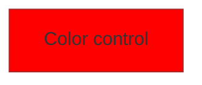
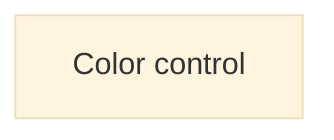

# Theme color contract probes

## named


## hex


## unquoted


## unknown


## Class definition CSS formats
```mermaid
---
config:
  theme: base
  look: classic
---
flowchart LR
  COLOR_NAMED["Named"]
  COLOR_HEX["Short hex"]
  COLOR_RGB["RGB function"]
  classDef nodeNamed fill:aliceblue,stroke:steelblue,color:midnightblue
  classDef nodeHex fill:#abc,stroke:#123456,color:#123
  classDef nodeRgb fill:rgb(240,248,255),stroke:steelblue,color:midnightblue
  class COLOR_NAMED nodeNamed
  class COLOR_HEX nodeHex
  class COLOR_RGB nodeRgb
```
