# Mermaid code conventions

Use these conventions for new diagrams in this collection, whether written by hand
or generated with assistance. They are authoring conventions, not additional Mermaid
syntax rules. Existing diagrams and historical lessons may use older names and older
formatting; preserve them unless a rename or reformat is part of the requested change.

## For AI agents: verify before you deliver

This guide is also given to AI agents that create or edit Mermaid diagrams. If you
are one, follow the rest of the guide as written, and add these steps. You may be
running in a chat on a web page, in a desktop app on Windows, macOS, or Linux, or in
a Linux terminal, so first work out what you can actually run.

### 1. Find out what you can run

| Where you are                                         | What you can do                                                                                     |
| ----------------------------------------------------- | --------------------------------------------------------------------------------------------------- |
| Chat or web page with no code execution               | Nothing renders. Check the source by hand against [review before sharing](#review-before-sharing), deliver it, and say it is unrendered. |
| Interface that previews Mermaid for you               | The preview is one viewer with its own Mermaid version. Look at it, but report it by name, not as an `mmdc` render. |
| Sandbox that runs code but cannot install or browse   | Use `mmdc` if it is already present; otherwise use the [parse check](#4-if-you-cannot-render-parse-and-say-so). |
| Linux or macOS terminal, container, or desktop shell  | Render with `mmdc`. Install it if missing and permitted.                                             |
| Windows desktop (PowerShell or Command Prompt)        | Render with `mmdc`, which npm installs as `mmdc.cmd`. Use the Python script below rather than Bash. |

Check whether `mmdc` is installed:

```text
Linux, macOS:   command -v mmdc || npx --no-install mmdc --version
PowerShell:     Get-Command mmdc; npx --no-install mmdc --version
Command Prompt: where mmdc
```

A diagram you have not rendered is unverified, however correct the source looks.

### 2. Render every block you changed

Save this script with your file-writing tool and run it with `python3` (Linux and
macOS) or `py` (Windows). It extracts each Mermaid block from a Markdown file into
its own `.mmd` file, so every output maps to one block, then renders an SVG for the
checks in [verifying a render](#verify-a-render) and a PNG to look at:

```python
"""Render every mermaid block in a Markdown file with mmdc.

Usage: python render_blocks.py diagram.md [background] [puppeteer-config.json]
Works on Linux, macOS, and Windows. Prints the output folder and one line per block.
"""
import re, shutil, subprocess, sys, tempfile
from pathlib import Path

source = Path(sys.argv[1])
background = sys.argv[2] if len(sys.argv) > 2 else 'white'
puppeteer = sys.argv[3] if len(sys.argv) > 3 else None

mmdc = shutil.which('mmdc')  # finds mmdc.cmd on Windows too
if not mmdc:
    sys.exit('mmdc not found: install @mermaid-js/mermaid-cli or use the parse check')

out = Path(tempfile.mkdtemp(prefix='mermaid-review-'))
version = subprocess.run([mmdc, '--version'], capture_output=True, text=True).stdout.strip()
print(f'mmdc {version}; output in {out}')

text = source.read_text(encoding='utf-8')
blocks = re.findall(r'^```mermaid\n(.*?)^```', text, re.S | re.M)
for i, block in enumerate(blocks, 1):
    mmd = out / f'block-{i}.mmd'
    mmd.write_text(block, encoding='utf-8')
    for ext, extra in (('svg', []), ('png', ['-s', '2'])):
        cmd = [mmdc, '-i', str(mmd), '-o', str(mmd.with_suffix('.' + ext)), '-b', background, *extra]
        if puppeteer:
            cmd += ['-p', puppeteer]
        result = subprocess.run(cmd, capture_output=True, text=True)
        status = 'ok' if result.returncode == 0 else 'FAILED: ' + (result.stderr.strip().splitlines() or ['no output'])[0]
        print(f'block {i} {ext}: {status}')
```

Pass the diagram's canvas color as the background: `'#0b1120'` for the dark
template, `white` for a light card. If you can view images, open each PNG and
inspect it; reading the SVG text is not a visual check. If you cannot view images,
say that the layout was not inspected.

If a diagram contains emoji, check for an emoji font before rendering
(`fc-list | grep -i emoji` on Linux). Without one, report the emoji as unverified:
the PNG will show fallback symbols or empty boxes that most readers will not see.

**SVG for checks, PNG for looking.** Each format has a job:

| Format | Use it for                                                                                          |
| ------ | --------------------------------------------------------------------------------------------------- |
| SVG    | Text checks: edge styles, `themeCSS` rules, canvas color, measured positions. Also a deliverable for browser-based destinations. |
| PNG    | Looking at the drawing. Most agent image viewers accept PNG, not SVG. Also the deliverable for destinations that are not browsers (Word, slides, some wikis). |

Make both directly with `mmdc`, as the script does. The Markdown block is the
deliverable; rendered files are review artifacts unless the user asked for an image.
When they do, use SVG for web pages and PNG at `-s 2` to `-s 4` for everything else.

**Never convert the SVG to PNG with a non-browser tool.** Mermaid draws labels as
HTML inside `<foreignObject>` elements and lays them out using a browser's font
measurements. Converting the starter template's SVG with `cairosvg` produced every
box and line but none of the 19 labels, and lost the canvas color; ImageMagick 6
refused the file. Turning off `htmlLabels` brought the text back as SVG `<text>`,
but the words overlapped and spilled out of their boxes. Treat `rsvg-convert`,
Inkscape, ImageMagick, and other non-browser converters as unreliable for Mermaid
output, and the same for previewing an SVG in a tool that is not a browser.

**Chromium is what `mmdc` already uses.** `mmdc` launches headless Chrome through
Puppeteer, so you do not need to drive Chromium yourself. If you are tempted to:

- **Screenshotting the `mmdc` SVG** in a headless browser is an acceptable way to
  view it, because a browser renders `<foreignObject>` correctly. Prefer asking
  `mmdc` for the PNG; it is one step and uses the same engine.
- **Building your own HTML page** that loads Mermaid from a CDN and screenshotting it
  is a different renderer: whatever Mermaid version the page loads, with that
  page's fonts and CSS. Report it as that, with its version, not as an `mmdc` render,
  and use it only when `mmdc` cannot run.

### 3. If `mmdc` is missing or will not start

Install it where you have permission and network access:
`npm install @mermaid-js/mermaid-cli`, then run it with `npx mmdc` or add the
package's `node_modules/.bin` folder to the path for the script. It drives a
headless Chrome, which it may also need to download
(`npx puppeteer browsers install chrome-headless-shell`). Common failures:

- **Chrome refuses to start as root** (Linux containers). Pass a Puppeteer config,
  the script's third argument, containing `{"args": ["--no-sandbox"]}`.
- **The browser download is blocked.** Point the same config at an installed
  Chrome, Chromium, or Edge with `"executablePath"`. If none exists, you cannot
  render.
- **Several `mmdc` versions are present.** A global install and a project install
  can differ by a major version. Record the one you actually ran.

### 4. If you cannot render, parse and say so

Mermaid's own parser runs in Node on any operating system, with no browser. It
catches syntax errors and returns the configuration it read, which exposes a
dropped setting such as an unquoted hex color. After `npm install mermaid jsdom`,
save this as `parse.mjs` and run `node parse.mjs block-1.mmd block-2.mmd`:

```javascript
import { JSDOM } from 'jsdom';
import fs from 'fs';
const dom = new JSDOM('<!doctype html><body></body>');
globalThis.window = dom.window;
globalThis.document = dom.window.document;
const mermaid = (await import('mermaid')).default;
mermaid.initialize({ startOnLoad: false });
for (const f of process.argv.slice(2)) {
  try {
    const r = await mermaid.parse(fs.readFileSync(f, 'utf8'));
    console.log(f, 'PARSED', JSON.stringify(r?.config ?? {}));
  } catch (e) {
    console.log(f, 'FAILED', e.message.split('\n').slice(0, 3).join(' | '));
  }
}
```

A parse proves only that the syntax was accepted. It does not check layout,
containment, styles, or contrast, so never report it as a render.

### 5. Report what you verified

End with what ran, which blocks were rendered, previewed, parsed, or only read,
which checks passed, and what you could not check. For example: "Rendered both
blocks with mmdc 11.16.0 on Linux and inspected the PNGs; edge styles confirmed
in the SVG; the GitHub dagre copy was not rendered."

### 6. Do not widen the change

Apply these conventions to what you create or were asked to edit. Leave older class
names, init directives, and formatting in untouched diagrams alone, and mention them
instead of converting them.

## Naming

Mermaid IDs are references to drawing elements, not program variables. Keep the ID
stable when changing a displayed label, device model, address, or course title.

| Element               | Convention                                                                  | Example                                               |
| --------------------- | --------------------------------------------------------------------------- | ----------------------------------------------------- |
| Node ID               | Uppercase words separated by underscores; scope, role, then optional number | `SITE_A_SW_01`, `SITE_A_RTR_01`, `TRAINING_COURSE_01` |
| Annotation node ID    | Uppercase purpose prefix, then the item it describes                        | `LEGEND_WILD_CARD`, `RULE_TIEBREAKERS`                |
| Subgraph ID           | `SG_` followed by an uppercase descriptive scope                            | `SG_SITE_A`, `SG_TRAINING`, `SG_LEGEND`               |
| Edge ID               | `edge_` followed by lowercase endpoint roles and optional purpose           | `edge_site_a_sw_rtr_data`                             |
| Invisible layout edge | `layout_` followed by its endpoint roles                                    | `layout_course_01_03`                                 |
| Node role class       | `node` followed by a descriptive role in camelCase                          | `nodeNetwork`, `nodeServer`, `nodeNote`               |
| Node status class     | `state` followed by a status in camelCase                                   | `statePending`, `stateUnavailable`                    |
| Edge class            | `edge` followed by the connection meaning in camelCase                      | `edgeData`, `edgeManagement`, `edgeEncrypted`         |
| Subgraph class        | `group` followed by the grouping role in camelCase                          | `groupSite`, `groupStage`, `groupWrapper`             |
| Layout class          | Use `layoutOnly` for invisible layout helpers                               | `class layout_course_01_03 layoutOnly`                |

Use ASCII letters, digits, and underscores for IDs, beginning with a letter.
Avoid bare `end` and punctuation-heavy IDs even where a particular parser accepts
them. Put spaces, Unicode symbols, addresses, and human-readable punctuation in
quoted labels. These conservative choices make IDs easier to search and rename.

- Keep node, subgraph, and edge IDs distinct within a Mermaid block. Class names
  use their own prefixes so their purpose is obvious during review.
- Reuse the same ID for the same entity across related views when practical;
  each block still needs its own declarations and styles.
- Prefer meaningful scope names over unexplained abbreviations. Familiar roles
  such as `SW`, `RTR`, and `FW` are fine when the displayed labels explain them.
- Add a purpose suffix when two connections share endpoints, such as `_data`
  and `_management`. Use `_01`, `_02` for repeated peers consistently.
- Name edges that need styling or another explicit reference. Ordinary edges
  need not acquire IDs merely to satisfy the naming table.
- Give legend swatches and rules or note cards a purpose prefix (`LEGEND_`,
  `RULE_`, `NOTE_`) so they are never mistaken for entities in the drawing.
- Rename an ID with a script that skips quoted labels, not with a plain
  find-and-replace, which can also rewrite label and title text. See
  [renaming an ID](#rename-an-id).

## Source organization

Use this order within each Mermaid block:

1. YAML front matter with the diagram's configuration. It must be the first line.
1. A header comment saying what the diagram shows and, for a diagram that is
   edited repeatedly, how to update it (for example, how to record a result).
1. The diagram declaration and direction, such as `flowchart TB`.
1. Subgraphs and node declarations, with each node's full label defined once.
1. Meaningful connections, grouped by workflow or traffic path.
1. Layout-only connections, clearly commented and placed in their intended group.
1. `classDef` declarations, grouped by node role, status, edge role, and group style.
1. `class` assignments, grouped to match those definitions.

### Formatting

- **Indent two spaces per level,** in both the front matter and the diagram body.
  YAML requires spaces and two is its usual convention; using the same width below
  the front matter gives the whole block one rule. Mermaid ignores body indentation,
  so this is for readers, and two spaces keeps deeply nested subgraphs narrow.
  Never use tabs: they are invalid in YAML.
- **Omit statement semicolons.** Mermaid treats them as optional terminators. Do not
  mix styles within a block. Quoting every label (see below) prevents a `;` in label
  text from ending a statement early.
- Put each declaration, connection, and style statement on its own line. Prefer a
  single connection per line when it has a name, label, or special style.
- `A & B --> C & D` is fine for unnamed, unlabeled structural edges. It draws an
  arrow from every node on the left to every node on the right (four here), so add
  a comment when that fan-out is not obvious. Short invisible chains remain useful
  for list layout.

### Comments

- Use `%%` comments on their own lines to explain a layout constraint or unusual
  relationship. Comments should explain intent rather than repeat the syntax.
- **Never leave a bare `%%` line.** A line containing only `%%` breaks parsing when it
  appears before the diagram declaration, with an error such as "Parse error on
  line 1". Inside the diagram body it is currently harmless, but use `%% ---` as a
  separator everywhere so the rule needs no exceptions (see the
  [formatting lessons](mermaid-lessons-r1.0.6.md#known-bugs--hard-limitations)).
- **No `%%` comment of any kind may appear above front matter's opening `---`.**
  That is a parse error too.
- Inside front matter, comments use `#`. Put a `#` comment above each setting that
  explains why it is there.

## Configuration

Keep each diagram self-contained. Its palette, layout engine, and spacing belong in
its own front matter, so the diagram looks the same when copied or previewed
without an external `--configFile` or theme JSON file.

### Front matter

Configure every new diagram with YAML front matter: a `config:` block between two
`---` lines at the very top of the diagram.

```text
---
# Comments inside front matter start with #.
config:
  # The only built-in theme meant to be customized.
  theme: base
  layout: elk
  themeVariables:
    # Quote hex colors: an unquoted # starts a YAML comment.
    background: "#0b1120"
---
%% Mermaid comments go after the closing ---.
flowchart TB
```

Rules:

- **It must be the diagram's first line.** Nothing goes above the opening `---`,
  not even a `%%` comment.
- **Indent nested settings two spaces** under their parent, with spaces only.
- **Prefer CSS named colors** when they provide the intended appearance, for
  readability and maintainability. Use hex colors when precise colors are necessary.
- **Quote hex colors.** `background: #0b1120` parses as an empty value followed by a
  comment. Named CSS colors such as `white` need no quotes.
- **Requires Mermaid 10.5 or newer.** An older renderer does not report an error; it
  silently ignores the block and draws with its own theme and layout engine. If a
  viewer shows default colors or the wrong line shape, check its Mermaid version.
- Use one configuration form per diagram, never both.

Add settings to solve a demonstrated problem, and record the intended renderer when
relying on version-specific features. To see which Mermaid version a viewer runs,
render a block containing only `info`. These settings come up often:

| Setting                          | Use it when                                                                                                     |
| -------------------------------- | --------------------------------------------------------------------------------------------------------------- |
| `flowchart.htmlLabels`           | Labels use `<b>`, `<br/>`, or other HTML. Set it to `true`.                                                     |
| `flowchart.wrappingWidth`        | Long node-label lines wrap at the default of about 200px. Raise it (for example 400). It does not widen edge labels, whose space is set by the calculated edge, and it is not a minimum box width. |
| `flowchart.subGraphTitleMargin`  | A subgraph title crowds the first node. It takes `top` and `bottom` values. Prefer it to padding the title with blank HTML. |
| `markdownAutoWrap`               | Deliberate line breaks in Markdown String labels wrap again. Set it to `false`. It is a top-level key, not under `flowchart`. |

A label is part of the layout: changing its text or line breaks changes its size and
can move nearby nodes and arrows. Fix label content before reaching for these settings.

### Fallback: the init directive

Before front matter, configuration went in a JSON comment placed before the diagram
declaration: `%%{init: { "theme": "base", "layout": "elk" }}%%`. Mermaid marks it as
deprecated, but it still works, including on GitHub. Use it only for a diagram that
must render in a viewer older than Mermaid 10.5. Converting an existing diagram is
not required, but do it when the diagram is being substantially edited; the MLB
bracket's conversion changed nothing in its render.

### Layout engine: ELK or dagre

Set `layout: elk` explicitly. ELK keeps nodes inside their subgraphs and routes
connections at right angles; Dagre has been observed placing a node outside its own
subgraph box. `mmdc 12` already defaults to ELK, but a viewer with an older default
would silently switch engines if the setting were omitted.

Use `elk` itself, not the other ELK variants Mermaid registers (`elk.stress`,
`elk.force`, `elk.mrtree`, `elk.sporeOverlap`). `elk.mrtree` crashed with a
`TypeError` on any edge that crossed into a subgraph, and the others have not been
shown to be reliable here.

ELK ignores `flowchart.curve` and always draws right angles with small rounded
corners, so do not set `curve` in an ELK diagram. Under dagre, `curve` controls line
shape:

| Curve       | Result                                                                                         |
| ----------- | ---------------------------------------------------------------------------------------------- |
| `basis`     | Gentle curves. The safe default with dagre.                                                    |
| `monotoneX` | Straight where a run can be straight; only the bends curve.                                    |
| `linear`    | Straight segments with sharp kinks at each route point.                                        |
| `step`      | Right angles (`stepBefore` and `stepAfter` move the turn). Cruder than ELK: lines can share segments and arrowheads can meet boxes at awkward angles. |

Curved lines in one viewer and right angles in another usually mean the two viewers
chose different engines, not that the curve setting failed.

Exception: pin `layout: dagre` when the diagram depends on a subgraph
`direction`, such as a left-to-right bracket nested inside a top-to-bottom page.
ELK ignores subgraph `direction` and lays the subgraph out in the diagram's overall
direction; with `mmdc 12.0.0`, the [2026 MLB bracket](flowchart/mlb-playoff-2026-r1.0.4.md)
stacked its rounds top to bottom under ELK. Explain the choice in a `#` comment
above the `layout` setting.

Dagre honors a subgraph's `direction` only while no node inside that subgraph has
an edge to anything outside it. One outbound edge and the subgraph falls back to the
parent direction, in either engine. The MLB bracket works because nothing inside
`SG_BRACKET` connects outward; its only outside link (`SG_BRACKET ~~~ SG_RULES`)
starts from the subgraph itself. Do not plan on nested `direction` where a group's
members must also connect outside it, which is most subgraphs.

If a dagre-pinned diagram suddenly renders stacked, it has fallen back to ELK:
check that `layout: dagre` is still present and that the front matter still parses.

GitHub's Markdown renderer does not support ELK as of October 2026: it ignores
`layout: elk` and lays out every diagram with dagre
([community discussion](https://github.com/orgs/community/discussions/138426)).
For a diagram meant to be read on GitHub, also render a copy with `layout: dagre`
in its front matter and check that the drawing still holds up. Change the copy's
own setting: a diagram's front matter takes precedence over a `mmdc -c` config file.

## Labels and relationships

Quote displayed node and subgraph labels. Use consistent capitalization and
terminology, and use Markdown Strings or HTML (`<b>`, `<br/>`, with `htmlLabels`
enabled) for intentional multiline or bold labels when the target renderer supports
them.

Choose arrows by meaning: `-->` for directional flow, `<-->` for bidirectional
communication, and `---` for an association with no claimed direction. Explain
special line patterns in a legend. An invisible link is a placement aid and must
not replace a real prerequisite or network relationship.

Keep details near what they describe: device-specific information belongs in node
labels; shared link information belongs on connections. Move long explanations
into prose below the drawing. Prefer `SG_` IDs for group references, but decide
whether a connection really targets a whole group or an individual member.

A subgraph ID used as an edge endpoint draws one bulk connection, meaning "this
connects to the whole group," such as a switch to a set of hosts on bonded links.
That subgraph is then structural, not decoration: removing its `subgraph`/`end`
wrapper orphans every node that was inside it, because the edge pointed at the
group rather than at any member.

## Emoji in labels

An emoji can make a diagram faster to scan: a server, a database, or a warning is
recognized before its label is read. Use one when it adds that, and leave it out when
it only decorates. Unlike prose, a diagram is drawn with the fonts of whichever
machine renders it, so emoji need more care here than in text.

### Rules

- **Labels only.** Never put an emoji in a node, subgraph, or edge ID or a class
  name; those stay ASCII (see [naming](#naming)).
- **One emoji, at the start, with text that says the same thing.** Write
  `"🗄️ Application database"`, not `"🗄️"` alone and not `"🗄️ DB"`. A reader
  without emoji fonts, or using a screen reader, still gets the meaning.
- **Use the [emoji vocabulary](#appendix-emoji-vocabulary-for-diagrams), one meaning
  per emoji.** If a diagram gives an emoji a project-specific meaning, put it in the
  diagram's legend.
- **Status still needs its text and its status class.** `"🚧 Backup server - PLANNED"`
  can add a cue to the `PLANNED` label and the `statePending` dashed border; it
  cannot replace either.
- **Be sparing.** Mark node roles or statuses, not every node, and keep emoji off
  edge labels unless the edge's meaning is the point.
- **Do not use arrow emoji** (such as ➡️ or ↔️). Mermaid already draws direction,
  and a second arrow inside a label competes with the real one.

### Characters that break

- **Keep the variation selector.** Some emoji are two code points: the symbol plus
  an invisible U+FE0F that requests the color form. Without it, ⚠ (`U+26A0` alone) rendered as a
  black text symbol even on a machine with an emoji font. The vocabulary lists which
  entries need it; copying the glyph from there keeps it.
- **Avoid multi-part emoji.** Sequences joined with a zero-width joiner, such as
  ❤️‍🩹 (health check), rendered as two empty boxes without an emoji font. Every
  vocabulary entry is a single symbol.
- **Shortcodes do not work.** `:rocket:` stays literal text inside a Mermaid label.
  Shortcodes are a GitHub Markdown feature; use the Unicode character.

### Whose fonts decide

| Output                                             | Emoji drawn with                         |
| -------------------------------------------------- | ---------------------------------------- |
| PNG from `mmdc`                                    | The rendering machine's fonts, baked in  |
| SVG, or a diagram viewed live (GitHub, VS Code)    | Each reader's fonts, so it can vary      |

Rendered with `mmdc 11.16.0` and the Noto Color Emoji font, every vocabulary entry
drew in color. With that font hidden, the same source drew monochrome symbols and box
widths shifted slightly. Before rendering a diagram with emoji on Linux, check for an
emoji font with `fc-list | grep -i emoji`; if there is none, the PNG shows what a
reader without emoji fonts sees, not what most readers see. Emoji change label
width, so re-render after adding or removing one.

## Layout

Render the complete diagram before adding any layout aid. Cross-boundary links can
override local subgraph direction; do not assume that adding `direction TB` will
force a group's internal arrangement.

Neither engine lets you set sibling order directly. ELK's layered algorithm starts
from an order loosely based on declaration order, then swaps neighbors to reduce
edge crossings across the whole diagram. Changing one sibling's size can reorder the
others, and a change that works on a small test graph often stops working in the
full drawing. When placement is wrong, try these in order and re-render after each:

1. **Try declaration order.** Declare related nodes next to each other, such as each
   playoff seed next to its opponent. This helps in small or bracket-shaped drawings
   but is not reliable once the graph has competing structure; reordering the same
   four sibling subgraphs twice gave two different wrong orders.
1. **Merge nodes that always travel together.** When two entities share every
   connection, one node with a two-line label removes edges and crossings, as in
   `AL_SEED_04_05` for two seeds that play each other.
1. **Reduce the number of siblings.** Wrapping some siblings in a new parent subgraph
   gives the crossing pass a simpler problem. This was the lever that reliably fixed
   a cluttered row of host groups. Add a wrapper only when the grouping also makes
   sense to a reader.
1. **Add a pass-through node for a skipped stage.** An edge that jumps a column
   can cross the edges inside it. A dashed placeholder in that column, declared in
   order with its neighbors, lets the engine route it with them; a `bye` node in a
   bracket's Wild Card column removed every crossing to its right. Give it a
   visible label and a status-style dashed border so it is not mistaken for a
   real stage.
1. **Add invisible links.** Use `~~~` within the owning group, name it `layout_*`,
   and assign `class layout_* layoutOnly` (`classDef layoutOnly opacity:0`) if global
   strokes make it visible. A hidden link still constrains ranks and spacing.

Under ELK, a chain of invisible links tends to become a stacked column, not a row.
That is useful for a tidy list inside one group, but chaining sibling subgraphs to
force a horizontal row turns the row into a staircase.

If exact placement still matters after these steps, the drawing may need a
different tool. Layout aids must never change what the diagram means.

### Two columns for a long list

One invisible chain stacks a long list into a tall column, and no chain spreads it
into one wide row. Two alternating chains give two columns, read across the rows:

```text
subgraph SG_PROGRAM["Program training"]
  PROGRAM_COURSE_01["Course 1"]
  ...
  PROGRAM_COURSE_08["Course 8"]

  %% Layout only; courses may be completed in any order.
  PROGRAM_COURSE_01 layout_course_01_03@~~~ PROGRAM_COURSE_03 layout_course_03_05@~~~ PROGRAM_COURSE_05 layout_course_05_07@~~~ PROGRAM_COURSE_07
  PROGRAM_COURSE_02 layout_course_02_04@~~~ PROGRAM_COURSE_04 layout_course_04_06@~~~ PROGRAM_COURSE_06 layout_course_06_08@~~~ PROGRAM_COURSE_08
end

classDef layoutOnly opacity:0
class layout_course_01_03,layout_course_03_05,layout_course_05_07 layoutOnly
class layout_course_02_04,layout_course_04_06,layout_course_06_08 layoutOnly
```

For eight courses in the orientation guide, one chain measured 314 × 891 px, no
chain 1,749 × 147 px, and two chains 485 × 471 px
([measured example](mermaid-lessons-r1.0.6.md#two-columns-for-long-lists-a-measured-example)).
The result is compact, not a rigid grid: columns need not be equal width and rows
need not align. Keep real prerequisite arrows separate from the chains, and try
realistic label lengths before trusting the shape.

### Page-level patterns

Two patterns, both checked under dagre in the MLB bracket:

- **Invisible wrapper subgraph.** A subgraph whose label is a single space shows no
  title. A `groupWrapper` class with `stroke:none` and a fill matching the canvas
  hides the box while giving its contents a solid background.

  ```text
  subgraph SG_BRACKET[" "]
    direction LR
    ...
  end
  classDef groupWrapper fill:white,stroke:none
  class SG_BRACKET groupWrapper
  ```

- **Stacking blocks.** Invisible links between subgraphs order whole sections, such
  as a drawing, a rules strip, and a legend: `SG_BRACKET ~~~ SG_RULES ~~~ SG_LEGEND`.
  These links connect groups rather than nodes and are usually left unnamed;
  comment them.

## Styles

Name classes by role or meaning, such as `edgeEncrypted`, rather than by paint
such as `redLine`. Use a small palette and define each class once per block.

### Assign classes with `class` statements

Assign every class with a `class` statement at the bottom of the block. Inline
`:::` is valid Mermaid, but this collection does not use it in new diagrams:

- **Nodes gain classes as diagrams grow.** A node that starts with one role later
  picks up a status. Inline `:::` cannot hold two classes, so assignments would end
  up split between the declaration and the bottom.
- **`class` is the only way to style subgraphs and named edges.** One mechanism for
  everything is easier to review than two.
- **One place to audit.** Every element with a class is listed on one line that can
  be read, searched, and checked against the `classDef` list. Inline `:::` can also
  hide inside edge lines (`A:::c --> B`).
- **Status changes are one-line edits.** Commissioning a server means removing it
  from the `statePending` line without touching its declaration.
- **Cleaner diffs.** Label edits and style edits land on different lines.
- **Shorter declarations.** Labels with HTML are long enough already.

The cost is keeping assignments in sync when an element is renamed or deleted; the
[review checklist](#review-before-sharing) covers that.

Class syntax that fails, verified with Mermaid 12.1:

| Syntax                             | Result                                                                     |
| ---------------------------------- | -------------------------------------------------------------------------- |
| `subgraph G["Group"]:::groupStage` | Parse error. Use `class G groupStage`.                                     |
| `A:::c1:::c2`                      | Parse error. Use two `class` statements.                                   |
| `class B c1,c2`                    | No error, no style: `c1,c2` is read as one class name that matches nothing. |

To give an element two classes, write two statements, `class B c1` and `class B c2`.
A comma-separated list is for IDs, before the class name: `class A,B c1`.

### Role and status

Keep role and status distinct. For example, `nodeServer` can define fill and text,
while `statePending` defines a dashed border. Avoid overlapping properties between
classes on the same element; if overlap is intentional, inspect the resolved style.
Include a visible status label such as `TBD` so color is not the only signal.

Use named edge classes for selected connections instead of numeric `linkStyle`
indexes when supported. `linkStyle default` is useful for a shared baseline, but
check that layout helpers remain invisible afterward.

### Choosing a palette

Use CSS named colors when they provide the intended appearance, for readability
and maintainability. Retain hex colors where precise colors are necessary, such as
an exact brand palette or the starter template's custom dark palette. Apply this
rule to theme variables, class definitions, and export backgrounds.

Hard-coded fills and text colors must remain readable together in light and dark
exports. A theme switch does not automatically redesign explicit `classDef` colors.
Pick one of two strategies per diagram:

- **Dark canvas** (the starter template). Set `darkMode: true` and a dark
  `background`, and pair each fill with light text. Use CSS named colors when they
  provide the intended appearance; use hex for precise custom colors and quote
  them in YAML. Export with a matching background (`-b '#0b1120'` for the starter
  template).
- **Light card** (the MLB bracket). Pin `background: white`, use named CSS colors
  such as `lavender` and `slateblue` for pale fills, strong strokes, and dark text,
  and fill every subgraph white through its group class. Subgraph titles use dark
  text, so the white fills keep them readable when the page around the diagram is
  dark. Do not count on `background: white` alone: in the MLB bracket the theme
  variable did not reliably paint the canvas. A borderless white wrapper subgraph
  (see [page-level patterns](#page-level-patterns)) and `-b white` on export do.
  Gray lines are the weak point of a light card on a dark page: `dimgray` edges
  nearly disappeared outside the white areas, so keep edges inside filled containers.

These conventions standardize names and structure; historical diagram palettes can
remain different where their legends require it.

### Legends

When a diagram uses more than three or four node classes, build the legend inside
the diagram: one swatch node per class, assigned the same class as the nodes it
describes, in a `SG_LEGEND` subgraph kept in one row with invisible links. Because
the swatch and the nodes share a `classDef`, the legend cannot drift from the
drawing. Edge meanings, which a node swatch cannot show, still go in a prose legend
below the diagram.

### Subgraph title size

A `classDef` font size does not change a subgraph title. To resize a title, assign
the subgraph a `group` class and target it from `themeCSS` with a descendant
(space) selector:

```text
---
config:
  themeCSS: ".groupTitleLarge .cluster-label { font-size: 28px; }"
---
...
class SG_SITE_A groupTitleLarge
```

Never use the `>` child combinator. With the init directive it caused the whole
`themeCSS` value to be dropped without an error; avoid it in front matter too.

A title that looks larger does not prove the rule applied, because outer subgraph
titles are already larger by default. Check the rendered SVG as described in
[verifying a render](#verify-a-render).

### Older class names

Diagrams written before these conventions use shorter class names. Keep them unless a
rename is part of the change; when it is, use these equivalents.

| Older name                        | Convention                                                      | Note                                                       |
| --------------------------------- | --------------------------------------------------------------- | ---------------------------------------------------------- |
| `host`                            | `nodeServer`                                                    |                                                            |
| `network`                         | `nodeNetwork`                                                   |                                                            |
| `note`                            | `nodeNote`                                                      | Used for legend and annotation nodes                       |
| `pending`                         | `statePending` plus a role class                                | The older class also set fill and text colors              |
| `confirmed`                       | A role class, plus a status class only if verification is shown | The older class mixed device role with verification status |
| `encryptedPath`                   | `edgeEncrypted`                                                 |                                                            |
| `ipsecTunnel`                     | `edgeIpsecTunnel`                                               |                                                            |
| `titlebig`, `titlemed`, `titlesm` | `groupTitleLarge`, `groupTitleMedium`, `groupTitleSmall`        | Update the matching `themeCSS` selectors too               |

## Starter template

This example shows two sites, a carrier connection, a management path, and a planned
backup server. It demonstrates front matter, stable IDs, named edges, separate
role/status classes, and a shared dark palette. Replace the example topology with
verified relationships; these connections do not specify firewall rules, VLANs,
redundancy, or actual capacity.

Named-edge syntax was checked with `mmdc 12.0.0`; also check the intended Markdown
viewer. Copy the whole block so its configuration and style assignments travel with it.

```mermaid
---
# Explicit class colors at the bottom supplement the theme; changing only
# the theme will not recolor those classes. Match the export canvas with
# -b '#0b1120'.
config:
  # The only built-in theme meant to be customized.
  theme: base
  # ELK keeps nodes inside their subgraphs. It ignores flowchart.curve,
  # so no curve is set.
  layout: elk
  # Hex colors are quoted: an unquoted # starts a YAML comment.
  themeVariables:
    darkMode: true
    background: "#0b1120"
    primaryColor: "#17243b"
    primaryTextColor: "#e6edf7"
    primaryBorderColor: "#60a5fa"
    textColor: "#e6edf7"
    lineColor: "#94a3b8"
    edgeLabelBackground: "#111827"
    clusterBkg: "#111827"
    clusterBorder: "#475569"
    titleColor: "#e6edf7"
  flowchart:
    nodeSpacing: 35
    rankSpacing: 55
---
%% Two sites joined by a carrier network, with a management path and a
%% planned backup server. Replace with verified topology before use.
flowchart TB
  %% 1. Ownership: declare each full node label once inside its site.
  %% Change quoted labels freely; keep IDs stable for edges and class assignments.
  %% SG_ identifies a boundary, not another device or a security guarantee.
  subgraph SG_SITE_A["Site A - application services"]
    SITE_A_ADMIN_01["Admin workstation"]
    SITE_A_SW_01["Access switch"]
    SITE_A_FW_01["Edge firewall / router"]
    SITE_A_APP_01["Application server"]
    SITE_A_DB_01[("Application database")]
  end

  %% The carrier is outside both sites; its internal topology is out of scope.
  WAN_CARRIER["Carrier network"]

  subgraph SG_SITE_B["Site B - backup services"]
    SITE_B_FW_01["Edge firewall / router"]
    SITE_B_SW_01["Access switch"]
    SITE_B_BACKUP_01["Backup server - PLANNED"]
  end

  %% 2. Data path: solid double arrows mean bidirectional connectivity.
  %% Labels describe link purpose, not measured speed or verified access policy.
  %% Name edges that share styles; names survive unrelated edge insertions.
  %% Each chain is written from inside a site toward the carrier, so both WAN
  %% links leave through the bottom of their site and never cross a site title.
  SITE_A_APP_01 edge_site_a_app_sw_data@<-->|"Service network"| SITE_A_SW_01
  SITE_A_DB_01 edge_site_a_db_sw_data@<-->|"Database network"| SITE_A_SW_01
  SITE_A_SW_01 edge_site_a_sw_fw_data@<-->|"LAN transit"| SITE_A_FW_01
  SITE_A_FW_01 edge_site_a_fw_carrier_data@<-->|"WAN uplink"| WAN_CARRIER
  SITE_B_FW_01 edge_site_b_fw_carrier_data@<-->|"WAN uplink"| WAN_CARRIER
  SITE_B_SW_01 edge_site_b_sw_fw_data@<-->|"LAN transit"| SITE_B_FW_01

  %% 3. Logical management path: dotted arrow identifies the initiating host.
  %% It does not imply a separate cable or the absence of return traffic.
  SITE_A_ADMIN_01 edge_site_a_admin_fw_management@-.->|"HTTPS / SSH management"| SITE_A_FW_01

  %% 4. Planned connection: the dashed line and label both indicate future work.
  %% Do not imply that backups already run merely because this node is present.
  SITE_B_BACKUP_01 edge_site_b_backup_sw_planned@---|"Planned attachment"| SITE_B_SW_01

  %% 5. Layout helpers: none are needed here. Add them only after rendering.
  %% Keep any future ~~~ links in the owning group, name them layout_*, and
  %% assign classDef layoutOnly opacity:0 if global strokes make them visible.
  %% A layout link must never substitute for an actual prerequisite or data path.

  %% 6. Node roles: fill and text are paired for contrast on the dark canvas.
  %% Status is separate below; role classes deliberately leave dash patterns unset.
  classDef nodeNetwork fill:#172b46,stroke:#60a5fa,color:#eff6ff,stroke-width:2px
  classDef nodeServer fill:#113832,stroke:#2dd4bf,color:#f0fdfa,stroke-width:2px
  classDef nodeStorage fill:#29213f,stroke:#a78bfa,color:#f5f3ff,stroke-width:2px
  classDef nodeOperator fill:#12313d,stroke:#22d3ee,color:#ecfeff,stroke-width:2px
  classDef nodeExternal fill:#202b3d,stroke:#94a3b8,color:#e2e8f0,stroke-width:2px

  %% Status changes the border pattern without replacing the server's role colors.
  %% When commissioned, remove both this class assignment and the PLANNED label.
  classDef statePending stroke-dasharray:6 4

  %% Edge meaning: preserve labels and patterns so meaning does not rely on color.
  classDef edgeData stroke:#94a3b8,stroke-width:2px
  classDef edgeManagement stroke:#22d3ee,stroke-width:2px
  classDef edgePlanned stroke:#fbbf24,stroke-width:2px,stroke-dasharray:6 4
  classDef groupSite fill:#111827,stroke:#475569,stroke-width:1px

  %% 7. Assignments: keep these synchronized when deleting or renaming elements.
  %% A node may have a role and a status, each in its own class statement.
  class SITE_A_SW_01,SITE_A_FW_01,SITE_B_FW_01,SITE_B_SW_01 nodeNetwork
  class SITE_A_APP_01,SITE_B_BACKUP_01 nodeServer
  class SITE_A_DB_01 nodeStorage
  class SITE_A_ADMIN_01 nodeOperator
  class WAN_CARRIER nodeExternal
  class SITE_B_BACKUP_01 statePending
  class SG_SITE_A,SG_SITE_B groupSite

  class edge_site_a_app_sw_data,edge_site_a_db_sw_data,edge_site_a_sw_fw_data edgeData
  class edge_site_a_fw_carrier_data,edge_site_b_fw_carrier_data,edge_site_b_sw_fw_data edgeData
  class edge_site_a_admin_fw_management edgeManagement
  class edge_site_b_backup_sw_planned edgePlanned
```



**Legend:** solid double arrows show bidirectional data connectivity; the dotted cyan
arrow shows management initiation; the dashed amber line shows a planned attachment.
The backup server's dashed border and `PLANNED` label describe its status, not its role.
Site boxes group ownership; they do not establish network isolation.

To adapt the template:

1. Replace site names, devices, and labels; add addresses or interfaces only when useful.
1. Update real connections and their labels before adjusting layout. A connection to
   a site box means something different from a connection to its firewall.
   Write each chain from inside the site toward the shared network so that uplinks
   leave through the bottom of the site box instead of crossing its centered title.
1. Add each new element to the appropriate class assignments. If a planned component
   becomes active, update its label, status assignment, and planned edge together.
1. Render the complete diagram, then follow [Layout](#layout) if placement is wrong.
1. Inspect labels, arrowheads, dashed status borders, and containment in the target
   viewer. Export with `-b '#0b1120'` for a matching dark canvas; see the
   [export reference](mermaid-reference.md#match-a-github-or-vs-code-dark-appearance).

## Review before sharing

- Confirm each node's label is defined once and all IDs are distinct.
- Check that every class assignment names an existing element and defined class.
- Recheck assignments after removing or renaming an edge or node.
- Verify arrows, labels, and legends describe the real workflow or topology.
- Confirm the front matter is the block's first line and every hex color in it is quoted.
- Check emoji against [emoji in labels](#emoji-in-labels): labels only, each beside
  matching text, from the vocabulary, with no shortcodes or multi-part sequences.
- Check for bare `%%` comment lines: `grep -nE '^\s*%%\s*$' file.md` prints nothing.
- Check for inline class assignments in new diagrams: `grep -n ':::' file.md` prints
  nothing inside Mermaid blocks.
- Count `subgraph` and `end` lines; the two numbers must match. A misplaced `end`
  silently nests a sibling inside another subgraph, and inconsistent indentation
  hides it: `grep -cE '^\s*subgraph\b' file.md; grep -cE '^\s*end\s*$' file.md`.
- After moving a node to a different subgraph, search for its ID in every `~~~`
  chain. A stale chain can collapse a subgraph to a sliver or pull the node back
  into its old box.
- Render in the target viewer and inspect wrapping, containment, arrowheads, and contrast.
- For a diagram that may be read on a dark page, export with `-b transparent` and
  check the PNG composited over a dark color, for example
  `magick out.png -background '#0d1117' -flatten out-on-dark.png`
  (ImageMagick 6: `convert`).
- Confirm styles and `themeCSS` rules in the rendered SVG rather than by eye; see
  [verifying a render](#verify-a-render).
- Record what was actually verified: source accuracy, a successful render, measured
  layout, and visual inspection are separate claims. Note the viewer and its Mermaid
  version.

See the [formatting lessons](mermaid-lessons-r1.0.6.md) for observed layout gotchas
and the [authoring reference](mermaid-reference.md) for fuller syntax examples.
Official references: [flowchart syntax, IDs, and classes](https://mermaid.js.org/syntax/flowchart.html),
[configuration](https://mermaid.js.org/config/configuration.html),
and [theme configuration](https://mermaid.js.org/config/theming.html).

## Appendix: Rename and verification procedures

### Rename an ID

A plain find-and-replace can rewrite label and title text as well as the ID; the
[formatting lessons](mermaid-lessons-r1.0.6.md#bulk-renaming-ids-safely) record both
cases. This script changes an ID only inside Mermaid blocks, only as a whole token,
and never inside a quoted label:

````bash
python3 - diagram.md SITE_B_SW_01 SITE_B_SW_02 <<'EOF'
import re, sys
path, old, new = sys.argv[1:]
token = re.compile(rf'(?<![\w-]){re.escape(old)}(?![\w-])')
lines, inside, count = [], False, 0
for line in open(path, encoding='utf-8'):
    if line.strip() == '```mermaid':
        inside = True
    elif inside and line.startswith('```'):
        inside = False
    elif inside:
        parts = re.split(r'("[^"]*")', line)
        for i in range(0, len(parts), 2):
            parts[i], n = token.subn(new, parts[i])
            count += n
        line = ''.join(parts)
    lines.append(line)
open(path, 'w', encoding='utf-8').writelines(lines)
print(f'{count} replacement(s) of {old} -> {new} outside quoted labels')
EOF
````

Then:

1. Compare the reported count with the declaration, connections, and `class` lines
   you expected to change.
1. Search for the old ID. Any remaining matches should be prose or labels that you
   intend to keep.
1. Search for the corrupted shape, not only the new ID: the new ID or a fragment of
   it inside a quoted label or subgraph title. Confirming that the new ID exists
   says nothing about a label three lines away.
1. Rename related edge IDs, such as `edge_site_b_sw_fw_data`, separately; the script
   does not match an ID embedded in a longer name.
1. Re-render and compare the drawing with the previous render. A damaged title is
   easy to miss in a source diff.

### Verify a render

A successful render proves the syntax was accepted. It does not prove that each
style reached the intended element, and a dropped configuration setting produces
no error.

Render the edited block to SVG and record the CLI version:

```bash
review_dir=$(mktemp -d /tmp/mermaid-review.XXXXXX)
mmdc --version > "$review_dir/cli-version.txt"
mmdc -i diagram.mmd -o "$review_dir/review.svg" -b '#0b1120'
```

Add `-p` with a browser configuration if Mermaid's headless browser is not installed;
see [browser troubleshooting](mermaid-install.md#chromium-fails-to-start). If the
browser cannot start, report the render as unverified rather than relying on a
syntax check.

The SVG does not keep class names on edges; `mmdc` resolves them into inline styles.
List each named edge with the styles it received:

```bash
python3 - "$review_dir/review.svg" <<'EOF'
import re, sys
svg = open(sys.argv[1], encoding='utf-8').read()
for tag in re.findall(r'<path[^>]*\bdata-id="[^"]+"[^>]*>', svg):
    edge = re.search(r'data-id="([^"]+)"', tag).group(1)
    style = re.search(r'style="([^"]*)"', tag)
    applied = re.findall(r'stroke(?:-width|-dasharray)?:[^;\s][^;]*', style.group(1) if style else '')
    print(f'{edge}: {"; ".join(applied) or "(no class style)"}')
EOF
```

For the starter template, every `_data` edge should report `stroke:#94a3b8`, the
management edge `stroke:#22d3ee`, and the planned edge `stroke-dasharray:6 4`.

To confirm the front matter was read, check that the SVG uses the configured canvas
or theme colors rather than Mermaid's defaults; an ignored block renders with the
default theme and no error.

For `themeCSS`, search the SVG for the rule itself. `mmdc` removes the spaces
around braces and after colons, so search for the compacted form:

```bash
grep -o '\.groupTitleLarge \.cluster-label{[^}]*}' "$review_dir/review.svg"
```

No output means the rule was dropped; check its value for a `>` or other
punctuation first. Re-render after the last edit, then open the image in the
intended viewer. Neither check replaces looking at the drawing.

## Appendix: Emoji vocabulary for diagrams

A small, fixed set chosen for architecture and process diagrams. Every entry is a
single symbol; entries listing `U+FE0F` need that invisible character kept, so copy
the glyph from this table rather than retyping it. Arrow emoji are left out on
purpose (see [emoji in labels](#emoji-in-labels)).

| Emoji | Code points | Meaning |
| ----- | ----------- | ------- |
| **Status** | | |
| ✅ | `U+2705` | Complete, passed, or verified |
| ❌ | `U+274C` | Failed or rejected |
| ⚠️ | `U+26A0 U+FE0F` | Warning or caution |
| ℹ️ | `U+2139 U+FE0F` | Information |
| 🚧 | `U+1F6A7` | In progress or planned |
| ⏸️ | `U+23F8 U+FE0F` | Paused |
| ⛔ | `U+26D4` | Blocked or prohibited |
| 🚨 | `U+1F6A8` | Active incident or alert |
| **Systems and services** | | |
| 🖥️ | `U+1F5A5 U+FE0F` | Server, host, or console |
| 💻 | `U+1F4BB` | Workstation or client |
| ⚙️ | `U+2699 U+FE0F` | Service, process, or settings |
| 🗄️ | `U+1F5C4 U+FE0F` | Database or structured storage |
| 💾 | `U+1F4BE` | Disk, backup, or restore point |
| ☁️ | `U+2601 U+FE0F` | Cloud service or hosted resource |
| 🐳 | `U+1F433` | Container or container image |
| 📦 | `U+1F4E6` | Package or artifact |
| **Networking** | | |
| 🌐 | `U+1F310` | Network, internet, or DNS |
| 🔌 | `U+1F50C` | Physical link or port |
| 📡 | `U+1F4E1` | Wireless or radio link |
| 🔗 | `U+1F517` | Tunnel, route, or relationship |
| 🚦 | `U+1F6A6` | Traffic policy or QoS |
| 🧱 | `U+1F9F1` | Firewall or network boundary |
| 🗺️ | `U+1F5FA U+FE0F` | Topology, site, or map |
| **Security and operations** | | |
| 🛡️ | `U+1F6E1 U+FE0F` | Security control or protection |
| 🔒 | `U+1F512` | Encryption or restricted access |
| 🔑 | `U+1F511` | Credential, key, or certificate |
| 👤 | `U+1F464` | User or account |
| 👥 | `U+1F465` | Group, role, or team |
| 📊 | `U+1F4CA` | Monitoring or metrics |
| ⏱️ | `U+23F1 U+FE0F` | Timing or latency |
| 🔄 | `U+1F504` | Restart, retry, or sync |
| 🔧 | `U+1F527` | Configuration or repair |
| 🧪 | `U+1F9EA` | Test or experiment |
| 🔍 | `U+1F50D` | Inspection or review |
| 🚀 | `U+1F680` | Release or deployment |
| **Notes** | | |
| 📝 | `U+1F4DD` | Note or documentation |
| 💡 | `U+1F4A1` | Tip or idea |
| 📌 | `U+1F4CC` | Important reference |

## Revision history

**r1.0.6 (Oct. 25, 2026).** Prefer CSS named colors when they provide the intended
appearance, for readability and maintainability. Retain hex colors where precise
colors are necessary; clarify that this applies to light and dark palettes.

**r1.0.5 (Oct. 24, 2026).** New [emoji in labels](#emoji-in-labels) section and
[emoji vocabulary](#appendix-emoji-vocabulary-for-diagrams) appendix, self-contained
so an agent needs only this file. Tested with `mmdc 11.16.0` with and without an
emoji font: the variation selector, multi-part sequences, and shortcodes behave as
described. Added an emoji font check to the agent steps and the review checklist.

**r1.0.4 (Oct. 24, 2026).** Agent section: when to use SVG and PNG, why to take the
PNG from `mmdc` rather than converting the SVG (tested: `cairosvg` dropped every
label and the canvas color, ImageMagick 6 refused the file, and turning off
`htmlLabels` left overlapping text), and how driving Chromium directly relates to
`mmdc`.

**r1.0.3 (Oct. 24, 2026).** Added [For AI agents: verify before you deliver](#for-ai-agents-verify-before-you-deliver):
what to do in a chat, a Mermaid preview, a sandbox, a Linux or macOS shell, or on
Windows; a cross-platform Python script that renders each block with `mmdc`;
browser failures; a labeled parse-check fallback; and reporting what was verified.
The starter template was rendered with `mmdc 11.16.0` for this revision, and its
edge styles matched the expected values.

**r1.0.2 (Oct. 24, 2026).** Rules carried over from the
[formatting lessons r1.0.6](mermaid-lessons-r1.0.6.md):

- Corrected: dagre honors a subgraph's `direction` only while none of its nodes
  connects outside it.
- Corrected: declaration order is a weak lever for sibling order. Added fewer
  siblings, pass-through nodes, and the ELK column effect of invisible chains to
  the Layout steps, plus the two-column pattern for long lists.
- Curve choices under dagre (`monotoneX`, `step` caveats), the ELK-variant warning,
  and the `info` block for checking a viewer's Mermaid version.
- `subGraphTitleMargin`, `markdownAutoWrap`, and the edge-label limit of
  `wrappingWidth`.
- Light-card palettes: the `background` variable does not reliably paint the
  canvas, and gray lines fade on dark pages.
- Subgraph IDs as edge endpoints are structural.
- Review checklist: `subgraph`/`end` count, stale `~~~` chains, dark composite
  command, and recording what was verified. Rename steps: search for corrupted labels.

**r1.0.1 (Oct. 24, 2026).** Lessons from the MLB playoff diagrams:

- YAML front matter is the default configuration form; the init directive is the
  fallback for viewers older than Mermaid 10.5. Starter template converted.
- Two-space indentation and no statement semicolons, replacing four spaces and
  required semicolons.
- Classes are assigned only with `class` statements; inline `:::` is not used in
  new diagrams. Added the class syntax that fails.
- Precise bare-`%%` behavior, and no `%%` above front matter.
- ELK ignores `flowchart.curve`; removed the template's unused `curve` setting.
  GitHub dagre check now changes the copy's own `layout` setting.
- New Layout section: declaration order, merged nodes, wrapper subgraphs, and
  stacked blocks. New guidance on light-card palettes and in-diagram legends.
- Naming table: annotation node prefixes and more subgraph class examples.
