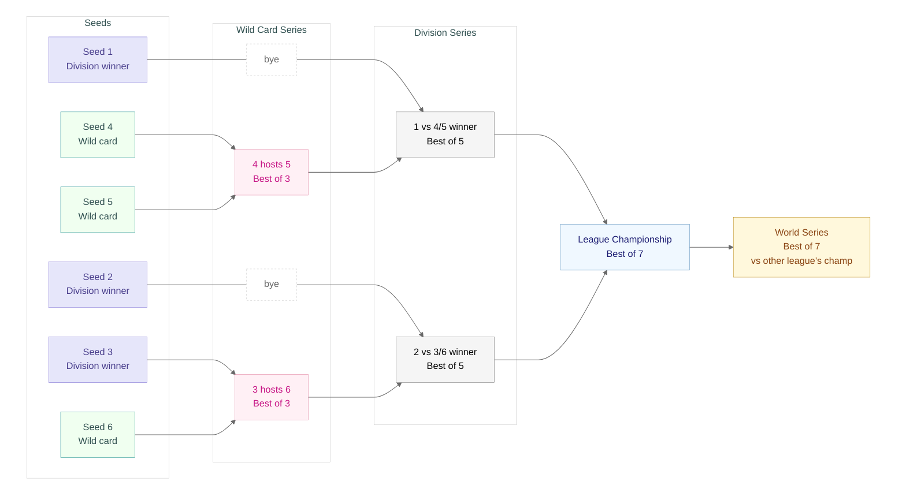
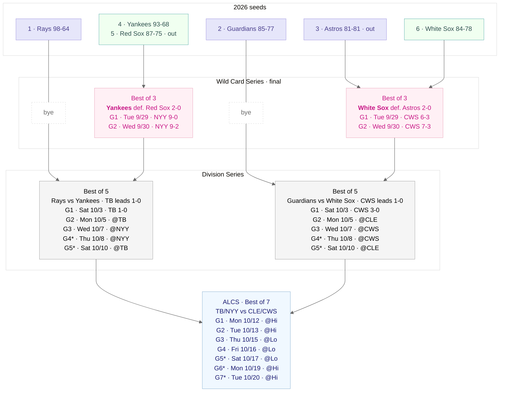
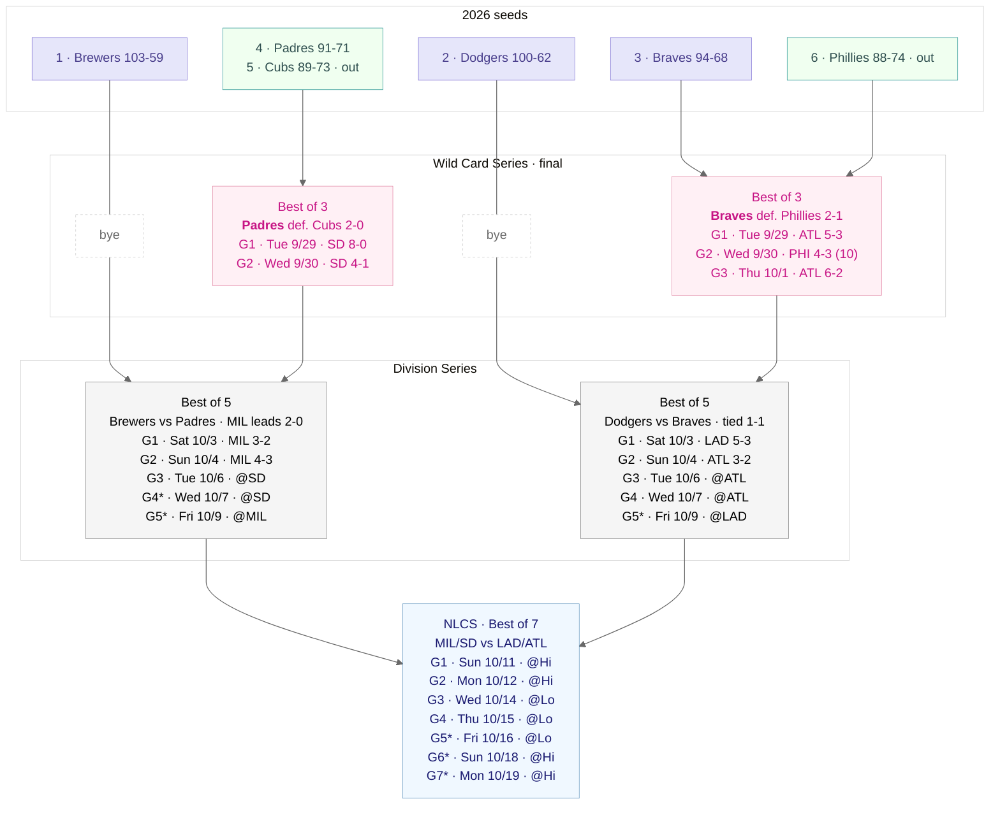
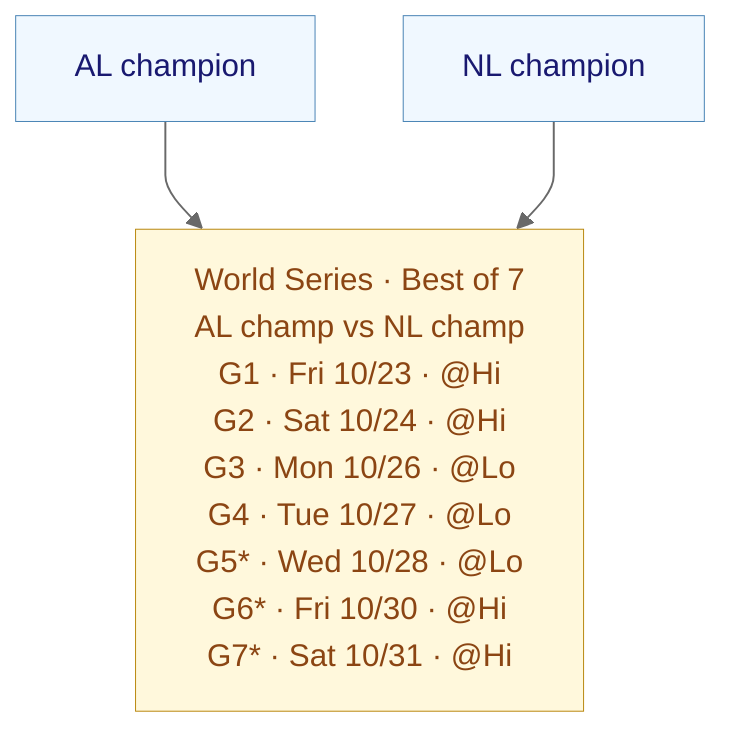

# MLB Playoffs 2026: Structure, Rules and Bracket

*Snapshot updated Monday, Oct. 5, 2026. Results are complete through Sunday, Oct. 4. Games dated Oct. 5 or later are shown as scheduled, even if they have since started or finished.*

## How MLB is organized

Major League Baseball has 30 teams split into two leagues, the **American League (AL)** and the **National League (NL)**. Each league has three divisions (East, Central and West) of five teams each. Teams are scheduled to play 162 regular-season games; a final record can total 161 if a postponed game is not made up. The 2026 final standings below list every team by division.

## Making the playoffs

Each league sends six teams to the postseason, 12 in total.

**Division winners (seeds 1–3).** The team with the best record in each division wins it. The three division winners are seeded 1 through 3 by regular-season winning percentage, with tiebreakers where needed.

**Wild cards (seeds 4–6).** The wild cards are the three teams with the best records among everyone else in the league, regardless of division. They are seeded 4 through 6 by regular-season winning percentage, with tiebreakers where needed.

Division winners always outrank wild cards. A division winner with a worse record than a wild card still gets the higher seed. In 2026 the Astros won the AL West at 81-81 and were seeded third, ahead of the 93-68 Yankees.

**Tiebreakers.** Since 2022, ties that affect a postseason berth or seed are settled by regular-season results, starting with head-to-head record, rather than by a one-game playoff.

## The rounds

1. **Wild Card Series (best of 3).** Seed 3 hosts seed 6, and seed 4 hosts seed 5. The higher seed hosts every game. Seeds 1 and 2 get a bye.
1. **Division Series (best of 5).** Seed 1 plays the 4/5 winner, and seed 2 plays the 3/6 winner. The bracket is fixed, so MLB does not reseed after the first round. The higher seed hosts Games 1, 2 and 5 (a 2-2-1 format).
1. **League Championship Series (best of 7).** The two Division Series winners in each league play for the pennant: the ALCS decides the AL champion and the NLCS decides the NL champion. The higher seed hosts Games 1, 2, 6 and 7 (a 2-3-2 format).
1. **World Series (best of 7).** The AL champion plays the NL champion. The team with the better regular-season record hosts Games 1, 2, 6 and 7, regardless of league seed. If their records match, MLB applies its tiebreaker rules.

## Why it matters

Winning a division guarantees a playoff spot and a top-three seed. The top two division winners in each league advance directly to the Division Series, avoiding elimination in the best-of-three opener and gaining rest. Wild-card teams can still win the pennant and World Series.

## The bracket at a glance

This is the format for one league. The AL and NL each run an identical bracket, and their champions meet in the World Series.

## 2026 final division standings

Teams are listed in finishing order. Bold marks a division winner; WC marks a wild card.

| League | Division | Teams (regular-season record) |
| ------ | -------- | ----------------------------- |
| AL | East | **Rays 98-64** Yankees 93-68 · WC Red Sox 87-75 · WC Orioles 79-82 Blue Jays 79-83 |
| AL | Central | **Guardians 85-77** White Sox 84-78 · WC Twins 77-85 Tigers 76-86 Royals 69-93 |
| AL | West | **Astros 81-81** Rangers 80-82 Mariners 76-86 Athletics 64-98 Angels 62-100 |
| NL | East | **Braves 94-68** Phillies 88-74 · WC Marlins 80-82 Nationals 77-85 Mets 74-88 |
| NL | Central | **Brewers 103-59** Cubs 89-73 · WC Pirates 82-80 Cardinals 77-85 Reds 75-87 |
| NL | West | **Dodgers 100-62** Padres 91-71 · WC D-backs 86-76 Giants 65-97 Rockies 58-104 |

## The 2026 field

| Seed | American League   | National League  | Qualification        |
| ---- | ----------------- | ---------------- | -------------------- |
| 1    | Rays (98-64)      | Brewers (103-59) | Division winner; bye |
| 2    | Guardians (85-77) | Dodgers (100-62) | Division winner; bye |
| 3    | Astros (81-81)    | Braves (94-68)   | Division winner      |
| 4    | Yankees (93-68)   | Padres (91-71)   | First wild card      |
| 5    | Red Sox (87-75)   | Cubs (89-73)     | Second wild card     |
| 6    | White Sox (84-78) | Phillies (88-74) | Third wild card      |

The Astros' division title gave them the AL's third seed despite the Yankees' better record. The D-backs (86-76) missed the NL's last wild-card spot by two games.

## Key dates

| Round            | Dates (2026)      |
| ---------------- | ----------------- |
| Wild Card Series | Sept. 29 – Oct. 1 |
| Division Series  | Oct. 3 – Oct. 10  |
| NLCS             | Oct. 11 – Oct. 19 |
| ALCS             | Oct. 12 – Oct. 20 |
| World Series     | Oct. 23 – Oct. 31 |

Games marked with an asterisk in the brackets are played only if needed. A World Series Game 7 would fall on Halloween. All dates come from MLB's published schedule and are subject to change.

## 2026 postseason bracket

The diagrams show results through Oct. 4 and later games as scheduled. They are the only place in this document that lists individual game scores.

Each completed game line gives the **winner first**, then the score. For a scheduled game, `@TB` means Tampa Bay hosts. An asterisk marks a game played only if necessary. In the league brackets, `@Hi` and `@Lo` mean the higher and lower seed; in the World Series, they mean the teams with the better and worse regular-season records.

**Team codes:** AL: BOS = Red Sox, CLE = Guardians, CWS = White Sox, HOU = Astros, NYY = Yankees, TB = Rays. NL: ATL = Braves, CHC = Cubs, LAD = Dodgers, MIL = Brewers, PHI = Phillies, SD = Padres.

The diagrams use the same colors as the overview: purple for division winners, teal for wild cards, pink for Wild Card Series, gray for Division Series, blue for league championships, and gold for the World Series. The light canvas and dagre layout are set inside each Mermaid block.

### American League

### National League

### World Series

The AL and NL champions advance to this final series. Home field belongs to the team with the better regular-season record, regardless of league seed.

## Updating this document

Game scores appear only in the three 2026 diagrams. After a game, replace its scheduled `@host` line with the winner and score, then update that series' lead. Remove an asterisk when a later game becomes guaranteed; remove unplayed conditional games when the series ends. Replace the next-round matchup placeholder with the advancing team, mark the loser `out` in its seed node, and replace `@Hi` and `@Lo` with hosts once those teams are known. Update the snapshot cutoff at the top, render all diagrams, and check MLB's schedule for date changes.

## Sources

- [MLB.com: 2026 postseason schedule and results](https://www.mlb.com/news/2026-mlb-playoff-and-world-series-schedule)
- [MLB.com: postseason bracket and latest games](https://www.mlb.com/postseason)
- [MLB.com: final 2026 standings](https://www.mlb.com/standings/2026)
- [MLB.com: postseason format](https://www.mlb.com/news/mlb-playoff-format-faq)
- [MLB.com: standings tiebreaker rules](https://www.mlb.com/news/mlb-playoff-tiebreaker-rules)