# Mermaid code conventions

Use these conventions for new diagrams in this collection, whether written by hand
or generated with assistance. They are authoring conventions, not additional Mermaid
syntax rules. Existing diagrams and historical lessons may use older names; preserve
those names unless a rename is part of the requested change.

## Naming

Mermaid IDs are references to drawing elements, not program variables. Keep the ID
stable when changing a displayed label, device model, address, or course title.

| Element               | Convention                                                                  | Example                                               |
| --------------------- | --------------------------------------------------------------------------- | ----------------------------------------------------- |
| Node ID               | Uppercase words separated by underscores; scope, role, then optional number | `SITE_A_SW_01`, `SITE_A_RTR_01`, `TRAINING_COURSE_01` |
| Subgraph ID           | `SG_` followed by an uppercase descriptive scope                            | `SG_SITE_A`, `SG_TRAINING`                            |
| Edge ID               | `edge_` followed by lowercase endpoint roles and optional purpose           | `edge_site_a_sw_rtr_data`                             |
| Invisible layout edge | `layout_` followed by its endpoint roles                                    | `layout_course_01_03`                                 |
| Node role class       | `node` followed by a descriptive role in camelCase                          | `nodeNetwork`, `nodeServer`, `nodeProcess`            |
| Node status class     | `state` followed by a status in camelCase                                   | `statePending`, `stateUnavailable`                    |
| Edge class            | `edge` followed by the connection meaning in camelCase                      | `edgeData`, `edgeManagement`, `edgeEncrypted`         |
| Subgraph class        | `group` followed by the grouping role in camelCase                          | `groupSite`, `groupPhase`                             |
| Layout class          | Use `layoutOnly` for invisible layout helpers                               | `class layout_course_01_03 layoutOnly;`               |

Use ASCII letters, digits, and underscores for IDs, beginning with a letter.
Avoid bare `end` and punctuation-heavy IDs even where a particular parser accepts
them. Put spaces, Unicode symbols, addresses, and human-readable punctuation in
quoted labels. These conservative choices make IDs easier to search and rename.

- Keep node, subgraph, and edge IDs distinct within a Mermaid block. Class names
  use their own prefixes so their purpose is obvious during review.
- Reuse the same ID for the same entity across related views when practical;
  each block still needs its own declarations and styles.
- Prefer meaningful scope names over unexplained abbreviations. Familiar roles
  such as `SW`, `RTR`, and `FW` are fine when the displayed labels explain them.
- Add a purpose suffix when two connections share endpoints, such as `_data`
  and `_management`. Use `_01`, `_02` for repeated peers consistently.
- Name edges that need styling or another explicit reference. Ordinary edges
  need not acquire IDs merely to satisfy the naming table.
- Rename an ID with a script that skips quoted labels, not with a plain
  find-and-replace, which can also rewrite label and title text. See
  [renaming an ID](#rename-an-id).

## Source organization

Use this order within each Mermaid block:

1. Configuration, when needed, followed by the diagram declaration and direction.
1. Subgraphs and node declarations, with each node's full label defined once.
1. Meaningful connections, grouped by workflow or traffic path.
1. Layout-only connections, clearly commented and placed in their intended group.
1. `classDef` declarations, grouped by node role, status, edge role, and group style.
1. `class` assignments, grouped to match those definitions.

Indent four spaces inside subgraphs. Put each declaration, connection, and style
statement on its own line; use semicolons consistently on `classDef`, `class`,
and `linkStyle` statements. Prefer a single connection per line when it has a
name, label, or special style. Short invisible chains remain useful for list layout.

Keep each diagram self-contained. Its palette, layout engine, and spacing belong in
its own `%%{init}%%` block, so the diagram looks the same when copied or previewed
without an external `--configFile` or theme JSON file.

Set `"layout": "elk"` explicitly. ELK keeps nodes inside their subgraphs and routes
connections at right angles; Dagre has been observed placing a node outside its own
subgraph box. `mmdc 12` already defaults to ELK, but a viewer with an older default
would silently switch engines if the setting were omitted.

Exception: pin `"layout": "dagre"` when the diagram depends on a subgraph
`direction`, such as a left-to-right bracket nested inside a top-to-bottom page.
ELK ignores subgraph `direction` and lays the subgraph out in the diagram's overall
direction; with `mmdc 12.0.0`, the [2026 MLB bracket](flowchart/mlb-playoff-2026-r1.0.4.md)
stacked its rounds top to bottom under ELK. Explain the choice in a comment above the
`%%{init}%%` block.

GitHub's Markdown renderer does not support ELK as of October 2026: it ignores
`"layout": "elk"` and lays out every diagram with dagre
([community discussion](https://github.com/orgs/community/discussions/138426)).
For a diagram meant to be read on GitHub, also render it with dagre
(`mmdc -c` with a config file containing `{"layout": "dagre"}`) and check that the
drawing still holds up.

Keep multiline configuration readable. Add settings to solve a demonstrated
problem, and record the intended renderer when relying on version-specific features.
Use `%%` comments on their own lines to explain a layout constraint or unusual
relationship. Comments should explain intent rather than repeat the syntax.
Never leave a bare `%%` line: it can break parsing (see the
[formatting lessons](mermaid-lessons-r1.0.6.md#known-bugs--hard-limitations)).
Use `%% ---` as a separator instead.

Mermaid now prefers YAML front matter (a `config:` block between `---` lines at
the very top of the diagram) over `%%{init}%%`. The init directive still works,
including on GitHub, so migrating existing diagrams is optional and low priority.

## Labels and relationships

Quote displayed node and subgraph labels. Use consistent capitalization and
terminology, and use Markdown Strings for intentional multiline or bold labels
when the target renderer supports them.

Choose arrows by meaning: `-->` for directional flow, `<-->` for bidirectional
communication, and `---` for an association with no claimed direction. Explain
special line patterns in a legend. An invisible link is a placement aid and must
not replace a real prerequisite or network relationship.

Keep details near what they describe: device-specific information belongs in node
labels; shared link information belongs on connections. Move long explanations
into prose below the drawing. Prefer `SG_` IDs for group references, but decide
whether a connection really targets a whole group or an individual member.

## Styles

Name classes by role or meaning, such as `edgeEncrypted`, rather than by paint
such as `redLine`. Use a small palette and define each class once per block.
Apply classes explicitly at the bottom so assignments can be audited together.

Keep role and status distinct. For example, `nodeServer` can define fill and text,
while `statePending` defines a dashed border. Avoid overlapping properties between
classes on the same element; if overlap is intentional, inspect the resolved style.
Include a visible status label such as `TBD` so color is not the only signal.

Use named edge classes for selected connections instead of numeric `linkStyle`
indexes when supported. `linkStyle default` is useful for a shared baseline, but
check that layout helpers remain invisible afterward.

A `classDef` font size does not change a subgraph title. To resize a title, assign
the subgraph a `group` class and target it from `themeCSS` with a descendant
(space) selector. Never use the `>` child combinator: it causes the whole `themeCSS`
value to be dropped without an error.

```text
%%{init: {"themeCSS": ".groupTitleLarge .cluster-label { font-size: 28px; }"}}%%
...
class SG_SITE_A groupTitleLarge;
```

A title that looks larger does not prove the rule applied, because outer subgraph
titles are already larger by default. Check the rendered SVG as described in
[verifying a render](#verify-a-render).

Hard-coded fills and text colors must remain readable together in light and dark
exports. A theme switch does not automatically redesign explicit `classDef` colors.
These conventions standardize names and structure; historical diagram palettes can
remain different where their legends require it.

### Older class names

Diagrams written before these conventions use shorter class names. Keep them unless a
rename is part of the change; when it is, use these equivalents.

| Older name                        | Convention                                                      | Note                                                       |
| --------------------------------- | --------------------------------------------------------------- | ---------------------------------------------------------- |
| `host`                            | `nodeServer`                                                    |                                                            |
| `network`                         | `nodeNetwork`                                                   |                                                            |
| `note`                            | `nodeNote`                                                      | Used for legend and annotation nodes                       |
| `pending`                         | `statePending` plus a role class                                | The older class also set fill and text colors              |
| `confirmed`                       | A role class, plus a status class only if verification is shown | The older class mixed device role with verification status |
| `encryptedPath`                   | `edgeEncrypted`                                                 |                                                            |
| `ipsecTunnel`                     | `edgeIpsecTunnel`                                               |                                                            |
| `titlebig`, `titlemed`, `titlesm` | `groupTitleLarge`, `groupTitleMedium`, `groupTitleSmall`        | Update the matching `themeCSS` selectors too               |

## Starter template

This example shows two sites, a carrier connection, a management path, and a planned
backup server. It demonstrates stable IDs, named edges, separate role/status classes,
and a shared dark palette. Replace the example topology with verified relationships;
these connections do not specify firewall rules, VLANs, redundancy, or actual capacity.

Named-edge syntax was checked with `mmdc 12.0.0`; also check the intended Markdown
viewer. Copy the whole block so its configuration and style assignments travel with it.

```mermaid
%% Keep configuration multiline so palette and spacing edits are easy to review.
%% Explicit class colors below supplement the theme; changing only the theme
%% will not recolor those classes. Match the export canvas with -b '#0b1120'.
%%{init: {
  "theme": "base",
  "layout": "elk",
  "themeVariables": {
    "darkMode": true,
    "background": "#0b1120",
    "primaryColor": "#17243b",
    "primaryTextColor": "#e6edf7",
    "primaryBorderColor": "#60a5fa",
    "textColor": "#e6edf7",
    "lineColor": "#94a3b8",
    "edgeLabelBackground": "#111827",
    "clusterBkg": "#111827",
    "clusterBorder": "#475569",
    "titleColor": "#e6edf7"
  },
  "flowchart": {
    "curve": "linear",
    "nodeSpacing": 35,
    "rankSpacing": 55
  }
}}%%
flowchart TB
    %% 1. Ownership: declare each full node label once inside its site.
    %% Change quoted labels freely; keep IDs stable for edges and class assignments.
    %% SG_ identifies a boundary, not another device or a security guarantee.
    subgraph SG_SITE_A["Site A - application services"]
        SITE_A_ADMIN_01["Admin workstation"]
        SITE_A_SW_01["Access switch"]
        SITE_A_FW_01["Edge firewall / router"]
        SITE_A_APP_01["Application server"]
        SITE_A_DB_01[("Application database")]
    end

    %% The carrier is outside both sites; its internal topology is out of scope.
    WAN_CARRIER["Carrier network"]

    subgraph SG_SITE_B["Site B - backup services"]
        SITE_B_FW_01["Edge firewall / router"]
        SITE_B_SW_01["Access switch"]
        SITE_B_BACKUP_01["Backup server - PLANNED"]
    end

    %% 2. Data path: solid double arrows mean bidirectional connectivity.
    %% Labels describe link purpose, not measured speed or verified access policy.
    %% Name edges that share styles; names survive unrelated edge insertions.
    %% Each chain is written from inside a site toward the carrier, so both WAN
    %% links leave through the bottom of their site and never cross a site title.
    SITE_A_APP_01 edge_site_a_app_sw_data@<-->|"Service network"| SITE_A_SW_01
    SITE_A_DB_01 edge_site_a_db_sw_data@<-->|"Database network"| SITE_A_SW_01
    SITE_A_SW_01 edge_site_a_sw_fw_data@<-->|"LAN transit"| SITE_A_FW_01
    SITE_A_FW_01 edge_site_a_fw_carrier_data@<-->|"WAN uplink"| WAN_CARRIER
    SITE_B_FW_01 edge_site_b_fw_carrier_data@<-->|"WAN uplink"| WAN_CARRIER
    SITE_B_SW_01 edge_site_b_sw_fw_data@<-->|"LAN transit"| SITE_B_FW_01

    %% 3. Logical management path: dotted arrow identifies the initiating host.
    %% It does not imply a separate cable or the absence of return traffic.
    SITE_A_ADMIN_01 edge_site_a_admin_fw_management@-.->|"HTTPS / SSH management"| SITE_A_FW_01

    %% 4. Planned connection: the dashed line and label both indicate future work.
    %% Do not imply that backups already run merely because this node is present.
    SITE_B_BACKUP_01 edge_site_b_backup_sw_planned@---|"Planned attachment"| SITE_B_SW_01

    %% 5. Layout helpers: none are needed here. Add them only after rendering.
    %% Keep any future ~~~ links in the owning group, name them layout_*, and
    %% assign classDef layoutOnly opacity:0; if global strokes make them visible.
    %% A layout link must never substitute for an actual prerequisite or data path.

    %% 6. Node roles: fill and text are paired for contrast on the dark canvas.
    %% Status is separate below; role classes deliberately leave dash patterns unset.
    classDef nodeNetwork fill:#172b46,stroke:#60a5fa,color:#eff6ff,stroke-width:2px;
    classDef nodeServer fill:#113832,stroke:#2dd4bf,color:#f0fdfa,stroke-width:2px;
    classDef nodeStorage fill:#29213f,stroke:#a78bfa,color:#f5f3ff,stroke-width:2px;
    classDef nodeOperator fill:#12313d,stroke:#22d3ee,color:#ecfeff,stroke-width:2px;
    classDef nodeExternal fill:#202b3d,stroke:#94a3b8,color:#e2e8f0,stroke-width:2px;

    %% Status changes the border pattern without replacing the server's role colors.
    %% When commissioned, remove both this class assignment and the PLANNED label.
    classDef statePending stroke-dasharray:6 4;

    %% Edge meaning: preserve labels and patterns so meaning does not rely on color.
    classDef edgeData stroke:#94a3b8,stroke-width:2px;
    classDef edgeManagement stroke:#22d3ee,stroke-width:2px;
    classDef edgePlanned stroke:#fbbf24,stroke-width:2px,stroke-dasharray:6 4;
    classDef groupSite fill:#111827,stroke:#475569,stroke-width:1px;

    %% 7. Assignments: keep these synchronized when deleting or renaming elements.
    %% A node may have a role and status; do not define competing fill/text rules.
    class SITE_A_SW_01,SITE_A_FW_01,SITE_B_FW_01,SITE_B_SW_01 nodeNetwork;
    class SITE_A_APP_01,SITE_B_BACKUP_01 nodeServer;
    class SITE_A_DB_01 nodeStorage;
    class SITE_A_ADMIN_01 nodeOperator;
    class WAN_CARRIER nodeExternal;
    class SITE_B_BACKUP_01 statePending;
    class SG_SITE_A,SG_SITE_B groupSite;

    class edge_site_a_app_sw_data,edge_site_a_db_sw_data,edge_site_a_sw_fw_data edgeData;
    class edge_site_a_fw_carrier_data,edge_site_b_fw_carrier_data,edge_site_b_sw_fw_data edgeData;
    class edge_site_a_admin_fw_management edgeManagement;
    class edge_site_b_backup_sw_planned edgePlanned;
```



**Legend:** solid double arrows show bidirectional data connectivity; the dotted cyan
arrow shows management initiation; the dashed amber line shows a planned attachment.
The backup server's dashed border and `PLANNED` label describe its status, not its role.
Site boxes group ownership; they do not establish network isolation.

To adapt the template:

1. Replace site names, devices, and labels; add addresses or interfaces only when useful.
1. Update real connections and their labels before adjusting layout. A connection to
   a site box means something different from a connection to its firewall.
   Write each chain from inside the site toward the shared network so that uplinks
   leave through the bottom of the site box instead of crossing its centered title.
1. Add each new element to the appropriate class assignments. If a planned component
   becomes active, update its label, status assignment, and planned edge together.
1. Render the complete diagram. Cross-site links can override local subgraph direction;
   do not assume that adding `direction TB` will force a site's internal arrangement.
1. Inspect labels, arrowheads, dashed status borders, and containment in the target
   viewer. Export with `-b '#0b1120'` for a matching dark canvas; see the
   [export reference](mermaid-reference.md#match-a-github-or-vs-code-dark-appearance).

## Review before sharing

- Confirm each node's label is defined once and all IDs are distinct.
- Check that every class assignment names an existing element and defined class.
- Recheck assignments after removing or renaming an edge or node.
- Verify arrows, labels, and legends describe the real workflow or topology.
- Check for bare `%%` comment lines: `grep -nE '^\s*%%\s*$' file.md` prints nothing.
- Render in the target viewer and inspect wrapping, containment, arrowheads, and contrast.
- For a diagram that may be read on a dark page, export with `-b transparent` and
  check the PNG composited over a dark color.
- Confirm styles and `themeCSS` rules in the rendered SVG rather than by eye; see
  [verifying a render](#verify-a-render).

See the [formatting lessons](mermaid-lessons-r1.0.6.md) for observed layout gotchas
and the [authoring reference](mermaid-reference.md) for fuller syntax examples.
Official references: [flowchart syntax, IDs, and classes](https://mermaid.js.org/syntax/flowchart.html)
and [theme configuration](https://mermaid.js.org/config/theming.html).

## Appendix: Rename and verification procedures

### Rename an ID

A plain find-and-replace can rewrite label and title text as well as the ID; the
[formatting lessons](mermaid-lessons-r1.0.6.md#bulk-renaming-ids-safely) record both
cases. This script changes an ID only inside Mermaid blocks, only as a whole token,
and never inside a quoted label:

````bash
python3 - diagram.md SITE_B_SW_01 SITE_B_SW_02 <<'EOF'
import re, sys
path, old, new = sys.argv[1:]
token = re.compile(rf'(?<![\w-]){re.escape(old)}(?![\w-])')
lines, inside, count = [], False, 0
for line in open(path, encoding='utf-8'):
    if line.strip() == '```mermaid':
        inside = True
    elif inside and line.startswith('```'):
        inside = False
    elif inside:
        parts = re.split(r'("[^"]*")', line)
        for i in range(0, len(parts), 2):
            parts[i], n = token.subn(new, parts[i])
            count += n
        line = ''.join(parts)
    lines.append(line)
open(path, 'w', encoding='utf-8').writelines(lines)
print(f'{count} replacement(s) of {old} -> {new} outside quoted labels')
EOF
````

Then:

1. Compare the reported count with the declaration, connections, and `class` lines
   you expected to change.
1. Search for the old ID. Any remaining matches should be prose or labels that you
   intend to keep.
1. Rename related edge IDs, such as `edge_site_b_sw_fw_data`, separately; the script
   does not match an ID embedded in a longer name.
1. Re-render and compare the drawing with the previous render. A damaged title is
   easy to miss in a source diff.

### Verify a render

A successful render proves the syntax was accepted. It does not prove that each
style reached the intended element, and a dropped `%%{init}%%` setting produces
no error.

Render the edited block to SVG and record the CLI version:

```bash
review_dir=$(mktemp -d /tmp/mermaid-review.XXXXXX)
mmdc --version > "$review_dir/cli-version.txt"
mmdc -i diagram.mmd -o "$review_dir/review.svg" -b '#0b1120'
```

Add `-p` with a browser configuration if Mermaid's headless browser is not installed;
see [browser troubleshooting](mermaid-install.md#chromium-fails-to-start). If the
browser cannot start, report the render as unverified rather than relying on a
syntax check.

The SVG does not keep class names on edges; `mmdc` resolves them into inline styles.
List each named edge with the styles it received:

```bash
python3 - "$review_dir/review.svg" <<'EOF'
import re, sys
svg = open(sys.argv[1], encoding='utf-8').read()
for tag in re.findall(r'<path[^>]*\bdata-id="[^"]+"[^>]*>', svg):
    edge = re.search(r'data-id="([^"]+)"', tag).group(1)
    style = re.search(r'style="([^"]*)"', tag)
    applied = re.findall(r'stroke(?:-width|-dasharray)?:[^;\s][^;]*', style.group(1) if style else '')
    print(f'{edge}: {"; ".join(applied) or "(no class style)"}')
EOF
```

For the starter template, every `_data` edge should report `stroke:#94a3b8`, the
management edge `stroke:#22d3ee`, and the planned edge `stroke-dasharray:6 4`.

For `themeCSS`, search the SVG for the rule itself. `mmdc` removes the spaces
around braces and after colons, so search for the compacted form:

```bash
grep -o '\.groupTitleLarge \.cluster-label{[^}]*}' "$review_dir/review.svg"
```

No output means the rule was dropped; check its value for a `>` or other
punctuation first. Re-render after the last edit, then open the image in the
intended viewer. Neither check replaces looking at the drawing.