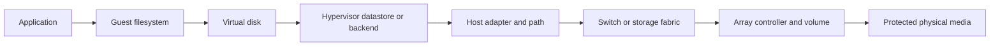

# Storage Acronyms and Terms: A Guide for New System Administrators

**Version:** r1.0.3 (LVM concepts added)  
**Audience:** System administrators who are new to shared storage and virtualization terminology.  
**Purpose:** Build a practical mental model of how virtual-machine data reaches storage, explain the concepts needed to operate that system, and define the acronyms and terms used in the storage comparison.  
**Related guide:** [Storage Capability Comparison r1.4.0](README-Storage-Comparison_r1.4.0.md)  
**Terminology baseline:** 2026-11-08 for release-sensitive examples. Check current vendor documentation before applying them to a deployment.

## Table of contents

- [1. How to use this guide](#1-how-to-use-this-guide)
  - [1.1 Learning path](#11-learning-path)
  - [1.2 Scope and limits](#12-scope-and-limits)
- [2. Follow one write through the system](#2-follow-one-write-through-the-system)
  - [2.1 From a guest application to physical media](#21-from-a-guest-application-to-physical-media)
  - [2.2 Where the data path can fail](#22-where-the-data-path-can-fail)
- [3. Storage foundations](#3-storage-foundations)
  - [3.1 Block storage and file storage](#31-block-storage-and-file-storage)
  - [3.2 Arrays, backends, and datastores](#32-arrays-backends-and-datastores)
  - [3.3 Shared storage and filesystems](#33-shared-storage-and-filesystems)
  - [3.4 LVM: physical volumes, volume groups, and logical volumes](#34-lvm-physical-volumes-volume-groups-and-logical-volumes)
- [4. Virtual machines and clusters](#4-virtual-machines-and-clusters)
  - [4.1 VM, virtual disk, VMDK, and VMFS](#41-vm-virtual-disk-vmdk-and-vmfs)
  - [4.2 Proxmox VE, PVE, and VE](#42-proxmox-ve-pve-and-ve)
  - [4.3 HA, Corosync, QDevice, and quorum](#43-ha-corosync-qdevice-and-quorum)
  - [4.4 Live migration and storage migration](#44-live-migration-and-storage-migration)
- [5. How hosts connect to storage](#5-how-hosts-connect-to-storage)
  - [5.1 SAN and NAS](#51-san-and-nas)
  - [5.2 LUNs and NFS datastores](#52-luns-and-nfs-datastores)
  - [5.3 FC, iSCSI, NVMe, and NVMe over Fabrics](#53-fc-iscsi-nvme-and-nvme-over-fabrics)
  - [5.4 Multipathing and host access patterns](#54-multipathing-and-host-access-patterns)
- [6. Copies, snapshots, backups, and replication](#6-copies-snapshots-backups-and-replication)
  - [6.1 VM snapshots vs. array snapshots vs. backups](#61-vm-snapshots-vs-array-snapshots-vs-backups)
  - [6.2 Crash consistency and application consistency](#62-crash-consistency-and-application-consistency)
  - [6.3 Replication and synchronous replication](#63-replication-and-synchronous-replication)
  - [6.4 RPO, RTO, and granular recovery](#64-rpo-rto-and-granular-recovery)
  - [6.5 Proxmox Backup Server (PBS)](#65-proxmox-backup-server-pbs)
- [7. Availability and failure handling](#7-availability-and-failure-handling)
  - [7.1 Failure domains](#71-failure-domains)
  - [7.2 Failover vs. failback](#72-failover-vs-failback)
  - [7.3 Fencing and single-owner access](#73-fencing-and-single-owner-access)
  - [7.4 Compute quorum vs. storage quorum](#74-compute-quorum-vs-storage-quorum)
  - [7.5 Witnesses and mediators](#75-witnesses-and-mediators)
- [8. Capacity and performance](#8-capacity-and-performance)
  - [8.1 Raw capacity vs. usable capacity](#81-raw-capacity-vs-usable-capacity)
  - [8.2 TB, Mbit/s, and Gbit/s](#82-tb-mbits-and-gbits)
  - [8.3 N+1 and performance headroom](#83-n1-and-performance-headroom)
  - [8.4 QoS and performance objectives](#84-qos-and-performance-objectives)
- [9. Product and ecosystem vocabulary](#9-product-and-ecosystem-vocabulary)
  - [9.1 NetApp: ONTAP, SVM, WAFL, AFF, FAS, and ASA](#91-netapp-ontap-svm-wafl-aff-fas-and-asa)
  - [9.2 VMware: VCF and VVF](#92-vmware-vcf-and-vvf)
  - [9.3 Compatibility: IMT](#93-compatibility-imt)
  - [9.4 Kubernetes: CSI](#94-kubernetes-csi)
  - [9.5 ZFS, Btrfs, and volume chains](#95-zfs-btrfs-and-volume-chains)
- [10. Put the concepts together](#10-put-the-concepts-together)
  - [10.1 One host cluster and one shared array](#101-one-host-cluster-and-one-shared-array)
  - [10.2 A two-array replication design](#102-a-two-array-replication-design)
  - [10.3 Walk through a failure and recovery](#103-walk-through-a-failure-and-recovery)
- [11. Alphabetical glossary](#11-alphabetical-glossary)
- [12. Further reading and verification](#12-further-reading-and-verification)
- [Appendix A: Acronyms and Terms](#appendix-a-acronyms-and-terms)
  - [Acronyms and abbreviations](#acronyms-and-abbreviations)
  - [Key terms](#key-terms)

## 1. How to use this guide

### 1.1 Learning path

Start with the data path in Section 2. It gives you a map for the rest of the terms: a workload writes data, virtualization software places it on a datastore, the host sends it over a path, and a storage system commits it to media. Sections 3–5 explain the storage layers and connections. Sections 6–8 explain recovery, availability, and capacity. Section 9 introduces vendor and ecosystem names. Section 10 walks through example designs. Use Appendix A when you need a quick definition.

### 1.2 Scope and limits

This is a concepts and terminology guide. It is not a configuration runbook, a capacity-sizing prescription, or a product-selection recommendation. Protocol availability, support status, licensing, behavior, and feature maturity depend on exact product models and software releases. Confirm them in current vendor documentation and compatibility tools before implementation.

## 2. Follow one write through the system

### 2.1 From a guest application to physical media

Suppose a database running inside a VM updates a record. The write passes through several layers:



The guest filesystem organizes files inside the VM. The virtual disk is the disk device the guest sees. The hypervisor datastore or backend locates and manages the virtual disk. The host adapter, network or fabric, and array controller carry the I/O to storage. The array maps the write to its internal layout and physical media, often using cache and redundancy mechanisms.

The exact layers vary. A VMware VM may use a VMDK file on VMFS or NFS. A Proxmox VM may use an LVM logical volume on a SAN LUN or a disk image file on NFS. In both cases, the guest still has its own filesystem. Do not confuse the guest filesystem, hypervisor storage layer, and array's internal storage layout.

### 2.2 Where the data path can fail

The write can be delayed or interrupted at any layer: the VM or guest OS, hypervisor, host adapter, cable, switch/fabric, storage controller, array, power system, or site. Redundancy is useful only when it bypasses the failed component and is configured end to end. Two network ports connected to one switch, for example, do not protect against failure of that switch.

A **failure domain** is a component or location whose failure can affect multiple systems. A failure review should map hosts, adapters, switches, controllers, arrays, power feeds, and sites, then test the failures that matter to the service.

## 3. Storage foundations

### 3.1 Block storage and file storage

**Block storage** presents a device made of addressable blocks. The host or hypervisor decides how to use those blocks. A LUN is a common block device; a host might put VMFS or LVM on it.

**File storage** presents files and directories through a protocol. The storage system owns the exported filesystem; a host mounts a share such as NFS and stores files in it.

| Question | Block storage | File storage |
|---|---|---|
| What does the host receive? | A block device, such as a LUN | A mounted export or share |
| Who manages the filesystem visible to the host? | The host/hypervisor may create a layer such as VMFS or LVM | The storage system manages the exported filesystem |
| Example in this guide | FC or iSCSI SAN LUN | NFS datastore |
| Main design checks | Protocol, zoning/network, multipathing, host backend, shared access | NFS version, network paths, export settings, permissions, datastore behavior |

A protocol name does not tell you whether a feature is supported by a particular product combination. Check the exact array, hypervisor, release, and configuration.

### 3.2 Arrays, backends, and datastores

An **array** is the storage system that owns drives, controllers, and its internal data layout. A **backend** is how the hypervisor manages a storage target. A **datastore** is a place the hypervisor can use for VM or container data; VMware commonly calls its storage container a datastore.

These terms describe different layers. For example, an array can present a LUN; the host can use shared LVM over that LUN; and Proxmox can place VM disks in LVM volumes managed by that backend. Alternatively, an array can export NFS, which the hypervisor mounts as a datastore.

### 3.3 Shared storage and filesystems

**Shared storage** means multiple cluster hosts can access the same storage through a method designed to coordinate their access. Shared access is what allows a VM to remain on the same storage while its compute host changes. It does not mean every filesystem can safely be mounted read/write by multiple hosts.

VMFS and NFS datastores are designed for supported multi-host access. Proxmox shared LVM exposes block volumes from shared storage to the cluster through the Proxmox storage backend and its cluster-wide locking behavior; it is not the same thing as mounting one ordinary filesystem on every node. Ordinary ZFS or Btrfs on a shared SAN LUN does not become a cluster filesystem. Use a supported cluster-aware design or give the filesystem a single owner with fencing.

### 3.4 LVM: physical volumes, volume groups, and logical volumes

**Logical Volume Manager (LVM)** is a block-storage management layer. It is not a filesystem. LVM combines block devices into pools and divides the pooled capacity into logical volumes. A guest operating system or application can use a logical volume as a virtual disk; the guest then creates its own filesystem inside that disk if needed.

The basic terms are:

| LVM object | Plain-language explanation | Example in a SAN-backed Proxmox design |
|---|---|---|
| Physical volume (PV) | A block device that LVM can manage | A multipathed SAN LUN initialized for LVM |
| Volume group (VG) | A pool made from one or more PVs | The shared pool from which Proxmox allocates VM disk volumes |
| Logical volume (LV) | A virtual block device allocated from a VG | A VM disk presented to the hypervisor/guest |

Conceptually:

```text
SAN LUN (block device)
  └── LVM physical volume (PV)
        └── LVM volume group (VG)
              └── logical volume (LV) for a VM disk
```

This stack has no host filesystem between the LUN and VM disk in the common Proxmox shared-LVM layout. LVM manages block allocation; it does not turn the VG into a shared directory. Proxmox marks the backend as shared so nodes use the supported shared-storage behavior and cluster-wide locking. Configure and validate the same storage identity and multipath view on each node.

“Thick” and “thin” describe when physical capacity is committed:

| Backend style | When capacity is allocated | Sharing and snapshot notes |
|---|---|---|
| Thick LVM (`lvm`) | When the LV is created | Proxmox supports shared LVM on suitable shared SAN block devices. VM snapshot-as-volume-chain support is a separate, release-sensitive feature currently marked technology preview in the docs checked for this guide. |
| LVM-thin (`lvmthin`) | As blocks are written into a thin pool | Proxmox documents this backend for local, non-shared storage. It supports snapshots and clones but cannot be shared across nodes as the ordinary LVM-thin backend. |

Thin provisioning allows the sum of provisioned virtual capacity to exceed physical pool capacity. That can improve utilization, but the administrator must monitor actual pool consumption and reserve enough space. A full thin pool can interrupt writes. Thin provisioning does not create physical capacity.

Do not confuse an LVM logical volume with a filesystem, a Proxmox storage backend, or an array snapshot. They are separate layers. See [Proxmox's LVM backend documentation](https://github.com/proxmox/pve-docs/blob/master/pve-storage-lvm.adoc) and [LVM-thin backend documentation](https://github.com/proxmox/pve-docs/blob/master/pve-storage-lvmthin.adoc) for release-specific behavior.

## 4. Virtual machines and clusters

### 4.1 VM, virtual disk, VMDK, and VMFS

A **virtual machine (VM)** is a software-defined computer managed by a hypervisor. Its **virtual disk** is the disk device presented to its guest operating system. The guest sees a disk and formats it with a guest filesystem, such as NTFS, ext4, or XFS.

**VMDK** means Virtual Machine Disk, a VMware virtual-disk format. The VMDK is not the guest filesystem. It is a virtual disk file or representation managed by VMware.

**VMFS** means Virtual Machine File System. It is a VMware datastore filesystem used on supported block devices. VMFS is above the array's internal filesystem/layout and below the VM's virtual disk. NFS datastores use a different path: the array exports a file share, and VMware mounts it without formatting that export with VMFS.

### 4.2 Proxmox VE, PVE, and VE

**Proxmox Virtual Environment (Proxmox VE or PVE)** is a virtualization platform based on KVM for VMs and Linux containers. Documentation and tools may shorten the name to **VE**. A Proxmox storage backend is selected and configured for particular content types, such as VM disks, container root filesystems, ISO images, or backups. Not every backend supports every content type or operation.

Storage behavior changes by backend and release. For example, local LVM-thin and shared LVM on a SAN are different designs. Do not assume a feature available on one backend is available on another.

### 4.3 HA, Corosync, QDevice, and quorum

**High availability (HA)** describes the system's ability to keep a service running or restart it after a defined failure. HA does not necessarily mean uninterrupted service. Restarting a VM on a surviving host causes an interruption while the guest boots and its application recovers.

Proxmox uses **Corosync** for cluster communication and membership. **Quorum** is the voting condition that lets a cluster make coordinated decisions. If a cluster lacks quorum, it may restrict changes or HA actions to avoid conflicting decisions. Quorum does not supply CPU, RAM, storage, or network capacity.

A **QDevice** is an external vote that can help establish quorum in supported cluster layouts. Its placement and configuration matter. A QDevice is not a replacement for adequate surviving hosts, storage access, or a tested failure plan. VMware HA also has its own admission control and failover rules; do not apply Proxmox quorum terminology to VMware as if the mechanisms were identical.

### 4.4 Live migration and storage migration

**Live migration** moves a running VM's compute state from one host to another. If both hosts can access the same datastore, the virtual disk usually stays where it is; the migration transfers memory and device/CPU state. Compatibility, networking, devices, and destination capacity can limit migration.

**Storage migration** moves the VM's virtual disks from one datastore or backend to another. It can involve substantial data transfer and has its own compatibility limits. A system may support live compute migration without supporting every storage-migration combination.

| Operation | What moves? | Typical reason |
|---|---|---|
| Live migration | Running VM's compute state | Planned host maintenance or workload placement |
| Storage migration | Virtual disk data | Datastore maintenance, tiering, or changing backend |
| HA restart | VM starts on another host after failure | Recovery when the original host is unavailable |

Migration is a planned operation; HA restart is a failure response. Neither is a backup.

## 5. How hosts connect to storage

### 5.1 SAN and NAS

A **storage area network (SAN)** presents block devices to servers over a storage network. A **network-attached storage (NAS)** system provides files and directories over a network protocol such as NFS. Product families may offer one or both kinds of access, but the exact platform and software release determine supported protocols.

SAN and NAS describe access models, not media types. Either can use flash media; a protocol does not imply HDD, SSD, or NVMe drives.

### 5.2 LUNs and NFS datastores

A **logical unit number (LUN)** is a block-storage device presented by an array. In practice, administrators often use “LUN” to mean the presented block device itself. A hypervisor can place a supported storage layer on it. VMware commonly uses VMFS on a supported LUN. Proxmox can use shared thick LVM over a supported SAN block device with multipathing configured on each node. LVM creates logical volumes for VM disks; it does not create a shared filesystem. Proxmox LVM-thin is a different backend and is local-only in the current backend documentation.

An **NFS datastore** is a directory exported by the array and mounted by hypervisor hosts. The NFS server owns the filesystem; the hosts access files over the network. VM disk formats and snapshot behavior depend on hypervisor, NFS version, and backend configuration.

Do not treat a LUN and an NFS export as interchangeable. They have different host software layers, path behavior, management, and failure tests.

### 5.3 FC, iSCSI, NVMe, and NVMe over Fabrics

**Fibre Channel (FC)** carries block-storage traffic over a dedicated fabric. **iSCSI** carries SCSI block commands over IP networks. Both can provide SAN block access, but require appropriate host adapters or network interfaces, switches, configuration, and multipathing.

**NVMe (Non-Volatile Memory Express)** is a storage command and interface family designed for efficient access to non-volatile storage. **NVMe over Fabrics (NVMe-oF)** carries NVMe commands across a fabric; possible transports include Fibre Channel and TCP. NVMe-oF is a host protocol path and does not, by itself, prove that the array has NVMe drives or that a given hypervisor/array combination is supported.

For any transport, verify the exact host software, array model, firmware, network/fabric design, and compatibility entry. Matching protocol names on a product sheet do not establish end-to-end support.

### 5.4 Multipathing and host access patterns

**Multipathing** gives a host more than one path to a block device and uses software to select paths and respond to path failure. It may provide availability and load distribution, depending on the array and path policy. Configure it on every host that uses the SAN.

Multiple links are useful only when they are independent enough to survive the failures you care about. Two links to the same switch share that switch as a failure domain. Ethernet bonding is not automatically the same as SCSI/NVMe multipathing; use the method supported for the protocol and platform.

In dual-array designs, **uniform host access** usually means hosts at both sites have direct paths to both arrays. **Non-uniform access** means some hosts reach only their local array or have asymmetric paths. These layouts can behave differently during path loss or array failover. Follow the selected array's host-connectivity guidance and test the actual failure behavior.

## 6. Copies, snapshots, backups, and replication

### 6.1 VM snapshots vs. array snapshots vs. backups

These mechanisms act at different layers and have different recovery scope.

| Mechanism | Managed by | What it commonly captures | Main caution |
|---|---|---|---|
| VM snapshot | Hypervisor | VM disk state and, optionally, memory or guest-quiesced state | Often intended as a short-lived checkpoint; delta growth and consolidation need management |
| Array snapshot | Storage system | A volume, LUN, datastore, or consistency group at a point in time | May contain many VMs; rollback can affect unrelated workloads |
| Backup | Backup software/system | A retained recoverable copy of selected VMs or data | Restore speed and consistency depend on configuration; test recovery, not just job success |

A **snapshot** is a point-in-time view or reference. It may depend on the original data and remain in the same array or failure domain. A **backup** is a separately managed recovery copy with retention and restore procedures. Some systems implement backups using snapshots internally, but the operational purpose and protection boundary are different.

Proxmox VE's shared-LVM snapshot-as-volume-chain option was explicitly labeled a technology preview in documentation on 2025-08-29 and remains marked preview in the documentation checked on 2026-11-08. No published stable-release date or commitment was identified in those sources. Proxmox live VM backup is a separate capability. Check the current release guide before relying on maturity statements.

### 6.2 Crash consistency and application consistency

A **crash-consistent** copy resembles the state left after sudden power loss. Filesystem journals and applications may recover, but in-flight application operations may not have completed cleanly.

An **application-consistent** copy coordinates with the guest or application so it can flush or pause writes before the snapshot. Guest agents and application plugins can support this, but setup and coverage vary. “VM snapshot” or “array snapshot” alone does not tell you the consistency level. Record which workloads are quiesced, which are only crash-consistent, and how restore is validated.

### 6.3 Replication and synchronous replication

**Replication** copies data changes from one system or location to another. It can help recover after an array or site failure, but it may also copy accidental deletion, ransomware encryption, or application corruption. Retained point-in-time copies and independent backups address different failure modes.

With **synchronous replication**, a write is acknowledged according to the paired systems' synchronous rules, which generally require the change to reach both copies before completion is reported. This can reduce the recovery-point gap for supported failures, but adds network latency and depends on the product's consistency, quorum, and failover design. It does not guarantee automatic failover for every failure.

“Active/active” and “synchronous” are product-specific terms. Confirm which systems can accept writes, what happens when the replication link or mediator is lost, and how split-brain is prevented. Do not infer behavior from a label alone.

### 6.4 RPO, RTO, and granular recovery

**Recovery Point Objective (RPO)** is the maximum acceptable data loss, often expressed as time. An RPO of 15 minutes means the design must be able to recover to a point no more than 15 minutes before the disruption. RPO is a requirement, not a feature name.

**Recovery Time Objective (RTO)** is the target time to restore the service. Measure from the defined start of the incident to usable application service, not merely to the moment an array is reachable.

**Granular recovery** means restoring a selected object, such as one VM or application, without rolling back unrelated workloads. A snapshot of a shared LUN or datastore may contain many VMs. Demonstrate the desired restore scope on the selected products and versions.

### 6.5 Proxmox Backup Server (PBS)

**Proxmox Backup Server (PBS)** is Proxmox's backup product, which can store and manage backups for Proxmox VE. It is distinct from VM snapshots and storage-array replication. Plan its storage, network, access controls, retention, and failure domain separately from the primary VM datastore. A backup is useful only if the backup system and catalog remain accessible and a restore succeeds within the required time.

## 7. Availability and failure handling

### 7.1 Failure domains

A failure domain is a part of the design that can fail as a unit or affect several components together. Examples include a host, adapter, switch, controller, array, rack, power feed, building, or site. Redundant components that share a switch, power feed, or site do not protect against loss of that shared domain.

For every design, ask: what single failures must it tolerate, what service interruption is allowed, and what independent recovery copy remains? A second array in the same room can address some array failures but not necessarily a site-wide power or network event.

### 7.2 Failover vs. failback

**Failover** moves service or storage access to a surviving component after a failure. It can be automatic or manual and may cause a pause or VM restart.

**Failback** returns service to the preferred system after the fault is resolved. It may require resynchronizing data and confirming the preferred copy is current. A failed array that returns with stale data must not overwrite newer writes. Test both directions: initial failover and planned return.

### 7.3 Fencing and single-owner access

**Fencing** prevents a host or site that has lost authority from continuing to write to a resource. This protects against two systems believing they own the same data. Fencing may use power control, storage reservations, or another supported mechanism; the method depends on the design.

An ordinary filesystem such as ZFS or Btrfs is normally mounted read/write by one host at a time unless a specific cluster-capable design says otherwise. If a single-owner filesystem is placed on a SAN LUN, failover requires reliable fencing and exclusive ownership transfer. The shared LUN alone does not make concurrent mounts safe.

### 7.4 Compute quorum vs. storage quorum

**Compute quorum** allows a host cluster to agree on membership and coordinated actions. **Storage quorum** or a storage-pair witness helps storage systems decide which copy can serve writes. They are separate decisions.

In a multi-site design, compute and storage must agree on which side is allowed to run workloads and serve data. A compute cluster that has quorum but cannot access current storage cannot provide the intended service. A storage pair that can select a primary does not provide enough compute capacity or application readiness by itself.

### 7.5 Witnesses and mediators

A **witness** or **mediator** is an independent service or vote used by some paired systems to resolve which side should remain active after a communication failure. Its job and terminology are product-specific. It should be placed so that it does not fail with either protected side when that is a design requirement.

A witness is not a third data copy and usually does not store the workload's data. It does not automatically replace the hypervisor cluster's quorum device. Understand which system consults it, what decisions it can make, and what happens when it is unreachable.

## 8. Capacity and performance

### 8.1 Raw capacity vs. usable capacity

**Raw capacity** is the sum of the nominal drive capacities before protection and overhead. **Usable capacity** is the space available for workload data after the array's protection layout, spare/reserve policy, metadata, formatting, and other overhead. Vendors may use additional capacity labels, so confirm what each number includes.

For the comparison scenario, 130 TB is raw capacity; the document leaves open whether that applies to each array or the pair. A replica is another copy of data and does not double the amount of unique workload data that can be stored. Size snapshots, growth, replicas, and independent backups explicitly.

### 8.2 TB, Mbit/s, and Gbit/s

This comparison uses decimal units: 1 TB = 1,000,000,000,000 bytes. Some operating systems and tools display binary units such as TiB, where 1 TiB = 1,099,511,627,776 bytes. The values differ even when people casually call both “terabytes.”

Mbit/s and Gbit/s measure bits per second; MB/s and GB/s measure bytes per second. Eight bits make one byte, before protocol overhead. A 10 Gbit/s link therefore has a theoretical ceiling of 1.25 GB/s, not 10 GB/s; real application throughput is lower because of encoding, protocol overhead, contention, and other limits.

### 8.3 N+1 and performance headroom

**N+1** means the design has enough capacity to tolerate one additional component failure while still meeting the stated service requirement. For a three-host cluster, test whether the remaining two hosts can run the required VMs after one host fails. Include CPU, memory, network, and device constraints.

Capacity is not only space. A surviving array or controller may have enough free terabytes but not enough IOPS or bandwidth for the workload. Measure normal and degraded performance, including rebuilds and failover.

### 8.4 QoS and performance objectives

**Quality of Service (QoS)** refers to policies that manage or limit resource use, such as IOPS or throughput. Exact controls differ between vendors and products. Define workload objectives in measurable terms: for example, p95/p99 read and write latency, sustained throughput, queue depth, and application response time. A feature called QoS does not prove the workload will meet those objectives; test under representative load.

## 9. Product and ecosystem vocabulary

The following are examples from the comparison, not universal feature guarantees. Product names, available protocols, entitlements, and support status vary by model and release.

### 9.1 NetApp: ONTAP, SVM, WAFL, AFF, FAS, and ASA

**ONTAP** is NetApp's storage operating system. A **Storage Virtual Machine (SVM)** is a logical storage server within ONTAP that provides data access and protocol endpoints. **WAFL** (Write Anywhere File Layout) is ONTAP's internal filesystem/layout layer. It is below the host-visible VMFS or guest filesystem.

**AFF** is NetApp's all-flash FAS family. **FAS** is a NetApp storage family often used for hybrid or capacity-focused configurations. **ASA** means All SAN Array and identifies a SAN-focused personality; **ASA r2** is a distinct product family/personality. These names are not interchangeable. Verify which protocols, data services, and replication features are available on the specific platform and ONTAP release.

For example, current NetApp documentation describes SnapMirror active sync as requiring a supported pair and a mediator for automated failover. Its supported cluster types, protocols, and behavior vary by ONTAP version. Do not generalize an AFF, ASA, or ASA r2 example to every NetApp platform.

### 9.2 VMware: VCF and VVF

**VMware Cloud Foundation (VCF)** and **VMware vSphere Foundation (VVF)** are VMware product offerings. Product packaging and entitlements can determine which features an organization may use. Check the current product/edition documentation and the organization's entitlement before treating a capability as available.

The comparison guide treats vVols as a lifecycle-sensitive topic because VMware has published changes to vVol/VASA support in newer VCF/VVF releases. This is an example of why feature names and old designs must be checked against current release notices before a deployment or migration.

### 9.3 Compatibility: IMT

NetApp's **Interoperability Matrix Tool (IMT)** helps verify supported combinations of NetApp hardware/software and host operating systems, protocols, and related components. A compatibility check should use the actual controller model, ONTAP release, hypervisor release, protocol, host settings, and required integration software. “Both vendors support iSCSI” is not a complete compatibility result.

Other vendors publish their own compatibility guides and support matrices. Keep the exact result or configuration record for the design being purchased.

### 9.4 Kubernetes: CSI

The **Container Storage Interface (CSI)** is a standard interface through which Kubernetes communicates with storage drivers. A CSI driver can provision, attach, mount, expand, or snapshot storage when those operations are implemented and supported by the driver and storage platform.

Having an array protocol such as NFS or iSCSI does not by itself prove that a Kubernetes CSI driver supports the desired workflow. Confirm Kubernetes, driver, array, access mode, topology, and feature versions together.

### 9.5 ZFS, Btrfs, and volume chains

**ZFS** is a filesystem and volume-management system with checksumming, snapshots, and storage-pool features. **Btrfs** is a Linux filesystem with checksumming, snapshots, and subvolume features. Their exact behavior and supported RAID profiles depend on implementation and release. Neither should be treated as a multi-host cluster filesystem simply because its backing device is a shared SAN LUN.

A **volume chain** is a base disk plus one or more dependent delta layers. Proxmox's shared-LVM snapshot-as-volume-chain feature uses qcow2 backing chains over thick LVM, and current documentation marks this feature as a technology preview in the sources checked for the comparison. Keep the entire chain intact and verify current maturity before production use. This VM snapshot mechanism is distinct from Proxmox live backup. The volume chain is an additional layer above the LVM logical volumes, not an LVM filesystem.

## 10. Put the concepts together

### 10.1 One host cluster and one shared array

In a three-host cluster with one array, each eligible host can access the same shared datastore. A VM can be live-migrated between compatible hosts without moving its virtual disk, assuming the backend and configuration support the operation. If a host fails, HA may restart its VMs on surviving hosts, provided cluster state, storage paths, and resources remain available.

This design can protect against selected host, path, and internal array component failures. It does not protect against complete loss of the array unless an independent backup or another recovery copy exists. The cluster also needs enough capacity to handle maintenance and a host failure if both are expected at once.

### 10.2 A two-array replication design

A second array can hold a replica or participate in a synchronous/active-sync design. The outcome depends on the exact replication type, host connectivity, mediator/witness, and supported failover workflow. Some designs require manual intervention; some can automate selected failures. “Two arrays” alone does not promise transparent service.

Map separately: (1) the compute cluster's quorum and surviving hosts, (2) the storage pair's decision about which copy serves writes, and (3) the application restart or recovery process. If the arrays are in separate sites, include inter-site latency, network, power, and quorum placement. Keep an independent backup because replication can copy unwanted changes.

### 10.3 Walk through a failure and recovery

Consider loss of one host:

1. Cluster membership detects the host is unavailable.
2. The cluster must retain quorum and fence or otherwise ensure the failed host cannot conflict with restarted workloads.
3. The hypervisor starts eligible VMs on surviving hosts if storage is reachable and resources are sufficient.
4. Applications recover from their own restart state; measure when service is usable.
5. When the host returns, confirm its storage paths and cluster state before placing workloads back.

For loss of an array, the steps differ. The design must identify a valid surviving copy, determine who may promote it, restore host access, and check data currency against the RPO. Then measure service recovery against the RTO. Record failback and resynchronization separately; never assume a recovered array is automatically safe to resume serving writes.

## 11. Alphabetical glossary

Use [Appendix A: Acronyms and Terms](#appendix-a-acronyms-and-terms) as the lookup reference. The explanatory sections above provide context and examples for the terms that are easiest to confuse.

## 12. Further reading and verification

Start with the [Storage Capability Comparison r1.4.0](README-Storage-Comparison_r1.4.0.md), especially its [verification reference register](README-Storage-Comparison_r1.4.0.md#appendix-c-verification-reference-register). The references below are primary documentation used for the concepts in this guide. Online documentation changes; the research baseline for this edition is 2026-11-08.

- [Proxmox VE Administration Guide](https://pve.proxmox.com/pve-docs/pve-admin-guide.html): storage backends, clustering, HA, migration, and backup. Confirm the installed VE release because upstream pages may describe a newer release.
- [Proxmox VE storage: LVM](https://github.com/proxmox/pve-docs/blob/master/pve-storage-lvm.adoc) and [LVM-thin](https://github.com/proxmox/pve-docs/blob/master/pve-storage-lvmthin.adoc): physical-volume/VG/LV concepts as used by the Proxmox backends, shared LVM, local-only LVM-thin, and snapshot-as-volume-chain behavior. The LVM snapshot feature's maturity label is release-sensitive; check current docs.
- [Proxmox VE storage: NFS](https://github.com/proxmox/pve-docs/blob/master/pve-storage-nfs.adoc): NFS backend and content behavior.
- [Proxmox Backup Server documentation](https://pbs.proxmox.com/docs/): backup and restore concepts for PBS.
- [Broadcom vSphere documentation](https://docs.vmware.com/en/VMware-vSphere/index.html): VMware terminology and current release behavior.
- [Broadcom knowledge base: vSphere migration behavior](https://knowledge.broadcom.com/external/article/419637/crossvcenter-migrations-with-different-s.html): example distinction between migration with shared storage and disk transfer.
- [NetApp ONTAP documentation](https://docs.netapp.com/us-en/ontap/): ONTAP, SVMs, storage protocols, protection, and platform support.
- [NetApp SnapMirror active sync overview](https://docs.netapp.com/us-en/ontap/snapmirror-active-sync/index.html), [prerequisites](https://docs.netapp.com/us-en/ontap/snapmirror-active-sync/prerequisites-reference.html), and [architecture](https://docs.netapp.com/us-en/ontap/snapmirror-active-sync/architecture-concept.html): release- and platform-specific synchronous protection and mediator behavior.
- [NetApp hardware comparison](https://docs.netapp.com/us-en/asa-r2/learn-more/hardware-comparison.html): product personality distinctions.
- [Btrfs documentation](https://btrfs.readthedocs.io/en/latest/) and [OpenZFS documentation](https://openzfs.github.io/openzfs-docs/): filesystem concepts and administration.
- [Kubernetes CSI documentation](https://kubernetes-csi.github.io/docs/): CSI architecture and driver concepts.

For any deployment, record source title, exact product/release scope, URL, access date, claim checked, and limitations. A vendor guide is evidence for the configuration it describes, not blanket certification for every model or release.

## Appendix A: Acronyms and Terms

### Acronyms and abbreviations

| Acronym or abbreviation | Full form | Meaning in this document |
|---|---|---|
| AFF | All Flash FAS | NetApp all-flash storage family; one example of a unified ONTAP platform. |
| ASA | All SAN Array | NetApp SAN-focused storage personality; distinguish classic ASA from ASA r2. |
| Btrfs | B-tree filesystem | Linux filesystem considered as a guest filesystem or part of a separate storage-server design. |
| Corosync | Proper name (not an acronym expanded in this guide) | Cluster communication and membership software used by Proxmox VE. |
| CSI | Container Storage Interface | Interface through which Kubernetes storage drivers provision and attach storage. |
| FAS | Fabric-Attached Storage | NetApp storage family often considered for HDD or hybrid capacity configurations. |
| FC | Fibre Channel | Block-storage transport used to connect hosts to a SAN. |
| HA | High availability | Ability to continue or restart eligible workloads after defined failures; it does not necessarily mean zero interruption. |
| IMT | Interoperability Matrix Tool | NetApp tool for checking supported combinations of hardware and software. |
| iSCSI | Internet Small Computer Systems Interface | Protocol that carries SCSI block-storage commands over IP networks. |
| LUN | Logical unit number | A block device presented by a storage array to a host. |
| LV | Logical volume | A block device allocated from an LVM volume group; in the example, it can hold a VM disk. |
| LVM | Logical Volume Manager | Linux block-storage layer that groups physical volumes into volume groups and allocates logical volumes; it is not a filesystem. |
| Mbit/s, Gbit/s | Megabits per second, gigabits per second | Data-rate units; bits per second are different from bytes per second. |
| NAS | Network-attached storage | File-based storage accessed over a network, such as through NFS. |
| NFS | Network File System | File-sharing protocol used to provide a shared datastore. |
| N+1 | N plus one | Design with enough spare capacity to tolerate one additional component failure while meeting requirements. |
| NVMe | Non-Volatile Memory Express | Storage command/interface family; NVMe-oF carries it over a network or fabric. |
| NVMe-oF | NVMe over Fabrics | Carries NVMe commands across a network or storage fabric. |
| ONTAP | Product name, not expanded as an acronym here | NetApp storage operating system; capabilities depend on platform, personality, and release. |
| PBS | Proxmox Backup Server | Proxmox backup product, separate from hypervisor snapshot features. |
| PV | Physical volume | A block device initialized for use by LVM, such as a SAN LUN. |
| PVE | Proxmox Virtual Environment | Proxmox virtualization platform; VE is also used as its short form. |
| QDevice | Quorum device | External vote used in certain Proxmox cluster configurations. |
| QoS | Quality of Service | Controls or policies that influence resource allocation or performance; implementations vary by product. |
| RPO | Recovery Point Objective | Maximum acceptable data loss, often expressed as an amount of time. |
| RTO | Recovery Time Objective | Target time to restore a service after disruption. |
| SAN | Storage Area Network | Storage network that presents block devices to servers. |
| SCSI | Small Computer System Interface | Command set used by storage devices and protocols such as iSCSI. |
| SVM | Storage Virtual Machine | ONTAP logical storage server that provides storage services and protocol endpoints. |
| TB | Terabyte | Decimal capacity unit: 1 TB = 10¹² bytes. |
| VCF/VVF | VMware Cloud Foundation / VMware vSphere Foundation | VMware product offerings referenced in connection with features and entitlements. |
| VE | Virtual Environment | Short form in the Proxmox VE product name. |
| VG | Volume group | A pool of one or more LVM physical volumes from which logical volumes are allocated. |
| VM | Virtual machine | Software-defined computer running on a hypervisor. |
| VMFS | Virtual Machine File System | VMware filesystem used to create datastores on supported block storage. |
| VMDK | Virtual Machine Disk | VMware virtual-disk format. |
| WAFL | Write Anywhere File Layout | NetApp ONTAP internal filesystem/layout, distinct from a host datastore filesystem. |
| ZFS | Zettabyte File System | Filesystem and volume-management system considered as a guest filesystem or separate storage-server design. |

### Key terms

| Term | Plain-language definition | How it applies here |
|---|---|---|
| Array | A purpose-built storage system that presents data to servers. | Dell and NetApp systems are compared as external arrays; exact model and release determine capabilities. |
| Array snapshot | A point-in-time copy or reference maintained by the storage system. | It may cover a volume, LUN, datastore, or consistency group; it is not automatically a VM-aware backup. |
| Backend | The storage type and management method used by a hypervisor. | Examples include VMFS, shared LVM, NFS, local ZFS, and local Btrfs. |
| Backup | A separately retained copy intended for recovery after loss or unwanted change. | Snapshots and replicas may share failure modes or copy corruption, so backup and restore must be tested. |
| Capacity: raw vs. usable | Raw is drive capacity before protection and overhead; usable is space available to workload data afterward. | The comparison starts with 130 TB raw; usable capacity and allocation across arrays remain to be determined. |
| Crash-consistent | A copy reflecting storage as if power were lost at that moment, without application coordination. | Applications may need recovery; this differs from an application-coordinated copy. |
| Data path | The route data travels between a workload and storage, including software, adapters, network, and array interfaces. | Used to understand performance bottlenecks and failure points. |
| Failure domain | A component or location whose failure can affect multiple systems. | Hosts, fabrics, arrays, power zones, and sites should be assessed separately. |
| Failback | Returning service or ownership to the preferred system after failover. | Includes resynchronization, path state, and avoiding writes to stale data. |
| Failover | Switching service or storage access to a surviving component after a failure. | Automation and interruption depend on the exact host-array design. |
| Fencing | Preventing a failed or isolated system from continuing to access a resource it no longer owns. | Helps prevent two hosts or sites from writing to a single-owner filesystem or service. |
| Granular recovery | Restoring one selected object, such as a VM or application, without reverting unrelated data. | Important when a datastore-level restore would affect other workloads. |
| Live migration | Moving a running VM between hosts with little planned interruption. | Requires compatible hosts and configuration; it differs from restarting after a host failure. |
| Logical volume (LV) | A block device allocated from an LVM volume group. | In the shared-LVM example, Proxmox allocates an LV for a VM disk; it is not itself a filesystem. |
| Multipathing | Using multiple paths between a host and block storage, with path selection and recovery. | Supports resilient FC/iSCSI designs; redundant network links alone do not configure multipathing. |
| NFS datastore | A shared directory exported by a storage system and mounted by hypervisor hosts. | A file-based datastore alternative to a block LUN managed with VMFS or LVM. |
| Physical volume (PV) | A block device prepared for LVM to manage. | A multipathed SAN LUN can serve as an LVM PV in an appropriate supported layout. |
| Quorum | The minimum set of votes or members needed for a cluster to make coordinated decisions. | Compute-cluster quorum and storage-system quorum are separate concerns. |
| Replication | Copying data changes from one storage system or location to another. | Can support array/site recovery, but can also copy deletion or corruption. |
| Shared storage | Storage accessible to multiple cluster hosts through a supported shared-access method. | Supports eligible migration and HA workflows when the backend permits the intended access. |
| Snapshot | A point-in-time view used as a checkpoint or recovery reference. | VM, guest, and array snapshots operate at different layers and have different consistency and rollback scope. |
| Storage migration | Moving a VM's virtual disks between datastores or storage backends. | Separate from moving only the running VM between hosts; backend and VM configuration can limit it. |
| Sync replication | Replication that acknowledges writes according to synchronous protection rules across paired systems. | Can reduce data loss for supported failures, subject to latency, quorum, and topology requirements. |
| Thick provisioning | Reserving the logical volume capacity from the storage pool when the volume is created. | Proxmox shared LVM (`lvm`) uses thick-provisioned logical volumes; the SAN may still have its own internal thin-provisioning behavior. |
| Thin provisioning | Allocating physical blocks as data is written rather than reserving all virtual capacity upfront. | LVM-thin can overcommit capacity; monitor pool usage because thin provisioning does not add physical space. |
| Uniform / non-uniform host access | Whether hosts at both storage sites have equivalent direct paths to both storage systems. | Affects path behavior and recovery steps in dual-array designs. |
| Usable capacity | Capacity available to workloads after redundancy, metadata, reserves, formatting, and other overhead. | Must be sized separately from raw capacity, snapshots, replicas, and backup retention. |
| Volume chain | A sequence of base and changed disk images where each layer depends on an earlier layer. | Proxmox shared-LVM snapshot preview uses qcow2 backing chains; the full chain must remain intact. |
| Volume group (VG) | A pool of LVM physical volumes from which logical volumes are allocated. | A shared VG can provide the allocation pool for Proxmox VM disk LVs when configured as shared storage. |
| Witness / mediator | An independent service or vote that helps paired systems decide which side may serve data. | Placement and role depend on the array design; it is not the same as compute-cluster quorum. |
