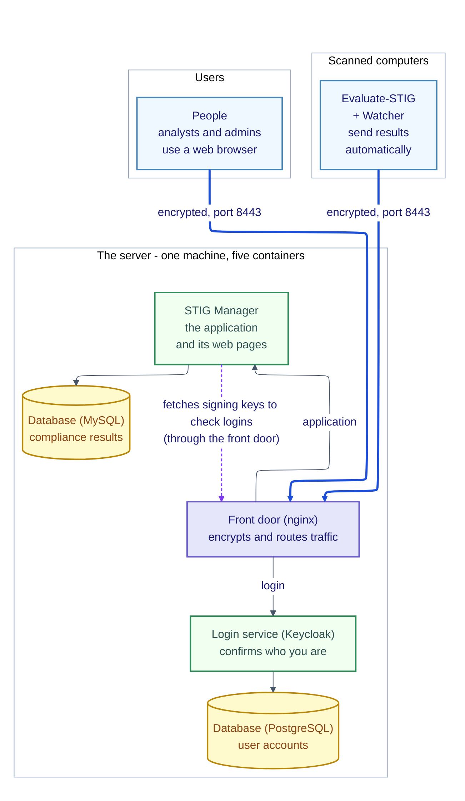
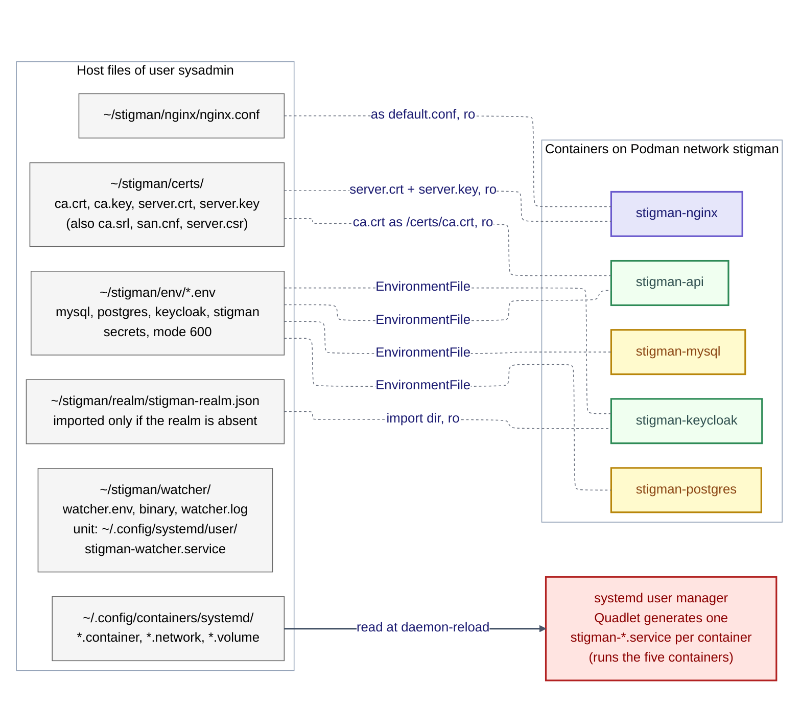
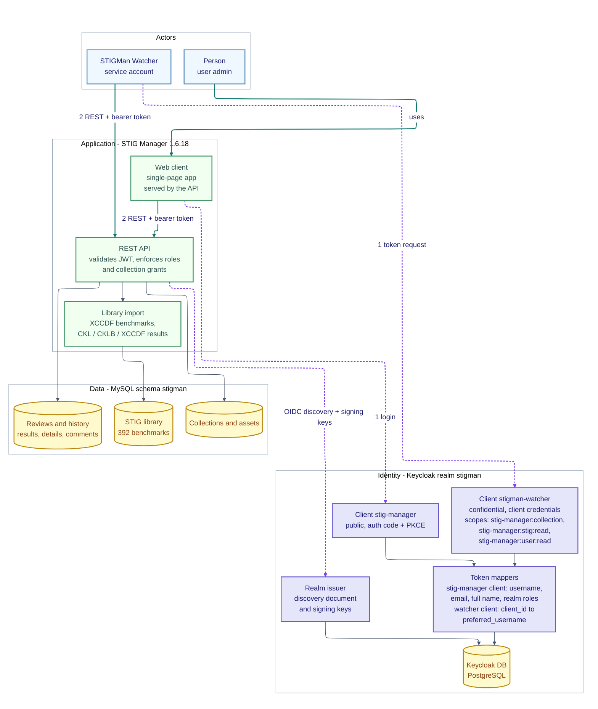
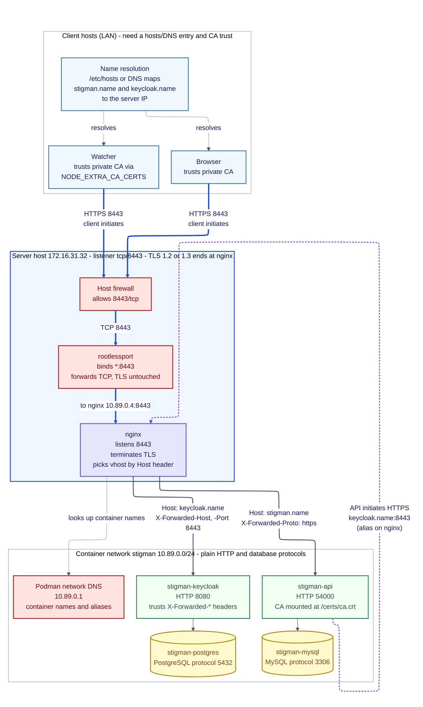
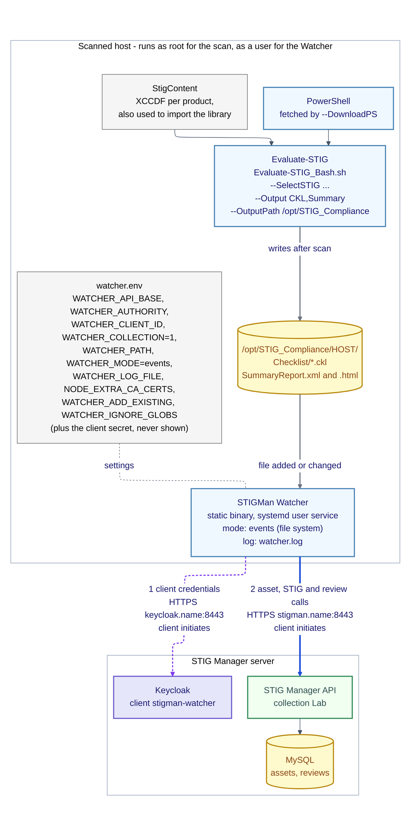
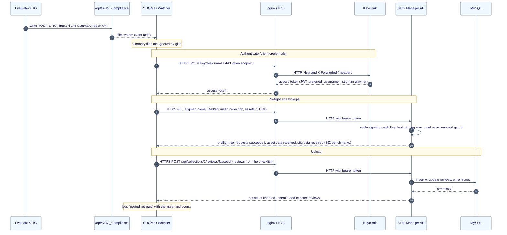
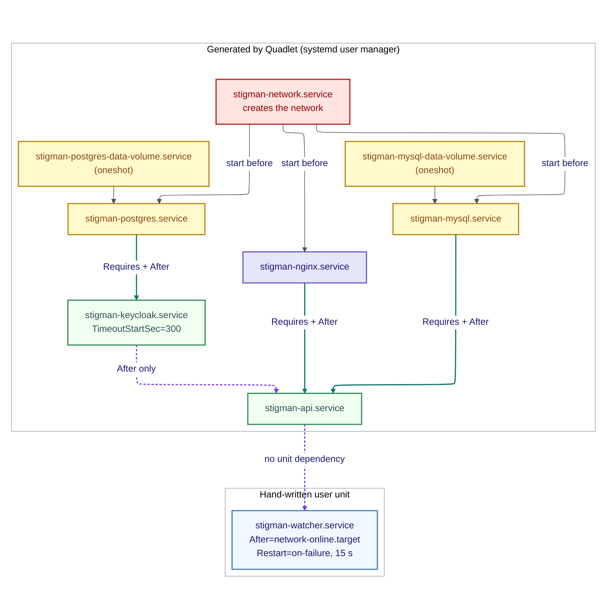

# STIG Manager architecture

Revision r1.2.4. Example system observed 2026-11-11.

**Scope.** This document describes the runtime architecture of an example STIG Manager deployment: what runs where, how components connect, how logins and uploads work, and what each part is for. It is not an installation guide, recovery procedure, hardening checklist or firewall approval record. Hostnames, addresses and the collection are example values. Observations come from the example system on the date above; descriptions of what STIG Manager does come from the official documentation ([Appendix B](#appendix-b-sources)). The diagrams are Mermaid source embedded in this file.

## Contents

- [Executive summary](#executive-summary)
- [Overview](#overview)
- [Detailed topology](#detailed-topology)
  - [Runtime topology](#runtime-topology)
  - [Files and mounts](#files-and-mounts)
- [Logical view](#logical-view)
- [Transport view](#transport-view)
- [Evaluate-STIG pushing data to STIG Manager](#evaluate-stig-pushing-data-to-stig-manager)
  - [What Evaluate-STIG does](#what-evaluate-stig-does)
  - [Two ways to send results](#two-ways-to-send-results)
- [Evaluate-STIG pushing data: message flow](#evaluate-stig-pushing-data-message-flow)
- [Units and start order](#units-and-start-order)
- [Appendix A: Acronyms and key terms](#appendix-a-acronyms-and-key-terms)
  - [Acronyms and abbreviations](#acronyms-and-abbreviations)
  - [Key terms](#key-terms)
- [Appendix B: Sources](#appendix-b-sources)

## Executive summary

**What it is.** STIG Manager is a web application that keeps an organization's security-compliance checklists in one place. A STIG (Security Technical Implementation Guide) is a published security configuration standard for a product, such as Red Hat Linux. For each computer, STIG Manager tracks whether each rule passes or fails, who reviewed it and how that has changed over time.

**What it does for us.** The project describes STIG Manager as an open-source API and web client for managing the assessment of information systems against DISA security checklists (STIGs and SRGs), and as a "single source of truth" for assessment status during the Implement and Assess steps of the Risk Management Framework (RMF), which the project calls steps 3 and 4: implementing the security controls, and assessing whether they are in place and operating as intended ([Appendix B](#appendix-b-sources)). In practice:

- **Collects results.** Evaluate-STIG scans each computer, and its results reach STIG Manager automatically (through the Watcher uploader in this example, or directly from Evaluate-STIG) and are kept in one place. It stores the current state of each computer's review, not the uploaded files themselves.
- **Supports review.** Analysts use a browser to review each rule, add comments, set the evaluation and status, and see real-time dashboards and a findings report of what is still open.
- **Controls the workflow.** Collection owners can accept or reject reviews. Role-based grants limit who sees which computers.
- **Keeps history.** Every review is timestamped and its changes are kept, so progress over time can be shown.
- **Produces output on demand.** Checklists can be exported as a zip of `.ckl` files (for example for eMASS), along with a POA&M-style findings spreadsheet.

This replaces emailing checklist files around. Because the original scan files are not kept by STIG Manager, keep them in an archive outside the directory the Watcher watches (or in your records system) if they are needed as evidence; with `WATCHER_ADD_EXISTING=true` in this example, the Watcher processes existing checklist files in its watched directory when it starts. Unfamiliar terms are explained in [Appendix A](#appendix-a-acronyms-and-key-terms).

| View | Question it answers |
|---|---|
| [Overview](#overview) | What are the parts, and who talks to whom? |
| [Detailed topology](#detailed-topology) | Which host, container, network, volume and file is where? |
| [Logical view](#logical-view) | What does each component do, and how do login and authorization work? |
| [Transport view](#transport-view) | Which protocol, port and encryption sits on each hop? |
| [Evaluate-STIG push: pipeline](#evaluate-stig-pushing-data-to-stig-manager) | How does a scan become a review in the database? |
| [Evaluate-STIG push: message flow](#evaluate-stig-pushing-data-message-flow) | In what order do the requests happen? |
| [Units and start order](#units-and-start-order) | What starts in what order, and what depends on what? |

## Overview

In short: people and scanned computers connect, encrypted, to one front door on a single server. The front door passes them to the application or to the login service. Results are stored in one database and user accounts in a second.

The server runs five containers (isolated, packaged applications):

| Container | Software | What it does | What it holds or talks to |
|---|---|---|---|
| `stigman-nginx` | nginx 1.27 | The front door. Encrypts all outside traffic (TLS) and passes each request to the application or the login service, depending on the host name used. It is the only container reachable from outside, on port 8443. | Receives all client traffic; forwards to `stigman-api` and `stigman-keycloak`. |
| `stigman-api` | STIG Manager 1.6.18 | The application: the web pages people use and the API that scanned computers upload to. It checks every request's sign-in token and decides who may see or change which results. | Reads and writes `stigman-mysql`; fetches Keycloak's signing keys to check tokens. |
| `stigman-keycloak` | Keycloak 26.0 | The login service. It checks identity and issues the sign-in tokens used by people (browser) and by the uploader (service account). | Reads and writes `stigman-postgres`. |
| `stigman-mysql` | MySQL 8.4 | The database for STIG Manager: the STIG library, the tracked computers, the collections, and the reviews with their history. | Used only by `stigman-api`. |
| `stigman-postgres` | PostgreSQL 16 | The database for the login service: user accounts, clients and realm settings. | Used only by `stigman-keycloak`. |

The diagram shows how they connect.

**Legend:** blue = people and scanned computers; purple = the front door (nginx); green = the application and the login service; yellow cylinders = databases. A thick blue line is encrypted traffic. The dotted purple line is the application fetching the login service's public signing keys, which it uses to check each sign-in token itself; it goes out through the front door, using the login service's public name (see Transport view). Arrows point from the side that opens a connection to the side that accepts it. All client traffic enters on one TCP port, 8443; SSH (22/tcp) is only for administration.

*Text equivalent: people (in a web browser) and scanned computers (running Evaluate-STIG and the STIGMan Watcher uploader) both connect over an encrypted link to the front door (nginx) on the server. The front door passes requests either to the STIG Manager application, which stores compliance results in the MySQL database, or to the Keycloak login service, which keeps account data in the PostgreSQL database. The application fetches the login service's signing keys, through the front door, and checks each sign-in token itself.*

---

## Detailed topology

The five containers, their data and all settings sit on one server, `sm-server`. Other machines, and the server itself, scan and upload results.

**Design choices and their consequences.** One host keeps the system simple, but a host failure stops the whole service. Rootless Podman limits the damage of a container compromise, but cannot bind ports below 1024 by default on this host, hence 8443. Unpublished ports are not reachable from outside, but the containers share one Podman network and can reach each other's ports. The three-host example is not a capacity recommendation; no sizing was measured.

### Runtime topology

```mermaid
---
config:
  # The only built-in theme meant to be customized.
  theme: base
  look: classic
  # ELK keeps nodes inside their subgraphs.
  layout: elk
  # Hex colors are quoted: an unquoted # starts a YAML comment.
  themeVariables:
    darkMode: false
    background: "#ffffff"
    primaryColor: "#f0f8ff"
    primaryTextColor: "#191970"
    lineColor: "#475569"
    edgeLabelBackground: "#ffffff"
    clusterBkg: "#ffffff"
    clusterBorder: "#94a3b8"
  # Labels use <br/>, so HTML labels must be on.
  flowchart:
    htmlLabels: true
    wrappingWidth: 260
    nodeSpacing: 30
    rankSpacing: 60
---
%% Runtime topology of the example system: client hosts, the server host, and the containers on the stigman network.
%% To update: change quoted labels freely; keep IDs stable. Mounts and files are in the files-and-mounts diagram.
flowchart TD
  subgraph SG_PAGE[" "]
    subgraph SG_CLIENTS["Client side - names resolved by /etc/hosts or DNS"]
      direction LR
      CLIENT_WORKSTATION["workstation<br/>172.16.31.31<br/>browser + private CA trusted"]
      CLIENT_RHEL10["system02 172.16.31.159<br/>Evaluate-STIG + Watcher"]
      CLIENT_DEBIAN["system01 172.16.31.160<br/>Evaluate-STIG + Watcher"]
    end

    subgraph SG_SERVER_HOST["Server host sm-server - 172.16.31.32 - RHEL 9.8 - SELinux enforcing"]
      direction TB
      HOST_FIREWALL["Host firewall (firewalld on RHEL)<br/>rule: allow 8443/tcp"]
      HOST_ROOTLESSPORT["rootlessport (user sysadmin)<br/>binds *:8443 on the host<br/>forwards TCP, no TLS handling"]
      HOST_WATCHER["Evaluate-STIG + Watcher<br/>stigman-watcher.service<br/>(user unit, not Quadlet)<br/>scans this host too"]

      subgraph SG_PODMAN["Rootless Podman - user sysadmin - linger on - Quadlet units"]
        subgraph SG_NETWORK["Podman network stigman - 10.89.0.0/24 - gateway 10.89.0.1"]
          POD_NGINX["stigman-nginx<br/>nginx 1.27<br/>publishes 8443<br/>aliases: stigman.sm-server,<br/>keycloak.sm-server"]
          POD_API["stigman-api<br/>stig-manager 1.6.18<br/>listens 54000"]
          POD_KEYCLOAK["stigman-keycloak<br/>Keycloak 26.0<br/>listens 8080<br/>realm: stigman"]
          POD_MYSQL[("stigman-mysql<br/>MySQL 8.4<br/>3306")]
          POD_POSTGRES[("stigman-postgres<br/>PostgreSQL 16<br/>5432")]
        end
        VOLUME_MYSQL[("volume<br/>stigman-mysql-data")]
        VOLUME_POSTGRES[("volume<br/>stigman-postgres-data")]
      end
    end

    %% --- Client traffic enters through the firewall to the host listener (rootlessport), which forwards to nginx.
    CLIENT_WORKSTATION edge_workstation_fw_tls@-->|"HTTPS 8443"| HOST_FIREWALL
    CLIENT_RHEL10 edge_rhel10_fw_tls@-->|"HTTPS 8443"| HOST_FIREWALL
    CLIENT_DEBIAN edge_debian_fw_tls@-->|"HTTPS 8443"| HOST_FIREWALL
    HOST_FIREWALL edge_fw_rootlessport_tls@-->|"TCP 8443"| HOST_ROOTLESSPORT
    HOST_ROOTLESSPORT edge_rootlessport_nginx_tls@-->|"forwards to nginx 10.89.0.4:8443"| POD_NGINX
    %% The local Watcher uses the same published port.
    HOST_WATCHER edge_watcher_nginx_tls@-->|"HTTPS 8443 to own IP"| POD_NGINX

    %% --- Inside the network.
    POD_NGINX -->|"HTTP 54000"| POD_API
    POD_NGINX -->|"HTTP 8080"| POD_KEYCLOAK
    POD_API -->|"3306"| POD_MYSQL
    POD_KEYCLOAK -->|"5432"| POD_POSTGRES
    POD_API edge_api_nginx_alias@-.->|"API initiates HTTPS<br/>to alias keycloak.name"| POD_NGINX

    %% --- Persistent data.
    POD_MYSQL ---|"/var/lib/mysql"| VOLUME_MYSQL
    POD_POSTGRES ---|"/var/lib/postgresql/data"| VOLUME_POSTGRES
  end

  %% --- Roles
  classDef nodeClient fill:aliceblue,stroke:steelblue,color:midnightblue,stroke-width:2px
  classDef nodeNetwork fill:mistyrose,stroke:firebrick,color:darkred,stroke-width:2px
  classDef nodeProxy fill:lavender,stroke:slateblue,color:midnightblue,stroke-width:2px
  classDef nodeService fill:honeydew,stroke:seagreen,color:darkslategray,stroke-width:2px
  classDef nodeStorage fill:lemonchiffon,stroke:darkgoldenrod,color:saddlebrown,stroke-width:2px
  %% --- Edges
  classDef edgeEncrypted stroke:#1d4ed8,stroke-width:3px
  classDef edgeTrust stroke:#7c3aed,stroke-width:2px,stroke-dasharray:4 3
  %% --- Groups
  classDef groupWrapper fill:white,stroke:none
  classDef groupZone fill:white,stroke:#94a3b8,stroke-width:1px

  class CLIENT_WORKSTATION,CLIENT_RHEL10,CLIENT_DEBIAN,HOST_WATCHER nodeClient
  class HOST_FIREWALL,HOST_ROOTLESSPORT nodeNetwork
  class POD_NGINX nodeProxy
  class POD_API,POD_KEYCLOAK nodeService
  class POD_MYSQL,POD_POSTGRES,VOLUME_MYSQL,VOLUME_POSTGRES nodeStorage
  class edge_workstation_fw_tls,edge_rhel10_fw_tls,edge_debian_fw_tls,edge_fw_rootlessport_tls,edge_rootlessport_nginx_tls,edge_watcher_nginx_tls edgeEncrypted
  class edge_api_nginx_alias edgeTrust
  class SG_PAGE groupWrapper
  class SG_CLIENTS,SG_SERVER_HOST,SG_PODMAN,SG_NETWORK groupZone
```

```mermaid
---
config:
  # The only built-in theme meant to be customized.
  theme: base
  look: classic
  # ELK keeps nodes inside their subgraphs.
  layout: elk
  # Hex colors are quoted: an unquoted # starts a YAML comment.
  themeVariables:
    darkMode: false
    background: "#ffffff"
    primaryColor: "#f0f8ff"
    primaryTextColor: "#191970"
    lineColor: "#475569"
    edgeLabelBackground: "#ffffff"
    clusterBkg: "#ffffff"
    clusterBorder: "#94a3b8"
  # Labels use <br/>, so HTML labels must be on.
  flowchart:
    htmlLabels: true
    wrappingWidth: 260
    nodeSpacing: 30
    rankSpacing: 60
---
%% Key for the runtime topology diagram: node colors by role.
flowchart LR
  LEGEND_CLIENT["Client"]
  LEGEND_NETWORK["Firewall or port forwarder"]
  LEGEND_PROXY["Reverse proxy"]
  LEGEND_SERVICE["Application service"]
  LEGEND_STORAGE[("Database or volume")]
  LEGEND_CLIENT ~~~ LEGEND_NETWORK ~~~ LEGEND_PROXY ~~~ LEGEND_SERVICE ~~~ LEGEND_STORAGE

  classDef nodeClient fill:aliceblue,stroke:steelblue,color:midnightblue,stroke-width:2px
  classDef nodeNetwork fill:mistyrose,stroke:firebrick,color:darkred,stroke-width:2px
  classDef nodeProxy fill:lavender,stroke:slateblue,color:midnightblue,stroke-width:2px
  classDef nodeService fill:honeydew,stroke:seagreen,color:darkslategray,stroke-width:2px
  classDef nodeStorage fill:lemonchiffon,stroke:darkgoldenrod,color:saddlebrown,stroke-width:2px
  class LEGEND_CLIENT nodeClient
  class LEGEND_NETWORK nodeNetwork
  class LEGEND_PROXY nodeProxy
  class LEGEND_SERVICE nodeService
  class LEGEND_STORAGE nodeStorage
```

**Key.** Node colors by role are shown in the key diagram above. Thick blue lines are TLS traffic; the dotted purple line is the API's call to Keycloak, which goes out through nginx's alias so the issuer URL is identical for browsers and the API. Arrows point from the side that opens the connection.

Notes:
- **Only port 8443 is published.** The host listener is `rootlessport`, run by user `sysadmin`, which forwards TCP into the rootless network to nginx (10.89.0.4:8443, an address observed on this host; `stigman.network` does not pin a subnet or gateway, so `10.89.0.0/24` and `10.89.0.1` are what Podman assigned). TLS is not terminated there. The other four containers publish nothing and are reachable only on the `stigman` network by container name. Images also declare other ports (Keycloak 8443 and 9000, MySQL 33060, nginx 80); they are unused and unpublished.
- **The listener binds all interfaces** (`*:8443`, IPv4 and IPv6), so access to it is controlled by the host firewall.
- **Quadlet** turns each file in `~/.config/containers/systemd` into a systemd user service, and `loginctl enable-linger` lets the services start at boot with no login. Quadlet units cannot be enabled; they start through `WantedBy=default.target`.
- **nginx's `resolver` is the Podman network gateway** (`10.89.0.1`) and is hard-coded in `nginx.conf`.
- **Firewall.** Inbound 8443/tcp is allowed on the host firewall. Without a source-restricted rule the port is open to every source in the zone. The live firewall state was not verified here.
- **The Watcher on `sm-server`** connects to the host's own IP, using the same hostnames and published port as every other client, so it is drawn as a client. Whether the firewall policy covers that path was not verified.
- **Certificates expire.** The server certificate is valid for 825 days (here it expires 2029-02-13) and the private CA for 1825 days. When either expires, browsers and uploads fail until a new one is installed on the server (and, for a new CA, trusted again on every client).

### Files and mounts

**Legend:** gray = host files, red = systemd/Quadlet, dashed gray = bind mount or env file, solid = read by the unit generator. Purple, green and yellow are the containers by role as in the runtime topology diagram.

| Container | Mounts (all with the SELinux `:Z` relabel) | Environment file |
|---|---|---|
| `stigman-nginx` | `nginx.conf` to `/etc/nginx/conf.d/default.conf` (ro); `server.crt` and `server.key` to `/certs/` (ro, single files; `ca.crt` is not mounted here) | none |
| `stigman-api` | `ca.crt` to `/certs/ca.crt` (ro) | `stigman.env`: `STIGMAN_OIDC_PROVIDER`, `STIGMAN_DB_*`, `NODE_EXTRA_CA_CERTS` |
| `stigman-keycloak` | `~/stigman/realm` to `/opt/keycloak/data/import` (ro) | `keycloak.env`: `KC_DB_*`, `KC_HOSTNAME`, `KC_PROXY_HEADERS`, `KC_HTTP_ENABLED`, `JAVA_OPTS_KC_HEAP`, `KC_BOOTSTRAP_ADMIN_*` |
| `stigman-mysql` | volume `stigman-mysql-data` to `/var/lib/mysql` (rw) | `mysql.env` |
| `stigman-postgres` | volume `stigman-postgres-data` to `/var/lib/postgresql/data` (rw) | `postgres.env` |

- All four env files are mode 600 and hold secrets.
- **The CA signing key is on the server.** `ca.key` (mode 600) sits in `~/stigman/certs` beside `server.key`. Nothing mounts it into a container, but anyone who can read the stack user's files can sign certificates that every client trusts. Exposure of the key would require a replacement CA key pair and a reissued server certificate, trust in the new CA on every client (browsers, Watcher hosts and the API container), removal of trust in the old CA, and an accounting of existing copies of the old key, such as backups. Holding the CA key off the application server would remove this exposure.
- **The realm JSON is imported at startup only if the realm does not already exist.** Once the realm is in Keycloak's database, later edits to `stigman-realm.json` have no effect, and the `stigman-watcher` client exists only in that database.
- **Logs.** Containers log to stdout (nginx's access and error log included); the user journal is empty on this install. The Watcher writes JSON lines to `~/stigman/watcher/watcher.log` (no rotation configured). Evaluate-STIG output is under `/opt/STIG_Compliance/<HOST>/`.

---

## Logical view

What each component is responsible for, and how a request is authenticated and authorized. Two OIDC clients exist in the Keycloak realm `stigman`: a public one for people (browser) and a confidential one for machines (the Watcher).

In plain terms: people and the upload program each sign in to the login service first and receive a digital pass. STIG Manager then accepts only requests that carry a valid pass, and STIG Manager itself, not the login service, decides who may see or change which collection of results.

**Legend:** blue = actors, purple = identity components, green = application components, yellow = stored data. Dotted purple = authentication and trust; solid teal = application requests. Numbers show the order for each actor: get a token first, then call the API with it.

Notes:
- **The API never sees a password.** It trusts a token if it is signed by the configured issuer (`STIGMAN_OIDC_PROVIDER`) and carries the username claim `preferred_username`. The mappers in the realm supply that claim.
- **A service-account token here has no username claim unless a mapper adds one.** In this realm the `username-from-client-id` mapper copies the client ID into `preferred_username`, so the API sees the user `stigman-watcher`.
- **Authorization is inside STIG Manager, not Keycloak.** Realm roles decide who may administer or create collections; per-collection grants decide who may see or change reviews. The user `stigman-watcher` has the Manage grant on collection `Lab`, which lets it create assets and post reviews. All Watchers in this example share that service account, and its Manage grant applies to the whole `Lab` collection, not only to the uploading host's asset, so history cannot show which host used the credential.
- **A review can only attach to a benchmark that is already in the library.**
- The data is shown as three groups (the STIG library, the tracked computers, the review results) so the purpose is clear. This is not the exact database layout.

---

## Transport view

Protocol, port and encryption on every hop. In this view `name` in a host name stands for the server's host name (`sm-server` in the example).

Summary: external application connections use HTTPS. nginx forwards requests to the API and Keycloak over HTTP on the container network, and the API's issuer lookup also uses HTTPS through nginx, although that connection stays on the host. Database sessions are not configured for TLS. Only the front door accepts outside connections. The server's certificate comes from a private certificate authority run for this system, so every computer that connects must be set up to trust it.

**Legend:** blue = clients and their name resolution, red = firewall, port forwarder and DNS, purple = the proxy, green = services, yellow = databases. Thick blue = TLS; solid gray = plain HTTP inside the network; dotted purple = the API's TLS call back through the proxy. Arrows point from the side that opens the connection to the side that accepts it.

Notes:
- **One port, two names, one certificate.** The proxy chooses the backend by hostname. The certificate carries `stigman.sm-server`, `keycloak.sm-server`, `sm-server` and `172.16.31.32` as names, and is signed by the private CA. A client must resolve both names to the server and trust the CA in three places: the browser or OS store, the Watcher process (`NODE_EXTRA_CA_CERTS`, because the Watcher binary used here does not read the OS store) and the API container (`/certs/ca.crt`). Only `ca.crt` is distributed; the server key stays on the server.
- **Why the API calls Keycloak through nginx.** The token issuer is `https://keycloak.name:8443/realms/stigman`. Browsers see that exact URL, so the API must use it too. The proxy carries both names as network aliases, so the call never leaves the host.
- **Rootless port path.** The host listener on `*:8443` is `rootlessport`, which forwards to nginx at 10.89.0.4:8443; TLS is not terminated there. Rootless Podman cannot bind below port 1024 by default (`net.ipv4.ip_unprivileged_port_start` is 1024), hence 8443, not 443.
- **The container network is not isolated from outbound traffic.** It is not marked `internal`, so containers can reach the outside; only inbound is closed, because nothing but `rootlessport` listens. Setting `Internal=true` in `stigman.network` would block egress (not verified).
- **Source IP visibility.** nginx sets `X-Forwarded-For $remote_addr`, but behind rootless port forwarding that address appeared, in the tested deployment (Podman 5.8.2 on RHEL 9.8), as the container-network address (for example 10.89.0.4 for outside clients, 10.89.0.1 for the API's own calls), not the client's LAN address. Keycloak and STIG Manager logs therefore did not attribute requests to client IPs, which are available only in firewall or network logs. Per-source restrictions on 8443 therefore have to be applied in the host or network firewall, not in nginx. A request from a second host was not captured.
- **TLS.** `ssl_protocols TLSv1.2 TLSv1.3` in both server blocks; current clients negotiate TLS 1.3 with `TLS_AES_256_GCM_SHA384`. No cipher list is set, so nginx defaults apply to TLS 1.2. Nothing listens on port 80, and there is no HSTS.
- **Proxy limits (from `nginx.conf`).** `stigman` vhost: `client_max_body_size 1g` (for large STIG imports) and `proxy_read_timeout 300s`. `keycloak` vhost: `proxy_buffer_size 128k`, `proxy_buffers 4 256k`, `proxy_busy_buffers_size 256k` (Keycloak sends large headers), and it adds `X-Forwarded-Host` and `X-Forwarded-Port 8443`. nginx resolves backends at request time (`resolver 10.89.0.1 valid=10s`), so it can start while a backend is down. Any firewall or IPS in the path must allow request bodies up to 1 GB and idle gaps of 300 s on 8443.
- **IPv6.** The host listener is dual-stack but the container network is IPv4 only and the certificate has no IPv6 name, so clients connect by name, not by IPv6 literal. IPv6 behaviour through the firewall was not verified.
- **A firewall, NAT or load balancer in front** must keep the external port at 8443 and both names pointing at it; the issuer URL contains the port, and `X-Forwarded-Port 8443` is fixed in `nginx.conf`.

---

## Evaluate-STIG pushing data to STIG Manager

In plain terms: Evaluate-STIG checks the computer and saves a checklist file. The STIGMan Watcher, a small helper program, watches the folder, notices the new file and uploads it. In the tested runs a repeat scan updated the existing results without duplicating them, so the dashboard stayed current with no manual import. In this example Evaluate-STIG is started by hand; a scheduler of your choice can start it instead. The Watcher automates only the upload, not the scans.

In this example Evaluate-STIG writes checklist files and the Watcher uploads them, so the two never talk to each other directly; Evaluate-STIG can also send results to STIG Manager itself (see [Two ways to send results](#two-ways-to-send-results)). The same pipeline runs on every client host (RHEL 9, RHEL 10, Debian 13); only the Evaluate-STIG product selection differs.

**Legend:** blue = programs on the scanned host, gray = configuration, yellow = stored data, purple = Keycloak, green = the API. Thin gray = local file activity; thick blue = TLS request to the server; dotted purple = authentication; dashed gray = configuration. Arrows point from the side that opens the connection.

Notes:
- **Output format.** The scan uses `--Output CKL,Summary`: one `.ckl` checklist per STIG plus `SummaryReport.xml/.html`. The Watcher ignores the summary files (`WATCHER_IGNORE_GLOBS`) because they are not checklists.
- **`WATCHER_ADD_EXISTING=true`** makes the Watcher upload checklists already on disk when it starts; afterwards it reacts to new files.
- **Assets are created for you.** The checklist names a host; the Watcher creates the asset in the collection if it is missing, then posts the reviews. Reviews for benchmarks not in the library are skipped.
- **One host can produce several checklists.** For example, an operating-system STIG and a Firefox STIG in one pass; both are pushed to the one asset.
- **Re-running a scan** updated the existing reviews and created no duplicates in the tested runs.
- **Not tested:** which result wins when several dated checklists for the same asset and STIG exist, how automated imports interact with analyst edits, and how an interrupted upload is replayed. `WATCHER_ADD_EXISTING=true` re-uploads files already on disk at every start. The scan runs as root and the Watcher as an unprivileged user, so the Watcher needs read and traverse access to the output directory.
- **Earlier scans stay in the watched tree.** `PreviousToKeep` defaults to 1, so a new scan moves the previous outputs into `<OutputPath>\Previous\<date-time>`, which is inside the directory the Watcher watches. Whether the Watcher picks those files up at startup was not verified; the example host holds a single checklist.
- On a platform with no STIG of its own (for example Debian 13) the scan is forced to a similar product (`--ForceSTIG Ubuntu24`). The results come from a different product's rules and are indicative only.
- Every request is client-initiated and outbound from the scanned host to the server on 8443; the server opens no connection to the scanned host. The token is reused until it expires, so token requests are rare; uploads are the large flows.

### What Evaluate-STIG does

Evaluate-STIG is a PowerShell tool for automating STIG scans. It detects which of the supported STIGs apply to a system, evaluates the checks it can automate, and records the results. It documents compliance state and does not change a system's configuration. It can scan the local machine or remote assets. Checks it cannot evaluate technically stay Not_Reviewed unless an answer file (a user-defined XML file, one per STIG) supplies a status or comment; no answer files are configured in this example.

| Step | Who does it |
|---|---|
| Decide which STIGs apply and evaluate the checks it can automate | Evaluate-STIG |
| Record a result for each rule, with finding details | Evaluate-STIG |
| Supply a status or comment for checks it cannot evaluate | Evaluate-STIG, only if answer files are configured (none here) |
| Notice new checklists and upload them | STIGMan Watcher |
| Match results to the STIG library, store reviews and history, enforce access | STIG Manager |
| Review the rules left Not_Reviewed, edit comments, accept or reject reviews | Analysts and collection owners |

Evaluate-STIG records one of four values for each rule. The same values appear in each output format:

| Evaluate-STIG | CKL | CKLB | XCCDF |
|---|---|---|---|
| NR | Not_Reviewed | Not_Reviewed | notchecked |
| NF | NotAFinding | not_a_finding | pass |
| O | Open | Open | fail |
| NA | Not_Applicable | Not_Applicable | notapplicable |

In the example database, the Watcher's imports were stored as Open to `fail`, NotAFinding to `pass` and Not_Applicable to `notapplicable`. The 33 rules left Not_Reviewed (10, 11 and 12 on the three hosts) were stored as `informational`. Every imported review had the status `saved`; none were submitted or accepted, so the review workflow starts after import.

**Platforms.** The operating systems documented for this release are Windows 7, 10 and 11, Windows Server 2008 R2 to 2025, Red Hat Enterprise Linux 7 to 9, Oracle Linux 7 to 9, Ubuntu 16.04 to 24.04 and Amazon Linux 2023. It can also scan some network devices and databases, and remote systems. The example runs it on RHEL 9 and on RHEL 10, which the release scans natively with RHEL 10 content although the documented operating-system list stops at RHEL 9. Debian 13 is not supported and is scanned with the Ubuntu 24.04 STIG forced, as described above. Windows and network-device clients were not exercised.

### Two ways to send results

| | Files and Watcher (this example) | Evaluate-STIG direct output (not used here) |
|---|---|---|
| Who talks to STIG Manager | The Watcher | Evaluate-STIG itself (`-Output STIGManager`) |
| Credential | Client secret (client credentials) | Client certificate and key (signed JWT) |
| Configured in | `watcher.env` | `Preferences.xml`: API base, OIDC authority, client ID, certificate and key, collection ID |
| Access needed | Manage grant on the collection | Manage grant on the collection |
| Checklist files on disk | Yes | Only if also requested with `-Output CKL` |

The direct path is described from the Evaluate-STIG documentation and was not exercised in this example. Evaluate-STIG's own guide for it was written for older software (Evaluate-STIG 1.2401.3, STIG Manager 1.4.6 and Keycloak 24.0.3).

---

## Evaluate-STIG pushing data: message flow

The same push as a timeline: save the file, sign in, check the server is ready, send the results, receive confirmation. The names in the notes are what the Watcher logs.

**Reading it:** steps 11 to 15 repeat for every checklist file; the token (steps 3 to 6) is reused until it expires. The Watcher creates a missing asset before it posts reviews; that request is not drawn. In the tested runs the Watcher imported a checklist within seconds of it appearing.

---

## Units and start order

**Legend:** teal solid = hard dependency (`Requires` and `After`); purple dotted = ordering only, or no dependency. The oneshot volume and network units show `active (exited)`. All five containers also start after the network unit; only three arrows are drawn to keep the picture readable.

Consequences:
- Stopping or restarting `stigman-nginx` or `stigman-mysql` also stops or restarts `stigman-api` (`Requires`).
- Restarting Keycloak does **not** restart the API. If the API started before Keycloak was ready, its OIDC check fails and login breaks until the API is restarted.
- The Watcher has no dependency on the stack. If the server is down it logs errors (503, Bad Gateway). The unit's `Restart=on-failure` with `RestartSec=15` restarts the Watcher process 15 seconds after it fails; whether the Watcher retries a failed request while it keeps running was not verified.
- Ordering is not readiness: `After=` and `Requires=` wait for a container to start, not for the application inside it to answer. A cold boot with a slow Keycloak or database can leave login broken until the API is restarted. A readiness check integrated with startup ordering and bounded recovery could address this failure mode. It has not been implemented or validated here, cold-reboot recovery was not tested, and a manual API restart remains the documented recovery action.

---

## Appendix A: Acronyms and key terms

### Acronyms and abbreviations

| Acronym or abbreviation | Full form | Meaning in this document |
|---|---|---|
| API | Application Programming Interface | How programs talk to STIG Manager: the Watcher and the browser app both call its API. |
| CA | Certificate Authority | Signs certificates. The system uses its own private CA, so browsers and scanners must be told to trust it. |
| CKL | Checklist (file) | The format a STIG scan result is saved in; the Watcher uploads these. |
| CKLB | Checklist (STIG Viewer 3 format) | A newer checklist file format that STIG Manager can also import. |
| DISA | Defense Information Systems Agency | The US agency that publishes the STIGs and SRGs. |
| DNS | Domain Name System | Turns names such as `stigman.sm-server` into IP addresses. Clients need both names to resolve to the server. |
| eMASS | Enterprise Mission Assurance Support Service | A system used to manage RMF assessment records; STIG Manager can export checklists for import into it. |
| HSTS | HTTP Strict Transport Security | A header telling browsers to use only HTTPS for a site. |
| HTTP | Hypertext Transfer Protocol | The web protocol. Between nginx and the internal containers it is plain HTTP on the private container network. |
| HTTPS | HTTP over TLS | Encrypted web traffic; the only way in from outside, on port 8443. |
| IP | Internet Protocol (address) | The numeric address of a host, such as `172.16.31.32`. |
| JSON | JavaScript Object Notation | Text format of API requests and responses. |
| JWT | JSON Web Token | The signed pass issued at login; STIG Manager checks it on every request. |
| NAT | Network Address Translation | Rewrites addresses in transit. If one sits in front of the server, port 8443 and both names must still map to it (see Transport view). |
| OIDC | OpenID Connect | Standard that lets STIG Manager rely on Keycloak for login. |
| PKCE | Proof Key for Code Exchange | Protects the browser login flow for a public client that cannot keep a secret. |
| POA&M | Plan of Action and Milestones | A tracked list of open findings and the plan to fix them; STIG Manager can export a POA&M-style findings spreadsheet. |
| REST | Representational State Transfer | The style of the STIG Manager API: plain HTTP requests on resources. |
| RMF | Risk Management Framework | The process for assessing and authorizing information systems; the project describes STIG Manager as a source of truth for the Implement and Assess steps, which it calls steps 3 and 4. |
| SRG | Security Requirements Guide | A broader DISA security requirements document; STIG Manager supports STIGs and SRGs. |
| SSH | Secure Shell | Remote administration of the hosts. |
| STIG | Security Technical Implementation Guide | A published list of security settings and checks for a product. The example library holds 392 of them (benchmarks). |
| TCP | Transmission Control Protocol | The connection type used by most connections in the system (DNS lookups normally use UDP). |
| TLS | Transport Layer Security | Encrypts traffic between a user or scanner and the server (the padlock in the browser). TLS 1.2 and 1.3 are enabled. |
| URL | Uniform Resource Locator | A web address. The Keycloak issuer URL contains the port, so a port change breaks login. |
| VM | Virtual Machine | The example hosts are virtual machines. |
| XCCDF | Extensible Configuration Checklist Description Format | The XML format of STIG content; imported as benchmarks. |
| YAML | YAML Ain't Markup Language | Format of some configuration files. |

### Key terms

| Term | Plain-language definition | How it applies here |
|---|---|---|
| Evaluate-STIG | A PowerShell scanning tool. It detects which STIGs apply to a computer, evaluates the checks it can automate and writes the results, as checklist files or directly to STIG Manager. | Runs on each scanned host and writes its checklists to `/opt/STIG_Compliance`. |
| Answer file | A user-defined XML file, one per STIG, that gives Evaluate-STIG a status or comment for checks it cannot evaluate on its own. | None are configured in this example. |
| STIGMan Watcher | A small program on each scanned computer. It notices new checklist files and uploads them to STIG Manager. | Installed on each scanned host; all Watchers share the `stigman-watcher` service account to upload. |
| Collection | A named group of computers and their results inside STIG Manager. | One collection, `Lab` (id 1), holding three assets. |
| Container, Podman | A packaged application running in isolation; Podman is the software that runs the containers. The system has five. | Five containers on `sm-server`, run by Podman. |
| Rootless | The containers run under an ordinary user account, not the all-powerful administrator account, which limits the damage if one is compromised. | All five run under the `sysadmin` user, not root. |
| Quadlet | The mechanism that turns container description files into services that start automatically at boot. | Unit files in the user's systemd directory start the stack at boot (see Units and start order). |
| Reverse proxy (nginx) | The single front door: every outside connection arrives here first and is passed to the right internal service. | `stigman-nginx` is the only container with a published port (8443). |
| Certificate, CA | A certificate is a digital ID that proves the server is genuine and enables TLS; it expires. A CA (certificate authority) signs certificates. This system runs its own private CA, so each browser and scanner must be told to trust it. | A private CA signs the server certificate, which expires 2029-02-13. |
| Keycloak | The login service: it checks identity and issues sign-in tokens. | `stigman-keycloak`, realm `stigman`, with its own PostgreSQL database. |
| Service account | A login for a program, not a person. The Watcher uses one. | Client `stigman-watcher` (client credentials). |
| MySQL, PostgreSQL | The two databases. MySQL holds the STIG data; PostgreSQL holds the login service's data. | `stigman-mysql` 8.4 for STIG Manager, `stigman-postgres` 16 for Keycloak. |
| Firewall | Allows only the permitted network ports into the server. | The application requires inbound TCP 8443 (see Transport view). |

---

## Appendix B: Sources

| Source | Used for |
|---|---|
| [STIG Manager documentation home](https://stig-manager.readthedocs.io/en/latest/) | Stated purpose; project background and licensing. |
| [Features](https://stig-manager.readthedocs.io/en/latest/features/index.html) | RMF "single source of truth" wording; results via API; review history; dashboards and findings report; role-based access; eMASS and POA&M-style export. |
| [Common tasks](https://stig-manager.readthedocs.io/en/latest/features/common-tasks.html) | Importing results; collection and asset review workspaces; export as zip of `.ckl` files; grants. |
| [Review handling](https://stig-manager.readthedocs.io/en/latest/user-guide/review-handling.html) | How reviews carry over between STIG revisions. |
| [Evaluate-STIG](https://spork.navsea.navy.mil/nswc-crane-division/evaluate-stig) | The scanning tool that writes the checklists. |
| Evaluate-STIG 1.2607.1 User Guide (bundled with the release) | What the tool is, supported operating systems, output formats, result values, answer files, retention of previous scans and the direct STIG Manager output. A local copy; the online pages were not read. |
| Evaluate-STIG to STIG Manager guide (bundled with the release) | The direct output path and its Keycloak client. Written for Evaluate-STIG 1.2401.3, STIG Manager 1.4.6 and Keycloak 24.0.3, which are older than the example. |
| [NIST Risk Management Framework](https://csrc.nist.gov/projects/risk-management/about-rmf) | The RMF steps. NIST lists seven steps, beginning with Prepare, and does not number them; STIG Manager's documentation calls the Implement and Assess steps 3 and 4, which is how this document reads them. |
| [STIGMan Watcher](https://github.com/NUWCDIVNPT/stigman-watcher) | The uploader that sends checklists to STIG Manager. The repository page and wiki home were read to describe what the tool is; its configuration pages were not. |
| [STIG Manager 1.6.18 release](https://github.com/NUWCDIVNPT/stig-manager/releases/tag/1.6.18) | The STIG Manager version used in this document (not re-read for this revision). |

Not read: the documentation's setup, authentication and Collection Grants pages, the Evaluate-STIG online project pages (its bundled documentation was read instead), and the STIGMan Watcher configuration pages. Statements about them in this document come from hands-on setup rather than the official pages.
